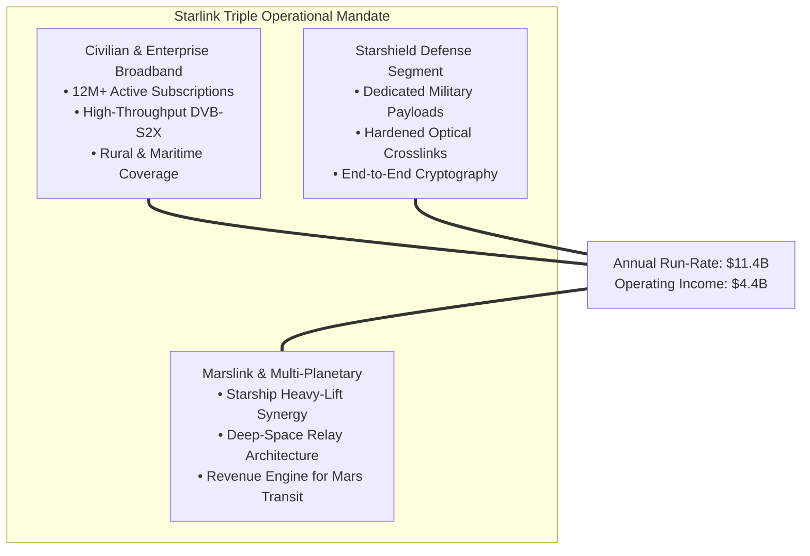
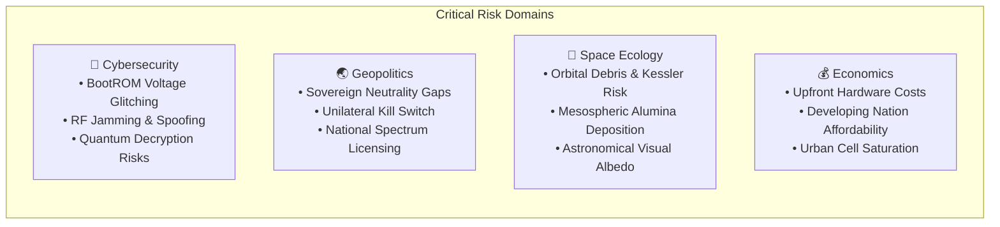

# 🎯 Chapter 01: Executive Summary — Starlink Comprehensive Monograph

> *"The overarching objective of Starlink is to provide high-throughput, low-latency broadband telecommunications globally, addressing persistent connectivity deficits while establishing a capital-generative commercial architecture to fund interplanetary exploration."* — Aerospace Engineering Synthesis

---

## 1. Project Overview & Strategic Imperative

**Starlink** is SpaceX's flagship Low Earth Orbit (LEO) satellite telecommunications constellation. Formally announced in Seattle in January 2015 by SpaceX Chief Executive Elon Musk, the program was conceived to fundamentally replace the high-latency, bandwidth-constrained paradigm of legacy Geostationary Earth Orbit (GEO) satellites with a dense, dynamically interconnected mesh of orbital spacecraft.

Operating at orbital altitudes between $525\text{ km}$ and $570\text{ km}$, Starlink delivers fiber-competitive broadband connectivity (100–400 Mbps) with terrestrial-grade round-trip latency ($20–30\text{ ms}$) across $160+$ licensed jurisdictions worldwide.



---

## 2. The Structural Deficit Starlink Resolves

Over **3.1 billion people**—exceeding $38\%$ of the global population—remain unserved or critically underserved by reliable broadband internet:
- **Terrestrial Economic Limits:** Capital expenditures (CAPEX) for terrestrial fiber installation range from $\$30,000$ to $\$100,000+$ per route-kilometer, rendering physical cable deployments economically unviable across rural, mountainous, and archipelagic geographies.
- **Legacy GEO Satellite Constraints:** Geostationary satellites stationed at $35,786\text{ km}$ altitude suffer from physical speed-of-light propagation delays ($550–800\text{ ms}$ round-trip latency), severely limiting interactive protocols, real-time voice, video conferencing, and low-latency cloud applications.
- **Cellular Backhaul Gaps:** Rural cellular towers lack high-capacity fiber backhaul, constraining mobile networks to degraded 2G/3G speeds.

Starlink bridges this infrastructure gap by deploying an orbital spatial mesh where the physical path length is reduced by a factor of $\approx 65\times$ compared to GEO satellites.

---

## 3. Paradigm Shift: LEO Constellation vs. Legacy GEO

| Architectural Parameter | Legacy GEO Systems (ViaSat, HughesNet) | SpaceX Starlink (LEO Mega-Constellation) | Performance Multiplier |
| :--- | :--- | :--- | :--- |
| **Orbital Altitude ($h$)** | $35,786\text{ km}$ (Circular Equatorial) | $525–570\text{ km}$ (Multi-Shell LEO) | $\approx 65\times$ Proximity |
| **Propagation Latency (One-Way)** | $\approx 240–280\text{ ms}$ | $\approx 3.5–5.0\text{ ms}$ | $\approx 55\times$ Lower Latency |
| **Total Round-Trip Time (RTT)** | $550–800\text{ ms}$ | $20–30\text{ ms}$ (Fiber Competitive) | $20–25\times$ Improvement |
| **Downlink Throughput** | $15–25\text{ Mbps}$ (Shared Transponder) | $100–400\text{ Mbps}$ (Adaptive DVB-S2X) | $10–15\times$ Higher Speed |
| **Doppler Frequency Shift** | Negligible ($\approx 0\text{ Hz}$) | Significant ($\pm 325\text{ kHz}$ at Ku-band) | Active Tracking Required |
| **Constellation Topology** | $3–5$ High-Power Spacecraft | $11,000+$ Distributed Spacecraft | High Distributed Resiliency |
| **Inter-Satellite Routing** | Terrestrial Double-Hop Required | $1550\text{ nm}$ Optical Laser Mesh (100 Gbps) | Autonomous Space Routing |

---

## 4. Current Scale & Telemetry Scorecard (October 2026)

```text
📊 STARLINK EMPIRICAL SCALE SCORECARD:
━━━━━━━━━━━━━━━━━━━━━━━━━━━━━━━━━━━━━━━━━━━━━━━━━━━━━━━━━━━━━━━━━━━━
  🛰️  Operational Spacecraft in Orbit : 11,000+ (70% of all active satellites)
  🌍  Sovereign Jurisdictions Licensed: 160+ countries and maritime zones
  👥  Active Global Subscriber Base   : 12 Million+ verified nodes
  📡  Terrestrial Gateway Stations    : 100+ Gateway Earth Stations globally
  💰  FY2025 Annualized Revenue        : $11.4 Billion USD
  📈  FY2025 Operating Income (EBIT)  : $4.4 Billion USD
  📶  Satellite Market Share (Ookla)  : 97.1% of all satellite speed tests
  ⚡  Median Downlink Speed (USA)     : 170 Mbps (Peak >350 Mbps)
  🔗  Median Round-Trip Latency       : 22.4 ms
━━━━━━━━━━━━━━━━━━━━━━━━━━━━━━━━━━━━━━━━━━━━━━━━━━━━━━━━━━━━━━━━━━━━
```

---

## 5. Architectural & Technological Core Innovations

### 5.1 Active Electronically Scanned Array (AESA) Terminals
Starlink user terminals ("Dishy McFlatface", Gen 2, Gen 3, and Mini) employ planar AESA phased arrays incorporating $1,280$ microstrip antenna patch elements. By manipulating relative phase shifts and True Time Delay (TTD) vectors at individual RF elements, the terminal dynamically steers high-gain pencil beams across the sky without physical mechanical motion, executing seamless satellite handovers every $11–15\text{ seconds}$.

### 5.2 Vacuum Free-Space Optical (FSO) Laser Crosslinks
Equipped across all V1.5, V2 Mini, and V3 spacecraft, $1550\text{ nm}$ optical laser transceivers communicate across orbital distances exceeding $1,000–2,500\text{ km}$ at $100+\text{ Gbps}$. Because photons propagate through space vacuum at $c \approx 300,000\text{ km/s}$—compared to $v \approx 204,000\text{ km/s}$ in silica fiber ($n \approx 1.47$)—optical space routing achieves a theoretical **$46.8\%$ velocity advantage** over terrestrial trans-oceanic fiber backbones.

### 5.3 Krypton & Argon Hall-Effect Plasma Propulsion
Starlink spacecraft utilize proprietary Hall-effect electrostatic plasma thrusters ($I_{sp} \approx 1,600–1,850\text{ s}$). Transitioning from rare xenon to abundant krypton (V1) and argon (V2/V3), these thrusters provide autonomous orbit insertion, orbit raising, station-keeping against thermospheric neutral drag, and autonomous collision avoidance maneuvers.

### 5.4 Decentralized Autonomous Routing
Satellites in LEO orbit Earth at velocities exceeding $7.59\text{ km/s}$ ($27,300\text{ km/h}$), shifting the physical mesh topology continuously. Starlink executes dynamic Software-Defined Network (SDN) routing in the vacuum space plane, utilizing predictive ephemeris algorithms to forward packets along minimal-delay spatial paths.

---

## 6. Critical Engineering, Geopolitical & Environmental Challenges



1. **Cybersecurity & Hardware Vulnerabilities:** Scale creates an unprecedented attack surface. Fault injection research (Lennert Wouters 2022) exposed user terminal BootROM vulnerabilities, while tactical Russian EW units (Krasukha-4, Tirada-2S) have targeted Ku-band uplinks in the Ukrainian theater.
2. **Geopolitical Single-Point-of-Control:** Unilateral authority exercised by private leadership during active combat operations (e.g., the 2022 Crimean drone operation restriction) exposes the vulnerability of sovereign defense systems dependent on private corporate constellations.
3. **Orbital Congestion & Environmental Footprint:** Operating over $11,000$ satellites at $550\text{ km}$ heightens spatial collision probabilities ($P_c$). Continuous atmospheric demise of retiring satellites deposits an estimated $1,560\text{ tons}$ of aluminum oxide nanoparticles annually into the stratosphere, with unquantified impacts on ozone chemistry.

---

## 7. Competitive Landscape (2026 Assessment)

```text
GLOBAL LEO MEGA-CONSTELLATION COMPETITIVE BENCHMARK (2026):
━━━━━━━━━━━━━━━━━━━━━━━━━━━━━━━━━━━━━━━━━━━━━━━━━━━━━━━━━━━━━━━━━━━━
  🥇 SpaceX Starlink       : 11,000+ satellites, 12M subscribers — UNCONTESTED LEADER
  🥈 Eutelsat OneWeb       : 648 satellites, GEO-LEO hybrid — B2B / Enterprise niche
  🥉 Amazon Project Kuiper : 180+ prototypes/early satellites — In deployment phase
  🎖️ China GuoWang (SatNet): Early orbital launches — Sovereign national alternative
━━━━━━━━━━━━━━━━━━━━━━━━━━━━━━━━━━━━━━━━━━━━━━━━━━━━━━━━━━━━━━━━━━━━
```

SpaceX's vertical integration with the Falcon 9 and Starship launch vehicles provides an insurmountable cost advantage: internal launch marginal costs of $<\$1,500/\text{kg}$ to LEO compared to $>\$5,000/\text{kg}$ for commercial competitor launches.

---

## 8. Summary of Strategic Conclusions

1. **Concept Proven:** The viability, economic profitability ($$11.4\text{B}$ revenue), and operational utility of LEO broadband mega-constellations is conclusively validated.
2. **Architecture Transition:** Mega-constellations must evolve from perimeter security models to **Zero Trust Satellite Architecture (ZTSA)**, integrating post-quantum lattice cryptography and multi-party sovereign key escrow.
3. **Regulatory Imperatives:** International space traffic management (STM) and binding orbital debris mitigation standards must be instituted by the ITU and UN OOSA to prevent long-term Kessler cascades.

---

## 9. Monograph Organization

This monograph is systematically organized into **16 analytical chapters** and **7 graduate-level R&D engineering whitepapers**:
- Chapters [01](./01-executive-summary.md) through [06](./06-network-technology.md): Problem definition, physical architecture, orbital mechanics, ground segment, and RF electromagnetics.
- Chapters [07](./07-security-risks.md) and [16](./16-security-countermeasures-and-mitigations.md): Comprehensive vulnerability decomposition and the complete Zero Trust engineering remediation blueprint.
- Chapters [08](./08-geopolitical-analysis.md) through [15](./15-conclusions.md): Geopolitical sovereignty, environmental impact, competitor economics, history, future Starlink V3/Starship roadmaps, and India-specific regulatory licensing.
- R&D Whitepapers ([`docs/rnd/`](./docs/rnd/)): First-principles mathematical derivations, link budgets, and simulation models.
- Simulation Suite ([`simulations/`](./simulations/)): Runnable Python tools for orbit propagation, phased array beamforming, link budgeting, and post-quantum benchmarks.

---

*Previous: [Technical Monograph Index ←](./README.md) | Next: [Problem Statement →](./02-problem-statement.md)*  
*Associated R&D Whitepaper: [Whitepaper 01: Astrodynamics & Orbit Architecture](./docs/rnd/01-astrodynamics-and-orbital-mechanics.md)*
