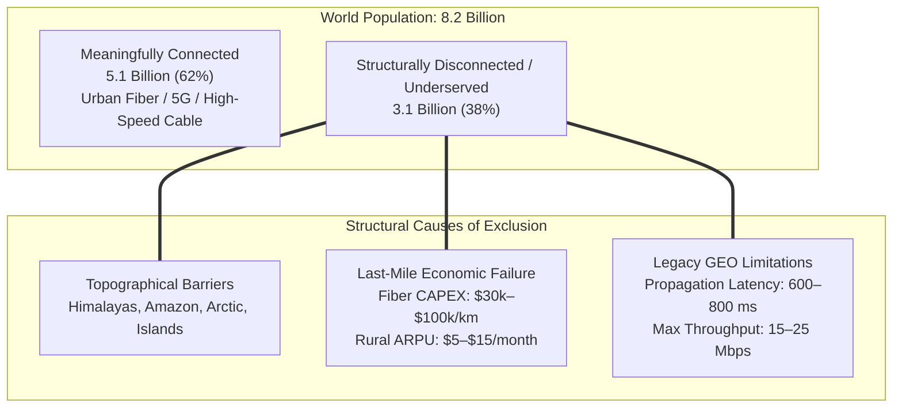
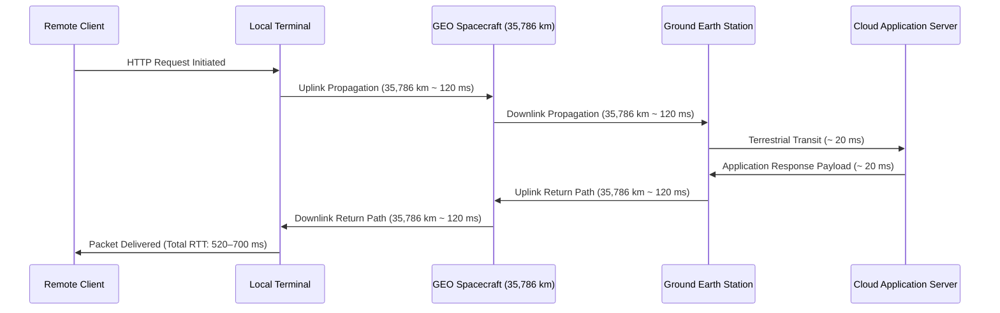

# 🌍 Chapter 02: Problem Statement — The Structural Dynamics of the Global Digital Divide

> *"Broadband telecommunications is no longer an auxiliary convenience—it is foundational civil infrastructure essential for civic engagement, education, economic participation, and public health. Yet, over 3.1 billion individuals remain structurally disconnected from the global digital economy."* — United Nations Broadband Commission Synthesis

---

## 1. The Global Connectivity Deficit: Quantitative Topology

As of late 2026, approximately **3.1 to 3.4 billion people** ($38–41\%$ of the global population) lack reliable, broadband-grade telecommunications access. This deficit is not distributed uniformly; it is structurally concentrated within three primary demographics:

1. **Topographically Isolated & Remote Geographies:** Mountainous cordilleras, archipelagos, dense tropical rainforests, and arctic tundras where civil engineering trenching is physically barred.
2. **Developing & Transitioning Economies:** Regions across Sub-Saharan Africa, Central/South Asia, and Latin America where per-capita GDP cannot subsidize high-capital fiber-optic rollouts.
3. **Peri-Urban & Rural Infrastructure Deserts:** Low-density agricultural basins within high-income nations (e.g., rural North America, inland Australia) where commercial terrestrial ISPs decline to invest due to negative Return on Investment (ROI).



```text
GLOBAL CONNECTIVITY DEFICIT MATRIX (2026 ESTIMATE):
━━━━━━━━━━━━━━━━━━━━━━━━━━━━━━━━━━━━━━━━━━━━━━━━━━━━━━━━━━━━━━━━━━━━
  Total Global Population             : 8.2 Billion
  Meaningfully Connected Population   : 5.1 Billion (62%)
  Unconnected / Underserved           : 3.1 Billion (38%)
  ──────────────────────────────────────────────────────────────────
  Regional Broadband Penetration:
    • North America                   : 93%
    • Western & Northern Europe       : 89%
    • Latin America & Caribbean       : 74%
    • Asia-Pacific (Blended)          : 68%
    • Sub-Saharan Africa              : 43%
    • UN Least Developed Countries    : 36%
━━━━━━━━━━━━━━━━━━━━━━━━━━━━━━━━━━━━━━━━━━━━━━━━━━━━━━━━━━━━━━━━━━━━
```

---

## 2. The Economic & Physical Failure of Terrestrial Infrastructure

### 2.1 The Microeconomics of Last-Mile Terrestrial Fiber
Telecommunications operators evaluate infrastructure capital expenditures (CAPEX) through a standard net present value (NPV) and amortization formula:

$$\text{Payback Period (Years)} = \frac{\text{CAPEX per Route Kilometer}}{\text{Subscriber Density} \times \text{Average Revenue Per User (ARPU)} \times 12}$$

```text
ECONOMIC DISPARITY MODEL (RURAL VS. URBAN LAST-MILE FIBER):
━━━━━━━━━━━━━━━━━━━━━━━━━━━━━━━━━━━━━━━━━━━━━━━━━━━━━━━━━━━━━━━━━━━━
  Parameter                     Urban High-Density    Rural Dispersed
  ──────────────────────────────────────────────────────────────────
  Fiber CAPEX per Route-km      $15,000 – $40,000     $30,000 – $100,000
  Subscribers per Route-km      250 – 800 premises    2 – 10 premises
  Monthly ARPU                  $65 – $95 / month     $8 – $25 / month
  Annual Revenue per Route-km   $195,000 – $912,000   $192 – $3,000
  Amortization Payback Horizon  < 6 Months            50 – 200+ YEARS
━━━━━━━━━━━━━━━━━━━━━━━━━━━━━━━━━━━━━━━━━━━━━━━━━━━━━━━━━━━━━━━━━━━━
```

**Economic Conclusion:** In dispersed rural geographies, capital amortization horizons exceed the operational lifespan of physical cabling. Commercial terrestrial telecommunications providers inevitably abandon last-mile deployment, concentrating capital expenditure exclusively within high-density urban corridors.

### 2.2 Physical and Topographical Barriers
Terrestrial fiber installation requires continuous civil engineering trenching, right-of-way licensing, conduit laying, and active repeater stations. Physical topography frequently renders this impossible:

| Topographical Domain | Primary Regions Affected | Physical / Engineering Barrier |
| :--- | :--- | :--- |
| **High Mountain Cordilleras** | Himalayas, Andes, Rockies, Alps | Extreme elevation gradients, avalanche hazards, rock blasting requirements. |
| **Tropical Rainforests** | Amazon Basin, Congo Basin, Borneo | Dense vegetation cover, severe humidity degradation, seasonal flooding. |
| **Archipelagos & Island Nations** | South Pacific, Caribbean, Indonesia | Subsea fiber cable laying costs exceeding $\$50,000/\text{km}$, seismic seabed risks. |
| **Permafrost & Arctic Zones** | Nunavut, Alaska, Northern Scandinavia | Seasonal soil expansion, permafrost heave severing underground conduit. |
| **Conflict & Disrupted Zones** | Contested military theaters | Systematic kinetic destruction of cell towers and terrestrial fiber junctions. |

---

## 3. The Failure of Legacy Geostationary (GEO) Satellite Systems

For decades, Geostationary Earth Orbit (GEO) satellites were marketed as the definitive answer to remote connectivity. In practice, fundamental physics and electromagnetic constraints rendered GEO broadband inadequate for modern telecommunications:



### 3.1 The Physics of Speed-of-Light Propagation Latency
A geostationary satellite occupies a circular equatorial orbit at altitude $h = 35,786\text{ km}$. For a ground terminal located at latitude $\lambda$, the minimum slant range distance $d$ is:

$$d = \sqrt{R_E^2 \sin^2\epsilon + 2 R_E h + h^2} - R_E \sin\epsilon \approx 38,000\text{ km}$$

Where $R_E \approx 6,378\text{ km}$ and $\epsilon$ is elevation angle. The minimum one-way free-space vacuum propagation delay is:

$$\tau_{prop} = \frac{d}{c} = \frac{38,000\text{ km}}{300,000\text{ km/s}} \approx 126.7\text{ ms}$$

A standard TCP handshake or HTTP request requires a double-hop round trip (Terminal $\to$ Satellite $\to$ Gateway $\to$ Internet $\to$ Gateway $\to$ Satellite $\to$ Terminal), establishing a theoretical speed-of-light physical minimum latency of:

$$\text{RTT}_{theoretical} = 4 \times \tau_{prop} \approx 507\text{ ms}$$

When accounting for baseband demodulation, atmospheric refraction, forward error correction (FEC) decoding, and router queuing delays, empirical GEO round-trip latency ranges between **$600\text{ ms}$ and $850\text{ ms}$**.

### 3.2 Protocols Broken by 600ms+ Latency:
- **Interactive Cloud Workspaces:** Remote desktop protocols (RDP, VNC, SSH) exhibit human-perceptible input lag exceeding $0.6\text{ seconds}$.
- **Real-Time Voice & Video:** SIP, VoIP, and WebRTC protocols break under ITU-T G.114 guidelines requiring one-way mouth-to-ear delay $<150\text{ ms}$.
- **TCP Throughput Degradation:** High bandwidth-delay product ($BDP = \text{Bandwidth} \times \text{RTT}$) combined with legacy TCP congestion control causes throughput collapse on dropped packets.
- **Autonomous Financial & Medical Systems:** Cloud-assisted surgical robotics, distributed consensus ledgers, and automated trading fail under sub-second synchronicity timeouts.

---

## 4. Socio-Economic Repercussions of Digital Exclusion

The persistent digital divide drives compounding socio-economic stratification across four primary sectors:

```text
SECTORAL IMPACTS OF CHRONIC DIGITAL EXCLUSION:
━━━━━━━━━━━━━━━━━━━━━━━━━━━━━━━━━━━━━━━━━━━━━━━━━━━━━━━━━━━━━━━━━━━━
  Sector                 Empirical Exclusion Consequences
  ──────────────────────────────────────────────────────────────────
  Education & Literacy   • 258 Million school-age children lack home internet
                         • Educational attainment deficits: 3.2 grade levels
                         • Total exclusion from STEM, AI, and global curricula
  
  Macroeconomic Wealth   • Excluded economies lose 1.5% to 3.0% of GDP annually
                         • Agricultural information asymmetry: rural farmers
                           suffer 20–35% lower wholesale harvest pricing
                         • Inability to participate in global remote work labor
  
  Healthcare Delivery    • Critical lack of rural telemedicine consultation
                         • Rural infant mortality rates up to 40% higher
                         • Absence of real-time epidemiological telemetry
  
  Disaster Resilience    • Zero early warning notifications for tsunamis/cyclones
                         • Complete telecommunications collapse during crises
━━━━━━━━━━━━━━━━━━━━━━━━━━━━━━━━━━━━━━━━━━━━━━━━━━━━━━━━━━━━━━━━━━━━
```

---

## 5. The Technological Convergence Window (2015–2026)

Why was a low-latency LEO mega-constellation impossible in the early 2000s, yet viable today? Starlink leveraged the simultaneous convergence of five foundational aerospace and telecommunications breakthroughs:

1. **Launch Vehicle Reusability:** The commercial perfection of Falcon 9 first-stage propulsive vertical landing reduced orbital payload insertion costs from $>\$50,000/\text{kg}$ (Space Shuttle) to $<\$1,500/\text{kg}$.
2. **Satellite Bus Miniaturization & Flat-Pack Form Factor:** Advances in radiation-tolerant commercial off-the-shelf (COTS) electronics enabled high-capability telecommunications payloads to fit inside a $260–800\text{ kg}$ chassis, allowing 20 to 60 spacecraft to be launched simultaneously in a single Falcon 9 fairing.
3. **Silicon-Integrated Phased Array Antennas (AESA):** The commercial fabrication of beamforming RFICs (Radio Frequency Integrated Circuits) made consumer-grade electronically steerable antennas economically viable at the $\$300–\$500$ price point.
4. **Space-Qualified Optical Laser Crosslinks (OISL):** Miniaturized diode-pumped solid-state lasers and piezo-electric fine-pointing mirrors permitted robust inter-satellite links across $1,000–2,500\text{ km}$ vacuum baselines.
5. **Software-Defined Networking (SDN):** Distributed high-throughput packet routing engines capable of calculating minimal-delay paths across dynamic, constantly shifting Walker Delta topologies.

---

## 6. Chapter Synthesis: The Imperative for Starlink

```text
STRUCTURAL PROBLEM FORMULATION:
  • Problem : 3.1+ Billion individuals excluded from high-throughput connectivity.
  • Cause   : Terrestrial fiber is economically non-amortizable in remote regions;
              GEO satellites are physically constrained by speed-of-light latency.
  • Solution: A distributed Low Earth Orbit (LEO) mega-constellation reducing orbital
              distance by 65x, bypassing terrestrial topography, and providing fiber-class
              broadband from space.
```

---

*Previous: [Executive Summary ←](./01-executive-summary.md) | Next: [Solution Architecture →](./03-solution-architecture.md)*  
*Associated R&D Whitepaper: [Whitepaper 01: Astrodynamics & Orbit Architecture](./docs/rnd/01-astrodynamics-and-orbital-mechanics.md)*
