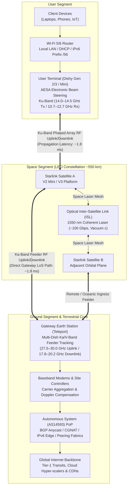

# 🔧 Solution Architecture — How Starlink Works

> *"We are fundamentally rebuilding the internet in space."* — SpaceX Engineering Team

---

## 1. System Architecture Overview

The Starlink telecommunications system operates across three tightly integrated segments: the **User Segment**, the **Space Segment**, and the **Ground Segment**.

```
┌─────────────────────────────────────────────────────────────────┐
│                    STARLINK SYSTEM ARCHITECTURE                  │
├─────────────────┬───────────────────┬───────────────────────────┤
│   USER SEGMENT  │   SPACE SEGMENT   │     GROUND SEGMENT        │
│                 │                   │                           │
│  User Terminal  │  LEO Satellites   │  Gateway Earth Stations   │
│  (Dishy)        │  (11,000+)        │  + Core Network           │
│                 │                   │                           │
│  ↕ Ku-band RF   │  ↕ Ka-band RF     │  → Fiber Internet         │
│                 │  ↔ Laser ISL      │                           │
└─────────────────┴───────────────────┴───────────────────────────┘
```

The end-to-end topological relationships and communication flows between these segments are illustrated below:



---

## 2. Space Segment: Low Earth Orbit (LEO) Constellation

### 2.1 Orbital Dynamics and Latency Mechanics

The physical advantage of Low Earth Orbit (LEO) over Geostationary Earth Orbit (GEO) is governed directly by the propagation velocity of electromagnetic radiation in free space ($c \approx 3 \times 10^8\text{ m/s}$):

```
LATENCY COMPARISON:
━━━━━━━━━━━━━━━━━━━━━━━━━━━━━━━━━━━━━━━━━━━━━━━━━
  GEO (35,786 km altitude):
    Round-trip physical distance = 71,572 km
    Theoretical propagation delay = 71,572 / 300,000 = 238.6 ms minimum
    Observed end-to-end latency   = 600–800 ms
    
  Starlink LEO (~550 km altitude):
    Round-trip physical distance = 1,100 km  
    Theoretical propagation delay = 1,100 / 300,000 = 3.67 ms minimum
    Observed end-to-end latency   = 20–30 ms ✅
━━━━━━━━━━━━━━━━━━━━━━━━━━━━━━━━━━━━━━━━━━━━━━━━━
```

Operating at 550 km achieves an order-of-magnitude reduction in latency (~60× lower than GEO systems), enabling real-time interactive protocols such as VoIP, high-frequency trading, and interactive video conferencing.

### 2.2 Orbital Shell Configuration and Inclinations

The Starlink constellation is structured into multiple orbital shells with distinct inclinations to optimize coverage density across populated latitudes while ensuring polar and equatorial connectivity:

```
STARLINK ORBITAL SHELLS:
━━━━━━━━━━━━━━━━━━━━━━━━━━━━━━━━━━━━━━━━━━━━━━━━━
  Shell 1: 53.0° inclination, 550 km altitude
           (Dense coverage for mid-latitudes: North America, Europe)
  Shell 2: 53.2° inclination, 540 km altitude
           (High-capacity expansion layer)
  Shell 3: 70.0° inclination, 560 km altitude
           (Extended sub-polar coverage: Alaska, Northern Scandinavia)
  Shell 4: 97.6° inclination, 560 km altitude
           (Sun-synchronous polar coverage: Maritime & Arctic regions)
  Shell 5: 43.0° inclination, 560 km altitude
           (Equatorial and tropical capacity enhancement)
━━━━━━━━━━━━━━━━━━━━━━━━━━━━━━━━━━━━━━━━━━━━━━━━━
```

### 2.3 Satellite Platform Specifications (Gen 2 / V2 Mini)

```
STARLINK V2 MINI SATELLITE SPECIFICATIONS:
━━━━━━━━━━━━━━━━━━━━━━━━━━━━━━━━━━━━━━━━━━━━━━━━━
  Wet Mass            : ~800 kg (V2 Mini, vs. ~260 kg for Gen 1)
  Form Factor         : Ultra-thin flat-panel stack, ~3 m × 9 m deployed
  Power Subsystem     : Dual solar arrays with Gallium Arsenide (GaAs) triple-junction cells
  Electric Propulsion : Krypton Hall-Effect Ion Thrusters (high specific impulse Isp ~1,600 s)
  Autonomous Guidance : Star trackers + onboard collision avoidance trajectory computation
  Design Lifetime     : 5–7 years operational life
  Demisability        : 100% atmospheric demisability; zero titanium survival risk
  Inter-Satellite Link: 4× Optical Laser Terminals (1550 nm coherent transmission)
  Aggregate Capacity  : ~1–8 Gbps per satellite depending on orbital phase & feeder bandwidth
━━━━━━━━━━━━━━━━━━━━━━━━━━━━━━━━━━━━━━━━━━━━━━━━━
```

---

## 3. User Segment: Phased Array User Terminals

### 3.1 Terminal Hardware Evolution

The Starlink User Terminal (colloquially designated "Dishy") is an Active Electronically Scanned Array (AESA) transceiver designed for mass consumer manufacturing.

```
EVOLUTION OF STARLINK USER TERMINALS:
━━━━━━━━━━━━━━━━━━━━━━━━━━━━━━━━━━━━━━━━━━━━━━━━━
  Gen 1 (Circular Dish, 2020):
    Aperture Diameter : ~59 cm
    Net Weight        : ~4.2 kg
    Positioning       : Dual-axis stepper motor tracking + electronic fine-steering
    
  Gen 2 (Standard Actuated, 2021):
    Dimensions        : ~51 cm × 30 cm (rectangular aperture)
    Net Weight        : ~4.2 kg
    Positioning       : Single-axis motorized alignment with electronic beam steering
    Peak Throughput   : Up to 300 Mbps download
    
  Gen 3 (Standard Flat Panel, 2023):
    Dimensions        : ~29 cm × 26 cm (ultra-compact planar form factor)
    Net Weight        : ~2.6 kg
    Positioning       : Fully electronic beam steering (zero mechanical motors)
    Operating Temp    : -30°C to +50°C (integrated heating elements for snow melt)
    
  Starlink Mini (2024):
    Dimensions        : ~30 cm × 26 cm (integrated router, DC barrel jack powered)
    Power Draw        : 25–40 W (operable via USB-PD 100 W power bank)
    Peak Throughput   : 50–100 Mbps
    Application       : Backpack expeditionary, tactical mobility, emergency response
    
  High Performance (Enterprise / Maritime / Aviation):
    Aperture          : Expanded aperture area with wider field-of-view (140° conical)
    Environmental     : IP67 ingress rating, de-icing heaters up to 75 mm/hour snow
    Peak Throughput   : Up to 500+ Mbps with dual-satellite concurrent tracking
━━━━━━━━━━━━━━━━━━━━━━━━━━━━━━━━━━━━━━━━━━━━━━━━━
```

### 3.2 Principles of AESA Beamforming

Unlike parabolic dishes that rely on mechanical gimbals to track satellites, the Starlink terminal utilizes an array of over 1,000 microstrip patch antenna elements.

```
PHASED ARRAY BEAMFORMING PRINCIPLES:
━━━━━━━━━━━━━━━━━━━━━━━━━━━━━━━━━━━━━━━━━━━━━━━━━
  1. ARRAY FACTOR SYNTHESIS:
     Independent RF phase shifters and Variable Gain Amplifiers (VGAs) control
     each microstrip element.
     
  2. CONSTRUCTIVE & DESTRUCTIVE INTERFERENCE:
     Phase timing gradients steer the main radiated lobe to precise azimuth
     and elevation coordinates within nanoseconds without mechanical inertia.
     
  3. RAPID SATELLITE HANDOVER:
     Terminals switch tracking beams from a setting satellite to a rising
     satellite within microseconds (<100 μs), preventing TCP packet drops.
     
  4. SPATIAL FILTERING & NULL-STEERING:
     Deep pattern nulls (>40 dB attenuation) are formed in directions of 
     geostationary arc exclusion zones to prevent interference with GEO operators.
━━━━━━━━━━━━━━━━━━━━━━━━━━━━━━━━━━━━━━━━━━━━━━━━━
```

### 3.3 Autonomous Terminal Onboarding

```
TERMINAL COMMISSIONING SEQUENCE:
━━━━━━━━━━━━━━━━━━━━━━━━━━━━━━━━━━━━━━━━━━━━━━━━━
  1. Boot sequence initializes secure enclave and boots authenticated image.
  2. Integrated GNSS receiver acquires centimeter-accurate fix and UTC time.
  3. Terminal downloads current NORAD / Starlink constellation ephemeris.
  4. Phased array conducts wideband RF scan to locate initial overhead beam.
  5. Mutual cryptographic challenge-response authentication occurs with satellite.
  6. Dynamic scheduling channel assigned; subscriber session registered with BGP PoP.
  
  Average initial acquisition time: 2–5 minutes.
  Operator intervention required   : Zero (fully zero-touch provisioning).
━━━━━━━━━━━━━━━━━━━━━━━━━━━━━━━━━━━━━━━━━━━━━━━━━
```

---

## 4. Ground Segment: Gateway Earth Stations & PoPs

### 4.1 Gateway Earth Stations (Teleports)

Gateway earth stations bridge the space segment with terrestrial fiber-optic backbones.

```
GATEWAY EARTH STATION ARCHITECTURE:
━━━━━━━━━━━━━━━━━━━━━━━━━━━━━━━━━━━━━━━━━━━━━━━━━
  Operational Facilities      : 100+ teleports worldwide
  Geographic Distribution     : Strategically co-located near dark-fiber transits
  Antenna Systems             : 8 to 32 high-gain parabolic tracking dishes per site
  Radome Protection           : Dielectric radomes with HVAC climate control
  Uplink RF Carrier           : Ka-band (27.5–30.0 GHz)
  Downlink RF Carrier         : Ka-band (17.8–20.2 GHz)
  High-Capacity Augmentation  : V-band (47.2–51.4 GHz Up / 37.5–42.0 GHz Down)
  Site Power Redundancy       : N+1 diesel generator sets with uninterrupted battery backup
━━━━━━━━━━━━━━━━━━━━━━━━━━━━━━━━━━━━━━━━━━━━━━━━━
```

### 4.2 End-to-End Packet Routing Architectures

```
STANDARD DOMESTIC PACKET FLOW (Bent-Pipe Mode):
━━━━━━━━━━━━━━━━━━━━━━━━━━━━━━━━━━━━━━━━━━━━━━━━━
  User Terminal ──[Ku Uplink 14 GHz]──> Satellite
                                            │
  Satellite ──────[Ka Downlink 20 GHz]─> Gateway Teleport
                                            │
  Gateway ────────[Dark Fiber 100G]───> Regional Point of Presence (PoP)
                                            │
  PoP ────────────[BGP AS14593 Peering]─> Public Internet Transit
  
  Total Round-Trip Propagation Delay: 20–30 ms.
━━━━━━━━━━━━━━━━━━━━━━━━━━━━━━━━━━━━━━━━━━━━━━━━━

OCEANIC & EXPEDITIONARY FLOW (Inter-Satellite Laser Mesh):
━━━━━━━━━━━━━━━━━━━━━━━━━━━━━━━━━━━━━━━━━━━━━━━━━
  User Terminal ──[Ku Uplink]──> Satellite A
                                     │ (1550 nm Laser ISL, ~100 Gbps)
                                 Satellite B
                                     │ (1550 nm Laser ISL)
                                 Satellite C
                                     │
  Satellite C ────[Ka Downlink]─> Continental Gateway Teleport
                                     │
  Gateway ────────[Dark Fiber]──> Regional PoP ──> Public Internet
  
  Routes purely through space vacuum; operates independently of foreign ground stations.
━━━━━━━━━━━━━━━━━━━━━━━━━━━━━━━━━━━━━━━━━━━━━━━━━
```

---

## 5. Optical Inter-Satellite Links (ISL): Space Laser Mesh

Beginning with Starlink V1.5 and standard on all Gen 2 / V2 Mini spacecraft, optical inter-satellite links create an autonomous orbital routing topology.

### 5.1 Laser Crosslink Physical Characteristics

```
INTER-SATELLITE LASER LINK SPECIFICATIONS:
━━━━━━━━━━━━━━━━━━━━━━━━━━━━━━━━━━━━━━━━━━━━━━━━━
  Operating Wavelength  : ~1,550 nm (C-band telecom standard)
  Modulation Format     : Dual-Polarization Quadrature Phase Shift Keying (DP-QPSK)
  Transmission Channel  : Space vacuum ($n = 1.000$)
  Beam Divergence       : Diffraction-limited microradian pointing
  Tracking Precision    : Fast Steering Mirrors (FSM) with quadrant photodiode feedback
  Aggregate Data Rate   : ~100 Gbps duplex per optical head
  Operational Range     : Up to 3,000 km between adjacent constellation nodes
  
  Propagation Velocity Benchmark:
    Speed in vacuum ($c$) : 299,792 km/s
    Speed in silica fiber : ~204,000 km/s (refractive index $n \approx 1.468$)
    Physical Latency Gain : Optical signals propagate ~47% faster in vacuum than terrestrial fiber!
━━━━━━━━━━━━━━━━━━━━━━━━━━━━━━━━━━━━━━━━━━━━━━━━━
```

### 5.2 Strategic Operational Benefits of Laser Crosslinks

| Capability Dimension | Terrestrial Gateway Dependency | Laser ISL Mesh Architecture |
|:---|:---|:---|
| **Oceanic Coverage** | Infeasible beyond 800 km coastal limit | Seamless high-speed connectivity across open oceans |
| **Polar Coverage** | Highly constrained by tundra terrain | Continuous high-latitude communications |
| **Sovereign Interception** | Subject to transit telecommunication laws | Traffic traverses space segment, bypassing hostile sovereign territory |
| **Disaster Resilience** | Vulnerable to fiber cuts and power grid failure | Resilient to localized ground station outages |
| **Transoceanic Latency** | London-New York fiber: ~62 ms | Trans-Atlantic vacuum laser routing: ~45 ms theoretical |

---

## 6. Software-Defined Constellation Networking (SDN)

### 6.1 Dynamic Orbital Topology Challenges

LEO satellites orbit Earth at approximately $7.56\text{ km/s}$ (~27,200 km/h), completing an orbit in approximately 95 minutes. A user terminal observes a given satellite for only 5 to 10 minutes before it traverses below the minimum elevation threshold (typically 25°–40°). Maintaining sub-30 ms latency across this topology requires dynamic software orchestration.

```
DYNAMIC TOPOLOGY CHARACTERISTICS:
━━━━━━━━━━━━━━━━━━━━━━━━━━━━━━━━━━━━━━━━━━━━━━━━━
  Node Orbit Velocity        : ~27,200 km/h (LEO velocity)
  Contact Window per Satellite: 5–10 minutes
  Active Topological Nodes   : 11,000+ orbital nodes
  Dynamic Edge Rerouting     : Millisecond-level path recomputations
  Mitigation Framework       : Distributed Software-Defined Networking (SDN)
━━━━━━━━━━━━━━━━━━━━━━━━━━━━━━━━━━━━━━━━━━━━━━━━━
```

### 6.2 SDN Orchestration Stack

```
STARLINK SDN FUNCTIONAL MODULES:
━━━━━━━━━━━━━━━━━━━━━━━━━━━━━━━━━━━━━━━━━━━━━━━━━
  1. ORBITAL PREDICTIVE TELEMETRY:
     High-precision orbital ephemerides are computed by central ground controllers
     and distributed across the constellation, projecting topological links hours in advance.
     
  2. TIME-VARYING GRAPH ROUTING:
     Shortest-path algorithms (modified Dijkstra / Bellman-Ford variants) compute optimal
     forwarding routes through the laser mesh, accounting for propagation delay,
     buffer queue states, and feeder gateway capacity.
     
  3. MAKE-BEFORE-BREAK HANDOFF:
     Terminals synthesize secondary phased array receiving beams to lock onto the
     approaching satellite before severing the link to the receding satellite,
     ensuring zero frame loss.
     
  4. AUTONOMOUS COLLISION MITIGATION:
     Spacecraft autonomously evaluate conjunction alerts derived from Combined Space
     Operations Center (CSpOC) data, firing ion thrusters without manual ground operator commands.
━━━━━━━━━━━━━━━━━━━━━━━━━━━━━━━━━━━━━━━━━━━━━━━━━
```

---

## 7. Radio Frequency Architecture and Spectral Allocation

The Starlink constellation leverages multi-band RF spectrum governed by international and domestic regulatory allocations:

```
STARLINK SPECTRUM ALLOCATION PROFILE:
━━━━━━━━━━━━━━━━━━━━━━━━━━━━━━━━━━━━━━━━━━━━━━━━━
  User Downlink (Satellite to Terminal):
    Band           : Ku-band
    Frequencies    : 10.70 GHz – 12.70 GHz
    Polarization   : Dual Circular (RHCP / LHCP)
    
  User Uplink (Terminal to Satellite):
    Band           : Ku-band
    Frequencies    : 14.00 GHz – 14.50 GHz
    Polarization   : Dual Circular (RHCP / LHCP)
    
  Gateway Feeder Downlink (Satellite to Gateway):
    Band           : Ka-band
    Frequencies    : 17.80 GHz – 20.20 GHz
    
  Gateway Feeder Uplink (Gateway to Satellite):
    Band           : Ka-band
    Frequencies    : 27.50 GHz – 30.00 GHz
    
  Next-Generation Feeder Expansion (V2 Mini / V3):
    Downlink       : V-band (37.50 GHz – 42.00 GHz)
    Uplink         : V-band (47.20 GHz – 51.40 GHz)
    E-band Carrier : 71.00 GHz – 76.00 GHz (high-throughput backhaul)
    
  Optical Crosslink:
    Wavelength     : 1550 nm infrared laser (vacuum propagation)
━━━━━━━━━━━━━━━━━━━━━━━━━━━━━━━━━━━━━━━━━━━━━━━━━
```

---

## 8. Direct-to-Cell Space Telephony

Direct-to-Cell enables standard, unmodified 4G LTE/5G NR mobile smartphones to connect directly to Starlink satellite platforms without external hardware dishes or proprietary baseband modifications.

```
DIRECT-TO-CELL ARCHITECTURE:
━━━━━━━━━━━━━━━━━━━━━━━━━━━━━━━━━━━━━━━━━━━━━━━━━
  Spacecraft Hardware : V2 Mini / V3 equipped with large-aperture (~25 m²) eNodeB AESA arrays
  Standard Compliance : 3GPP Release 17 Non-Terrestrial Networks (NTN)
  User Equipment      : Unmodified commercial LTE/5G smartphones
  Operating Spectrum  : 1.9 GHz PCS Band (via carrier partner spectrum allocations)
  
  Service Deployment Phases:
    Phase 1 (2024–2025): Short Message Service (SMS), emergency telemetry, MMS
    Phase 2 (2025–2026): Low-bitrate packet data (messaging apps, weather data, IoT)
    Phase 3 (2026+)    : Full duplex VoLTE voice telephony and streaming data
    
  Global Telephony Consortium:
    United States : T-Mobile US
    Canada        : Rogers Communications
    Japan         : KDDI
    Australia     : Optus
    New Zealand   : One NZ
    Switzerland   : Salt Mobile
━━━━━━━━━━━━━━━━━━━━━━━━━━━━━━━━━━━━━━━━━━━━━━━━━
```

---

## 9. Real-World Performance Benchmarks (Empirical Telemetry)

Empirical network benchmarking (Ookla Speedtest intelligence and independent academic measurements) demonstrates consistent sub-40 ms latency and high multi-megabit throughput across global service regions:

```
GLOBAL PERFORMANCE BENCHMARKS:
━━━━━━━━━━━━━━━━━━━━━━━━━━━━━━━━━━━━━━━━━━━━━━━━━
  Geographic Region       Downlink (Mbps)  Uplink (Mbps)  Latency (ms)
  ━━━━━━━━━━━━━━━━━━━━━━━━━━━━━━━━━━━━━━━━━━━━━━━━━━━━━━━━━━━━━━━━━━
  North America (Suburban)   180–220           20–30          21–24
  North America (Remote)     130–175           18–25          23–27
  Western Europe (UK/DE)     160–210           20–28          20–25
  Northern Canada (Sub-polar)120–160           15–22          25–30
  Australia (Outback)        140–185           18–24          26–31
  South America (Amazonas)    85–125           10–18          32–38
  Sub-Saharan Africa          80–115           10–15          35–42
  ━━━━━━━━━━━━━━━━━━━━━━━━━━━━━━━━━━━━━━━━━━━━━━━━━━━━━━━━━━━━━━━━━━
  Legacy Geostationary (GEO)   15–30            2–5          600–850
━━━━━━━━━━━━━━━━━━━━━━━━━━━━━━━━━━━━━━━━━━━━━━━━━
```

---

*Previous: [Problem Statement ←](./02-problem-statement.md) | Next: [Satellite Constellation →](./04-satellite-constellation.md)*
