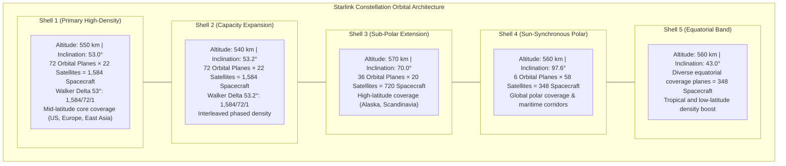

# 🛰️ Starlink Satellite Constellation — Deep Orbital Dive

> *"Over 11,000 satellites deployed across dynamic orbital planes, traveling at 27,000 km/h to serve 160+ sovereign nations. This represents the most intricate orbital engineering system ever deployed in aerospace history."*

---

## 1. Principles of Orbital Mechanics

### 1.1 Regime Comparison: LEO vs. MEO vs. GEO

The selection of Low Earth Orbit (LEO) for the Starlink megaconstellation is rooted in orbital astrodynamics and electro-optical physics:

```
ORBITAL REGIME COMPARATIVE ANALYSIS:
━━━━━━━━━━━━━━━━━━━━━━━━━━━━━━━━━━━━━━━━━━━━━━━━━
  Geostationary Earth Orbit (GEO):
    Orbital Altitude   : 35,786 km above sea level
    Orbital Period     : 23 hours, 56 minutes, 4 seconds (sidereal day)
    Apparent Motion    : Stationary relative to terrestrial coordinates
    One-Way Latency    : 120–140 ms (free space path) → 600–800 ms real-world
    Constellation Size : 3 satellites provide theoretical global coverage (excluding poles)
    
  Medium Earth Orbit (MEO):
    Orbital Altitude   : 2,000–35,786 km (e.g., GPS at 20,200 km, O3b at 8,062 km)
    Orbital Period     : 4–12 hours
    One-Way Latency    : 50–150 ms
    Constellation Size : 12–32 satellites
    
  Low Earth Orbit (LEO — Starlink Regime):
    Orbital Altitude   : 300–600 km (Starlink operational: 525–570 km)
    Orbital Period     : 90–96 minutes
    Orbital Velocity   : ~7.56 km/s (~27,200 km/h)
    One-Way Latency    : 1.8–3.7 ms free space → 20–30 ms end-to-end
    Aperture Geometry  : Small terrestrial footprint per node (~1,100 km diameter)
    Constellation Size : Thousands of spacecraft required for seamless handoff
━━━━━━━━━━━━━━━━━━━━━━━━━━━━━━━━━━━━━━━━━━━━━━━━━
```

Operating at 550 km minimizes Free-Space Path Loss ($FSPL \propto (4\pi d / \lambda)^2$) and slashes the link budget deficit, allowing compact consumer-grade phased arrays to achieve gigabit-class spectral efficiency.

### 1.2 Mathematical Basis for Megaconstellation Sizing

At an orbital altitude of $h = 550\text{ km}$, assuming a minimum ground elevation angle $\varepsilon_{min} = 25^\circ$, the terrestrial coverage radius $R_{cov}$ and coverage footprint area $A_{cov}$ per spacecraft are derived from spherical Earth geometry ($R_E \approx 6,378\text{ km}$):

$$\sin\theta = \frac{R_E}{R_E + h} \cos\varepsilon_{min}$$

$$\alpha = 90^\circ - \varepsilon_{min} - \theta$$

$$R_{cov} = R_E \cdot \alpha_{\text{rad}} \approx 1,050\text{ km}$$

$$A_{cov} = 2\pi R_E^2 (1 - \cos\alpha) \approx 3.46 \times 10^6\text{ km}^2$$

With Earth's total surface area $A_{Earth} \approx 510.1 \times 10^6\text{ km}^2$, the geometric lower bound for instantaneous planetary coverage is:

$$N_{min} = \frac{A_{Earth}}{A_{cov}} \approx 147\text{ satellites}$$

However, Starlink's operational constellation exceeds 11,000 spacecraft to address operational imperatives:
- **Spatial Redundancy:** Continuous line-of-sight to multiple satellites (elevation $>45^\circ$) to eliminate physical terrain masking and urban obstruction.
- **Microsecond Handoff Margins:** Maintaining seamless make-before-break RF links as satellites transit overhead in 5 to 10 minutes.
- **Spectral Capacity Density:** Aggregating localized spatial bandwidth in high-density metropolitan and suburban corridors.
- **Multilateral Inclinations:** Providing continuous coverage from equatorial zones to geographic poles.

---

## 2. Walker Delta Constellation Shell Architecture

The Starlink constellation relies on the **Walker Delta** pattern, designated formally as $i: t/p/f$, where $i$ is the orbital inclination, $t$ is the total satellite count, $p$ is the number of equally spaced orbital planes, and $f$ is the relative phasing parameter between adjacent planes.



```
STARLINK CONSTELLATION AUTHORIZATION ARCHITECTURE:
━━━━━━━━━━━━━━━━━━━━━━━━━━━━━━━━━━━━━━━━━━━━━━━━━
  FCC Gen 1 Authorization:
  
  Shell  | Altitude | Inclination | Satellite Count | Mission Profile
  ━━━━━━━┿━━━━━━━━━━┿━━━━━━━━━━━━━┿━━━━━━━━━━━━━━━━━┿━━━━━━━━━━━━━━━━━━━━━━━━━━━━━━━━━
  1      | 550 km   | 53.0°       | 1,584           | Mid-latitude core population coverage
  2      | 540 km   | 53.2°       | 1,584           | Interleaved capacity augmentation
  3      | 570 km   | 70.0°       | 720             | Sub-polar and northern maritime
  4      | 560 km   | 97.6°       | 348             | Sun-synchronous polar coverage
  5      | 560 km   | 43.0°       | 348             | Tropical and equatorial density
  
  FCC Gen 2 Authorization (Deployment 2023–2027):
  
  Shell  | Altitude | Inclination | Satellite Count | Mission Profile
  ━━━━━━━┿━━━━━━━━━━┿━━━━━━━━━━━━━┿━━━━━━━━━━━━━━━━━┿━━━━━━━━━━━━━━━━━━━━━━━━━━━━━━━━━
  6      | 525 km   | 53.0°       | 2,493           | Gen 2 high-throughput capacity layer
  7      | 530 km   | 43.0°       | 2,478           | Low-latitude expansion
  8      | 535 km   | 33.0°       | 2,493           | Equatorial direct-to-cell density
  9      | 604 km   | 148.0°      | 1,201           | Retrograde orbital geometry
  10     | 614 km   | 115.7°      | 1,201           | Retrograde mid-inclination
  
  Aggregate FCC/ITU Authorized Spacecraft: ~30,000 Spacecraft
━━━━━━━━━━━━━━━━━━━━━━━━━━━━━━━━━━━━━━━━━━━━━━━━━
```

---

## 3. Spacecraft Bus Hardware Evolution

### 3.1 Platform Generations

```
SATELLITE BUS GENERATION METRICS:
━━━━━━━━━━━━━━━━━━━━━━━━━━━━━━━━━━━━━━━━━━━━━━━━━
  V0.9 Prototype (Tintin A/B, 2018):
    Mass          : ~400 kg
    Payload       : Ku-band engineering breadboard
    De-orbit Date : Re-entered atmosphere 2020
    
  V1.0 Operational Bus (2019–2021):
    Mass          : 260 kg
    Form Factor   : Planar flat-stack, ~3.2 m × 1.6 m
    Propulsion    : Krypton Hall-effect thrusters
    RF Payloads   : 4× Ku-band user AESA, 2× Ka-band gateway parabolic
    ISL Crosslinks: None (strictly bent-pipe teleport architecture)
    
  V1.5 Crosslink Bus (2021–2023):
    Mass          : 306 kg
    Payload Mod   : Integrated 4× Optical Inter-Satellite Links (1550 nm)
    Capability    : Transoceanic routing without local gateway stations
    
  V2 Mini Platform (2023–2025):
    Mass          : ~800 kg
    Payload Power : Quadrupled solar generation via dual GaAs wings
    RF Payloads   : Advanced Ku-band user arrays, Ka-band and E-band (71–76 GHz)
    Throughput    : ~4× bandwidth capacity relative to V1.0
    Launch Vehicle: Constrained to Falcon 9 (~20–23 spacecraft per manifest)
    
  V3 Full-Scale Heavy Bus (2025+):
    Mass          : ~1,250–1,500 kg
    Launch System : Exclusively deployed via SpaceX Starship (~50–100+ per flight)
    Payload Power : Next-gen high-efficiency arrays yielding ~10–20× V2 capacity
    Direct-to-Cell: Large-aperture (~25 m²) phased array for direct 3GPP cellular links
━━━━━━━━━━━━━━━━━━━━━━━━━━━━━━━━━━━━━━━━━━━━━━━━━
```

### 3.2 Electric Ion Propulsion Mechanics

Starlink spacecraft utilize proprietary **Krypton Hall-Effect Thrusters** for orbital injection, station-keeping, collision avoidance, and controlled end-of-life de-orbiting.

```
KRYPTON HALL-EFFECT THRUSTER CHARACTERISTICS:
━━━━━━━━━━━━━━━━━━━━━━━━━━━━━━━━━━━━━━━━━━━━━━━━━
  Propellant Choice     : Krypton (Kr, molecular mass ~83.8 u)
  Nominal Thrust        : ~40–60 mN per thruster assembly
  Specific Impulse (Isp): ~1,600–1,800 seconds
  
  Functional Operational Cycles:
    1. Orbit Ingestion  : Propelling spacecraft from launch insertion (300 km) to operational orbit (550 km).
    2. Drag Compensation: Neutralizing atmospheric residual drag in the thermosphere.
    3. Conjunction Burn : Executing autonomous impulse burns to evade space debris.
    4. Rapid De-orbit   : Lowering perigee below 250 km at end-of-life to ensure thermal demisability within months.
    
  Industrial Rationale for Krypton vs. Xenon:
    - Xenon cost: ~$3,000–$5,000 / kg (subject to global supply constraints).
    - Krypton cost: ~$300–$500 / kg (~10× cost efficiency).
    - Krypton enables sustainable mass production economics across 10,000+ hulls.
━━━━━━━━━━━━━━━━━━━━━━━━━━━━━━━━━━━━━━━━━━━━━━━━━
```

---

## 4. Orbit Precession & Astrodynamic Mathematics

Due to Earth's oblateness (the equatorial bulge quantified by the second zonal harmonic coefficient $J_2 \approx 1.08263 \times 10^{-3}$), the Right Ascension of the Ascending Node ($\Omega$) undergoes secular precession. The nodal precession rate is defined by:

$$\dot{\Omega} = -\frac{3}{2} J_2 \left(\frac{R_E}{p}\right)^2 n \cos i$$

Where:
- $R_E = 6,378.137\text{ km}$ (Earth equatorial radius)
- $p = a(1 - e^2)$ is the semi-latus rectum (for circular orbits $e \approx 0$, so $p \approx a = 6,928.137\text{ km}$ at 550 km altitude)
- $n = \sqrt{\mu / a^3}$ is the mean motion ($\mu = 398,600.4418\text{ km}^3/\text{s}^2$)
- $i = 53.0^\circ$ is the orbital inclination

Evaluating this formulation for Shell 1 yields a secular nodal drift rate of:

$$\dot{\Omega} \approx -4.71^\circ/\text{day}$$

This regression is deliberately leveraged during constellation phase deployment: satellites launched into lower insertion orbits ($h \approx 300\text{ km}$) precess at higher angular rates relative to the operational plane, allowing a single Falcon 9 launch to populate distinct orbital planes through differential drift prior to final orbit raising.

---

## 5. Launch Cadence and Industrial Economics

```
STARLINK INDUSTRIAL FLIGHT STATISTICS (2019–2026):
━━━━━━━━━━━━━━━━━━━━━━━━━━━━━━━━━━━━━━━━━━━━━━━━━
  Total Dedicated Launches   : 220+ orbital missions
  Primary Booster            : Falcon 9 Block 5 (partial Falcon Heavy integration)
  Spacecraft per Launch      : 60 (V1.0) → 53 (V1.5) → ~20–23 (V2 Mini)
  Primary Spaceports         : Cape Canaveral SLC-40 / KSC LC-39A (Florida)
                               Vandenberg Space Force Base SLC-4E (California)
  Sustained Cadence          : ~2–4 launches per calendar month
  
  Economic Cost Amortization (Falcon 9 Reusability):
    - External Commercial Price : ~$67 Million
    - Internal SpaceX Launch Cost: ~$25–28 Million
    - Booster Reflight Record   : 25+ flights on single first-stage airframe
    - Average Stage Turnaround   : ~20 days
    
  Starship Heavy Lift Trajectory:
    - Target Payload Mass       : 100–150 metric tons to LEO
    - V3 Satellite Capacity     : ~60–100 full-scale V3 satellites per launch
    - Projected Marginal Launch : <$15 Million per launch
    - Amortized Cost per Sat    : Slashed from ~$250,000 to <$40,000
━━━━━━━━━━━━━━━━━━━━━━━━━━━━━━━━━━━━━━━━━━━━━━━━━
```

---

## 6. Autonomous Collision Avoidance System

Operating thousands of spacecraft in Low Earth Orbit demands zero-latency autonomous space situational awareness (SSA) to eliminate conjunction risks.

```
AUTONOMOUS COLLISION MITIGATION PROTOCOL:
━━━━━━━━━━━━━━━━━━━━━━━━━━━━━━━━━━━━━━━━━━━━━━━━━
  Telemetry Data Ingestion:
    - US Space Surveillance Network (SSN) 18th Space Defense Squadron Conjunction Data Messages (CDMs)
    - LeoLabs commercial radar tracking telemetry
    - Onboard multi-constellation GNSS precision ephemeris (sub-meter real-time accuracy)
    
  Autonomous Execution Pipeline:
    1. Ground systems compute 72-hour conjunction probabilities ($P_c$).
    2. If $P_c > 1 \times 10^{-4}$ (1 in 10,000), an avoidance maneuver is autonomously synthesized.
    3. The thruster firing vector is optimized to maximize miss distance while minimizing propellant expenditure.
    4. The maneuver sequence is uploaded to the spacecraft during next gateway contact.
    5. The satellite executes the impulse burn autonomously and publishes revised ephemeris to 18th SDS.
    
  Historical Operational Telemetry (2025):
    - Avoidance Maneuvers Executed : 50,000+ autonomous maneuvers per year
    - Starlink On-Orbit Breakups   : 0 (zero debris-generating fragmentation events)
    - Orbital Coordination         : Automated peer-to-peer data sharing with NASA and foreign civil space agencies
━━━━━━━━━━━━━━━━━━━━━━━━━━━━━━━━━━━━━━━━━━━━━━━━━
```

---

## 6. Interactive Astrodynamics Notebook

Simulate Starlink orbital mechanics and collision avoidance directly in Python:
- **[Interactive Astrodynamics Notebook (`01_orbit_sgp4_propagation.ipynb`)](./notebooks/01_orbit_sgp4_propagation.ipynb):** SGP4 orbital propagation, J2 secular nodal drift ($-4.49^\circ/\text{day}$), Walker Delta $53^\circ:72/22/1$ geometry, and Foster collision probability ($P_c$).

---

*Previous: [Solution Architecture ←](./03-solution-architecture.md) | Next: [Ground Segment →](./05-ground-segment.md)*
