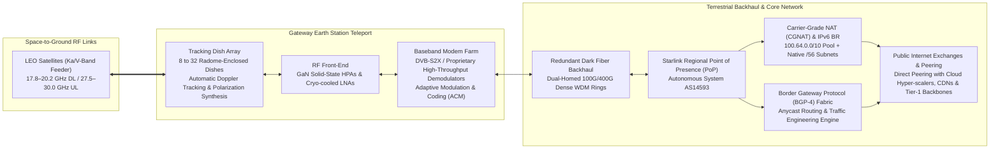

# 📡 Ground Segment & Terrestrial Infrastructure — Deep Dive

> *"The orbital megaconstellation is only half the engineering equation. Without high-capacity, geo-redundant earth station teleports and a high-availability terrestrial fiber core, gigabit-class low-latency space routing cannot exist."*

---

## 1. Ground Segment Architecture

The Starlink Ground Segment comprises hundreds of Gateway Earth Stations (teleports), high-speed dark fiber backhaul networks, and geographically distributed Points of Presence (PoPs) operating under Autonomous System **AS14593**.



---

## 2. Gateway Earth Stations (Teleports)

### 2.1 Teleport Infrastructure and Site Engineering

Gateway Earth Stations serve as high-throughput bridges between the orbiting satellites and terrestrial core internet peering fabrics.

```
GATEWAY TELEPORT SPECIFICATIONS:
━━━━━━━━━━━━━━━━━━━━━━━━━━━━━━━━━━━━━━━━━━━━━━━━━
  Global Facility Count    : 100+ active commercial teleports globally
  North American Footprint : 100+ teleports across contiguous US, Alaska, and Hawaii
  Site Topography Criteria : Co-located within <10 km of major fiber trunk routes,
                             clear hemispherical horizon (>5° elevation mask),
                             and low ambient precipitation regimes.
  
  Antenna Array Systems:
    - 8 to 32 parabolic tracking dishes per site (diameter: 1.5 m to 2.4 m)
    - Enclosed in rigid, UV-stabilized, low-loss dielectric radomes
    - Integrated HVAC climate control and automated snow-melt heating systems
    - Dual-axis motorized tracking gimbals with high slew rate (>15°/second)
    
  RF Subsystems:
    - Uplink Amplifiers   : High-power Gallium Nitride (GaN) solid-state power amplifiers (SSPAs)
    - Downlink Receivers  : Ultra-low-noise block downconverters (LNBs, noise figure <1.2 dB)
    - Frequency Bands     : Ka-band (27.5–30.0 GHz Uplink / 17.8–20.2 GHz Downlink)
                            V-band (47.2–51.4 GHz Uplink / 37.5–42.0 GHz Downlink on select sites)
                            
  Site Resilience & Power:
    - Dual diverse subterranean fiber conduits (SONET / DWDM protected rings)
    - N+1 diesel generator sets with 72-hour fuel storage reserves
    - Redundant uninterruptible power supply (UPS) battery banks with zero-transfer switching
    - Automated telemetry, vibration monitoring, and remote network operation center (NOC) oversight
━━━━━━━━━━━━━━━━━━━━━━━━━━━━━━━━━━━━━━━━━━━━━━━━━
```

### 2.2 Baseband Processing and Doppler Compensation

Because Starlink satellites move relative to ground stations at approximately $7.56\text{ km/s}$, the received RF signal experiences significant Doppler frequency shifts ($\Delta f = f_0 \frac{v_r}{c}$, shifting Ka-band carriers by up to $\pm 600\text{ kHz}$). Gateway baseband racks feature dedicated hardware accelerators that perform:
- **Real-Time Doppler Tracking:** Predictive ephemeris-based frequency correction applied prior to carrier phase locking.
- **Adaptive Modulation & Coding (ACM):** Real-time monitoring of signal-to-noise ratio ($E_s / N_0$), dynamically adapting MODCODs between QPSK, 8PSK, 16APSK, 32APSK, and 64APSK according to atmospheric channel conditions.
- **Dynamic Polarization Synthesis:** Adjusting orthogonal circular polarization (RHCP/LHCP) alignment to maximize cross-polarization isolation ($XPI > 25\text{ dB}$).

---

## 3. Points of Presence (PoPs) and Core Routing Architecture

### 3.1 Autonomous System AS14593

Traffic egressing gateway earth stations traverses dedicated optical backhaul to Starlink Points of Presence (PoPs) located inside tier-1 carrier-neutral colocation facilities (e.g., Equinix, Digital Realty).

```
STARLINK POP TOPOLOGICAL SPECIFICATIONS:
━━━━━━━━━━━━━━━━━━━━━━━━━━━━━━━━━━━━━━━━━━━━━━━━━
  Autonomous System Number : AS14593 (SpaceX Starlink Core Network)
  BGP Routing Policy       : Multi-homed Anycast peering with major Internet Exchange Points (IXPs)
  Direct Private Peering   : Google, Microsoft Azure, Amazon AWS, Cloudflare, Meta, Akamai, Netflix
  
  Edge Protocol Stack:
    - BGP-4 Route Reflectors with Segment Routing over MPLS (SR-MPLS)
    - Anycast DNS infrastructure ensuring single-digit millisecond query resolution
    - Line-rate distributed denial-of-service (DDoS) scrubbing centers
    - Real-time software-defined traffic engineering (SD-WAN / SDN)
━━━━━━━━━━━━━━━━━━━━━━━━━━━━━━━━━━━━━━━━━━━━━━━━━
```

### 3.2 Address Architecture: CGNAT vs. Native IPv6

To manage IPv4 scarcity while serving over 12 million subscribers globally, Starlink implements a dual-stack carrier routing model:

```
IP ADDRESS MANAGEMENT ARCHITECTURE:
━━━━━━━━━━━━━━━━━━━━━━━━━━━━━━━━━━━━━━━━━━━━━━━━━
  IPv4 Implementation:
    - Carrier-Grade NAT (CGNAT) conforming to RFC 6598
    - Shared address space: 100.64.0.0/10 assigned to customer premises equipment
    - Inbound unsolicited port-forwarding blocked by default
    - Stateful translation gateways with dynamic port preservation
    
  IPv6 Implementation:
    - Native dual-stack routing with prefix delegation (RFC 3633)
    - Every subscriber terminal receives a dedicated /56 IPv6 prefix
    - Provides $2^{72}$ globally routable, un-NATted end-to-end IP addresses
    - Recommended for business endpoints, server hosting, and direct peer-to-peer tunnels
    
  Public Routable IPv4 Option:
    - Available on Starlink Priority / Business service tiers
    - Static or persistent dynamic public IPv4 allocation
    - Enables custom firewall rules, IPsec VPN termination, and inbound server hosting
━━━━━━━━━━━━━━━━━━━━━━━━━━━━━━━━━━━━━━━━━━━━━━━━━
```

---

## 4. Ground Network Resilience and Redundancy

```
FAILOVER AND RESILIENCE MECHANISMS:
━━━━━━━━━━━━━━━━━━━━━━━━━━━━━━━━━━━━━━━━━━━━━━━━━
  1. DIVERSE TELEPORT SELECTION:
     If heavy convective storm cells induce deep rain fade ($>25\text{ dB}$) at a primary
     gateway, the space SDN orchestrator redirects the satellite's feeder beam to an
     adjacent regional teleport within milliseconds.
     
  2. MULTI-POP BGP ANYCAST EVACUATION:
     In the event of a metro fiber outage or datacenter failure, BGP routes are 
     withdrawn via fast BGP communities, shifting subscriber egress to the next closest PoP.
     
  3. SATELLITE LASER MESH FALLBACK:
     If all local terrestrial gateway connections are severed (e.g., in a natural disaster
     or conflict zone), inter-satellite laser links route traffic across orbital planes
     to distant continental teleports without local ground footprint.
━━━━━━━━━━━━━━━━━━━━━━━━━━━━━━━━━━━━━━━━━━━━━━━━━
```

---

*Previous: [Satellite Constellation ←](./04-satellite-constellation.md) | Next: [Network Technology →](./06-network-technology.md)*
