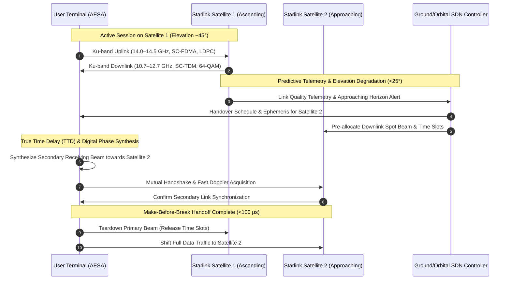

# 🌐 Network Technology — RF Protocols, Beamforming & Transport Architecture

> *"Operating a high-throughput, low-latency packet network across thousands of nodes traversing space at hypersonic velocities requires redefining the OSI stack—from RF physical-layer beam steering to dynamic software-defined routing."*

---

## 1. Physical Layer: RF Frequency Spectrum & Air Interface

Starlink utilizes a multi-band radio frequency architecture engineered for maximum spectral efficiency and resilience against atmospheric path degradation.

```
STARLINK RF SPECTRUM & MODULATION MATRIX:
━━━━━━━━━━━━━━━━━━━━━━━━━━━━━━━━━━━━━━━━━━━━━━━━━━━━━━━━━━━━━━━━━━━━
  Link Segment            Frequency Band        Carrier Frequencies     Modulation & Coding
  ──────────────────────────────────────────────────────────────────
  User Uplink (UT → Sat)  Ku-band               14.00 – 14.50 GHz       SC-FDMA, LDPC, QPSK to 16-QAM
  User Downlink (Sat → UT)Ku-band               10.70 – 12.70 GHz       SC-TDM, LDPC, QPSK to 64-APSK
  Feeder Uplink (GW → Sat)Ka-band               27.50 – 30.00 GHz       DVB-S2X / ACM, up to 64-APSK
  Feeder Downlink (Sat→GW)Ka-band               17.80 – 20.20 GHz       DVB-S2X / ACM, up to 64-APSK
  Next-Gen Feeder (V2/V3) V-band / E-band       37.5–51.4 / 71–76 GHz   Wideband Coherent Carrier
  Crosslink Mesh (ISL)    Near-Infrared Optical ~1,550 nm (Laser)       DP-QPSK / 100 Gbps Coherent
━━━━━━━━━━━━━━━━━━━━━━━━━━━━━━━━━━━━━━━━━━━━━━━━━━━━━━━━━━━━━━━━━━━━
```

### 1.1 Air Interface Mechanics

```
AIR INTERFACE CHARACTERISTICS:
━━━━━━━━━━━━━━━━━━━━━━━━━━━━━━━━━━━━━━━━━━━━━━━━━
  1. USER UPLINK ACCESS (SC-FDMA):
     Single Carrier Frequency Division Multiple Access is utilized for user transmissions.
     SC-FDMA provides a significantly lower Peak-to-Average Power Ratio (PAPR) compared
     to standard OFDMA. This maximizes transmitter power amplifier (PA) DC-to-RF conversion
     efficiency, reducing power consumption and thermal stress inside compact user terminals.
     
  2. USER DOWNLINK BROADCAST (SC-TDM):
     Single Carrier Time Division Multiplexing allows the satellite high-power phased
     array transponders to operate near saturation without non-linear intermodulation
     distortion, maximizing downlink power spectral density.
     
  3. ADAPTIVE CODING & MODULATION (ACM):
     Channel quality indicators (CQI) are fed back dynamically at millisecond intervals.
     Under severe rain fade, modulation automatically downshifts to robust QPSK with heavy
     forward error correction (FEC); under clear-sky conditions, modulation scales to 64-APSK
     for maximum throughput.
━━━━━━━━━━━━━━━━━━━━━━━━━━━━━━━━━━━━━━━━━━━━━━━━━
```

---

## 2. AESA Phased Array Beam Steering & Make-Before-Break Handover

Because Low Earth Orbit satellites transit across a terminal's field of view in approximately 5 to 10 minutes, the network cannot rely on mechanical antenna slewing. Both the satellite platforms and user terminals utilize Active Electronically Scanned Arrays (AESA) with digital phase shifters and True Time Delay (TTD) units.



---

## 3. End-to-End Latency Budget Analysis

The total round-trip time (RTT) experienced by a user terminal is modeled across physical propagation, RF modulation/demodulation processing, and terrestrial backbone transport:

```
LATENCY BUDGET DECOMPOSITION (Residential Subscriber, 550 km Shell):
━━━━━━━━━━━━━━━━━━━━━━━━━━━━━━━━━━━━━━━━━━━━━━━━━━━━━━━━━━━━━━━━━━━━
  Subsystem Stage                    One-Way Delay   Cumulative RTT
  ──────────────────────────────────────────────────────────────────
  Terminal Baseband Frame Processing : ~0.8–1.2 ms    ~2.0 ms
  Ku-Band Uplink Propagation (550 km): ~1.83 ms       ~5.7 ms
  Satellite Transponder Baseband/L2  : ~0.5–1.0 ms       ~7.2 ms
  Ka-Band Downlink to Gateway Teleport: ~1.83 ms      ~10.9 ms
  Gateway Baseband Demod & SerDes    : ~0.8–1.2 ms    ~12.9 ms
  Optical Backhaul to Peering PoP    : ~2.5–6.0 ms    ~18.0–25.0 ms
  Internet Backbone Transit to Server: ~3.0–8.0 ms    ~24.0–33.0 ms
  ━━━━━━━━━━━━━━━━━━━━━━━━━━━━━━━━━━━━━━━━━━━━━━━━━━━━━━━━━━━━━━━━━━
  NOMINAL OBSERVED ROUND-TRIP TIME   : 20 – 32 ms typical
  DIRECT OPTICAL ISL ROUTING (Ocean) : 18 – 24 ms
  HIGH-LATENCY DISTANT TELEPORT PATH : 45 – 58 ms
━━━━━━━━━━━━━━━━━━━━━━━━━━━━━━━━━━━━━━━━━━━━━━━━━━━━━━━━━━━━━━━━━━━━
```

---

## 4. Traffic Engineering & Bandwidth Management

```
QUALITY OF SERVICE (QoS) & TRAFFIC HIERARCHY:
━━━━━━━━━━━━━━━━━━━━━━━━━━━━━━━━━━━━━━━━━━━━━━━━━
  1. PRIORITY DATA TIER:
     - Dedicated bandwidth reservations guaranteed during peak regional congestion.
     - Zero throughput throttling or packet drop priority.
     - Bundled with Starlink Priority, Maritime, and Aviation tiers.
     
  2. STANDARD DATA TIER:
     - Best-effort dynamic scheduling under nominal operating conditions.
     - In heavily congested geographic cells, rate-limiting algorithms dynamically
       smooth bursty traffic while maintaining interactive responsiveness (<35 ms latency).
       
  3. BACKGROUND / SYSTEM DATA TIER:
     - Firmware updates, ephemeris distribution, and analytical telemetry.
     - Strictly queued in lowest-priority buffers, transmitting only during idle slot windows.
━━━━━━━━━━━━━━━━━━━━━━━━━━━━━━━━━━━━━━━━━━━━━━━━━
```

---

## 5. Network Layer Addressing: CGNAT and IPv6 Architecture

```
IP ROUTING & ADDRESS ASSIGNMENT SPECIFICATIONS:
━━━━━━━━━━━━━━━━━━━━━━━━━━━━━━━━━━━━━━━━━━━━━━━━━
  IPv4 Implementation:
    - Carrier-Grade NAT (CGNAT) conforming to RFC 6598 (100.64.0.0/10 prefix).
    - Prevents inbound unsolicited connection establishment by default.
    - Port allocation handled via deterministic or dynamic stateful translation.
    
  IPv6 Implementation:
    - Native dual-stack routing enabled across all modern firmware builds.
    - DHCPv6 Prefix Delegation allocates a dedicated /56 subnet per terminal.
    - Enables $2^{72}$ globally routable IPv6 addresses per subscriber endpoint.
    - Eliminates NAT traversal bottlenecks for real-time peer-to-peer protocols.
    
  Static Routable IPv4 Option:
    - Dedicated public IPv4 addresses available on Business and Enterprise subscriptions.
    - Enables custom ingress firewalling, IPsec/WireGuard VPN termination, and server hosting.
━━━━━━━━━━━━━━━━━━━━━━━━━━━━━━━━━━━━━━━━━━━━━━━━━
```

---

*Previous: [Ground Segment ←](./05-ground-segment.md) | Next: [Security Risks →](./07-security-risks.md)*
