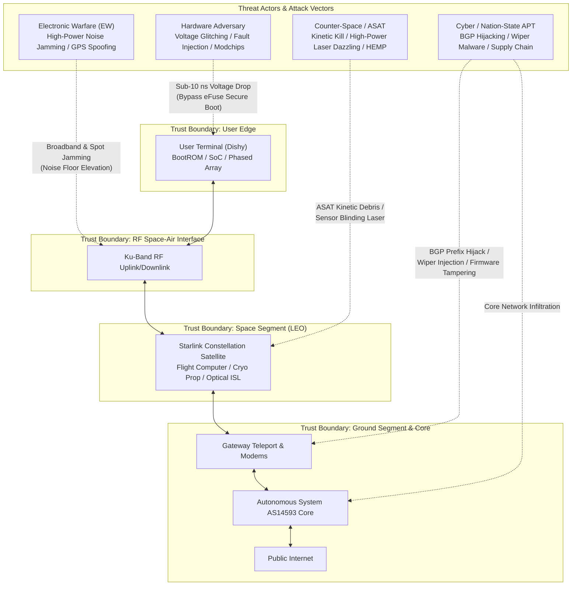

# 🔐 Security Risks — Megaconstellation Vulnerability & Threat Analysis

> *"Every critical planetary infrastructure constitutes an adversarial target. What renders the Starlink megaconstellation uniquely challenging from a cybersecurity perspective is its unprecedented orbital scale, distributed physical attack surface, and the rapid velocity at which sovereign civilian and military communications have become dependent upon it."*

---

## 1. System Threat Landscape & Attack Surface

The Starlink ecosystem operates across multiple distinct trust boundaries spanning consumer hardware, space-air RF links, orbital flight computers, terrestrial teleports, and autonomous network routing cores.



```
SYSTEM ATTACK SURFACE TOPOLOGY:
━━━━━━━━━━━━━━━━━━━━━━━━━━━━━━━━━━━━━━━━━━━━━━━━━
  1. User Terminal Edge       : Physical fault injection, BootROM glitching, firmware reverse engineering.
  2. Space-Air RF Links       : Electronic warfare noise jamming, GPS spoofing, uplink brute-forcing.
  3. Orbital Spacecraft Bus   : Laser blinding, direct kinetic ASAT, high-altitude EMP (HEMP).
  4. Inter-Satellite Laser    : Optical crosslink beam interruption, dazzler jamming.
  5. Gateway Teleports        : Edge router firmware wipers (e.g., AcidRain precedent), physical sabotage.
  6. Terrestrial SDN Core     : Supply-chain dependency compromise, BGP prefix hijacking, insider threat.
━━━━━━━━━━━━━━━━━━━━━━━━━━━━━━━━━━━━━━━━━━━━━━━━━
```

---

## 2. Hardware Vulnerabilities: The User Terminal Edge

### 2.1 The Lennert Wouters Voltage Glitching Exploit (Black Hat / CCC 2022)

In landmark hardware security research presented at Black Hat USA and Chaos Communication Congress (CCC), Belgian researcher **Lennert Wouters** (KU Leuven) demonstrated that the Starlink User Terminal (UT) SoC can be compromised at the hardware level using precision physical fault injection.

```
VOLTAGE FAULT INJECTION METHODOLOGY:
━━━━━━━━━━━━━━━━━━━━━━━━━━━━━━━━━━━━━━━━━━━━━━━━━
  Attacking Hardware : Custom interposer PCB (mod-chip) manufactured for ~$25 USD,
                       utilizing an RP2040 microcontroller and solid-state MOSFET switches.
  Physical Access    : Depot desoldering of the mainboard RF shielding metal enclosure.
  Execution Sequence :
    1. Monitor VDD core rail during early power-on sequence.
    2. Detect BootROM execution window (~560 ms post-power applied).
    3. Inject sub-10 ns negative voltage glitch (dropping core supply from 0.9V to 0.4V).
    4. Force instruction skip in the hardware signature verification loop.
    5. Bypass eFuse-backed cryptographic signature verification of the secondary bootloader.
    6. Execute arbitrary root payload; extract private firmware images and telemetry keys.
    
  Adversarial Impact :
    - Reverse engineering of proprietary space-ground modulation and framing formats.
    - Extraction of root cryptographic certificates and hardware identity tokens.
    - Creation of non-sanctioned, unlocked subscriber terminals operating outside billing geofences.
━━━━━━━━━━━━━━━━━━━━━━━━━━━━━━━━━━━━━━━━━━━━━━━━━
```

### 2.2 Darknavy Research (2024–2025)

Subsequent research by hardware security collective **Darknavy** extended fault injection techniques to Gen 2 (Standard Actuated) and Gen 3 planar terminals:

```
GEN 2 / GEN 3 HARDWARE ANALYSIS:
━━━━━━━━━━━━━━━━━━━━━━━━━━━━━━━━━━━━━━━━━━━━━━━━━
  Target Hardware      : Starlink Standard Actuated and Compact Planar SoCs.
  Exploit Vector       : Multi-stage fault injection combined with side-channel clock modulation.
  Access Elevation     : Achieved administrative supervisor state; extracted baseband firmware.
  Engineering Finding  : Demonstrates that silicon-level vulnerabilities persist across consumer
                         generations unless active analog crowbar and lockstep parity are integrated.
━━━━━━━━━━━━━━━━━━━━━━━━━━━━━━━━━━━━━━━━━━━━━━━━━
```

### 2.3 Structural Hardware Threat Model

Securing over 12 million consumer hardware endpoints deployed globally presents unique physical security trade-offs:
- **Zero Physical Custody:** Terminals are installed in accessible civilian locations without physical tamper-proof perimeters.
- **Supply Chain Interception:** State intelligence agencies can procure, inspect, and instrument subscriber terminals in controlled laboratory environments.
- **Static Silicon:** Consumer SoCs lack field-replaceable crypto-processors once fabricated and deployed.

---

## 3. Signal-Layer Attacks: Electronic Warfare, Jamming & Spoofing

### 3.1 Radio Frequency Jamming

```
ELECTRONIC WARFARE (EW) JAMMING PROFILE:
━━━━━━━━━━━━━━━━━━━━━━━━━━━━━━━━━━━━━━━━━━━━━━━━━
  Threat Mechanism   : High-power broadband noise barrage across 10.7–12.7 GHz (Ku-band downlink)
                       or 14.0–14.5 GHz (Ku-band uplink), reducing receiver SNR below Shannon limit.
  Observed Deployment: Russian electronic warfare systems in the Ukraine theater:
                       - Krasukha-4 mobile EW complex
                       - R-330Zh Zhitel jamming stations
                       - Tobol space electronic reconnaissance and jamming installations
                       
  Operational Impact : Localized service denial across tens of kilometers; degradation of tactical drones.
  
  SpaceX Countermeasures:
    - Rapid Over-the-Air (OTA) firmware deployments modifying chirp parameters.
    - Spatial beam narrowing and dynamic frequency-hopping channelization.
    - Directional array nulling to reject ground jammer look-angles.
━━━━━━━━━━━━━━━━━━━━━━━━━━━━━━━━━━━━━━━━━━━━━━━━━
```

### 3.2 Signal Spoofing & Ephemeris Manipulation

```
SIGNAL INTEGRITY & SPOOFING ANALYSIS:
━━━━━━━━━━━━━━━━━━━━━━━━━━━━━━━━━━━━━━━━━━━━━━━━━
  Uplink Authentication : Starlink RF links utilize proprietary symmetric session keys
                          negotiated during initial acquisition, preventing direct RF injection.
                          
  Vulnerability Points  :
    - GPS Spoofing: User terminals rely on civilian GNSS for accurate orbital ephemeris synchronization.
      Adversarial GPS spoofing can induce false positional errors, degrading phased array pointing vectors.
    - Man-in-the-Middle (MitM) at Gateway Level: Rogue terrestrial gateways or compromised BGP routes
      can intercept unencrypted application layer protocols.
━━━━━━━━━━━━━━━━━━━━━━━━━━━━━━━━━━━━━━━━━━━━━━━━━
```

### 3.3 Signals Intelligence (SIGINT) & Traffic Pattern Analysis

Even when application traffic is protected by TLS 1.3 and link-layer AES encapsulation, RF emissions reveal intelligence:
- **Geographic Direction Finding:** High-power Ku-band uplink emissions can be localized by enemy COMINT aircraft, exposing troop locations and field command posts.
- **Traffic Volume Fingerprinting:** Packet burst timing and bandwidth cadence can indicate upcoming military operations or drone launches.

---

## 4. Ground Teleport & Core Network Infrastructure Risks

### 4.1 The Viasat KA-SAT AcidRain Cyber Attack (Historical Precedent)

```
VIASAT ATTACK LESSONS FOR MEGACONSTELLATIONS:
━━━━━━━━━━━━━━━━━━━━━━━━━━━━━━━━━━━━━━━━━━━━━━━━━
  Incident Date      : February 24, 2022 (Concurrent with Russian invasion of Ukraine)
  Target Network     : Viasat KA-SAT European commercial satellite broadband network
  Attack Execution   : Adversaries exploited an unpatched enterprise VPN gateway to penetrate
                       the terrestrial satellite management core.
  Payload Deployed   : "AcidRain" destructive wiper malware targeted the flash memory of
                       SurfBeam customer modems, systematically executing `rm -rf` and zeroing MTD partitions.
  Collateral Impact  : Over 45,000 satellite modems permanently bricked across Europe;
                       thousands of wind turbine monitoring systems in Germany knocked offline;
                       initial Ukrainian military command communications degraded.
                       
  Architectural Lesson for Starlink:
    - Demonstrates that terrestrial gateway networks are prime high-value targets.
    - Proves modem management channels must feature physically isolated out-of-band controls.
━━━━━━━━━━━━━━━━━━━━━━━━━━━━━━━━━━━━━━━━━━━━━━━━━
```

### 4.2 Gateway Teleport Physical & Cyber Exposure

```
TELEPORT VULNERABILITY MATRIX:
━━━━━━━━━━━━━━━━━━━━━━━━━━━━━━━━━━━━━━━━━━━━━━━━━
  Physical Sabotage   : Cutting subterranean dark-fiber conduits or destroying high-gain tracking dishes.
  Power Grid Outages  : Sustained disruption of municipal power exceeding 72-hour diesel reserves.
  Software Exploits   : Zero-day vulnerabilities in BGP border routers, edge modems, or site telemetry RTUs.
  Blast Radius        : Disabling a major teleport knocks offline all non-ISL satellite passes across an 800 km radius.
━━━━━━━━━━━━━━━━━━━━━━━━━━━━━━━━━━━━━━━━━━━━━━━━━
```

---

## 5. Software-Defined Constellation Architecture Risks

```
SDN CENTRALIZATION RISKS:
━━━━━━━━━━━━━━━━━━━━━━━━━━━━━━━━━━━━━━━━━━━━━━━━━
  1. CENTRALIZED CONTROLLER COMPROMISE:
     Centralized management plane architectures risk catastrophic blast radius if supervisory
     credentials or root orchestration APIs are compromised by nation-state actors.
     
  2. BGP PREFIX HIJACKING:
     Adversarial state telecommunication entities announcing illegitimate BGP routes can divert
     Starlink traffic through foreign surveillance nodes.
     
  3. ADVERSARIAL MACHINE LEARNING:
     Predictive orbital routing models are potentially susceptible to traffic injection attacks
     designed to induce artificial network congestion and route flapping.
━━━━━━━━━━━━━━━━━━━━━━━━━━━━━━━━━━━━━━━━━━━━━━━━━
```

---

## 6. Anti-Satellite (ASAT) & Counter-Space Threat Vectors

```
COUNTER-SPACE CAPABILITIES VS. STARLINK:
━━━━━━━━━━━━━━━━━━━━━━━━━━━━━━━━━━━━━━━━━━━━━━━━━
  1. DIRECT-ASCENT KINETIC ASAT (DA-ASAT):
     - Demonstrated by Russia (Cosmos 1408, 2021), China (FY-1C, 2007), USA, and India.
     - Constellation Resilience: Highly effective against individual high-value satellites, but
       statistically futile against a 11,000+ node megaconstellation (an adversary exhausts their
       missile inventory long before degrading constellation capacity).
     - Collateral Catastrophe: Resulting orbital debris clouds threaten indiscriminate Kessler Syndrome.
     
  2. DIRECTED ENERGY WEAPONS (DEW):
     - High-power ground or airborne lasers designed to blind star trackers and electro-optical ISL heads.
     - Research published in Chinese PLA journals highlights "soft-kill" dazzler strategies.
     
  3. HIGH-ALTITUDE ELECTROMAGNETIC PULSE (HEMP):
     - Nuclear detonation in low-Earth orbit creates prompt gamma-ray bursts, Compton electrons,
       and artificial radiation belts that degrade non-radiation-hardened commercial components over time.
━━━━━━━━━━━━━━━━━━━━━━━━━━━━━━━━━━━━━━━━━━━━━━━━━
```

---

## 7. Geopolitical Governance & Sovereign Command Risk

```
SINGLE-ENTITY CONTROL & SOVEREIGN RISK:
━━━━━━━━━━━━━━━━━━━━━━━━━━━━━━━━━━━━━━━━━━━━━━━━━
  Critical Structural Concern:
    - A single private corporation (SpaceX) exercises unilateral operational control over
      communications critical to sovereign national defense and civilian survival.
      
  Documented Operational Incidents:
    - Black Sea / Crimea Incident (2022): Starlink connectivity was withheld during a planned
      Ukrainian naval drone strike due to corporate policy against offensive weapons integration.
    - Dynamic Speed Throttling: Enforcing a 160 km/h (100 mph) terminal speed cap disrupted certain
      tactical aerial drone platforms.
      
  Geopolitical Implication:
    - Sovereign nations lack independent operational guarantees over commercial LEO networks.
    - Demonstrates an urgent requirement for international multi-party escrow agreements and sovereign defense overlays.
━━━━━━━━━━━━━━━━━━━━━━━━━━━━━━━━━━━━━━━━━━━━━━━━━
```

---

## 8. Quantitative Risk Assessment Matrix

| Threat Category | Severity | Likelihood | Impact Vector | SpaceX Baseline Mitigation |
|:---|:---|:---|:---|:---|
| **Hardware Fault Injection** | HIGH | MEDIUM | Root key extraction, terminal cloning | Secure Boot, silicon revisions, bug bounties |
| **Electronic Warfare / Jamming** | HIGH | HIGH | Localized link denial in combat zones | Adaptive beam steering, rapid OTA chirp updates |
| **Terrestrial Gateway Sabotage** | CRITICAL | MEDIUM | Regional broadband outage | Geo-redundant teleports, optical ISL bypass |
| **Direct Kinetic ASAT** | CRITICAL | LOW | Debris generation, constellation risk | Spacecraft redundancy, autonomous avoidance |
| **Firmware Wiper (AcidRain)** | CRITICAL | MEDIUM | Fleet-wide modem bricking | Cryptographic image signing, rollback recovery |
| **Sovereign Service Denial** | CRITICAL | MEDIUM-HIGH | Loss of sovereign communications control | Starshield government program, contract covenants |
| **Kessler Cascade Debris** | CATASTROPHIC| LOW-MEDIUM | Long-term orbital denial | 100% atmospheric demisability, active de-orbiting |

---

## 9. Monograph Defense Solutions & Cross-References

This research monograph derives full formal engineering and mathematical solutions for every vulnerability identified above:
- 🛡️ **Constellation Security Framework (StarSec):** [StarSec CSF v1.0 Overview](./framework/README.md) — 4-layer open standard, normative RFC specifications, and compliance tiers.
- 🎯 **SPARTA & ATT&CK Threat Matrix:** [Constellation Threat Matrix (32 Vectors)](./framework/threat-matrix/constellation-threat-matrix.md) & [CVSS v4 Space Profile](./framework/threat-matrix/cvss-v4-space-profile.md) — Exhaustive threat catalog and scoring.
- 🛡️ **Comprehensive Engineering Blueprint:** [Chapter 16: Security Countermeasures & Mitigations](./16-security-countermeasures-and-mitigations.md) — Detailed silicon hardening, adaptive spatial null-steering, post-quantum cryptography, and sovereign escrow governance.
- 📐 **Mathematical Threat Model:** [Whitepaper 05: Quantitative STRIDE Threat Model](./docs/rnd/05-quantitative-stride-threat-model.md) — Level-2 DFD trust boundary models, Lennert Wouters fault-injection equations, and electronic warfare J/S link budgets.
- 🔬 **Publication-Grade Research Paper:** [Whitepaper 07: Zero Trust Satellite Architecture (ZTSA)](./docs/rnd/07-zero-trust-satellite-architecture-and-cyber-defense.md) — NIST SP 800-207 space adaptation, MVDR null-steering proofs, NIST FIPS 203/204 PQC, BBM92 QKD, and Shamir (3,5) MPC quorum protocols.
- 💻 **Interactive Tooling & Simulations:** [Threat Score Calculator](./simulations/threat_score_calculator.py) | [MPC TT&C Quorum](./simulations/mpc_quorum_telecommand.py) | [Tooling Guide](./tools/README.md).

---

*Previous: [Network Technology ←](./06-network-technology.md) | Next: [Geopolitical Analysis →](./08-geopolitical-analysis.md)*
