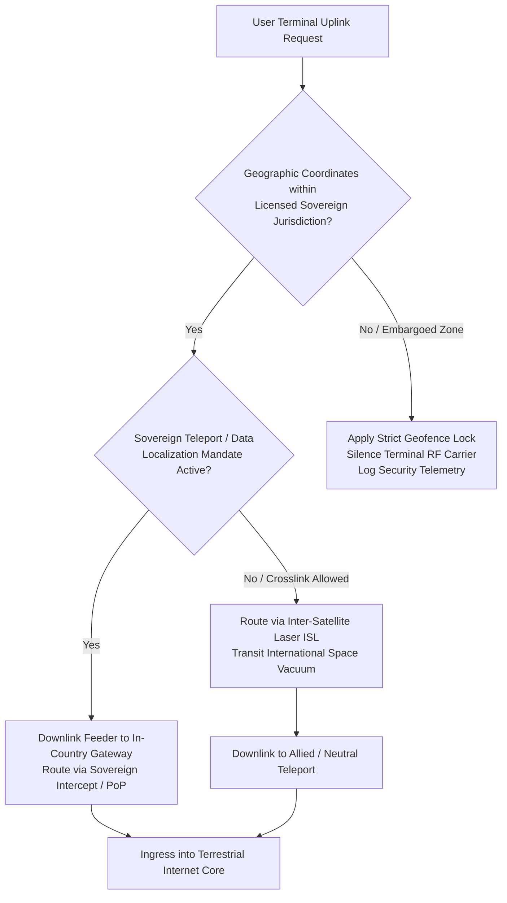

# 🌏 Geopolitical Analysis — Megaconstellations in Global Power Dynamics

> *"For the first time in modern military history, a single commercial corporation controls the primary tactical communications backbone of a major armed conflict. This dynamic fundamentally alters the Westphalian concept of national sovereignty and the law of armed conflict."*

---

## 1. The Ukraine War: A Paradigm Shift in Space Geopolitics

### 1.1 The Operational Pivot to LEO Communications

The outbreak of the Russo-Ukrainian conflict on February 24, 2022, demonstrated the acute vulnerability of legacy geostationary telecommunications and terrestrial fiber infrastructure to combined cyber and kinetic warfare.

```
THE UKRAINE DEPLOYMENT CHRONOLOGY:
━━━━━━━━━━━━━━━━━━━━━━━━━━━━━━━━━━━━━━━━━━━━━━━━━
  February 24, 2022 : Russian GRU deploys the "AcidRain" wiper malware targeting Viasat's
                      KA-SAT network, severing thousands of command modems within hours.
  February 26, 2022 : Ukrainian Vice Prime Minister Mykhailo Fedorov publicly solicits
                      emergency Starlink satellite terminal support via social media.
  February 28, 2022 : SpaceX activates regional constellation beams over Ukrainian airspace;
                      the initial batch of user terminals enters Ukraine via Poland.
  2022–2024         : Over 45,000 Starlink terminals deployed across military, emergency,
                      and critical civilian infrastructure.
  2023–2025         : The United States Department of Defense (DoD) formalizes procurement
                      agreements, transitioning sensitive operations to the dedicated
                      Starshield government architecture.
━━━━━━━━━━━━━━━━━━━━━━━━━━━━━━━━━━━━━━━━━━━━━━━━━
```

### 1.2 Tactical Military Utility in Modern Combat

The Starlink constellation became the indispensable nervous system of Ukraine's defense doctrine across four core operational axes:

```
TACTICAL MILITARY INTEGRATION:
━━━━━━━━━━━━━━━━━━━━━━━━━━━━━━━━━━━━━━━━━━━━━━━━━
  1. Distributed C4ISR Operations:
     Tactical field commanders utilized Starlink to coordinate maneuvers using the DELTA
     battlefield management system, providing near-real-time situational awareness across
     dispersed battalions.
     
  2. First-Person-View (FPV) & Reconnaissance Drones:
     High-bandwidth, low-latency uplinks enabled operators to pilot reconnaissance and
     attack drones over long standoff distances, relaying real-time HD video streams to command posts.
     
  3. Sensor-to-Shooter Artillery Pairing:
     Counter-battery radar coordinates and forward observer telemetry were coupled directly
     to artillery batteries via Starlink, reducing strike cycle latencies from tens of minutes to seconds.
     
  4. Resilient Counter-EW Survivability:
     Unlike legacy high-power geostationary terminals, Starlink's directional AESA pencil beams
     and rapid software adaptation rendered Russian electronic jamming substantially less effective.
━━━━━━━━━━━━━━━━━━━━━━━━━━━━━━━━━━━━━━━━━━━━━━━━━
```

---

## 2. Sovereign Decision-Making and the Geofencing Dilemma

The dual-use nature of commercial satellite internet creates novel jurisdictional and ethical friction when commercial software controls state military operations.



### 2.1 The Black Sea Interdiction Precedent

In late 2022, Ukrainian forces initiated an offensive operation utilizing autonomous explosive naval surface drones against Russian naval vessels stationed at the Sevastopol naval base in Russian-occupied Crimea. The drones reportedly lost connectivity upon reaching the exclusion boundary:

```
THE CRIMEA GEOFENCING PRECEDENT:
━━━━━━━━━━━━━━━━━━━━━━━━━━━━━━━━━━━━━━━━━━━━━━━━━
  Operational Incident : Naval drones traversing toward Sevastopol lost RF link to Starlink.
  Corporate Rationale  : SpaceX affirmed that Starlink service had never been authorized or
                         activated over Crimea due to US sanctions compliance and corporate terms
                         prohibiting offensive weaponized integration.
  Strategic Concern    : Corporate leadership expressed apprehension regarding direct attribution
                         for a strategic maritime strike potentially escalating to nuclear retaliation.
                         
  Constitutional Paradigm Shift:
    - A commercial executive made an independent operational determination that altered the
      tactical outcome of a major sovereign military strike.
    - Highlights the complete absence of a binding international legal framework governing
      corporate dual-use space infrastructure during armed conflicts.
━━━━━━━━━━━━━━━━━━━━━━━━━━━━━━━━━━━━━━━━━━━━━━━━━
```

### 2.2 Operational Speed Caps

To curb the unauthorized integration of commercial subscriber terminals onto high-speed kinetic weapons platforms, SpaceX implemented an automated 160 km/h (100 mph) terminal tracking speed cap. While justified under commercial terms of service, this constraint disrupted improvised military reconnaissance aircraft, compelling defense ministries to demand contractually guaranteed military tiers (Starshield).

---

## 3. Adversarial Counter-Strategies: Electronic Warfare & Legal Rhetoric

### 3.1 Russian Countermeasures

```
RUSSIAN ANTI-CONSTELLATION DOCTRINE:
━━━━━━━━━━━━━━━━━━━━━━━━━━━━━━━━━━━━━━━━━━━━━━━━━
  Electronic Warfare Deployments:
    - Deployment of the 14Ts227 "Tobol" electronic warfare complex designed to disrupt satellite uplinks.
    - Field operations with Krasukha-4 and Borisoglebsk-2 jamming platforms.
    - Mixed effectiveness: SpaceX's continuous OTA firmware agility neutralized jamming signatures
      within hours, leading senior US Space Force officials to describe Starlink as the most resilient
      tactical communications constellation in military history.
      
  International Legal Posturing:
    - Official declarations before the United Nations Committee on the Peaceful Uses of Outer Space (COPUOS)
      asserting that commercial constellations utilized for military operations constitute legitimate targets
      for military retaliation under international humanitarian law.
━━━━━━━━━━━━━━━━━━━━━━━━━━━━━━━━━━━━━━━━━━━━━━━━━
```

### 3.2 Chinese Strategic Assessments & Project GuoWang

Chinese defense strategists closely monitor Starlink's role in asymmetric warfare, with particular focus on potential contingencies in the Taiwan Strait:

```
CHINESE MILITARY SCIENCE EVALUATION:
━━━━━━━━━━━━━━━━━━━━━━━━━━━━━━━━━━━━━━━━━━━━━━━━━
  PLA Strategic Threat Assessment:
    - Papers in the PLA Military Science Journal argue that Starlink presents severe asymmetric challenges
      in amphibious landing scenarios, providing continuous C4ISR to defending forces.
    - Proposes multi-spectrum counter-strategies, including directed-energy dazzling of optical sensors,
      cyber exploitation of teleport baseband routers, and localized electronic spoofing.
      
  Sovereign Megaconstellation Responses:
    1. Project GuoWang (国网, SatNet):
       - State-authorized megaconstellation of 12,992 LEO satellites across 500–1,145 km orbital shells.
       - Designed to guarantee sovereign Chinese orbital slots, RF spectrum priority, and secure military comms.
       
    2. Qianfan (G60 / Thousand Sails):
       - Commercial/state enterprise constellation planning over 14,000 LEO satellites.
       - Aims to serve domestic infrastructure and export satellite connectivity along Belt and Road corridors.
━━━━━━━━━━━━━━━━━━━━━━━━━━━━━━━━━━━━━━━━━━━━━━━━━
```

---

## 4. The Global "Digital Sovereignty" Crisis

The realization that critical telecommunications depend on a single American corporation has triggered an international race toward sovereign space infrastructure:

```
SOVEREIGN LEO CONSTELLATION INITIATIVES:
━━━━━━━━━━━━━━━━━━━━━━━━━━━━━━━━━━━━━━━━━━━━━━━━━
  European Union — IRIS² (Infrastructure for Resilience, Interconnectivity & Security by Satellite):
    - Multi-orbital architecture: 290 LEO spacecraft coupled with MEO and GEO assets.
    - Budget: €6+ Billion public-private partnership.
    - Objective: Guaranteed European strategic autonomy, military-grade quantum encryption, and independent connectivity.
    
  United Kingdom / India — Eutelsat OneWeb:
    - Operational constellation of 600+ high-latitude LEO satellites.
    - Backed by the UK Government, Bharti Global (India), and Eutelsat.
    - Serves sovereign enterprise and defense clients with dedicated in-country gateways.
    
  Japan & South Korea:
    - Expanding national space defense budgets and non-terrestrial network partnerships to secure
      independent regional satellite capacity.
━━━━━━━━━━━━━━━━━━━━━━━━━━━━━━━━━━━━━━━━━━━━━━━━━
```

---

## 5. United States Defense Integration: The Starshield Transition

To resolve the constitutional ambiguity of commercial corporate control over military operations, the US Government instituted the **Starshield** initiative:

```
STARSHIELD PROGRAM CHARACTERISTICS:
━━━━━━━━━━━━━━━━━━━━━━━━━━━━━━━━━━━━━━━━━━━━━━━━━
  Structural Separation : Distinct government-dedicated business unit operating independently of commercial Starlink.
  Custom Bus Payloads   : Satellites equipped with classified government optical sensors, synthetic aperture radar (SAR),
                          and high-assurance Type 1 cryptographic communications modules.
  Command Authority     : Clear contractual chain of command granting the US Department of Defense
                          direct operational oversight and operational guarantee covenants.
  Proliferated Warfighter Architecture:
    - Integrated with Space Development Agency (SDA) Transport and Tracking Layer constellations.
    - Designed to provide resilient low-latency targeting data for global hypersonic defense.
━━━━━━━━━━━━━━━━━━━━━━━━━━━━━━━━━━━━━━━━━━━━━━━━━
```

---

## 6. International Space Law Vacuum

The deployment of commercial megaconstellations has exposed severe deficiencies in twentieth-century space governance:

```
INTERNATIONAL LEGAL FRAMEWORK GAPS:
━━━━━━━━━━━━━━━━━━━━━━━━━━━━━━━━━━━━━━━━━━━━━━━━━
  Outer Space Treaty (1967):
    - Article VI establishes state responsibility for non-governmental activities in space,
      yet lacks precise enforcement mechanisms for dual-use commercial constellations operating in conflict.
      
  International Telecommunication Union (ITU):
    - Regulates radio spectrum allocations and orbital slot registrations on a first-come, first-served basis,
      with no mandate to address wartime neutrality, geofenced access, or electronic jamming conflicts.
      
  Unresolved Legal Questions:
    - Does an adversary have the legal right under the Geneva Conventions to kinetically target a commercial
      satellite that carries both civilian internet packets and military targeting telemetry?
    - If a commercial operator denies service to an ally under diplomatic pressure, does that constitute a breach
      of international treaty or domestic contractual law?
━━━━━━━━━━━━━━━━━━━━━━━━━━━━━━━━━━━━━━━━━━━━━━━━━
```

---

## 7. Strategic Conclusions

| Strategic Dimension | Observation | Geopolitical Policy Implication |
|:---|:---|:---|
| **Sovereignty vs. Utility** | Commercial LEO connectivity provides unmatched tactical agility. | Nations cannot safely accept foreign commercial monopoly over sovereign telecommunications. |
| **Dual-Use Inevitability** | Identical satellite transponders carry humanitarian video calls and artillery fire coordinates. | International humanitarian law must define proportionality rules for megaconstellation interdiction. |
| **Orbital Land-Rush** | First movers capture optimal orbital shells and spectrum priority. | Major geopolitical powers will deploy sovereign counter-constellations to prevent orbital exclusion. |

---

*Previous: [Security Risks ←](./07-security-risks.md) | Next: [Environmental Concerns →](./09-environmental-concerns.md)*
