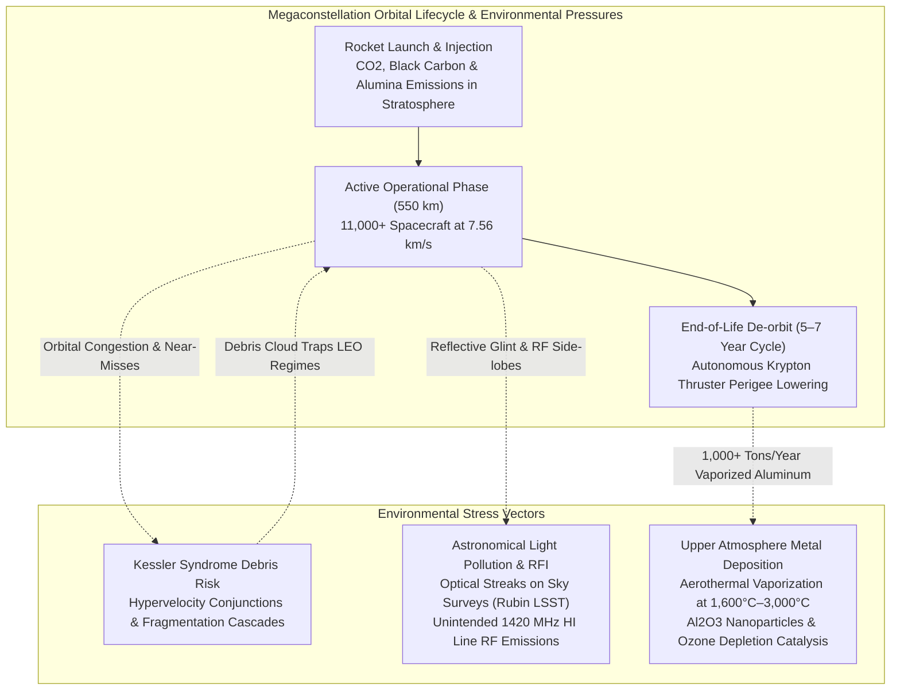

# 🌌 Environmental Concerns — Space Debris, Astronomy & Atmospheric Chemistry

> *"We are creating an orbital industrial economy. Yet without coordinated planetary governance, we risk triggering an orbital tragedy of the commons that could imperil low-Earth space utilization for generations."* — Space Environmental Science Review

---

## 1. Megaconstellation Environmental Lifecycle

The environmental footprint of a tens-of-thousands-satellite constellation spans three critical domains: orbital congestion and Kessler syndrome risks in Low Earth Orbit, optical and radio astronomical interference, and aerothermal vaporization chemistry in the upper stratosphere.



---

## 2. Space Debris & Astrodynamic Conjunction Risks

### 2.1 The Population Explosion in Low Earth Orbit

```
ORBITAL POPULATION STATISTICS (2026 Telemetry):
━━━━━━━━━━━━━━━━━━━━━━━━━━━━━━━━━━━━━━━━━━━━━━━━━
  Cataloged Tracked Orbital Objects (>10 cm) : ~36,000+
  Estimated Lethal Non-Trackable Debris (1–10 cm) : ~500,000+
  Microscopic Debris Particulates (<1 cm)     : ~100 Million+
  
  Active Operational Satellites (Global Total): ~12,000
  Starlink Operational Constellation Proportion : ~11,500 (~75% of all active satellites in orbit)
  
  Historical Launch Comparative Cadence:
    - 1957–2018 (61 Years): ~8,500 total satellites launched globally across all nations.
    - 2019–2026 (7 Years) : SpaceX deployed over 11,500 Starlink spacecraft alone.
━━━━━━━━━━━━━━━━━━━━━━━━━━━━━━━━━━━━━━━━━━━━━━━━━
```

### 2.2 Kessler Syndrome: Non-Linear Collision Cascades

Formulated by NASA astrophysicist Donald J. Kessler in 1978, the **Kessler Syndrome** describes a theoretical critical density threshold in Low Earth Orbit where the rate of debris generation via hypervelocity collisions exceeds the rate of orbital decay induced by atmospheric drag:

$$\frac{d N_{\text{debris}}}{dt} = \alpha_{\text{collision}} \cdot N_{\text{sat}}^2 - \beta_{\text{decay}}(h) \cdot N_{\text{debris}}$$

At orbital velocities of $v \approx 7.56\text{ km/s}$, an impact between two spacecraft yields a relative kinetic energy density:

$$E_k = \frac{1}{2} m v_{rel}^2$$

For a head-on conjunction ($v_{rel} \approx 14\text{ km/s}$), a 100-gram fragment carries approximately $9.8\text{ MJ}$ of kinetic energy—equivalent to the explosion of over 2.3 kg of TNT—completely shattering spacecraft into thousands of secondary lethal projectile fragments.

### 2.3 SpaceX Debris Mitigation Engineering

```
SPACEX MITIGATION FRAMEWORK:
━━━━━━━━━━━━━━━━━━━━━━━━━━━━━━━━━━━━━━━━━━━━━━━━━
  1. Low-Altitude Passive Safety Strategy (540–570 km):
     Unlike legacy megaconstellations positioned above 1,000 km (e.g., OneWeb at 1,200 km,
     where orbital debris persists for centuries), Starlink operates in the residual
     thermosphere where atmospheric molecular drag passively de-orbits dead spacecraft within 1 to 5 years.
     
  2. Autonomous Conjunction Maneuvering:
     Spacecraft autonomously ingest Conjunction Data Messages (CDMs) from the 18th Space
     Defense Squadron and commercial radar networks, executing over 50,000 automated
     propulsive avoidance burns per year.
     
  3. Strict 5-Year Regulatory De-orbit Compliance:
     Complies with the FCC 2022 mandate requiring LEO spacecraft to de-orbit within 5 years
     of mission completion, with SpaceX targeting operational de-orbits within 6 months of decommissioning.
     
  4. 100% Structural Demisability:
     Engineering design eliminates dense titanium and beryllium structures; the entire bus
     is engineered from aluminum alloys and composite materials that completely burn up during atmospheric re-entry.
━━━━━━━━━━━━━━━━━━━━━━━━━━━━━━━━━━━━━━━━━━━━━━━━━
```

---

## 3. Light Pollution & Astronomical Interference

### 3.1 Optical Brightness and the Vera C. Rubin Observatory

The passage of reflective solar panels and spacecraft bus structures across telescope fields of view during astronomical twilight creates prominent streak saturation on sensitive wide-field optical sensors.

```
OPTICAL BRIGHTNESS MITIGATION TRAJECTORY:
━━━━━━━━━━━━━━━━━━━━━━━━━━━━━━━━━━━━━━━━━━━━━━━━━
  V1.0 Early Spacecraft    : Apparent magnitude ~3.0–4.0 (conspicuously visible to the unaided eye).
  DarkSat Experimentation  : Anti-reflective blackened coatings applied (thermal management trade-offs).
  VisorSat Era (V1.5)      : Deployable radio-transparent sunshades blocking sunlight reflection (magnitude ~5.5–6.0).
  V2 Mini / Gen 2 Bus      : Specular mirror dielectric backing films and automated "knife-edge"
                             attitude maneuvers during terminator crossings (magnitude ~6.5–7.0, sub-naked-eye limit).
                             
  Residual Observational Challenges:
    - The Vera C. Rubin Observatory (Legacy Survey of Space and Time / LSST) surveys the entire sky every 3 nights.
    - Up to 30–40% of twilight exposures retain linear streak artifacts, masking potential near-Earth asteroid detections.
━━━━━━━━━━━━━━━━━━━━━━━━━━━━━━━━━━━━━━━━━━━━━━━━━
```

### 3.2 Unintended Radio Frequency Emissions (UERE)

Groundbreaking radio astronomy studies conducted by the Netherlands Institute for Radio Astronomy (ASTRON) in 2023 utilizing the LOFAR array revealed unintended electromagnetic radiation from Starlink spacecraft electronics:
- **110–188 MHz Spectrum Leakage:** Downlink clock harmonics and onboard DC-DC converters radiate unintended RF signatures across protected radio astronomy allocations.
- **21 cm Hydrogen Line Proximity (1420 MHz):** Stray emissions threaten ultra-sensitive cosmological measurements of primordial neutral hydrogen from the cosmic dawn.

---

## 4. Atmospheric Chemistry: Stratospheric Metal Vaporization

### 4.1 Re-entry Aerothermal Vaporization Mechanics

When a decommissioned satellite re-enters the upper atmosphere at approximately $7.8\text{ km/s}$, intense aerothermal compression shockwaves generate localized plasma temperatures between 1,600°C and 3,000°C, causing total vaporization between 60 km and 90 km altitude (the mesosphere and lower thermosphere).

```
AEROTHERMAL AEROSOL CONSTITUENT ANALYSIS:
━━━━━━━━━━━━━━━━━━━━━━━━━━━━━━━━━━━━━━━━━━━━━━━━━
  Chassis & Structural Trusses : Aluminum Alloys ──> Aluminum Oxide (Al2O3 / Alumina)
  Secondary Hardpoints         : Titanium Alloys ──> Titanium Dioxide (TiO2)
  Electrochemical Cells        : Lithium-Ion     ──> Lithium Oxides / Aerosols
  Solar Photovoltaic Arrays    : GaAs / Silicon  ──> Gallium, Arsenic & Silicon Oxides
  Printed Circuit Boards       : Trace Copper, Tin, Lead, Brominated Flame Retardants
━━━━━━━━━━━━━━━━━━━━━━━━━━━━━━━━━━━━━━━━━━━━━━━━━
```

### 4.2 Stratospheric Alumina Aerosols and Ozone Depletion Risks

Recent peer-reviewed atmospheric research (e.g., *Nature Astronomy*, 2023; *Geophysical Research Letters*, 2024) indicates that mass megaconstellation replacement cycles introduce unprecedented anthropogenic metal concentrations into the stratosphere:

```
STRATOSPHERIC IMPACT ESTIMATION:
━━━━━━━━━━━━━━━━━━━━━━━━━━━━━━━━━━━━━━━━━━━━━━━━━
  Fleet Replacement Turnover : 11,000+ satellites with an operational life of 5 to 7 years.
  Annual De-orbiting Cadence  : ~1,500 to 2,200 spacecraft per year.
  Annual Alumina Deposition   : Projected 1,000+ metric tons of aluminum oxide nanoparticles annually.
  
  Atmospheric Chemistry Hazard:
    - Aluminum oxide nanoparticles serve as active heterogeneous catalytic surfaces for chlorine activation.
    - Accelerated chlorine catalysis destroys stratospheric ozone molecules ($O_3$), potentially delaying
      the recovery of the ozone layer established under the Montreal Protocol.
    - Injected aerosols alter stratospheric radiative forcing and albedo, with climate consequences
      currently unquantified by comprehensive atmospheric models.
━━━━━━━━━━━━━━━━━━━━━━━━━━━━━━━━━━━━━━━━━━━━━━━━━
```

---

## 5. Regulatory Gaps in Space Environmental Protection

Current space law lacks binding ecological standards for the orbital environment:

```
GLOBAL SPACE ENVIRONMENTAL DEFICITS:
━━━━━━━━━━━━━━━━━━━━━━━━━━━━━━━━━━━━━━━━━━━━━━━━━
  1. No Planetary Carrying-Capacity Threshold:
     International regulators do not establish cumulative caps on the aggregate number
     of satellites permitted in specific LEO altitude bands.
     
  2. Exclusion from Environmental Impact Statements:
     US satellite licensing historically received Categorical Exclusion (CATEX) from the
     National Environmental Policy Act (NEPA), avoiding comprehensive atmospheric assessments.
     
  3. Absence of Upper-Atmosphere Chemical Standards:
     Zero international environmental protocols govern aerosol deposition resulting from spacecraft re-entries.
━━━━━━━━━━━━━━━━━━━━━━━━━━━━━━━━━━━━━━━━━━━━━━━━━
```

---

## 6. Environmental Risk Summary Matrix

| Risk Dimension | Current Severity | 2030+ Trajectory | Regulatory Maturity | SpaceX Mitigation Posture |
|:---|:---|:---|:---|:---|
| **Orbital Collision Cascade (Kessler)** | HIGH | CRITICAL | Moderate (FCC 5-Yr Rule) | Proactive (Autonomous maneuvers, 550 km orbit) |
| **Optical Telescope Streak Saturation** | HIGH | VERY HIGH | Developing (IAU Guidelines)| Active (VisorSat, mirror films, knife-edge tilt) |
| **Radio Astronomy RF Leakage** | HIGH | HIGH | Low (ITU Coordination) | Ongoing technical dialogue with ASTRON/CRAF |
| **Stratospheric Alumina Catalysis** | MEDIUM-HIGH | HIGH | Unregulated | Pending independent atmospheric research |
| **Space Situational Awareness (SSA)** | MODERATE | HIGH | High (CSpOC / LeoLabs) | Industry-leading automated ephemeris sharing |

---

*Previous: [Geopolitical Analysis ←](./08-geopolitical-analysis.md) | Next: [Competitive Landscape →](./10-competitive-landscape.md)*
