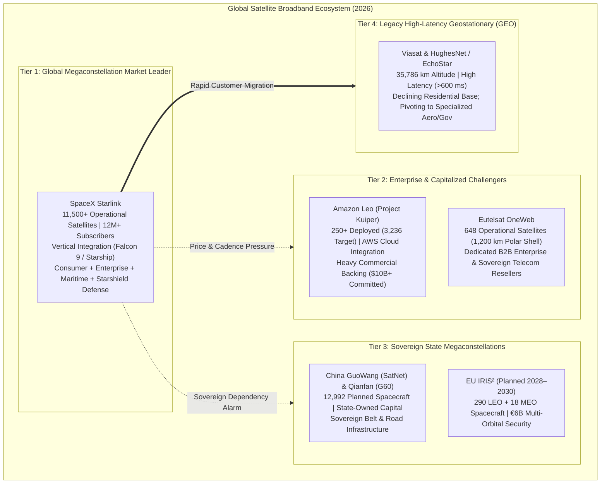

# ⚔️ Competitive Landscape — Global LEO & Non-Terrestrial Network Analysis

> *"The low-Earth orbit telecommunications race represents the definitive aerospace competition of the twenty-first century—a transition where commercial launch velocity, vertical integration, and silicon manufacturing outpace legacy aerospace conglomerates."*

---

## 1. Global Market Topology (2026 Assessment)

The commercial satellite broadband market has fundamentally pivoted from high-latency geostationary (GEO) transponders to proliferated Low Earth Orbit (pLEO) megaconstellations:

```
GLOBAL SATELLITE BROADBAND MARKET PROFILE (2026 Telemetry):
━━━━━━━━━━━━━━━━━━━━━━━━━━━━━━━━━━━━━━━━━━━━━━━━━━━━━━━━━━━━━━━━━━━━
  Global Addressable Market Size (2026) : ~$18–22 Billion USD
  Projected Total Addressable Market (2030): ~$55–70 Billion USD
  
  Global Broadband Subscriber Distribution:
    - SpaceX Starlink              : ~97.1% of global satellite speed test telemetry (>12M subscribers)
    - Eutelsat OneWeb              : ~1.8% (strictly wholesale B2B / enterprise / telecom trunking)
    - Amazon Leo (Project Kuiper)  : ~0.8% (initial commercial rollout phase)
    - Legacy Geostationary (GEO)   : ~0.3% (experiencing rapid residential churn)
━━━━━━━━━━━━━━━━━━━━━━━━━━━━━━━━━━━━━━━━━━━━━━━━━━━━━━━━━━━━━━━━━━━━
```



---

## 2. In-Depth Competitor Architecture Profiles

### 2.1 SpaceX Starlink — The Integrated Incumbent

```
SPACEX STARLINK INDUSTRIAL CAPABILITIES:
━━━━━━━━━━━━━━━━━━━━━━━━━━━━━━━━━━━━━━━━━━━━━━━━━
  Constellation Size      : 11,500+ operational satellites across 525–570 km shells
  Commercial Footprint    : Active in 160+ sovereign nations
  Annual Run-Rate Revenue : $11.4 Billion USD (2025 financial disclosures)
  
  Core Competitive Advantages:
    1. Complete Launch Vertical Integration:
       Proprietary Falcon 9 reusable fleet delivers satellites to orbit for ~$2,700/kg;
       Starship transition projected to lower deployment costs below $200/kg.
    2. Optical Inter-Satellite Routing:
       V1.5, V2 Mini, and V3 platforms feature coherent laser crosslinks enabling
       true transoceanic vacuum packet routing independent of intermediate teleports.
    3. Direct-to-Cell Telephony:
       eNodeB payloads enable non-modified standard LTE/5G smartphones to communicate directly.
    4. Hardware Manufacturing Scale:
       Proprietary silicon foundry production produces consumer AESA terminals at scale.
       
  Identified Structural Vulnerabilities:
    - Single executive operational concentration (geopolitical controversy risk).
    - CGNAT limitations for advanced enterprise hosting without static IPv4 overlays.
    - Escalating regulatory scrutiny regarding orbital carrying capacity and astronomy.
━━━━━━━━━━━━━━━━━━━━━━━━━━━━━━━━━━━━━━━━━━━━━━━━━
```

### 2.2 Amazon Leo (Project Kuiper) — The Hyperscale Cloud Challenger

```
AMAZON LEO (PROJECT KUIPER) PROFILE:
━━━━━━━━━━━━━━━━━━━━━━━━━━━━━━━━━━━━━━━━━━━━━━━━━
  Capital Commitment     : $10+ Billion committed by Amazon.com Inc.
  Authorized Constellation: 3,236 satellites across 590 km, 610 km, and 630 km shells
  Current State (2026)   : Commercial pilot deployments scaling across North America
  
  Strategic Strengths:
    1. Direct AWS Direct Connect Integration:
       Native hardware coupling with Amazon Web Services enables ultra-secure hybrid cloud
       extensions without touching public internet transit.
    2. Enterprise Logistics Dominance:
       Global fulfillment logistics and enterprise supplier relationships via Amazon Business.
    3. Multi-Aperture Terminal Portfolio:
       - Compact Portable (7-inch aperture, up to 100 Mbps)
       - Standard Consumer (11-inch planar aperture, up to 400 Mbps)
       - High-Bandwidth Enterprise (19×30 inch aperture, up to 1 Gbps)
       
  Structural Deficits:
    - Launch Vehicle Dependency: Lacks internal launch vehicles; reliant on contracted flights
      across ULA Vulcan Centaur, Arianespace Ariane 6, Blue Origin New Glenn, and commercial Falcon 9.
    - Multi-Year Cadence Gap: Operates 5+ years behind Starlink's on-orbit operational learning curve.
━━━━━━━━━━━━━━━━━━━━━━━━━━━━━━━━━━━━━━━━━━━━━━━━━
```

### 2.3 Eutelsat OneWeb — The Enterprise Wholesale Specialist

```
EUTELSAT ONEWEB ARCHITECTURE PROFILE:
━━━━━━━━━━━━━━━━━━━━━━━━━━━━━━━━━━━━━━━━━━━━━━━━━
  Corporate Structure    : Merged entity between OneWeb (UK) and Eutelsat (France)
  Constellation Size     : 648 operational satellites fully deployed in Gen 1
  Orbital Altitude       : 1,200 km (high-altitude LEO, polar inclination ~87.9°)
  Target Market          : Wholesale telecom backhaul, government/defense, maritime, aviation
  
  Competitive Differentiation:
    1. Wholesale Channel Model:
       Partners directly with established sovereign telecommunication operators (e.g., Bharti Airtel,
       Orange, Telstra) rather than competing against them for retail subscribers.
    2. Exceptional Polar Geometry:
       Near-polar orbital inclination guarantees continuous low-elevation line-of-sight across the Arctic.
       
  Technological Trade-offs:
    - Higher Latency Deficit: 1,200 km orbit results in 32–45 ms one-way propagation delay (~10–15 ms slower than Starlink).
    - Orbital Debris Persistence: Spacecraft failures at 1,200 km require active retrieval;
      passive atmospheric drag takes centuries to de-orbit dead hardware.
━━━━━━━━━━━━━━━━━━━━━━━━━━━━━━━━━━━━━━━━━━━━━━━━━
```

### 2.4 China GuoWang (SatNet) & Qianfan (G60) — Sovereign Counter-Constellations

```
CHINESE SOVEREIGN LEO CONSTELLATIONS:
━━━━━━━━━━━━━━━━━━━━━━━━━━━━━━━━━━━━━━━━━━━━━━━━━
  Project GuoWang (SatNet) : State-authorized megaconstellation of 12,992 LEO satellites.
  Qianfan (G60 Megagroup) : Municipal and industrial commercial constellation targeting 14,000+ satellites.
  
  Strategic Focus:
    - Guarantee sovereign Chinese spectrum allocation and non-US dependent communications.
    - Serve Belt and Road Initiative (BRI) member countries across Eurasia, Africa, and Latin America.
    - Integrated military command and anti-access / area-denial (A2/AD) tactical communications.
    
  Operational Bottlenecks:
    - Launch cadence constrained by expendable Long March rocket manufacturing pipelines
      pending commercial reusable rocket operationalization.
━━━━━━━━━━━━━━━━━━━━━━━━━━━━━━━━━━━━━━━━━━━━━━━━━
```

---

## 3. Comprehensive Multi-Vector Comparison Matrix

| Architectural Feature | SpaceX Starlink | Amazon Leo | Eutelsat OneWeb | China GuoWang | EU IRIS² |
|:---|:---|:---|:---|:---|:---|
| **Operational Satellites (2026)** | **11,500+** | ~250+ | 648 (Complete Gen 1) | ~150+ | 0 (Planned 2028+) |
| **Orbital Shell Altitudes** | **525 – 570 km** | 590 – 630 km | 1,200 km | 590 – 1,145 km | Multi-Orbit (LEO/MEO) |
| **One-Way Latency (RTT)** | **20 – 30 ms** | 22 – 35 ms | 32 – 45 ms | Estimated ~30–45 ms | Estimated ~25–40 ms |
| **Laser ISL Crosslinks** | **Operational (100G)**| In-flight Testing | None in Gen 1 | In Development | Mandated Quantum QKD |
| **Direct-to-Cell Telephony** | **Operational (PCS)** | Planned | None | Experimental | Planned |
| **Primary Launch Vehicle** | **Falcon 9 / Starship**| Vulcan / New Glenn | Multi-contractor | Long March Fleet | Ariane 6 / Vega-C |
| **Business Model** | **Direct & Wholesale** | Direct & Enterprise | Wholesale B2B Only | State Enterprise | Public-Private Gov |
| **Integrated Cloud Mesh** | Cloud-Agnostic | Native AWS Direct | Microsoft Azure Part | Sovereign Cloud | European Sovereign |

---

## 4. Competitive Moat Dynamics

```
THE STARLINK INDUSTRIAL DEFENSIVE MOAT:
━━━━━━━━━━━━━━━━━━━━━━━━━━━━━━━━━━━━━━━━━━━━━━━━━
  1. LAUNCH MARGIN ADVANTAGE:
     Reused Falcon 9 boosters slash launch costs to ~$2,700/kg to LEO, while competitors
     pay $4,500–$8,000/kg on expendable commercial vehicles. The impending deployment of
     Starship will expand this margin gap to an estimated 10× cost advantage.
     
  2. SILICON REVISION VELOCITY:
     SpaceX iterates consumer AESA terminal SoCs at silicon-level cadences, continuously
     reducing power draw, silicon die area, and bills-of-materials costs.
     
  3. SPECTRAL & ORBITAL FIRST-MOVER PRIORITY:
     Under ITU coordination rules, earlier operational filings enjoy international regulatory
     priority over subsequent entrants regarding RF interference protection.
     
  4. CASH FLOW REINVESTMENT ENGINE:
     Operating at $11.4 Billion in annual run-rate revenue generates self-sustaining operational
     capital to fund continuous satellite replacement and Starship development without external debt dilution.
━━━━━━━━━━━━━━━━━━━━━━━━━━━━━━━━━━━━━━━━━━━━━━━━━
```

---

*Previous: [Environmental Concerns ←](./09-environmental-concerns.md) | Next: [Business Model & Pricing →](./11-business-model-pricing.md)*
