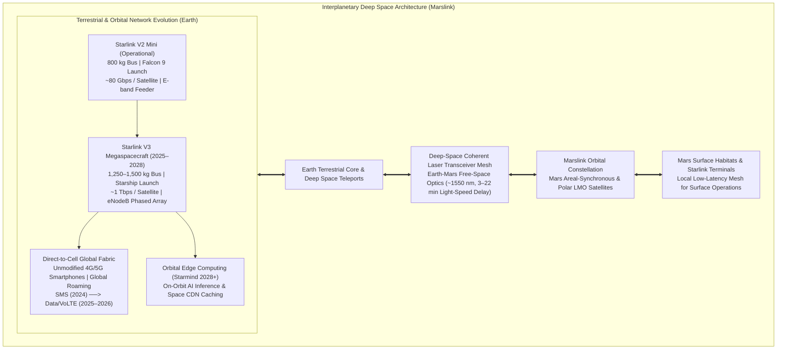

# 🚀 Future Technology Roadmap — Starship, V3 Platforms & Interplanetary Architecture

> *"The architectural horizon of low-Earth orbit megaconstellations extends far beyond terrestrial broadband: it forms the foundation for decentralized orbital edge computing, direct non-terrestrial cellular access, and interplanetary communication links connecting Earth with Martian outposts."*

---

## 1. Next-Generation Architectural Evolution

The technological evolution of the Starlink network transitions from Falcon 9-constrained V2 Mini satellites to Starship-deployed multi-terabit V3 platforms, global Direct-to-Cell cellular integration, and the interplanetary **Marslink** communications relay.



---

## 2. Starlink V3 Heavy Spacecraft: The Terabit Class

### 2.1 Technical Specifications and Bandwidth Scaling

```
STARLINK V3 SPACECRAFT SPECIFICATIONS:
━━━━━━━━━━━━━━━━━━━━━━━━━━━━━━━━━━━━━━━━━━━━━━━━━
  Launch System       : Exclusively deployed via SpaceX Starship (100–150t payload to LEO)
  Spacecraft Wet Mass : ~1,250 – 1,500 kg per bus
  Payload Dimensions  : High-aspect planar array (~3.5 m × 12 m deployed)
  Spacecraft per Flight: 60 to 100 satellites per Starship launch
  
  Communications Subsystems:
    - Aggregate Throughput : ~1.0 Tbps per satellite (approx. 10–12× throughput of V2 Mini)
    - User Transceivers    : Multi-beam True Time Delay (TTD) Active Phased Arrays (Ku-band & V-band)
    - Gateway Feeders      : High-capacity E-band (71–76 GHz) tracking arrays
    - Optical Crosslinks   : 4× Coherent Optical Laser Terminals (100+ Gbps per channel)
    - Direct-to-Cell Array : Large deployable eNodeB array (~25 m² aperture area)
    
  Constellation Aggregate Bandwidth Implications:
    - A constellation of 12,000 V3 satellites provides an aggregate on-orbit capacity of
      ~12,000 Terabits per second (12 Petabits/sec), vastly exceeding current transoceanic cable capacity.
━━━━━━━━━━━━━━━━━━━━━━━━━━━━━━━━━━━━━━━━━━━━━━━━━
```

### 2.2 Reusable Launch Economics with Starship

```
STARSHIP ECONOMIC TRANSFORMATION MATRIX:
━━━━━━━━━━━━━━━━━━━━━━━━━━━━━━━━━━━━━━━━━━━━━━━━━
  Performance Vector               Falcon 9 Block 5      SpaceX Starship (Full Reusability)
  ──────────────────────────────────────────────────────────────────────────
  Payload Mass to LEO              ~17,500 kg            100,000 – 150,000 kg
  Internal Launch Cost             ~$25–28 Million       ~$10–15 Million (marginal target)
  Satellites Delivered per Flight  ~20–23 (V2 Mini)      ~60–100 (Full V3 Heavy)
  Cost per Kilogram to LEO         ~$2,700 / kg          <$150 – $200 / kg
  Amortized Launch Cost / Satellite~$1,200,000 / sat     <$150,000 / sat
━━━━━━━━━━━━━━━━━━━━━━━━━━━━━━━━━━━━━━━━━━━━━━━━━
```

---

## 3. Direct-to-Cell Non-Terrestrial Network (NTN) Roadmap

Direct-to-Cell expands satellite connectivity to unmodified consumer handsets conforming to 3GPP Release 17/18 standards:

```
DIRECT-TO-CELL SERVICE DEPLOYMENT PHASES:
━━━━━━━━━━━━━━━━━━━━━━━━━━━━━━━━━━━━━━━━━━━━━━━━━
  Phase 1: Short Message Service (SMS / MMS) — Operational (2024):
    - Bilateral SMS emergency texting and messaging operationalized with T-Mobile US.
    - Low-bandwidth short burst data (<1 kbps) with sub-minute delivery latency.
    
  Phase 2: Low-Bitrate Packet Data — Commercial (2025):
    - Basic internet protocol (IP) packet transmission supporting mobile messaging apps,
      telemetry, and low-resolution situational mapping (2–4 Mbps shared cell throughput).
      
  Phase 3: High-Definition VoLTE Voice Telephony — Rollout (2025–2026):
    - Real-time packetized voice calls over satellite in remote terrestrial dead zones.
    - Jitter buffer optimization and forward error correction (FEC) managing Doppler shifts.
    
  Phase 4: Massive IoT & Autonomous Vehicle Telemetry (2026+):
    - Connecting agricultural sensors, oceanic maritime buoys, and autonomous transport fleets
      globally without specialized satellite modems.
━━━━━━━━━━━━━━━━━━━━━━━━━━━━━━━━━━━━━━━━━━━━━━━━━
```

---

## 4. Decentralized Orbital Edge Computing ("Starmind" Concept)

Placing distributed compute nodes directly on satellite buses enables real-time edge processing in space vacuum:

```
ORBITAL COMPUTE & EDGE AI ARCHITECTURE:
━━━━━━━━━━━━━━━━━━━━━━━━━━━━━━━━━━━━━━━━━━━━━━━━━
  1. REDUCTION OF DOWNLINK BOTTLENECKS:
     Earth observation sensors (multispectral optical, hyperspectral, and Synthetic Aperture Radar)
     generate petabytes of raw data. Onboard AI accelerators (e.g., custom TPUs / NPUs) process
     imagery in real-time, downlinking only actionable analytical vectors.
     
  2. DISTRIBUTED EDGE CONTENT DELIVERY (SPACE CDN):
     Frequently accessed static assets, cryptographic verification ledgers, and DNS roots cached
     directly on orbital nodes, allowing user terminals to fetch cached data in single-digit millisecond latency.
     
  3. COHERENT SPACECRAFT COLLABORATION:
     Orbital clusters executing federated machine learning algorithms for autonomous constellation
     rerouting, space situational awareness, and dynamic RF spectrum allocation.
━━━━━━━━━━━━━━━━━━━━━━━━━━━━━━━━━━━━━━━━━━━━━━━━━
```

---

## 5. Interplanetary Architecture: The Marslink Deep Space Network

To support human settlement of Mars, SpaceX plans to extend the Starlink telecommunications architecture into deep space:

```
MARSLINK ARCHITECTURAL PROFILE:
━━━━━━━━━━━━━━━━━━━━━━━━━━━━━━━━━━━━━━━━━━━━━━━━━
  Deep-Space Physical Constraints:
    - Earth-to-Mars Orbital Distance : 54.6 Million km (perihelion) to 401 Million km (aphelion)
    - One-Way Speed-of-Light Delay   : 3.03 minutes to 22.3 minutes
    
  Interplanetary Communications Stack:
    1. Mars Orbital Constellation:
       A constellation of Starlink-derived spacecraft in low Mars orbit (LMO) and areostationary orbit,
       providing continuous high-bandwidth telemetry and broadband to Martian surface bases.
       
    2. Deep-Space Optical Transceivers:
       Near-infrared coherent laser communication systems operating at 1550 nm equipped with
       high-aperture telescopes to bridge the multi-million kilometer interplanetary gulf.
       
    3. Delay-Tolerant Networking (DTN):
       Implementation of RFC 5050 / RFC 9171 Bundle Protocols with custody transfer,
       ensuring reliable data transmission across solar conjunctions and planetary occultations.
━━━━━━━━━━━━━━━━━━━━━━━━━━━━━━━━━━━━━━━━━━━━━━━━━
```

---

## 6. Financial Projections & Long-Term Valuation

```
FINANCIAL HORIZON (2025–2030 Projections):
━━━━━━━━━━━━━━━━━━━━━━━━━━━━━━━━━━━━━━━━━━━━━━━━━
  2025 (Actuals/Disclosures) : $11.4 Billion Revenue | $4.4 Billion Operating Income | 9.4M Subscribers
  2026 (Consensus Forecast)  : ~$16.0 Billion Revenue | ~12.5M Subscribers
  2027 (V3 Deployment Phase) : ~$22.0 Billion Revenue | ~18.0M Subscribers
  2028 (Full V3 Fleet Scale) : ~$28.5 Billion Revenue | ~25.0M Subscribers
  2030 (Long-Term Horizon)   : ~$40.0–$50.0 Billion Revenue | 50M–100M Subscribers (including Direct-to-Cell)
  
  Capital Markets & Enterprise Valuation:
    - Independent market analysts project a standalone Starlink enterprise valuation between
      $150 Billion and $220 Billion USD in the event of an initial public offering (IPO).
    - Operating cash flows fund continuous orbital replenishment while providing capital reserves
      for Starship planetary development.
━━━━━━━━━━━━━━━━━━━━━━━━━━━━━━━━━━━━━━━━━━━━━━━━━
```

---

*Previous: [History Timeline ←](./12-history-timeline.md) | Next: [India Perspective →](./14-india-perspective.md)*
