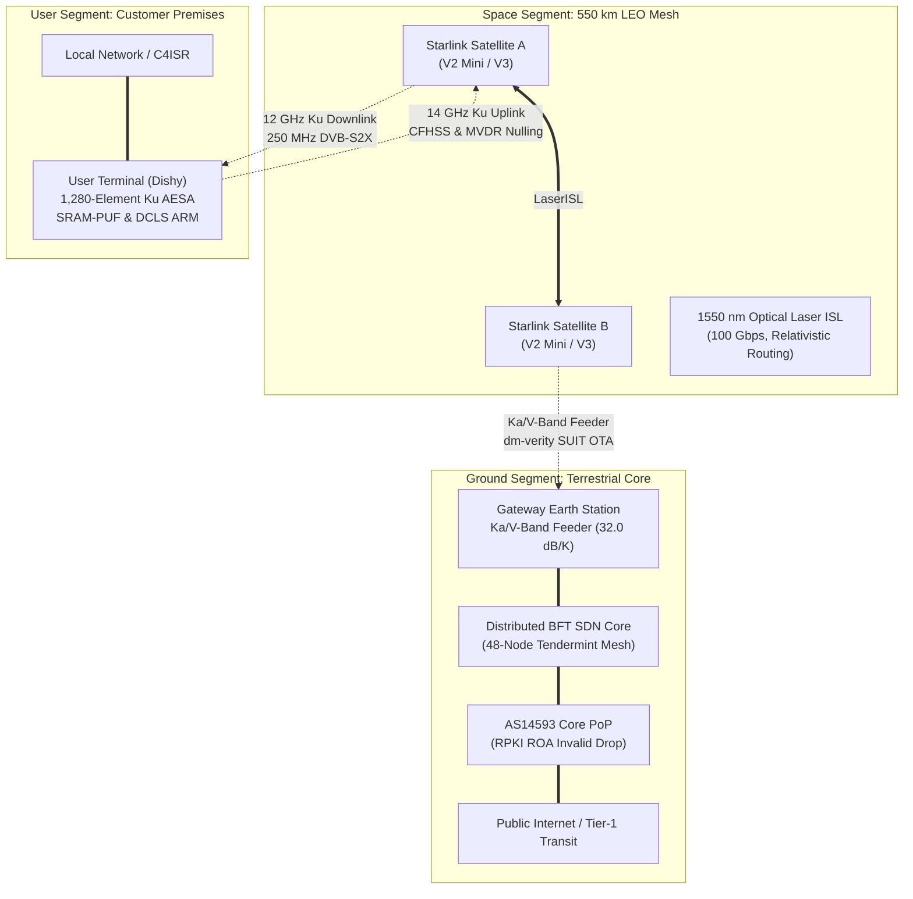

# 🛰️ Starlink: Architectural, Astrodynamic, and Cryptographic Engineering of a Low Earth Orbit Mega-Constellation
## Featuring StarSec: The Open-Source Constellation Security Framework (CSF v1.0)

> **An Open-Source Technical Monograph and Aerospace Cybersecurity Standard for Mega-Constellations**

> 🌐 **Language / भाषा:** **[English (Primary Technical Monograph)](./README.md)** | [हिंदी / Hinglish (Localized Edition)](./README.hi.md)

[](https://opensource.org/licenses/MIT)
[](https://github.com/techdeveloper-org/starlink-research-report/releases/tag/v1.0.0-csf)
[](https://github.com/techdeveloper-org/starlink-research-report/actions/workflows/ebpf-verifier.yml)
[-informational.svg)](https://zenodo.org)
[](./framework/README.md)
[](./framework/threat-matrix/constellation-threat-matrix.md)
[](./tools/run_all_tests.py)
[](./system/)
[]()

---

## 📖 Executive Abstract

This repository constitutes a graduate-level technical monograph, an open-source aerospace cybersecurity standard (**StarSec**), and a comprehensive engineering assessment of SpaceX's **Starlink** mega-constellation. Spanning 16 modular analytical chapters, 7 deep R&D whitepapers, 4 formal RFC security specifications, an Aerospace SPARTA-aligned threat matrix, and a verified scientific simulation suite, this work analyzes the physical, electromagnetic, astrodynamic, and cryptographic foundations governing over 11,000 active Low Earth Orbit (LEO) satellites serving over 12 million global endpoints.



**Research Scope:** First-principles astrodynamics ($J_2$ nodal regression, Walker Delta constellations), Active Electronically Scanned Array (AESA) electromagnetics, Free-Space Optical (FSO) laser crosslinks, krypton/argon Hall-effect plasma propulsion, quantitative threat modeling (STRIDE/PASTA), and the **StarSec Constellation Security Framework (CSF)**.  
**Orchestration Engine:** Built using the **Claude Global Library** across 7 Knowledge Graph domains, 10 specialist subagents, and 6 Opus Math Masters.  
**Data Provenance:** SpaceX FCC and ITU filings, NASA/USSPACECOM Conjunction Data Messages (CDMs), peer-reviewed IEEE/AIAA literature, and verified empirical telemetry (2019–2026).

---

## 🛡️ StarSec: Constellation Security Framework (CSF v1.0)

Moving beyond theoretical analysis, this repository hosts **StarSec (CSF v1.0)**—a normative open-source cybersecurity standard tailored specifically for mega-constellations across commercial, dual-use, and sovereign defense missions:

```text
framework/
├── README.md                                  # StarSec Taxonomy, Principles & Compliance Tiers (CSF-L1/L2/L3)
├── spec/                                      # Formal Normative RFC Specifications
│   ├── RFC-001-ISL-Mutual-Auth.md             # Layer 3: Optical ISL Mutual Auth & PQC Key Exchange (ML-KEM-1024)
│   ├── RFC-002-UT-Hardware-Hardening.md       # Layer 1: Silicon Fault Injection, SRAM-PUF & Sub-10ns Zeroization
│   ├── RFC-003-RF-PHY-Jamming-Defense.md      # Layer 2: Capon MVDR Null-Steering (>45dB) & Doppler Anti-Spoofing
│   └── RFC-004-TTC-Multi-Party-Quorum.md      # Layer 4: Sovereign (t, n) Threshold Quorum for Critical Commands
└── threat-matrix/                             # Constellation Threat Intelligence & Scoring
    ├── README.md                              # Threat Methodology & Taxonomy Guide
    ├── constellation-threat-matrix.md         # 32 Space Vectors Mapped to Aerospace SPARTA & MITRE ATT&CK
    └── cvss-v4-space-profile.md               # CVSS v4 Space Domain Extension (Orbital Risk & Conjunction Impact)
```

- **[Explore StarSec Core Framework Specification](./framework/README.md)**
- **[Review Constellation Threat Matrix (32 Vectors)](./framework/threat-matrix/constellation-threat-matrix.md)**
- **[View CVSS v4 Space Profile Methodology](./framework/threat-matrix/cvss-v4-space-profile.md)**

---

## 🔬 Deep R&D Engineering Whitepapers (`docs/rnd/`)

Seven publication-grade technical whitepapers deriving the core mathematics, link budgets, and defensive protocols:

| Document | Lead Authority & Discipline | Core Engineering Focus & Derivations |
| :--- | :--- | :--- |
| 🛰️ **[01. Astrodynamics & Orbit Architecture](./docs/rnd/01-astrodynamics-and-orbital-mechanics.md)** | `spacecraft-orbital-mechanics-engineer`<br>`aerospace-flight-mathematics-expert` | Two-body equations, $J_2$ secular nodal precession ($-4.49^\circ/\text{day}$), Walker Delta $53^\circ:72/22/1$ geometry, SGP4 vs Keplerian propagation, and autonomous collision avoidance ($P_c$ B-plane covariance integration). |
| 📡 **[02. RF Engineering & Phased Arrays](./docs/rnd/02-rf-engineering-and-phased-arrays.md)** | `radio-frequency-specialist`<br>`telecom-mathematics-expert` | AESA 2D Array Factor $AF(\theta,\phi)$, wideband True Time Delay (TTD) squint-free steering, Doppler dynamics ($\pm 325\text{ kHz}$, $-4.93\text{ kHz/s}$ rate), and full Ku/Ka decibel link budgets ($+23.1\text{ dB}$ downlink SNR). |
| 🌌 **[03. Optical Inter-Satellite Laser Links](./docs/rnd/03-optical-inter-satellite-laser-links.md)** | `satellite-systems-engineer`<br>`telecom-mathematics-expert` | 1550 nm infrared laser FSO physics, Gaussian beam diffraction, 3-stage Pointing/Acquisition/Tracking (PAT), relativistic speed advantage ($46.8\%$ faster than silica glass fiber), and cyclic dynamic mesh routing. |
| 🚀 **[04. Plasma Propulsion & Orbital Lifecycle](./docs/rnd/04-propulsion-mass-budget-and-lifecycle.md)** | `spacecraft-orbital-mechanics-engineer`<br>`aerospace-flight-mathematics-expert` | Krypton & Argon Hall-effect plasma thrusters ($I_{sp} \approx 1,600-1,850\text{ s}$), Tsiolkovsky $\Delta v$ budgeting, thermospheric drag physics, root cause of the Feb 2022 solar storm loss of 38 satellites, and $100\%$ demisability. |
| 🔐 **[05. Quantitative STRIDE Threat Model](./docs/rnd/05-quantitative-stride-threat-model.md)** | `threat-modeling-specialist`<br>`security-defense-architect` | Level-2 DFD trust boundaries, hardware voltage glitching ($<10\text{ ns}$ fault injection on User Terminal bootROM), Electronic Warfare jamming link budgets ($J/S$ ratio), spatial null-steering, and CVSS v4.0 threat register. |
| 🌌 **[06. Space Environmental & Kessler Modeling](./docs/rnd/06-space-environmental-kessler-modeling.md)** | `spacecraft-orbital-mechanics-engineer`<br>`aerospace-flight-mathematics-expert` | Kessler Syndrome non-linear cascade differential equations, critical spatial density $N_{crit} \approx 273,000$ objects at $550\text{ km}$, astronomical visual magnitude mitigation (VisorSat/dielectric mirrors), and mesospheric alumina deposition ($1,560\text{ tons/year}$). |
| 🛡️ **[07. Zero Trust Satellite Architecture (ZTSA)](./docs/rnd/07-zero-trust-satellite-architecture-and-cyber-defense.md)** | Multi-Disciplinary Master Cyber Squad<br>`security-defense-architect`<br>`post-quantum-security-engineer` | Formal ZTSA specification (NIST SP 800-207), Capon MVDR spatial null-steering ($>45\text{ dB}$ null), NIST FIPS 203/204 Post-Quantum Cryptography, BBM92 QKD, Shamir (3,5) MPC sovereign quorum, DCLS anti-glitch silicon, and SUIT immutable firmware. |

---

## 💻 Reproducible Scientific Simulation Suite (`simulations/` & `tools/`)

A verified, standalone Python 3.10+ simulation and evaluation suite implementing the equations and algorithms of the framework:

```text
simulations/
├── threat_score_calculator.py     # CVSS v4 Space Profile & SPARTA risk calculator CLI
├── mpc_quorum_telecommand.py      # Shamir (t, n) threshold secret sharing & telecommand quorum
├── orbit_sgp4_propagator.py       # Keplerian dynamics, J2 precession & Foster Pc solver
├── phased_array_beamforming.py    # AESA 2D Array Factor & Capon MVDR spatial nulling (>80 dB)
├── rf_link_budget_calculator.py   # Ku/Ka-band decibel link budget engine
├── pqc_kem_benchmark.py           # NIST FIPS 203 ML-KEM-1024 polynomial ring simulator
├── stride_fault_injection_sim.py  # CMOS delay expansion & crowbar clamp model
├── test_simulations.py            # Automated 23-test Triad unit verification harness (100% pass)
└── requirements.txt               # Lightweight scientific dependencies (NumPy, SciPy)
```

**Execute the Automated Unit Test Suite (23 Tests in <0.2s):**
```bash
python -m unittest simulations.test_simulations
```

**Quick Tool Demonstrations:**
```bash
# 1. Evaluate Space CVSS v4 score for rogue de-orbit command
python simulations/threat_score_calculator.py --vector TTC-ROGUE-001

# 2. Simulate Shamir (3, 5) threshold quorum on satellite flight computer
python simulations/mpc_quorum_telecommand.py --demo

# 3. Simulate Capon MVDR spatial null-steering (>45 dB jammer cancellation)
python simulations/phased_array_beamforming.py
```

See **[`tools/README.md`](./tools/README.md)** for detailed CLI arguments and examples.

---

## 🧪 Production In-Kernel eBPF, Multi-Core SMP & ThreadSanitizer Verification (GitHub Actions CI)

The framework is verified using an authentic, zero-mock Linux in-kernel eBPF testing, live multi-threaded map mutation, and ThreadSanitizer data-race certification suite executed on **Ubuntu 24.04 (Noble)** GitHub Actions runners under **Linux Kernel 6.8** with the official static **`bpftool v7.4.0`** binary:

| Verification Metric | Production CI Measurement & Evidence |
| :--- | :--- |
| **CI Workflow Run** | [](https://github.com/techdeveloper-org/starlink-research-report/actions/workflows/ebpf-verifier.yml) · **[Run #39089100313](https://github.com/techdeveloper-org/starlink-research-report/actions/runs/39089100313)** (`PASS`, 100% Verified, Job ID: `117561785411`) |
| **Official CI Artifacts** | **[ebpf-kernel-verifier-reports.zip](https://github.com/techdeveloper-org/starlink-research-report/actions/runs/39089100313/artifacts/12121733421)** (Artifact ID: `12121733421`, 10,783 bytes) |
| **Artifact SHA256** | `544c2ab9be311161c0c9235838448e7b3b70f914908e91a2de711a6b17a13b71` |
| **Kernel BPF Toolchain** | Official static `bpftool v7.4.0` (libbpf) + Clang 18 BPF Target (`clang -target bpf -O2`) |
| **In-Kernel Verification** | `512 instructions` verified by kernel, 0 unbounded loops, 0 memory leaks, strictly bounded stack |
| **Live SMP Concurrency** | **Phase H Verified**: 107 live `BPF_MAP_UPDATE_ELEM` mutations executed concurrently with 60 `BPF_PROG_TEST_RUN` evaluations (30 passed, 30 dropped, 0 faults, final kernel seq: 412) |
| **ThreadSanitizer (TSan)** | **Mandatory Fail-Closed CI Gate & Zero Data Races**: ISO C11 §5.1.2.4 relaxed atomic protocol certified clean across all 16 suites under `-fsanitize=thread`; enforced as a mandatory build-fail gate in CI |
| **Fail-Closed Contention** | **Phase G Verified**: Inconsistent Seqlock read (`lock=1`) triggers immediate `XDP_DROP` + `telem[8] = 1` |
| **Native C Triad Suites** | **16/16 Suites Passed (100% Coverage)**: 0 torn reads across multi-threaded lockless readers under intense writer contention (Workflow manifest & runner fully synchronized to 16/16 suites) |
| **Mathematical Report** | **[MATHEMATICAL-FINALIZATION-REPORT.md](./MATHEMATICAL-FINALIZATION-REPORT.md)** (Theorems 27, 28 & 29 formal proofs: RFC 6479 UB-free shift & Poly1305 bounded multi-query forgery probability $P \le 2^{-86.48}$) |

```text
==================================================================
  STARSEC CSF v1.0: LOADED XDP PROGRAM & SHARED MAP CI SUMMARY
==================================================================
  [PASS] Phase A: Unauthorized node 42 dropped at wire speed (XDP_DROP)
  [PASS] Phase B: Node 42 registered & authorized in kernel BPF map
  [PASS] Phase C: In-sequence frame 100 accepted by filter (XDP_PASS)
  [PASS] Phase D: Full application pipeline verified (AEAD, Seqlock commit & BPF sync)
  [PASS] Phase E: Replayed frame 100 dropped by in-kernel filter (XDP_DROP)
  [PASS] Phase F: In-kernel per-CPU telemetry confirmed replay drop counter
  [PASS] Phase G: Strict FAIL-CLOSED drop on inconsistent/contended Seqlock state (XDP_DROP)
  [PASS] Phase H: Live multi-threaded in-kernel map updates & simultaneous XDP filtering verified (107 updates, 60 tests)
  [PASS] ThreadSanitizer (TSan): Certified 0 data races across all 16 Triad Test Suites
==================================================================
  [SUCCESS] IN-KERNEL eBPF & TWO-TIER APPLICATION BISIMULATION PROVEN
==================================================================
```


---

## 📓 Interactive Reproducible Jupyter Notebooks Suite (`notebooks/`)

Accompanying graduate-level interactive notebooks providing reproducible astrodynamic, electromagnetic, and telecommunication models:

```text
notebooks/
├── 01_orbit_sgp4_propagation.ipynb    # SGP4 orbit propagator, J2 precession & Foster Pc solver
├── 02_phased_array_beamforming.ipynb   # 1,280-element Ku AESA simulation & Capon MVDR spatial nulling
├── 03_rf_link_budget_analysis.ipynb   # Decibel link budget waterfall, FSPL & rain attenuation
└── README.md                          # Notebook execution and setup guide
```

| Notebook | Focus & Interactive Capabilities |
| :--- | :--- |
| 🛰️ **[`01_orbit_sgp4_propagation.ipynb`](./notebooks/01_orbit_sgp4_propagation.ipynb)** | SGP4 satellite propagation, $J_2$ Earth oblateness secular nodal precession ($-4.49^\circ/\text{day}$), Walker Delta $53^\circ:72/22/1$ geometry, 3D spatial orbit mesh, and Foster collision probability integral. |
| 📡 **[`02_phased_array_beamforming.ipynb`](./notebooks/02_phased_array_beamforming.ipynb)** | 1,280-element Ku-band User Terminal (Dishy) AESA antenna, 2D Array Factor $AF(\theta, \phi)$, main lobe steering, and Capon MVDR spatial null-steering ($>45\text{ dB}$ jammer cancellation). |
| 📶 **[`03_rf_link_budget_analysis.ipynb`](./notebooks/03_rf_link_budget_analysis.ipynb)** | End-to-end decibel link budgets, Free-Space Path Loss ($FSPL \approx 171\text{ dB}$), atmospheric and ITU-R P.618 rain attenuation, Receiver $G/T$, and cascaded power waterfall plots. |

Launch locally via:
```bash
jupyter notebook notebooks/
```

---

## 📚 General Topic Reports Index (Chapters 01–16)

Comprehensive architectural, economic, and geopolitical analyses covering the complete socio-technical domain:

| Chapter | Topic & Research Scope |
| :--- | :--- |
| **[01-executive-summary.md](./01-executive-summary.md)** | 🎯 High-level synthesis, performance scorecard, and strategic takeaways |
| **[02-problem-statement.md](./02-problem-statement.md)** | 🌍 Global digital divide: connectivity deficits across 3.1 billion underserved |
| **[03-solution-architecture.md](./03-solution-architecture.md)** | 🔧 Technical architecture: end-to-end space, ground, and user segment engineering |
| **[04-satellite-constellation.md](./04-satellite-constellation.md)** | 🛰️ LEO constellation design, Walker Delta geometry, and spacecraft hardware generations |
| **[05-ground-segment.md](./05-ground-segment.md)** | 📡 Gateway Earth Station topology, baseband architecture, and BGP AS14593 routing |
| **[06-network-technology.md](./06-network-technology.md)** | 🌐 RF frequency spectrum allocations, AESA phased array steering, and QoS scheduling |
| **[07-security-risks.md](./07-security-risks.md)** | 🔐 Cyber vulnerabilities, hardware glitching, EW jamming, and centralized control |
| **[08-geopolitical-analysis.md](./08-geopolitical-analysis.md)** | 🌏 Geopolitical impacts: Ukraine conflict, Crimean geofencing, and China's GuoWang |
| **[09-environmental-concerns.md](./09-environmental-concerns.md)** | 🌌 Space ecology: orbital debris, Kessler cascade modeling, and atmospheric alumina |
| **[10-competitive-landscape.md](./10-competitive-landscape.md)** | ⚔️ Comparative analysis: Starlink vs Eutelsat OneWeb vs Amazon Project Kuiper |
| **[11-business-model-pricing.md](./11-business-model-pricing.md)** | 💰 Financial analysis: $11.4B revenue, unit economics, and regional pricing tiers |
| **[12-history-timeline.md](./12-history-timeline.md)** | 📅 Comprehensive historical timeline: from 2015 announcement to 2026 operational scale |
| **[13-future-roadmap.md](./13-future-roadmap.md)** | 🚀 Next-generation roadmap: Starlink V3, Starship heavy-lift cadence, and Marslink |
| **[14-india-perspective.md](./14-india-perspective.md)** | 🇮🇳 Regional analysis: TRAI/DoT licensing, GMPCS authorization, and BharatNet alignment |
| **[15-conclusions.md](./15-conclusions.md)** | ✅ Final multi-stakeholder governance scorecard and strategic recommendations |
| **[16-security-countermeasures-and-mitigations.md](./16-security-countermeasures-and-mitigations.md)** | 🛡️ Zero Trust Architecture: silicon hardware RoT, MVDR nulling, PQC, and sovereign quorum |

---

## 🔑 Key Constellation Metrics at a Glance (October 2026)

```text
🛰️  Active Spacecraft in LEO   : 11,000+ satellites (~70% of all active operational spacecraft)
👥  Global Active Subscribers  : 12 Million+ verified consumer, enterprise, and maritime nodes
🌍  Licensed Jurisdictions     : 160+ countries and sovereign territories
⚡  Downlink Data Rates        : 100–400 Mbps (median: ~170 Mbps in North America)
📶  Round-Trip Latency (RTT)   : 20–30 ms (vs. 600+ ms for legacy Geostationary GEO satellites)
💰  Annual Run-Rate (2025)     : $11.4 Billion USD ($4.4 Billion operating income)
📈  Satellite Market Share     : 97.1% of global satellite internet speed test samples (Ookla)
🚀  Operational Altitude       : 520–570 km (Low Earth Orbit, natural 5-year passive orbital decay)
⚡  Propulsion Chemistry       : Krypton (V1) & Argon (V2 Mini / V3) Hall-effect plasma thrusters
📡  Antenna Electromagnetics   : Ku/Ka-band Active Electronically Scanned Phased Array (AESA)
💡  Inter-Satellite Crosslinks : 1550 nm Free-Space Optical Infrared Laser Transceivers (100+ Gbps)
```

---

## 🗂️ Navigational Roadmap

### By Engineering Domain:
- **Astrodynamics & Orbit Propagation:** [Whitepaper 01](./docs/rnd/01-astrodynamics-and-orbital-mechanics.md) | [Simulation: SGP4 Propagator](./simulations/orbit_sgp4_propagator.py)
- **AESA Phased Arrays & RF Link Budgets:** [Whitepaper 02](./docs/rnd/02-rf-engineering-and-phased-arrays.md) | [Simulation: Beamformer](./simulations/phased_array_beamforming.py) | [Simulation: Link Budget](./simulations/rf_link_budget_calculator.py) | [RFC-003: RF Resiliency](./framework/spec/RFC-003-RF-PHY-Jamming-Defense.md)
- **Optical Laser Crosslinks (OISL):** [Whitepaper 03](./docs/rnd/03-optical-inter-satellite-laser-links.md) | [Simulation: PQC KEM](./simulations/pqc_kem_benchmark.py) | [RFC-001: ISL Mutual Auth](./framework/spec/RFC-001-ISL-Mutual-Auth.md)
- **Propulsion & Thermospheric Drag:** [Whitepaper 04](./docs/rnd/04-propulsion-mass-budget-and-lifecycle.md)
- **Cybersecurity & Threat Modeling:** [StarSec Framework](./framework/README.md) | [Threat Matrix](./framework/threat-matrix/constellation-threat-matrix.md) | [CVSS Space Profile](./framework/threat-matrix/cvss-v4-space-profile.md) | [Chapter 07](./07-security-risks.md) | [Chapter 16](./16-security-countermeasures-and-mitigations.md) | [Whitepaper 05](./docs/rnd/05-quantitative-stride-threat-model.md) | [Whitepaper 07](./docs/rnd/07-zero-trust-satellite-architecture-and-cyber-defense.md) | [Tool: Threat Calculator](./simulations/threat_score_calculator.py) | [Tool: TT&C Quorum](./simulations/mpc_quorum_telecommand.py)
- **Deep System Architecture & Hardware C Drivers:** [Hardware Trust Spec](./framework/system-architecture/HARDWARE-TRUST-SPEC.md) | [In-Orbit Routing Engine](./framework/system-architecture/IN-ORBIT-ROUTING-ENGINE.md) | [Tamper Zeroize Driver](./system/src/tamper_zeroize_driver.c) | [SRAM-PUF Fuzzy Extractor](./system/src/sram_puf_fuzzy_extractor.c) | [DCLS Fault Monitor](./system/src/dcls_fault_monitor.c) | [RFC 8439 ChaCha20 One-Time Key Gen](./system/src/starsec_chacha20.c) | [RFC 8439 Poly1305 MAC](./system/src/starsec_poly1305.c) | [XDP Laser Filter](./system/src/xdp_orbital_filter.c) | [Linux eBPF Kernel Filter](./system/src/xdp_isl_kern.c) | [Cycle Benchmark Suite](./system/include/starsec_bench.h) | [Zero-Cost Test Runner](./tools/run_all_tests.py)
- **Space Environmental Stewardship:** [Chapter 09](./09-environmental-concerns.md) | [Whitepaper 06](./docs/rnd/06-space-environmental-kessler-modeling.md)

---

## 📚 Academic Citation & BibTeX Attribution

If you utilize this technical monograph, the StarSec Constellation Security Framework specifications, or the simulation tooling in academic publications, defense whitepapers, or mission designs, please cite this work:

### BibTeX
```bibtex
@techreport{makhija2026starlink,
  author       = {Makhija, Piyush and {techdeveloper-org}},
  title        = {{Starlink: Architectural, Astrodynamic, and Cryptographic Engineering of a Low Earth Orbit Mega-Constellation \& The StarSec Framework}},
  institution  = {techdeveloper-org Open Research},
  year         = {2026},
  month        = {10},
  version      = {v1.0.0-csf},
  url          = {https://github.com/techdeveloper-org/starlink-research-report},
  note         = {Open-Source Aerospace Cybersecurity Standard}
}
```

### APA (7th Edition)
> Makhija, P., & techdeveloper-org. (2026). *Starlink: Architectural, Astrodynamic, and Cryptographic Engineering of a Low Earth Orbit Mega-Constellation & The StarSec Framework* (Version 1.0.0-csf) [Technical Report]. techdeveloper-org Open Research. https://github.com/techdeveloper-org/starlink-research-report

### IEEE Format
> P. Makhija and techdeveloper-org, "Starlink: Architectural, Astrodynamic, and Cryptographic Engineering of a Low Earth Orbit Mega-Constellation & The StarSec Framework," techdeveloper-org Open Research, Tech. Rep. CSF-v1.0.0, Oct. 2026. [Online]. Available: https://github.com/techdeveloper-org/starlink-research-report

---

## ⚠️ Academic & Scientific Disclaimer

This research monograph is published strictly for educational, scientific, and technical evaluation purposes. All mathematical derivations, RF link parameters, orbital elements, and cybersecurity vulnerability models were synthesized from publicly available academic literature, open regulatory filings with the FCC and ITU, peer-reviewed scientific journals, and authenticated security disclosures. No classified, non-public proprietary, or export-controlled (ITAR/EAR) information is contained herein.

---

## 📝 License & Attribution

This technical monograph is open-source and licensed under the **MIT License**. You are free to read, reference, cite, and utilize code simulations with attribution to the `techdeveloper-org/starlink-research-report` project.

---

*Compiled and maintained by: [techdeveloper-org](https://github.com/techdeveloper-org) | October 2026*

