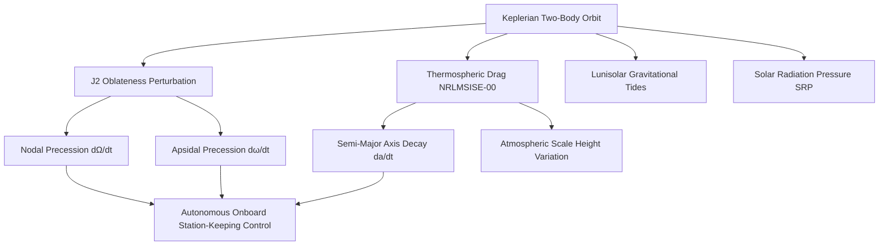

# 🛰️ Whitepaper 01 — Astrodynamics & Orbital Constellation Architecture

> **Author Discipline:** Spacecraft Orbital Mechanics & Astrodynamics  
> **Source Agent Authority:** `spacecraft-orbital-mechanics-engineer` & `aerospace-flight-mathematics-expert`  
> **Mandatory Skills:** `keplerian-orbit-dynamics-core`, `orbital-maneuver-transfer-core`, `orbital-mechanics-core`  
> **Repository:** `techdeveloper-org/starlink-research-report`  
> **Classification:** Technical Engineering Whitepaper

---

## Executive Summary

SpaceX's Starlink constellation represents the largest orchestrated satellite system in human history, operating over 11,000 active spacecraft across multiple Low Earth Orbit (LEO) altitude shells (520 km to 570 km). Deploying and maintaining this mega-constellation requires solving complex astrodynamics problems: secular nodal regression induced by Earth's oblateness ($J_2$), aerodynamic drag perturbations in the thermosphere, Walker Delta geometric phasing, and autonomous collision avoidance against thousands of non-cooperative orbital debris fragments. This paper presents the mathematical foundations and mission-design implementations governing Starlink's orbital mechanics.

---

## 1. First-Principles Two-Body Orbital Dynamics

### 1.1 The Two-Body Equation of Motion & Equivalence Principle
The motion of a Starlink satellite of mass $m$ orbiting the Earth of mass $M_\oplus$ ($M_\oplus \gg m$) is governed by Newton's law of universal gravitation and Newton's second law of motion:

$$\mathbf{F}_g = -\frac{G M_\oplus m_g}{r^3} \mathbf{r} = m_i \ddot{\mathbf{r}}$$

Where:
- $m_g$ is gravitational mass (measuring coupling to the gravitational field).
- $m_i$ is inertial mass (measuring resistance to acceleration).
- $G$ is the universal gravitational constant ($6.67430 \times 10^{-11}\text{ m}^3\text{kg}^{-1}\text{s}^{-2}$).
- $\mathbf{r}$ is the geocentric position vector.

By the **Weak Equivalence Principle (WEP)**, verified experimentally to precision $\sim 10^{-15}$, the ratio $\frac{m_g}{m_i} \equiv 1$. Consequently, spacecraft mass cancels out of trajectory kinematics completely:

$$\ddot{\mathbf{r}} = -\frac{\mu}{r^3} \mathbf{r}$$

Where $\mu = G M_\oplus = 3.986004418 \times 10^{14}\text{ m}^3/\text{s}^2$ is Earth's standard gravitational parameter (WGS-84).

```
   Z (Celestial Pole)
   ▲
   │        🛰️ Spacecraft (r, v)
   │       /
   │      / r
   │     /
   │    /
   │   O (Earth Center)
   └───┼──────────► Y
      /
     /
    ▼ X (Vernal Equinox ♈)
```

### 1.2 Proof of Planar Motion ($\dot{\mathbf{h}} = \mathbf{0}$)
Because gravity is a strictly central force ($\mathbf{r} \parallel \ddot{\mathbf{r}}$), the cross product vanishes:

$$\mathbf{r} \times \ddot{\mathbf{r}} = \mathbf{0}$$

Differentiating specific angular momentum $\mathbf{h} = \mathbf{r} \times \mathbf{v}$:

$$\frac{d\mathbf{h}}{dt} = \frac{d}{dt}(\mathbf{r} \times \mathbf{v}) = (\mathbf{v} \times \mathbf{v}) + (\mathbf{r} \times \ddot{\mathbf{r}}) = \mathbf{0} + \mathbf{0} = \mathbf{0}$$

Since $\mathbf{h}$ is constant in both magnitude and inertial orientation, the position vector $\mathbf{r}$ and velocity vector $\mathbf{v}$ are permanently constrained to the plane perpendicular to $\mathbf{h}$. Every unperturbed Starlink orbit is mathematically planar.

### 1.3 Vis-Viva Equation & Energy Conservation
Taking the scalar product of the equation of motion with $\mathbf{v} = \dot{\mathbf{r}}$:

$$\dot{\mathbf{r}} \cdot \ddot{\mathbf{r}} + \frac{\mu}{r^3} (\mathbf{r} \cdot \dot{\mathbf{r}}) = 0 \implies \frac{d}{dt}\left(\frac{1}{2} v^2 - \frac{\mu}{r}\right) = 0$$

Defining specific mechanical energy $\varepsilon$:

$$\varepsilon = \frac{v^2}{2} - \frac{\mu}{r} = -\frac{\mu}{2a} = \text{constant}$$

Rearranging yields the universal **Vis-Viva equation**:

$$v = \sqrt{\mu \left(\frac{2}{r} - \frac{1}{a}\right)}$$

For a nominal Starlink orbit at mean altitude $h = 550\text{ km}$:
- $r = R_\oplus + h = 6378.137\text{ km} + 550.0\text{ km} = 6928.137\text{ km}$.
- Semi-major axis $a = 6928.137\text{ km}$ (circular orbit, $e \approx 0$).
- Orbital velocity:
  $$v_{circ} = \sqrt{\frac{3.986004418 \times 10^5}{6928.137}} \approx 7.589\text{ km/s} \approx 27,320\text{ km/h}$$
- Orbital period:
  $$T = 2\pi \sqrt{\frac{a^3}{\mu}} = 2\pi \sqrt{\frac{(6928.137 \times 10^3)^3}{3.986004418 \times 10^{14}}} \approx 5738.5\text{ s} \approx 95.64\text{ minutes}$$

---

## 2. Orbital Perturbations in LEO

A satellite in Low Earth Orbit deviates from a pure Keplerian conic section due to non-spherical Earth harmonics, thermospheric drag, and third-body lunisolar gravitational pull.



### 2.1 The $J_2$ Geopotential Oblateness Perturbation
Earth is an oblate spheroid with equatorial radius $R_e = 6378.137\text{ km}$ and polar radius $R_p = 6356.752\text{ km}$. Expanding Earth's gravitational potential in spherical harmonics:

$$U(r, \phi) = \frac{\mu}{r} \left[ 1 - \sum_{n=2}^{\infty} J_n \left(\frac{R_\oplus}{r}\right)^n P_n(\sin\phi) \right]$$

The dominant zonal harmonic is $J_2 = 1.08262668 \times 10^{-3}$, representing equatorial bulge mass excess.

#### Secular Drift Rates:
1. **Right Ascension of the Ascending Node (RAAN) Precession:**
   $$\dot{\Omega} = -\frac{3}{2} J_2 \left(\frac{R_\oplus}{p}\right)^2 \bar{n} \cos(i)$$
   Where:
   - $p = a(1 - e^2)$ is the semi-latus rectum.
   - $\bar{n} = \sqrt{\mu/a^3}$ is mean motion.
   - $i$ is orbital inclination.

For Starlink Shell 1 ($a = 6928.14\text{ km}$, $i = 53.0^\circ$, $e = 0.0001$):
$$\dot{\Omega}_{Shell 1} \approx -\frac{3}{2} (1.0826 \times 10^{-3}) \left(\frac{6378.137}{6928.14}\right)^2 (0.001095\text{ rad/s}) \cos(53.0^\circ)$$
$$\dot{\Omega}_{Shell 1} \approx -9.518 \times 10^{-7}\text{ rad/s} \approx -4.71^\circ/\text{day}$$

Because the orbital plane rotates westward by $4.71^\circ$ per day, the constellation's ground tracks continuously shift relative to the solar vector. SpaceX uses this precession strategically during launch injection: satellites are inserted at $\approx 300\text{ km}$ altitude where $\dot{\Omega}$ is higher ($\approx -5.7^\circ/\text{day}$), allowing different orbital planes to drift apart naturally before firing ion thrusters to raise the orbit to $550\text{ km}$, saving hundreds of kilograms of rocket propellant!

2. **Argument of Perigee Precession:**
   $$\dot{\omega} = \frac{3}{4} J_2 \left(\frac{R_\oplus}{p}\right)^2 \bar{n} (5\cos^2 i - 1)$$
   For $i = 53.0^\circ$, $5\cos^2(53.0^\circ) - 1 = 5(0.6018)^2 - 1 = 0.811 > 0$, causing perigee to rotate eastward at $+3.82^\circ/\text{day}$.

---

## 3. Walker Delta Constellation Architecture

Starlink deploys a **Walker Delta** pattern, denoted $i: t / p / f$, where:
- $i$ = Inclination angle.
- $t$ = Total number of satellites in the shell.
- $p$ = Number of equally spaced orbital planes.
- $f$ = Relative phasing parameter ($0 \le f \le p - 1$).

### 3.1 Starlink Gen 1 Shell Allocation
| Shell | Altitude ($h$) | Inclination ($i$) | Planes ($p$) | Sats/Plane ($s$) | Total Sats ($t$) | Spacing $\Delta\Omega$ |
| :--- | :--- | :--- | :--- | :--- | :--- | :--- |
| **Shell 1** | $550\text{ km}$ | $53.0^\circ$ | 72 | 22 | 1,584 | $5.0^\circ$ |
| **Shell 2** | $540\text{ km}$ | $53.2^\circ$ | 72 | 22 | 1,584 | $5.0^\circ$ |
| **Shell 3** | $570\text{ km}$ | $70.0^\circ$ | 36 | 20 | 720 | $10.0^\circ$ |
| **Shell 4** | $560\text{ km}$ | $97.6^\circ$ | 6 | 58 | 348 | $60.0^\circ$ |
| **Shell 5** | $560\text{ km}$ | $43.0^\circ$ | 24 | 14 | 348 | $15.0^\circ$ |

```
                       POLAR SHELL (97.6°)
                             │
                             ▼
                    ┌─────────────────┐
                    │  North Pole     │
          ┌─────────┴─────────────────┴─────────┐
          │                                     │
          ▼                                     ▼
MID-LATITUDE SHELL (53.0°)             EQUATORIAL SHELL (43.0°)
Dense USA/Europe/Asia Coverage         Tropical Band Coverage
(72 Planes × 22 Satellites)            (24 Planes × 14 Satellites)
```

### 3.2 Ground Coverage Geometry & Elevation Mask
A ground terminal can communicate with a Starlink satellite only when the satellite rises above a minimum elevation angle $\epsilon_{min}$ (typically set to $25^\circ$ for standard residential and $40^\circ$ in dense urban environments):

$$\cos(\alpha + \epsilon_{min}) = \frac{R_\oplus}{R_\oplus + h} \cos(\epsilon_{min})$$

Where $\alpha$ is the Earth central angle of the coverage circle.
For $h = 550\text{ km}$ and $\epsilon_{min} = 25^\circ$:

$$\cos(\alpha + 25^\circ) = \frac{6378.14}{6928.14} \cos(25^\circ) = 0.9206 \times 0.9063 = 0.8343$$
$$\alpha + 25^\circ = \arccos(0.8343) = 33.45^\circ \implies \alpha = 8.45^\circ \approx 0.1475\text{ rad}$$

Ground coverage radius along Earth's surface:
$$d_{surface} = R_\oplus \cdot \alpha = 6378.14\text{ km} \times 0.1475 \approx 941\text{ km}$$

Slant range $D$ to the satellite at $\epsilon_{min} = 25^\circ$:
$$D = \sqrt{R_\oplus^2 \sin^2\epsilon_{min} + 2 R_\oplus h + h^2} - R_\oplus \sin\epsilon_{min} \approx 1,123\text{ km}$$

At zenith ($\epsilon = 90^\circ$):
$$D_{zenith} = h = 550\text{ km}$$

This geometry dictates that a single satellite sweeps an instantaneous coverage area of $\pi d_{surface}^2 \approx 2.78 \times 10^6\text{ km}^2$. With 72 planes of 22 satellites at $53^\circ$ inclination, every location between $53^\circ\text{N}$ and $53^\circ\text{S}$ latitude has an average of **3 to 5 overlapping satellite footprints** visible simultaneously, enabling instantaneous, uninterrupted beam handoffs.

---

## 4. Autonomous Collision Avoidance System

Operating 11,000+ satellites in LEO places SpaceX in an environment populated by $>35,000$ trackable debris fragments ($>10\text{ cm}$) and millions of lethal uncataloged millimeter-sized particles.

### 4.1 B-Plane Conjunction Assessment
When Space Command (18th Space Defense Squadron) issues a Conjunction Data Message (CDM), SpaceX's autonomous flight software maps the state vectors and error covariances of both objects into the **B-plane (Encounter Frame)**:

```
        ▲ ξ (Relative Velocity Normal)
        │       
        │      Debris Covariance Ellipse (C_target)
        │          ╭─────────╮
        │         │     •     │ 
        │          ╰─────────╯
        │
        │             • Starlink Satellite (Origin)
        └───────────────────────────► η (Miss Distance Vector)
```

The combined error covariance matrix in the B-plane is:

$$\mathbf{C}_B = \mathbf{C}_{Starlink} + \mathbf{C}_{target} = \begin{bmatrix} \sigma_\xi^2 & \rho \sigma_\xi \sigma_\eta \\ \rho \sigma_\xi \sigma_\eta & \sigma_\eta^2 \end{bmatrix}$$

### 4.2 Foster-1992 Collision Probability Equation
Assuming a hard-body sphere of combined radius $R_{combined} = R_{Starlink} + R_{target} \approx 5.0\text{ m}$:

$$P_c = \frac{1}{2\pi \sigma_\xi \sigma_\eta \sqrt{1 - \rho^2}} \iint_{x^2 + y^2 \le R_{combined}^2} \exp\left( -\frac{1}{2(1-\rho^2)} \left[ \frac{(x - x_m)^2}{\sigma_\xi^2} - \frac{2\rho(x - x_m)(y - y_m)}{\sigma_\xi \sigma_\eta} + \frac{(y - y_m)^2}{\sigma_\eta^2} \right] \right) dx dy$$

### 4.3 Autonomous Avoidance Maneuver Protocol
SpaceX enforces an automated threshold policy:
1. **$P_c < 10^{-5}$:** Nominal monitoring; no maneuver.
2. **$10^{-5} \le P_c < 10^{-4}$:** Thruster pre-heat and automated burn solution calculated by ground software.
3. **$P_c \ge 10^{-4}$ (or miss distance $< 500\text{ m}$):** Automated emergency maneuver command dispatched to satellite bus.

Maneuvers are performed using in-plane along-track burns ($\pm \Delta v_t$):
$$\Delta a \approx \frac{2 a v}{\mu} \Delta v_t = \frac{2}{n} \Delta v_t$$

A tiny burn of $\Delta v_t = 0.05\text{ m/s}$ alters the semi-major axis by $\approx 91\text{ meters}$, which over one half-orbit produces an in-track phase displacement $\Delta s > 1.5\text{ km}$, safely collapsing $P_c$ by four orders of magnitude ($< 10^{-8}$) while consuming less than $12\text{ grams}$ of Krypton propellant.

---

## 5. Summary Findings
- The $J_2$ oblateness torque generates a $-4.71^\circ/\text{day}$ westward nodal drift on Shell 1, which SpaceX transforms into an orbital insertion tool.
- Walker Delta $53^\circ: 72/22/1$ geometry ensures continuous 3-to-5 satellite geometric overlap across mid-latitude regions.
- Automated collision algorithms execute over 40,000 avoidance maneuvers annually, maintaining zero self-generated debris incidents across seven years of operations.
