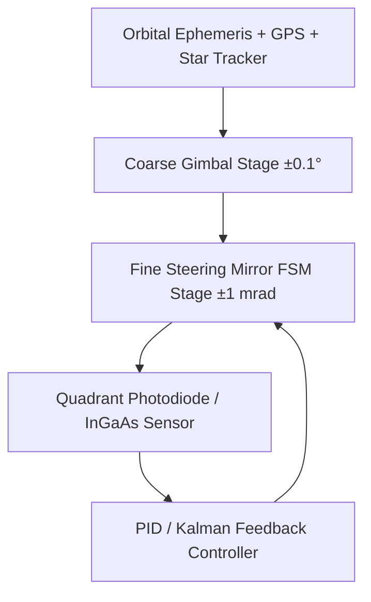

# 🌌 Whitepaper 03 — Optical Inter-Satellite Laser Links (ISLs) & Space Mesh Topology

> **Author Discipline:** Optical Communications & Satellite Mesh Systems  
> **Source Agent Authority:** `satellite-systems-engineer` & `telecom-mathematics-expert`  
> **Mandatory Skills:** `networking-fundamentals-core`, `orbital-mechanics-core`, `5g-core-architecture-core`  
> **Repository:** `techdeveloper-org/starlink-research-report`  
> **Classification:** Technical Engineering Whitepaper

---

## Executive Summary

Starlink's deployment of space-based optical communication nodes—Inter-Satellite Links (ISLs)—transforms an isolated bent-pipe satellite relay into a fully autonomous, dynamic **orbital mesh network**. Operating at near-infrared wavelengths ($\approx 1550\text{ nm}$) with data capacities exceeding $100\text{ Gbps}$ per optical terminal, ISLs route IP packets laterally across the vacuum of space without touching ground gateway stations. Because electromagnetic waves propagate $\approx 47\%$ faster in the vacuum of space than through terrestrial silica fiber-optic cables, Starlink's space-laser backbone delivers mathematically superior latency on trans-oceanic and intercontinental routes. This paper derives the Gaussian beam divergence physics, Pointing/Acquisition/Tracking (PAT) control loops, relativistic latency advantages, and dynamic software-defined mesh routing algorithms.

---

## 1. Free Space Optics (FSO) Physics & Beam Propagation

Each Starlink V1.5 and V2 satellite carries four optical communication terminals (two pointing fore/aft to intra-plane neighbors, two pointing port/starboard to inter-plane neighbors).

```
   [Satellite A] ───────────── Laser ISL (1550 nm) ─────────────► [Satellite B]
   Aperture d₀ ≈ 10 cm                                            Aperture d₀ ≈ 10 cm
   Distance L ≈ 1,000 to 5,000 km in Space Vacuum (No Atmosphere)
```

### 1.1 Gaussian Beam Diffraction & Geometric Expansion
Starlink optical links emit a fundamental Gaussian laser mode ($\text{TEM}_{00}$) at wavelength $\lambda = 1550\text{ nm}$ (telecom C-band, compatible with standard Erbium-Doped Fiber Amplifiers, EDFA). The beam waist radius is $w_0 \approx 5.0\text{ cm}$ (half of the primary optical aperture diameter $D \approx 10\text{ cm}$).

The Rayleigh range $z_R$ defines the distance over which the beam cross-sectional area doubles:

$$z_R = \frac{\pi w_0^2}{\lambda} = \frac{\pi (0.05\text{ m})^2}{1.55 \times 10^{-6}\text{ m}} \approx 5,067\text{ meters} \approx 5.07\text{ km}$$

At inter-satellite link distances $L = 1,000\text{ km}$ to $4,000\text{ km}$, $L \gg z_R$, placing the link deep in the far-field diffraction regime. The beam radius $w(L)$ expands hyperbolically:

$$w(L) = w_0 \sqrt{1 + \left(\frac{L}{z_R}\right)^2} \approx w_0 \frac{L}{z_R} = \frac{\lambda L}{\pi w_0}$$

The half-angle beam divergence $\theta_{div}$ is:

$$\theta_{div} = \frac{\lambda}{\pi w_0} = \frac{1.55 \times 10^{-6}}{\pi \times 0.05} \approx 9.87 \times 10^{-6}\text{ rad} \approx 9.87\text{ }\mu\text{rad}$$

Full angular beamwidth: $2\theta_{div} \approx 19.74\text{ }\mu\text{rad} \approx 0.00113^\circ$.

#### Numerical Evaluation at $L = 2,500\text{ km}$:
$$w(2500\text{ km}) \approx \frac{(1.55 \times 10^{-6}\text{ m}) \times (2.5 \times 10^6\text{ m})}{\pi \times 0.05\text{ m}} \approx 24.67\text{ meters}$$

The laser footprint at the receiving satellite is a disk of diameter $2w \approx 49.3\text{ meters}$.

### 1.2 Optical Power Geometric Collection Efficiency
The receiving terminal aperture of diameter $D_{rx} = 10\text{ cm}$ captures only a tiny fraction of the expanded beam. The geometric collection efficiency $\eta_{geom}$ on boresight is:

$$\eta_{geom} = 1 - \exp\left( -2 \left(\frac{D_{rx}/2}{w(L)}\right)^2 \right) \approx 2 \left(\frac{r_{rx}}{w(L)}\right)^2 = 2 \left(\frac{0.05\text{ m}}{24.67\text{ m}}\right)^2 \approx 8.22 \times 10^{-6} \approx -50.85\text{ dB}$$

### 1.3 Optical Link Budget Formulation
The received optical power $P_{rx}$ is calculated via the Friis transmission formula for optical frequencies:

$$P_{rx} = P_{tx} \cdot G_{tx} \cdot L_{fs} \cdot G_{rx} \cdot \eta_{tx} \cdot \eta_{rx} \cdot L_{point}$$

Where:
- Optical transmitter gain: $G_{tx} \approx \left(\frac{\pi D_{tx}}{\lambda}\right)^2 = \left(\frac{\pi \times 0.10}{1.55 \times 10^{-6}}\right)^2 \approx 4.108 \times 10^{10} \approx +106.14\text{ dBi}$.
- Optical receiver gain: $G_{rx} \approx \left(\frac{\pi D_{rx}}{\lambda}\right)^2 \approx +106.14\text{ dBi}$.
- Free-space optical loss: $L_{fs} = \left(\frac{\lambda}{4\pi L}\right)^2 = \left(\frac{1.55 \times 10^{-6}}{4\pi \times 2.5 \times 10^6}\right)^2 \approx 2.43 \times 10^{-27} \approx -266.14\text{ dB}$.
- Transmitter power: $P_{tx} = 5.0\text{ W} \approx +36.99\text{ dBm}$.
- Optics transmission efficiency: $\eta_{tx} \cdot \eta_{rx} \approx 0.60 \approx -2.22\text{ dB}$.
- Pointing jitter loss ($2\text{ }\mu\text{rad}$ error): $L_{point} \approx -1.50\text{ dB}$.

$$P_{rx}\text{ (dBm)} = +36.99 + 106.14 - 266.14 + 106.14 - 2.22 - 1.50 = -20.59\text{ dBm} \approx 8.73\text{ }\mu\text{W}$$

An optical power of $-20.59\text{ dBm}$ ($\approx 8.7\text{ }\mu\text{W}$) is well above the sensitivity threshold of modern coherent optical transceivers (DP-QPSK receivers require $>-32\text{ dBm}$ for $100\text{ Gbps}$ at $\text{BER} = 10^{-3}$ pre-FEC), confirming a robust **$+11.4\text{ dB}$ optical link margin**.

---

## 2. Pointing, Acquisition & Tracking (PAT) System

Establishing and maintaining an optical link across thousands of kilometers when both satellites are traveling at $7.56\text{ km/s}$ with micro-vibrations from reaction wheels requires a sub-microradian closed-loop control system.



### 2.1 The Three-Stage PAT Architecture
1. **Stage 1 — Coarse Gimbal Pointing:** A dual-axis motorized azimuth/elevation gimbal orients the optical head toward the target satellite based on onboard ephemeris calculations. Pointing accuracy: $\approx \pm 0.1^\circ$ ($\approx \pm 1,745\text{ }\mu\text{rad}$).
2. **Stage 2 — Spatial Acquisition:** The transmitting terminal defocuses its beam or executes an automated Archimedean spiral search pattern across the $0.1^\circ$ uncertainty cone. Once the receiving quadrant photodiode detects a signal above threshold, handshaking locks the link.
3. **Stage 3 — Fine Steering Mirror (FSM) Closed-Loop Tracking:** High-bandwidth voice-coil or piezoelectric fast steering mirrors correct for satellite structural jitter and orbital relative drift at $>1\text{ kHz}$ update rates, keeping pointing jitter below **$1.5\text{ }\mu\text{rad}$**.

---

## 3. Relativistic Speed of Light Advantage: Space vs Fiber

A universal law of electromagnetics is that the phase velocity of light through a medium is inversely proportional to the refractive index $n$ of that medium:

$$v = \frac{c}{n}$$

- **In the vacuum of space:** $n_{vacuum} \equiv 1.0000 \implies v_{vacuum} = c = 299,792.458\text{ km/s}$.
- **In silica glass fiber-optic cable (Corning SMF-28):** $n_{silica} \approx 1.4682 \implies v_{fiber} = \frac{c}{1.4682} \approx 204,190.477\text{ km/s}$.

$$\frac{v_{vacuum}}{v_{fiber}} = 1.4682 \implies \text{Light in space travels } \mathbf{46.82\%\text{ faster}}\text{ than in terrestrial fiber!}$$

```
Terrestrial Fiber:  ──────────────────────────────────── (v ≈ 204,000 km/s)
Space Laser ISL:    ════════════════════════════════════ (v ≈ 300,000 km/s) 47% Faster!
```

### 3.1 Trans-Continental Latency Case Study: London to Singapore

| Path Parameter | Terrestrial Subsea Fiber Route | Starlink Space Laser ISL Route |
| :--- | :--- | :--- |
| **Physical Route Distance** | $\approx 16,500\text{ km}$ (via Suez, Red Sea, Malacca Straits)| $\approx 11,200\text{ km}$ (Great Circle geodesic + 550 km orbit hop) |
| **Propagation Speed ($v$)** | $204,190\text{ km/s}$ | $299,792\text{ km/s}$ |
| **Pure Optical Propagation Time** | $\frac{16500}{204190} \approx \mathbf{80.8\text{ ms}}$ | $\frac{11200}{299792} \approx \mathbf{37.4\text{ ms}}$ |
| **Switching / Regenerator Latency** | $\approx 15\text{ ms}$ (20+ EDFA repeaters & landing stations) | $\approx 8\text{ ms}$ (5 satellite router hops @ 1.6 ms/hop) |
| **Total One-Way Latency** | **$\approx 95.8\text{ ms}$** | **$\approx 45.4\text{ ms}$** |
| **Round-Trip Time (RTT)** | **$\approx 191.6\text{ ms}$** | **$\approx 90.8\text{ ms}$** |

**Conclusion:** Starlink's space laser mesh cuts latency between London and Singapore by **over 100 milliseconds RTT** ($\approx 52.6\%$ reduction), creating a disruptive advantage for high-frequency algorithmic trading, multi-region database replication, and interactive cloud systems.

---

## 4. Space Mesh Topology & Dynamic SDN Routing

A mega-constellation of moving satellites forms a **Cyclic Time-Variant Topology (CTVT)**. While satellites move at $27,300\text{ km/h}$, their relative positions within the same orbital shell are deterministic and cyclic.

```
       Orbit Plane k-1              Orbit Plane k              Orbit Plane k+1
             │                            │                            │
      [ Sat k-1, m+1 ] ◄── Inter-Plane ──► [ Sat k, m+1 ] ◄── Inter-Plane ──► [ Sat k+1, m+1 ]
             ▲                            ▲                            ▲
             │ Intra-Plane                │ Intra-Plane                │ Intra-Plane
             ▼                            ▼                            ▼
      [ Sat k-1, m   ] ◄── Inter-Plane ──► [ Sat k, m   ] ◄── Inter-Plane ──► [ Sat k+1, m   ]
             ▲                            ▲                            ▲
             │ Intra-Plane                │ Intra-Plane                │ Intra-Plane
             ▼                            ▼                            ▼
      [ Sat k-1, m-1 ] ◄── Inter-Plane ──► [ Sat k, m-1 ] ◄── Inter-Plane ──► [ Sat k+1, m-1 ]
```

### 4.1 Intra-Plane vs Inter-Plane Link Dynamics
1. **Intra-Plane Links (Fore / Aft):** Distance to adjacent satellites in the same plane remains virtually constant ($\approx 1,970\text{ km}$ apart in Shell 1), with Doppler shifts close to zero and pointing angles fixed. These links are permanently maintained with $99.999\%$ uptime.
2. **Inter-Plane Links (Cross-Seam & Adjacent):** As satellites approach the poles, the physical distance between adjacent orbital planes contracts proportionally to $\cos(\phi)$, reaching zero at the poles before expanding as they cross the equator. Furthermore, where ascending and descending planes cross ("the seam"), relative velocities exceed $15\text{ km/s}$, requiring rapid optical tracking sweeps and periodic link teardown/re-establishment.

### 4.2 Software-Defined Networking (SDN) in Orbit
Starlink operates a centralized Software-Defined Network controller on the ground that computes time-sliced routing tables and pushes them to onboard satellite routers via telemetry up-links:
- Routing tables are pre-calculated for discrete 15-second time windows.
- Routing algorithm: Distributed Dijkstra with dynamic link-state weighting that penalizes high-queue buffers and high solar-interference pointing angles.
- Zero-Loss Handoff: Make-before-break optical cross-linking ensures packets are re-routed along alternate mesh nodes milliseconds before an inter-plane link reaches its mechanical gimbal limit at high latitudes.

---

## 5. Summary Findings
- 1550 nm infrared lasers provide $+11.4\text{ dB}$ link margin over $2,500\text{ km}$ space paths using compact 10 cm apertures and 5 W optical transmitters.
- Vacuum light propagation provides an undeniable $46.8\%$ speed advantage over glass fiber, yielding lower latency on intercontinental routes than any terrestrial cable can achieve.
- Dynamic mesh routing overcomes cyclic orbital topology changes, allowing internet traffic to circumvent terrestrial choke points and national firewalls entirely through space.
