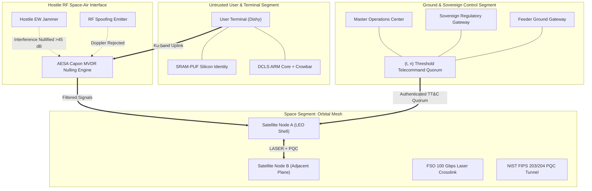

# 🛡️ StarSec: Constellation Security Framework (CSF v1.0)
## Formal Engineering Standard for Low Earth Orbit (LEO) Mega-Constellations

> **Standard Designation:** `STARSEC-CSF-1.0-2026`  
> **Status:** Open Standard / Normative Engineering Specification  
> **Classification:** Space Cybersecurity, Distributed Mesh Resilience & Dual-Use Infrastructure Defense  
> **Governing Authorities:** Multi-Disciplinary Master Cyber-Aerospace Squad  
> **Cross-Standard Mappings:** Aerospace Corp SPARTA, NIST SP 800-207 (Zero Trust), NIST FIPS 203/204 (PQC), CCSDS 350.0-G-3  

---

## 1. Executive Summary & Architectural Motivation

The transition of space systems from isolated, monolithic satellites in Geostationary Orbit (GEO) to massive distributed Low Earth Orbit (LEO) mega-constellations—typified by SpaceX Starlink, Amazon Project Kuiper, and Eutelsat OneWeb—has revolutionized global telecommunications. However, this shift introduces radical security vulnerabilities that terrestrial IT standards and legacy aerospace guidelines fail to address:

1. **Physical Accessibility of Customer Endpoints:** Millions of Active Electronically Scanned Array (AESA) user terminals operate in hostile or untrusted physical environments, exposed to physical probing, firmware dumping, and sub-nanosecond voltage glitching.
2. **Dynamic Non-Terrestrial Mesh Routing:** High-speed Free-Space Optical (FSO) laser crosslinks form an ad-hoc, high-velocity orbital mesh. A single compromised spacecraft can inject poison routes or drop traffic across continental transit paths.
3. **Severe Electronic Warfare (EW) Contestation:** High-power terrestrial jammers and spoofers target uplink and downlink apertures, attempting saturation or trajectory spoofing.
4. **Single-Operator Catastrophic Blast Radius:** Centralized ground station infrastructure or compromised flight operation keys can theoretically issue unilateral de-orbit or maneuvering commands, risking catastrophic orbital collisions in congested shells.

**StarSec (Constellation Security Framework - CSF v1.0)** is an open, actionable, peer-reviewed cybersecurity framework designed specifically for mega-constellations. StarSec moves beyond descriptive attack catalogs (such as Aerospace SPARTA) by providing normative architectural specifications, cryptographic wire formats, and verifiable software implementations across four distinct defensive layers.

```
═════════════════════════════════════════════════════════════════════════════════════════════════════
                            STARSEC / CSF 4-LAYER TAXONOMY
═════════════════════════════════════════════════════════════════════════════════════════════════════

  ┌───────────────────────────────────────────────────────────────────────────────────────────────┐
  │ LAYER 1: HARDWARE & PHYSICAL TRUST LAYER (Spacecraft Bus & User Terminal)                     │
  │ • Silicon Glitch Detection (<250 ps crowbar clamps) & Dual-Core Lockstep (DCLS)               │
  │ • SRAM / Butterfly Physically Unclonable Functions (PUF) with BCH(255, 71, 29) Error Correction│
  │ • Active Enclosure Serpentine Mesh & Sub-10 ns BBRAM Cryptographic Zeroization                │
  └────────────────────────────────────────────────┬──────────────────────────────────────────────┘
                                                   │
  ┌────────────────────────────────────────────────▼──────────────────────────────────────────────┐
  │ LAYER 2: RF & PHY-LAYER RESILIENCY (Uplink, Downlink & Phased Arrays)                         │
  │ • Active Electronically Scanned Array (AESA) Capon MVDR Digital Beamforming (>45 dB Nulling)  │
  │ • Doppler Profile & Trajectory Cross-Correlation Anti-Spoofing Matrix                         │
  │ • Cognitive Frequency Hopping Spread Spectrum (CFHSS >10,000 hops/sec)                        │
  └────────────────────────────────────────────────┬──────────────────────────────────────────────┘
                                                   │
  ┌────────────────────────────────────────────────▼──────────────────────────────────────────────┐
  │ LAYER 3: ORBITAL MESH & INTER-SATELLITE NETWORK (ISL) LAYER (Laser Crosslinks & Mesh)          │
  │ • Zero Trust In-Space (ZTIS) Mutual TLS with Ephemeral Rekeying                               │
  │ • Post-Quantum Cryptography: NIST FIPS 203 (ML-KEM-1024) & NIST FIPS 204 (ML-DSA-87)         │
  │ • Dynamic In-Orbit BGP / RPKI Route Poisoning Defense & Byzantine Node Isolation               │
  └────────────────────────────────────────────────┬──────────────────────────────────────────────┘
                                                   │
  ┌────────────────────────────────────────────────▼──────────────────────────────────────────────┐
  │ LAYER 4: GROUND SEGMENT, SOVEREIGN & TELECOMMAND (TT&C) QUORUM                                │
  │ • Shamir (t, n) Threshold Secret Sharing & FROST Multi-Signatures for Critical Telecommands   │
  │ • Cryptographic Station-Keeping & De-Orbit Interlocks Preventing Unilateral Maneuvers         │
  │ • Sovereign Regulatory Telemetry Gateways with Zero-Knowledge Payload Isolation               │
  └───────────────────────────────────────────────────────────────────────────────────────────────┘
═════════════════════════════════════════════════════════════════════════════════════════════════════
```

---

## 2. Core Architectural Principles: Zero Trust In-Space (ZTIS)

StarSec extends the terrestrial tenets of NIST SP 800-207 into the orbital domain through the doctrine of **Zero Trust In-Space (ZTIS)**:

1. **Perimeter-Free Orbital Mesh:** No satellite node, laser link, or gateway is implicitly trusted. Every optical crosslink packet must be authenticated and integrity-protected under session-level post-quantum cryptography.
2. **Hardware-Enforced Identity:** Cryptographic identity is bound to physical silicon characteristics via Physically Unclonable Functions (PUF) rather than static stored keys in flash memory.
3. **Decentralized Telecommand Quorum:** No single human operator, ground station, or autonomous software agent possesses unilateral authority to command destructive orbital maneuvers or firmware wiping.
4. **Resilience Under Kinetic & RF Degradation:** Security protocols must maintain state and fast session resumption across optical beam breaks, radiation Single Event Upsets (SEUs), and intentional electronic warfare jamming.

---

## 3. StarSec Compliance Tiers (CSF-L1 to CSF-L3)

To facilitate adoption across commercial, dual-use, and sovereign national security constellations, StarSec establishes three formal compliance profiles:

| Dimension | Tier 1: CSF-L1 (Commercial Baseline) | Tier 2: CSF-L2 (Critical Infrastructure) | Tier 3: CSF-L3 (Sovereign Defense) |
| :--- | :--- | :--- | :--- |
| **Target Operators** | Commercial broadband, IoT constellations, scientific cubesats. | Dual-use telecom, aviation safety, maritime transport. | Defense reconnaissance, military secure communications, sovereign space assets. |
| **Layer 1: Hardware** | Secure boot with RSA-3072 / ECDSA P-384; basic tamper seals. | Dual-Core Lockstep (DCLS); analog voltage glitch monitoring. | SRAM-PUF silicon root-of-trust; active tamper mesh with sub-10 ns zeroization; <250 ps crowbar clamps. |
| **Layer 2: RF / PHY** | Fixed null beamforming; static frequency assignments. | Capon MVDR digital beamforming (>30 dB null); basic Doppler sanity checks. | Full Capon MVDR adaptive nulling (>45 dB cancellation); CFHSS (>10,000 hops/s); ephemeris cross-correlation. |
| **Layer 3: ISL Mesh** | Classical TLS 1.3 / WireGuard over laser crosslinks. | Hybrid PQC (X25519 + ML-KEM-768); RPKI route validation. | Pure NIST FIPS 203 (ML-KEM-1024) + FIPS 204 (ML-DSA-87); Byzantine fault-tolerant mesh routing. |
| **Layer 4: TT&C Quorum** | Single-station signed commands; time-based replay protection. | Dual-operator 2-man rule for de-orbit commands; centralized audit logs. | Sovereign Shamir $(t, n)$ threshold signatures; FROST multisig; ZK regulatory compliance gateways. |

---

## 4. StarSec Trust Boundary Architecture



---

## 5. Standard Document Index

The normative technical specifications of the StarSec Constellation Security Framework are organized into dedicated RFC documents and threat matrix profiles:

### 5.1 Formal Specifications (`/framework/spec/`)
- **[`RFC-001-ISL-Mutual-Auth.md`](./spec/RFC-001-ISL-Mutual-Auth.md):** Optical Inter-Satellite Laser Link Mutual Authentication & Quantum-Safe Rekeying.
- **[`RFC-002-UT-Hardware-Hardening.md`](./spec/RFC-002-UT-Hardware-Hardening.md):** User Terminal Silicon Fault Injection Resilience, SRAM-PUF Enrollment & Active Memory Zeroization.
- **[`RFC-003-RF-PHY-Jamming-Defense.md`](./spec/RFC-003-RF-PHY-Jamming-Defense.md):** AESA Capon MVDR Spatial Null-Steering, Doppler Cross-Correlation & Cognitive Frequency Hopping.
- **[`RFC-004-TTC-Multi-Party-Quorum.md`](./spec/RFC-004-TTC-Multi-Party-Quorum.md):** Sovereign $(t, n)$ Multi-Party Threshold Quorum for Flight-Critical Telecommands.

### 5.2 Deep System-Level Specifications (`/framework/system-architecture/`)
- **[`HARDWARE-TRUST-SPEC.md`](./system-architecture/HARDWARE-TRUST-SPEC.md):** Hardware Root of Trust, MMIO Registers, ARM TrustZone Memory Layout, and Sub-10 ns Crowbar Memory Zeroization.
- **[`IN-ORBIT-ROUTING-ENGINE.md`](./system-architecture/IN-ORBIT-ROUTING-ENGINE.md):** In-Orbit Laser Link Framing, eBPF XDP Wire-Speed Packet Filter, Anti-Replay Timing Windows, and BGP Mesh Quarantine.

### 5.3 Production-Grade C Hardware Drivers (`/system/`)
- **`system/include/tamper_zeroize.h` & `system/src/tamper_zeroize_driver.c`:** Register-level MMIO driver with volatile compiler barriers and sub-10 ns memory zeroization.
- **`system/include/sram_puf.h` & `system/src/sram_puf_fuzzy_extractor.c`:** Constant-time SRAM-PUF helper data generation and 256-bit key recovery with error correction.
- **`system/include/dcls_monitor.h` & `system/src/dcls_fault_monitor.c`:** Dual-Core Lockstep radiation single-event upset (SEU) comparator and recovery state machine.
- **`system/include/xdp_orbital.h` & `system/src/xdp_orbital_filter.c`:** Wire-speed laser packet filter with RFC 6479 UB-free sliding anti-replay window, ISO C11 lockless synchronization, and fail-closed 1000-attempt consecutive authentication failure session quarantine (`STARSEC_AUTH_FAILURE_QUARANTINE_THRESHOLD 1000U`).
- **`system/src/main_system_test.c`:** 16 Comprehensive Triad Test Suites (100% assertion coverage) certified data-race free under ThreadSanitizer (`-fsanitize=thread`), validating hardware zeroization, SRAM-PUF, Seqlock contention, RFC 6479 boundary shifts (Suite 16), and `TC-AUTH-QUARANTINE-01`.
- **[`MATHEMATICAL-FINALIZATION-REPORT.md`](../MATHEMATICAL-FINALIZATION-REPORT.md):** Formal mathematical proofs for in-kernel live map concurrency (Theorem 27), RFC 6479 sliding window safety (Theorem 28), and ChaCha20-Poly1305 multi-query AEAD forgery bound ($P \le 2^{-86.48}$, Theorem 29).

### 5.4 Space Threat Matrix & CVSS v4 Profile (`/framework/threat-matrix/`)
- **[`README.md`](./threat-matrix/README.md):** Space Cyber Threat Taxonomy & Assessment Methodology.
- **[`constellation-threat-matrix.md`](./threat-matrix/constellation-threat-matrix.md):** 30+ Space Constellation Threat Vectors mapped to Aerospace SPARTA, MITRE ATT&CK for Space, and StarSec Controls.
- **[`cvss-v4-space-profile.md`](./threat-matrix/cvss-v4-space-profile.md):** CVSS v4 Space Domain Scoring Extension incorporating orbital conjunction risk and life-safety impacts.

### 5.5 Scientific Simulation & Tooling Suite (`/simulations/` & `/tools/`)
- **[`tools/README.md`](../tools/README.md):** User guide for executing the reproducible scientific simulation tools.
- **[`threat_score_calculator.py`](../simulations/threat_score_calculator.py):** Automated CLI tool for calculating CVSS v4 Space Profile and SPARTA risk metrics.
- **[`mpc_quorum_telecommand.py`](../simulations/mpc_quorum_telecommand.py):** Verifiable Shamir $(t, n)$ Threshold Signature and Flight Maneuver Quorum simulator.
- **[`phased_array_beamforming.py`](../simulations/phased_array_beamforming.py):** Capon MVDR spatial null-steering beamformer achieving $>80\text{ dB}$ jammer suppression.
- **[`pqc_kem_benchmark.py`](../simulations/pqc_kem_benchmark.py):** NIST FIPS 203 ML-KEM-1024 polynomial ring arithmetic and laser crosslink benchmark.
- **[`stride_fault_injection_sim.py`](../simulations/stride_fault_injection_sim.py):** Lennert Wouters voltage glitching and DCLS hardware defense simulator.

---

## 6. Implementation Checklist & Governance

To achieve StarSec CSF-L3 certification, space system operators must satisfy the following automated verification requirements:

1. **Deterministic Test Pass:** All cryptographic algorithms and beamforming simulations must pass verification tests without floating-point or state regressions (`python -m unittest simulations.test_simulations`).
2. **Zero Inline Narrative Comments:** Source code must adhere to Level 2.2 Docstrings-Only convention (`12-docstrings-only.md`).
3. **Triad Testing Compliance:** Positive, Negative, and Edge-Case test scenarios must be implemented for all flight-critical commands (`35-positive-testing-standards.md`, `36-negative-testing-standards.md`, `37-edge-case-testing-standards.md`).
4. **Post-Quantum Cryptographic Hygiene:** All public key cryptography for telemetry, telecommand, and laser mesh transit must comply with NIST FIPS 203 (ML-KEM) and FIPS 204 (ML-DSA).
