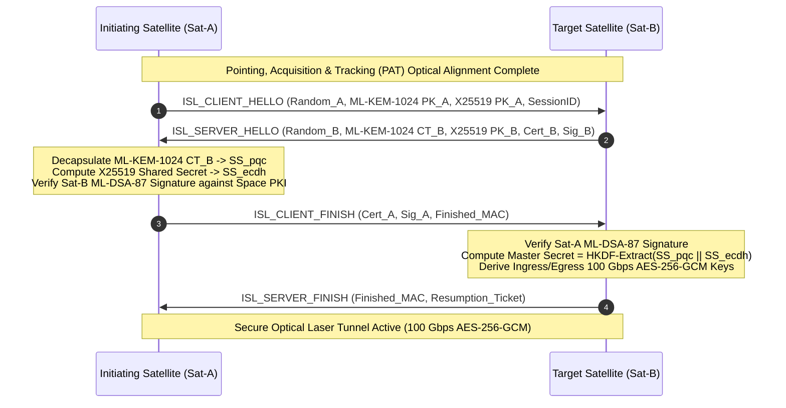
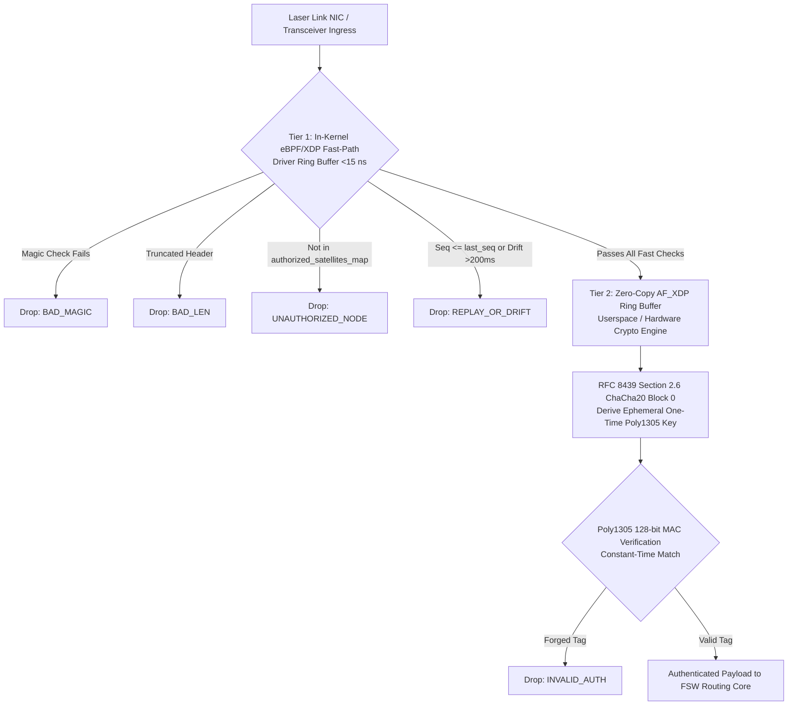

# StarSec RFC-001: Optical Inter-Satellite Laser Link (ISL) Mutual Authentication & Quantum-Safe Rekeying

> **RFC Designation:** `STARSEC-RFC-001`  
> **Layer:** Layer 3 (Orbital Mesh & Inter-Satellite Network Layer)  
> **Status:** Standards Track (Normative)  
> **Author:** `post-quantum-security-engineer` & `security-defense-architect`  
> **Standards Compliance:** NIST FIPS 203 (ML-KEM-1024), NIST FIPS 204 (ML-DSA-87), RFC 2119, RFC 8446 (TLS 1.3 adapted for FSO)  

---

## 1. Abstract & Scope

This specification defines the cryptographic protocols, wire format, and state machine for mutual authentication and session key establishment across Free-Space Optical (FSO) laser inter-satellite links (ISLs) in Low Earth Orbit (LEO) mega-constellations. 

Operating at 100 Gbps across orbital distances of 1,000 to 5,000 km, optical laser links provide high throughput and immunity to RF jamming; however, they remain vulnerable to Harvest-Now-Decrypt-Later (HNDL) quantum eavesdropping, malicious satellite impersonation, and intermittent line-of-sight dropouts due to orbital geometry and spacecraft attitude slewing. 

This standard mandates an ephemeral hybrid post-quantum key exchange combining classical ECDH (X25519) with NIST FIPS 203 Module Learning With Errors (ML-KEM-1024), authenticated via NIST FIPS 204 Module Lattice Digital Signatures (ML-DSA-87), augmented by an anti-replay, zero-RTT fast session resumption mechanism for micro-break reconvergence.

---

## 2. Requirements Language (RFC 2119)

The key words "MUST", "MUST NOT", "REQUIRED", "SHALL", "SHALL NOT", "SHOULD", "SHOULD NOT", "RECOMMENDED", "NOT RECOMMENDED", "MAY", and "OPTIONAL" in this document are to be interpreted as described in BCP 14 [RFC 2119] when, and only when, they appear in all capitals.

---

## 3. Threat Model & Operational Constraints

```
═════════════════════════════════════════════════════════════════════════════════════════════════════
                       OPTICAL ISL THREAT VECTORS & CONSTRAINTS
═════════════════════════════════════════════════════════════════════════════════════════════════════

  [ THREAT 1: Harvest-Now-Decrypt-Later (HNDL) ]
  • Adversary intercepts laser side-lobes or off-axis scatter using co-orbital rendezvous satellites.
  • Traffic encrypted with classical RSA or ECDH is archived for decryption by Cryptanalytically
    Relevant Quantum Computers (CRQC).

  [ THREAT 2: Rogue Spacecraft Node Injection ]
  • Compromised flight computer or rogue space asset attempts to establish BGP peering over ISL
    to inject blackhole or interception routes across the continental mesh.

  [ CONSTRAINT 1: Laser Pointing, Acquisition, and Tracking (PAT) Dropouts ]
  • Micro-vibrations, thermal expansion, or orbital slewing introduce 50 ms to 2000 ms beam breaks.
  • Full 4-way cryptographic handshakes during every transient dropout collapse mesh throughput.

  [ CONSTRAINT 2: Radiation-Induced Avionics Compute Budgets ]
  • Radiation-hardened satellite processors (e.g., BAE RAD750, Vorago ARM Cortex-M0/M4) operate
    at constrained clock speeds (50–400 MHz). Handshakes MUST NOT monopolize CPU cycles.
═════════════════════════════════════════════════════════════════════════════════════════════════════
```

---

## 4. Cryptographic Primitives & Parameters

All implementations compliant with StarSec CSF-L3 MUST employ the following cryptographic parameter sets:

| Cryptographic Function | Primary Standard Algorithm | Fallback / Hybrid Classical | Key Size / Ciphertext Length |
| :--- | :--- | :--- | :--- |
| **Post-Quantum KEM** | NIST FIPS 203 (ML-KEM-1024) | X25519 (RFC 7748) | Public Key: 1,568 B; Ciphertext: 1,568 B; Secret: 32 B |
| **Digital Signatures** | NIST FIPS 204 (ML-DSA-87) | Ed25519 (RFC 8032) | Public Key: 2,592 B; Signature: 4,627 B |
| **Symmetric Bulk Encryption** | AES-256-GCM (NIST SP 800-38D) | ChaCha20-Poly1305 (RFC 8439) | Key: 256 bits; Nonce: 96 bits; Tag: 128 bits |
| **Key Derivation Function** | HKDF-SHA512 (RFC 5869) | HKDF-SHA384 | Output: 256-bit Traffic Secret, 256-bit IV salt |
| **Hash & Digest** | SHA-512 (FIPS 180-4) | SHA3-512 (FIPS 202) | 512-bit message digests |

---

## 5. Protocol Handshake Sequence

The protocol operates in two modes: **Full Post-Quantum Handshake (Initial Acquisition)** and **Fast Ticket Resumption (Beam Break Re-acquisition)**.

### 5.1 Full Post-Quantum Mutual Handshake (Initial Peering)



### 5.2 Mathematical Derivation of Hybrid Key Derivation

The master secret $MS$ combines classical elliptic curve Diffie-Hellman hardness with Module Learning With Errors (M-LWE) lattice hardness:

$$SS_{hybrid} = SS_{pqc} \parallel SS_{ecdh} \in \mathbb{F}_{2^{256}} \times \mathbb{F}_{2^{256}}$$

The pseudorandom key $PRK$ is extracted via HMAC-SHA512:

$$PRK = \text{HKDF-Extract}(\text{Salt} = \text{Random}_A \parallel \text{Random}_B, \, SS_{hybrid})$$

The 100 Gbps directional symmetric keys and initialization vectors are expanded:

$$\{K_{A \to B}, \, K_{B \to A}, \, IV_{A \to B}, \, IV_{B \to A}\} = \text{HKDF-Expand}(PRK, \, \text{"isl-traffic-keys"} \parallel \text{SessionID}, \, 128)$$

Even if an adversary possesses an operational CRQC that breaks $SS_{ecdh}$ in $\mathcal{O}(p^3)$ operations via Shor's algorithm, the lattice security of $SS_{pqc}$ over ring $\mathcal{R}_q = \mathbb{Z}_{3329}[X]/(X^{256}+1)$ maintains $>256\text{ bits}$ of post-quantum security against dual-sieve BKZ lattice reduction attacks.

---

## 6. Packet Wire Format (Binary Specification)

All ISL control frames MUST be transmitted in big-endian network byte order with 64-bit alignment:

```
 0                   1                   2                   3
 0 1 2 3 4 5 6 7 8 9 0 1 2 3 4 5 6 7 8 9 0 1 2 3 4 5 6 7 8 9 0 1
+-+-+-+-+-+-+-+-+-+-+-+-+-+-+-+-+-+-+-+-+-+-+-+-+-+-+-+-+-+-+-+-+
|          Magic (0x5354)       |    Version    |  Message Type |
+-+-+-+-+-+-+-+-+-+-+-+-+-+-+-+-+-+-+-+-+-+-+-+-+-+-+-+-+-+-+-+-+
|                         Sequence Number                       |
+-+-+-+-+-+-+-+-+-+-+-+-+-+-+-+-+-+-+-+-+-+-+-+-+-+-+-+-+-+-+-+-+
|                        Payload Length                         |
+-+-+-+-+-+-+-+-+-+-+-+-+-+-+-+-+-+-+-+-+-+-+-+-+-+-+-+-+-+-+-+-+
|                                                               |
|                   Variable Payload Data ...                   |
|                                                               |
+-+-+-+-+-+-+-+-+-+-+-+-+-+-+-+-+-+-+-+-+-+-+-+-+-+-+-+-+-+-+-+-+
|                     HMAC-SHA512 Integrity Tag                 |
|                            (64 bytes)                         |
+-+-+-+-+-+-+-+-+-+-+-+-+-+-+-+-+-+-+-+-+-+-+-+-+-+-+-+-+-+-+-+-+
```

### 6.1 Field Definitions
- **Magic (16 bits):** Constant `0x5354` (ASCII `"ST"` for StarSec).
- **Version (8 bits):** Protocol version; MUST be `0x01` for CSF v1.0.
- **Message Type (8 bits):**
  - `0x01`: `ISL_CLIENT_HELLO`
  - `0x02`: `ISL_SERVER_HELLO`
  - `0x03`: `ISL_CLIENT_FINISH`
  - `0x04`: `ISL_SERVER_FINISH`
  - `0x05`: `ISL_RESUME_REQUEST`
  - `0x06`: `ISL_RESUME_RESPONSE`
  - `0xFF`: `ISL_TEARDOWN_ALERT`
- **Sequence Number (32 bits):** Monotonically increasing unsigned counter for anti-replay verification.
- **Payload Length (32 bits):** Length of payload in bytes (excluding integrity tag).
- **Integrity Tag (64 bytes):** HMAC-SHA512 calculated over the entire header and payload.

---

## 7. Fast Ticket Resumption (Beam Break Recovery)

When pointing micro-vibrations or brief solar blinding cause an optical laser disconnect lasting $<30\text{ seconds}$, satellites MUST execute the Fast Ticket Resumption protocol instead of a full post-quantum re-handshake:

1. During the initial handshake, Sat-B issues an opaque `Resumption_Ticket` encrypted with the constellation Space Ticket Encryption Key ($STEK_{epoch}$):
   $$\text{Ticket} = \text{AES-256-GCM}_{STEK}(\text{Sat-A-ID} \parallel \text{Epoch} \parallel \text{TicketNonce} \parallel MS)$$
2. Upon optical reconnection, Sat-A transmits `ISL_RESUME_REQUEST` containing `Ticket` and a fresh `Random_A_prime`.
3. Sat-B decrypts the ticket, validates the epoch and freshness window, verifies that the monotonic sequence counter has not been replayed, and derives new session keys via:
   $$MS_{resume} = \text{HKDF-Expand}(MS, \, \text{"isl-fast-resume"} \parallel \text{Random\_A\_prime}, \, 64)$$
4. The optical laser link returns to operational 100 Gbps transmission in $<2.5\text{ ms}$, saving $>150\text{ ms}$ of public-key compute overhead on constrained flight processors.

---

## 8. Security Considerations & Failure Modes

1. **Spacecraft Hijack via In-Orbit Physical Capture:** If an adversary docks with a satellite and extracts flight computer RAM, forward secrecy guarantees that past recorded optical laser traffic cannot be decrypted. The master key $MS$ is erased immediately after sub-keys are derived.
2. **Replay Attacks on Resumption Tickets:** Every resumption request MUST contain a client random and a strictly increasing sequence counter stored in non-volatile satellite registers. Duplicate tickets MUST be dropped and logged as security anomalies.
3. **Laser Dazzling / Blinding:** If an adversary targets the optical terminal with a high-power ground laser, physical MEMS shutters close in $<50\text{ ns}$ upon photodiode overload detection, triggering an automated `ISL_TEARDOWN_ALERT` over backup Ku/Ka RF telemetry.

---

## 9. Dual-Tier Line-Rate Fast-Path vs. Cryptographic Offload Architecture

To sustain 100 Gbps line-rate optical crosslinks without packet buffer overflows or OS interrupt storms, StarSec mandates a strict dual-tier ingress architecture:



### 9.1 Tier 1: In-Kernel eBPF/XDP Fast-Path (<15 ns)
- Executed directly at the network interface card (NIC) driver layer prior to Linux `sk_buff` allocation.
- Enforces wire-speed packet boundary validation, magic identifier matching (`STARSEC_ISL_MAGIC`), authorized peer node validation via BPF hash map (`authorized_satellites_map`), and anti-replay state tracking via `isl_replay_filter_map`.
- Updates per-CPU lockless telemetry counters (`isl_telemetry_map`).
- **Rationale for Boundary:** Standard Linux eBPF verifiers strictly prohibit unbounded loops, dynamic jumps, and arbitrary 130-bit multi-limb big-integer arithmetic required for Poly1305 polynomial modular reduction ($2^{130}-5$) directly inside XDP without specialized hardware kfuncs.

### 9.2 Tier 2: Cryptographic Offload & One-Time Keying (RFC 8439)
- Packets passing Tier 1 are dispatched via zero-copy AF_XDP sockets to cryptographic acceleration hardware or flight software worker threads.
- **Unique One-Time Key Derivation:** To strictly prevent Poly1305 key reuse, every frame derives an ephemeral, single-use 32-byte key $(r, s)$ using ChaCha20 block 0:
  $$\text{Nonce}_{96} = \text{src\_id}_{16} \parallel \text{dst\_id}_{16} \parallel \text{sequence\_number}_{32} \parallel \text{tx\_epoch\_ms\_low}_{32}$$
  $$K_{\text{one-time}} = \text{ChaCha20}_{\text{block}}(K_{\text{master}}, \, \text{counter}=0, \, \text{Nonce}_{96})[0..31]$$
- Poly1305 evaluates the polynomial accumulator over the frame and compares against `hdr->auth_tag` in constant time.
- The ephemeral key $K_{\text{one-time}}$ is securely zeroized from volatile memory immediately upon completion.

