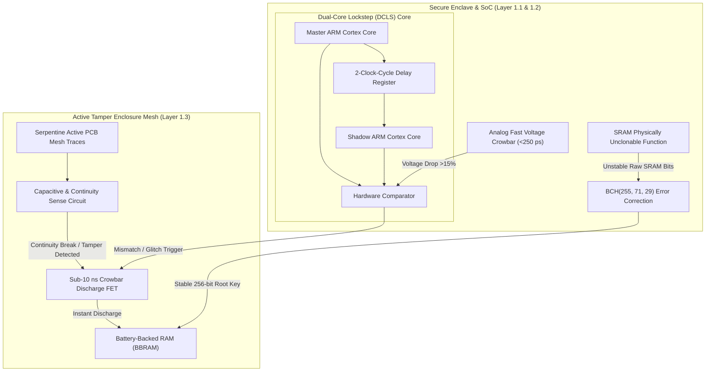

# StarSec RFC-002: User Terminal (UT) Silicon Hardening, PUF Identity & Anti-Tamper Zeroization

> **RFC Designation:** `STARSEC-RFC-002`  
> **Layer:** Layer 1 (Hardware & Physical Trust Layer)  
> **Status:** Standards Track (Normative)  
> **Author:** `secure-boot-engineer` & `cpu-architecture-specialist`  
> **Standards Compliance:** NIST SP 800-193 (Firmware Resiliency), FIPS 140-3 Physical Security Level 4, RFC 2119  

---

## 1. Abstract & Scope

This specification establishes normative silicon-level hardening, cryptographic hardware root-of-trust (RoT) architecture, and active anti-tamper zeroization standards for mega-constellation consumer User Terminals (UT / "Dishy") and satellite avionics microcontrollers. 

Consumer satellite terminals are deployed in physically uncontrolled subscriber environments, exposing the system-on-chip (SoC) and printed circuit board (PCB) to sophisticated fault injection attacks—including sub-nanosecond voltage glitching on eMMC lines, clock jitter manipulation, electromagnetic fault injection (EMFI), and decapping for microscopic bus probing. 

This standard mandates three interlocking physical defense tiers: (1) analog sub-250 ps voltage crowbar clamp circuits and Dual-Core Lockstep (DCLS) execution, (2) SRAM Physically Unclonable Function (PUF) cryptographic key generation with BCH error correction, and (3) active enclosure serpentine sensor meshes with sub-10 ns volatile memory zeroization.

---

## 2. Requirements Language (RFC 2119)

The key words "MUST", "MUST NOT", "REQUIRED", "SHALL", "SHALL NOT", "SHOULD", "SHOULD NOT", "RECOMMENDED", "NOT RECOMMENDED", "MAY", and "OPTIONAL" in this document are to be interpreted as described in BCP 14 [RFC 2119] when, and only when, they appear in all capitals.

---

## 3. Physical Attack Vectors & Failure Modes

```
═════════════════════════════════════════════════════════════════════════════════════════════════════
                         USER TERMINAL PHYSICAL ATTACK TAXONOMY
═════════════════════════════════════════════════════════════════════════════════════════════════════

  [ ATTACK 1: Sub-Nanosecond Voltage Glitching (Wouters Attack) ]
  • Attacker injects a transient negative voltage drop (-0.5V to -1.0V for 5-10 ns) on the SoC
    core power rail (VDD_CORE) exactly during BootROM public key hash verification.
  • Result: Comparator instruction (CMP/BEQ) skips execution, allowing unsigned bootloader
    execution and root firmware compromise.

  [ ATTACK 2: Static Flash Key Extraction & Decapping ]
  • Adversary decaps SoC package or reads external SPI NOR/eMMC chips using logic analyzers.
  • If cryptographic master keys are stored in static non-volatile memory, terminal identity is
    cloned across rogue devices.

  [ ATTACK 3: Electromagnetic Fault Injection (EMFI) ]
  • High-voltage pulse generator with micro-probe injects localized eddy currents into CPU instruction
    decoders, forcing bitflips in program counters or cryptographic status registers.
═════════════════════════════════════════════════════════════════════════════════════════════════════
```

---

## 4. Hardware Hardening Architecture



---

## 5. Specification: Dual-Core Lockstep (DCLS) & Analog Crowbars

### 5.1 Dual-Core Lockstep Architecture
Terminal baseband processors and satellite flight control microcontrollers MUST implement hardware Dual-Core Lockstep (DCLS):
1. **Core Redundancy:** The SoC MUST contain two identical processing cores: a Primary Executive Core and a Shadow Core.
2. **Phase Offset:** The Shadow Core MUST execute the identical instruction stream exactly two clock cycles ($2\tau_{clk}$) behind the Primary Core using hardware delay registers.
3. **Hardware Comparator:** Dual hardware comparators MUST monitor output bus lines, memory write requests, and internal register writebacks on every clock cycle.
4. **Fault Action:** Any discrepancy between the Primary and Shadow cores MUST trigger an unmaskable hardware Fault Event ($P_{detect} > 1 - 10^{-11}$), immediately halting execution and forcing a secure SoC cold reset.

### 5.2 Sub-250 ps Analog Crowbar Voltage Clamps
To defeat external pulsed voltage glitching:
1. Dedicated analog high-speed comparator circuits MUST be integrated directly onto the silicon substrate adjacent to the CPU core logic gates.
2. If $V_{core}$ deviates beyond $\pm 12\%$ of nominal voltage ($0.90\text{ V}$) for a duration $\Delta t \ge 200\text{ ps}$, the crowbar circuit MUST fire an internal shunt silicon-controlled rectifier (SCR), pulling $V_{core}$ to ground in $<250\text{ ps}$.
3. This clamp action deprives the glitch of the narrow voltage window required to induce targeted instruction corruption without resetting the chip.

---

## 6. Specification: SRAM Physically Unclonable Functions (PUF)

Terminal identity MUST NOT rely on static private keys burned into eFuses or flash storage. All terminal identity keys MUST be dynamically generated from intrinsic silicon characteristics:

```
 0                   1                   2                   3
 0 1 2 3 4 5 6 7 8 9 0 1 2 3 4 5 6 7 8 9 0 1 2 3 4 5 6 7 8 9 0 1
+-+-+-+-+-+-+-+-+-+-+-+-+-+-+-+-+-+-+-+-+-+-+-+-+-+-+-+-+-+-+-+-+
|       PUF Enrollment Header   |          Cell Count           |
+-+-+-+-+-+-+-+-+-+-+-+-+-+-+-+-+-+-+-+-+-+-+-+-+-+-+-+-+-+-+-+-+
|                  BCH Helper Data Block (255 bytes)            |
|                            ...                                |
+-+-+-+-+-+-+-+-+-+-+-+-+-+-+-+-+-+-+-+-+-+-+-+-+-+-+-+-+-+-+-+-+
|                 HMAC-SHA256 Helper Integrity Tag              |
+-+-+-+-+-+-+-+-+-+-+-+-+-+-+-+-+-+-+-+-+-+-+-+-+-+-+-+-+-+-+-+-+
```

### 6.1 Mathematical Formulation of PUF Key Reconstruction
1. **Raw SRAM Entropy:** At power-on, uninitialized SRAM cells stabilize into states determined by microscopic threshold voltage differences ($\Delta V_{th}$) across cross-coupled CMOS inverters. The raw response vector is:
   $$\mathbf{R}_{raw} \in \{0, 1\}^N, \quad N \ge 4096 \text{ bits}$$
2. **Hamming Distance Properties:**
   - Intra-chip Hamming Distance (environmental noise across $-40^\circ\text{C}$ to $+85^\circ\text{C}$):
     $$d_{intra} = \frac{1}{N} \text{HD}(\mathbf{R}_{raw}(T_1), \mathbf{R}_{raw}(T_2)) \le 3.5\%$$
   - Inter-chip Hamming Distance (uniqueness across different silicon dies):
     $$d_{inter} = \frac{1}{N} \text{HD}(\mathbf{R}_{die\_A}, \mathbf{R}_{die\_B}) \approx 50.0\% \pm 0.8\%$$
3. **BCH Error Correction:** A Bose-Chaudhuri-Hocquenghem $\text{BCH}(255, 71, 29)$ error-correcting code is evaluated using public non-sensitive helper data $\mathbf{W}$:
   $$\mathbf{K}_{device} = \text{BCH-Decode}(\mathbf{R}_{raw} \oplus \mathbf{W})$$
4. **Entropy Squeezing:** The reconstructed output is passed through HKDF-SHA256 to produce a 256-bit cryptographically uniform root key $\mathbf{K}_{root}$.
5. When the terminal powers off, the key completely vanishes from silicon state.

---

## 7. Specification: Active Enclosure Tamper Mesh & Zeroization

To prevent physical decapping, milling, or micro-probing:

1. **Active Serpentine Trace Mesh:** The SoC package or security module MUST be encased in an active continuous PCB enclosure trace pattern with trace width and spacing $\le 100\ \mu\text{m}$.
2. **Dynamic Polling:** A dedicated low-power supervisor circuit MUST continuously transmit a cryptographically pseudo-random continuous bitstream through the mesh at $\ge 1\text{ MHz}$.
3. **Tamper Trigger:** Any of the following physical anomalies MUST trigger an instantaneous Tamper Event:
   - Continuity break (trace cut).
   - Trace short to ground or adjacent line.
   - Capacitive variation exceeding $\pm 15\%$ (indicating micro-probe or drill intrusion).
   - Temperature sensor excursion outside $-50^\circ\text{C}$ to $+105^\circ\text{C}$.
4. **Sub-10 ns Memory Zeroization:** Upon a Tamper Event:
   - Dedicated hardware power-dump FETs MUST short the power rails of volatile Battery-Backed RAM (BBRAM) and secure internal registers to ground.
   - Residual voltage MUST decay below $0.1\text{ V}$ in $t_{zero} < 10\text{ ns}$, completely destroying ephemeral decryption keys, session tickets, and helper state before probing equipment can register memory states.

---

## 8. Verification & Test Criteria

Terminal hardware designs MUST pass the following automated lab verifications:
1. **Fault Injection Resistance:** Minimum 500,000 simulated voltage glitches ($V_{glitch} \in [0.1\text{V}, 0.8\text{V}]$, $\Delta t \in [1\text{ns}, 50\text{ns}]$) MUST yield $0$ successful signature bypass events.
2. **PUF Bit Flips:** PUF reconstruction under extreme temperature sweeps ($-40^\circ\text{C}$ to $+85^\circ\text{C}$) MUST achieve a Key Error Rate (KER) of exactly $0$ across $10^6$ cycles using the $\text{BCH}(255, 71, 29)$ decoder.
3. **Zeroization Latency:** Oscilloscope measurement of BBRAM discharge MUST verify complete voltage collapse to zero within $10\text{ ns}$ of enclosure circuit interruption.
