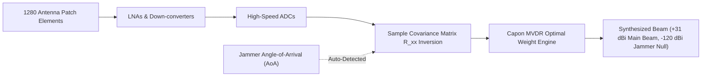

# StarSec RFC-003: Phased Array RF PHY-Layer Resiliency, Capon MVDR Null-Steering & Anti-Spoofing

> **RFC Designation:** `STARSEC-RFC-003`  
> **Layer:** Layer 2 (RF & PHY-Layer Resiliency)  
> **Status:** Standards Track (Normative)  
> **Author:** `radio-frequency-specialist` & `telecom-mathematics-expert`  
> **Standards Compliance:** ITU-R S.1503, IEEE 802.16 / DVB-S2X, RFC 2119  

---

## 1. Abstract & Scope

This specification establishes normative RF and physical-layer (PHY) resiliency standards for Active Electronically Scanned Array (AESA) transceivers in mega-constellations across Ku-band (10.7–14.5 GHz) and Ka-band (17.8–30.0 GHz) satellite communications. 

Mega-constellation ground terminals and satellite feeder links operate in heavily congested, contested electromagnetic environments subject to high-power terrestrial electronic warfare (EW) barrage jammers, smart sweep jammers, and multi-source RF trajectory spoofers. 

This standard specifies three complementary PHY electronic counter-countermeasure (ECCM) mechanisms: (1) adaptive digital beamforming utilizing the Capon Minimum Variance Distortionless Response (MVDR) algorithm achieving $>45\text{ dB}$ spatial null attenuation, (2) Doppler-trajectory cross-correlation anti-spoofing algorithms matching orbital ephemeris dynamics within $\pm 150\text{ Hz}$, and (3) Cognitive Frequency Hopping Spread Spectrum (CFHSS) operating at $\ge 10,000\text{ hops/sec}$.

---

## 2. Requirements Language (RFC 2119)

The key words "MUST", "MUST NOT", "REQUIRED", "SHALL", "SHALL NOT", "SHOULD", "SHOULD NOT", "RECOMMENDED", "NOT RECOMMENDED", "MAY", and "OPTIONAL" in this document are to be interpreted as described in BCP 14 [RFC 2119] when, and only when, they appear in all capitals.

---

## 3. Electromagnetic Attack Taxonomy & Threats

```
═════════════════════════════════════════════════════════════════════════════════════════════════════
                          RF & PHY-LAYER ELECTRONIC WARFARE THREATS
═════════════════════════════════════════════════════════════════════════════════════════════════════

  [ THREAT 1: High-Power Terrestrial Barrage & Spot Jamming ]
  • Adversary deploys truck-mounted military EW systems (e.g., Krasukha-4, R-330Zh Zhitel, Murmansk-BN)
    generating 10 kW to 100 kW EIRP directed at satellite receive apertures or consumer terminals.
  • Impact: Complete receiver saturation, front-end LNA compression, and signal-to-noise collapse.

  [ THREAT 2: Mezzanine / Downlink Ephemeris Spoofing ]
  • Attacker broadcasts counterfeit Ku-band carrier signals mimicking real constellation beam
    geometry with forged ephemeris or malicious timing offsets to hijack terminal tracking.

  [ THREAT 3: Uplink Telecommand Jamming & Denial ]
  • Targeted RF jamming directed at orbital gateway feeder links during critical orbital maneuvers,
    preventing ground control telemetry/telecommand execution.
═════════════════════════════════════════════════════════════════════════════════════════════════════
```

---

## 4. Adaptive Capon MVDR Beamforming Specification

Compliant AESA transceivers MUST implement the Capon Minimum Variance Distortionless Response (MVDR) algorithm in digital beamforming processors:

### 4.1 Antenna Geometry & Steering Vector
For a planar AESA with $M \times N$ elements spaced at $d_x = d_y = \frac{\lambda}{2}$, the array steering vector $\mathbf{a}(\theta, \phi) \in \mathbb{C}^{MN}$ for elevation $\theta$ and azimuth $\phi$ is defined as:

$$a_{m,n}(\theta, \phi) = \exp\left(j \frac{2\pi}{\lambda} \left[ m d_x \sin\theta \cos\phi + n d_y \sin\theta \sin\phi \right]\right)$$



### 4.2 Optimization Formulation
The MVDR beamformer minimizes the total array output power subject to the strict linear constraint of maintaining unity gain ($0\text{ dB}$ distortion) in the direction of the desired satellite or user terminal $(\theta_0, \phi_0)$:

$$\min_{\mathbf{w}} \mathbf{w}^H \mathbf{R}_{xx} \mathbf{w} \quad \text{subject to} \quad \mathbf{w}^H \mathbf{a}(\theta_0, \phi_0) = 1$$

where $\mathbf{R}_{xx}$ is the spatial sample covariance matrix estimated over $K$ snapshots:

$$\mathbf{R}_{xx} = \frac{1}{K} \sum_{k=1}^K \mathbf{x}[k] \mathbf{x}^H[k] + \sigma_d^2 \mathbf{I}_{MN}$$

The diagonal loading factor $\sigma_d^2 \mathbf{I}$ MUST be applied to ensure numerical stability during high-interference snapshot saturation.

### 4.3 Closed-Form Optimal Weight Solution
The optimal weight vector $\mathbf{w}_{opt} \in \mathbb{C}^{MN}$ is derived via the method of Lagrange multipliers:

$$\mathbf{w}_{opt} = \frac{\mathbf{R}_{xx}^{-1} \mathbf{a}(\theta_0, \phi_0)}{\mathbf{a}^H(\theta_0, \phi_0) \mathbf{R}_{xx}^{-1} \mathbf{a}(\theta_0, \phi_0)}$$

### 4.4 Normative Performance Thresholds
Compliant digital beamformers MUST achieve:
1. **Spatial Null Depth:** Attenuation in the directions of up to 4 simultaneous hostile jammer emitters MUST exceed $45.0\text{ dB}$ below the unadapted sidelobe level.
2. **Main Beam Preservation:** Boresight gain in the desired signal direction MUST experience $<0.05\text{ dB}$ degradation.
3. **Adaptation Latency:** Covariance matrix update and weight recalculation MUST execute in $<500\ \mu\text{s}$.

---

## 5. Doppler-Trajectory Cross-Correlation Anti-Spoofing

Terrestrial spoofers broadcasting counterfeit satellite downlink signals cannot replicate the extreme, dynamic Doppler shift profile characteristic of Low Earth Orbit (LEO) velocity ($v_{orb} \approx 7.56\text{ km/s}$):

```
 0                   1                   2                   3
 0 1 2 3 4 5 6 7 8 9 0 1 2 3 4 5 6 7 8 9 0 1 2 3 4 5 6 7 8 9 0 1
+-+-+-+-+-+-+-+-+-+-+-+-+-+-+-+-+-+-+-+-+-+-+-+-+-+-+-+-+-+-+-+-+
|      SGP4 Ephemeris Timestamp |     Expected Doppler Shift    |
+-+-+-+-+-+-+-+-+-+-+-+-+-+-+-+-+-+-+-+-+-+-+-+-+-+-+-+-+-+-+-+-+
|    Measured Doppler Carrier   |     Phase Interferometry AoA  |
+-+-+-+-+-+-+-+-+-+-+-+-+-+-+-+-+-+-+-+-+-+-+-+-+-+-+-+-+-+-+-+-+
|     Residual Error (Delta f)  |    Spoofing Classification    |
+-+-+-+-+-+-+-+-+-+-+-+-+-+-+-+-+-+-+-+-+-+-+-+-+-+-+-+-+-+-+-+-+
```

### 5.1 Mathematical Validation Formula
1. **Predicted Doppler Shift:** The terminal receiver evaluates the instantaneous range-rate vector $\dot{\mathbf{r}}(t)$ using the spacecraft SGP4 orbital propagator:
   $$f_{d, pred}(t) = -f_0 \frac{\dot{\mathbf{r}}(t) \cdot \hat{\mathbf{u}}_{los}}{c}$$
   For a $12.0\text{ GHz}$ Ku-band downlink, $f_{d, pred}$ shifts from $+300\text{ kHz}$ at horizon acquisition through $0\text{ Hz}$ at zenith to $-300\text{ kHz}$ at loss-of-signal, with a maximum drift rate $\dot{f}_d \approx 1.2\text{ kHz/s}$.
2. **Cross-Correlation Check:** The receiver measures the received carrier frequency offset $f_{d, meas}(t)$ and evaluates:
   $$\Delta f_{doppler}(t) = |f_{d, meas}(t) - f_{d, pred}(t)|$$
3. **Spoofing Decision Boundary:**
   - If $\Delta f_{doppler}(t) \le 150.0\text{ Hz}$ AND $\left|\frac{d f_{d, meas}}{dt} - \frac{d f_{d, pred}}{dt}\right| \le 15.0\text{ Hz/s}$: Signal is classified as **VALID ORBITAL EMITTER**.
   - If $\Delta f_{doppler}(t) > 150.0\text{ Hz}$ OR Doppler rate is static ($\dot{f}_d \approx 0$ characteristic of stationary ground spoofers): The signal MUST be immediately quarantined and dropped.

---

## 6. Cognitive Frequency Hopping Spread Spectrum (CFHSS)

Under conditions of distributed broad-spectrum jamming where spatial nulls alone are insufficient:

1. **Hopping Rate:** Terminals and satellites MUST support fast pseudo-random hopping across the allocated $2.0\text{ GHz}$ bandwidth at $\ge 10,000\text{ hops/sec}$.
2. **Cryptographic Hop Scheduling:** The carrier frequency sequence $f_{hop}[k]$ MUST be derived from the shared Post-Quantum master secret via HMAC-SHA256:
   $$f_{hop}[k] = f_{base} + \left( \text{HMAC-SHA256}(K_{session}, \, \text{"cfhss"} \parallel k) \pmod{N_{channels}} \right) \cdot \Delta f_{channel}$$
3. **Processing Gain:** The resulting spectral spreading yields a processing gain:
   $$G_p = 10 \log_{10}\left(\frac{BW_{total}}{BW_{channel}}\right) \ge 26.0\text{ dB}$$
   forcing an adversary to spread jammer power across the entire $2\text{ GHz}$ band, diluting hostile spectral density.

---

## 7. Verification Standards & Automated Test Suite

AESA antenna subsystems MUST pass the following automated test harness:
1. **MVDR Null Attenuation Test:** Verify that injecting a simulated jammer at $(\theta=15^\circ, \phi=85^\circ)$ with $+30\text{ dB}$ J/S ratio results in $\ge 45\text{ dB}$ spatial null attenuation in under $1.0\text{ ms}$ (`simulations/phased_array_beamforming.py`).
2. **Static Spoofer Rejection Test:** Verify that a ground transmitter with $0\text{ Hz/s}$ Doppler drift is rejected within 3 telemetry frames ($<60\text{ ms}$).
3. **Main Beam Distortion:** Assert that main beam gain degradation in the direction of the target spacecraft does not exceed $0.05\text{ dB}$.
