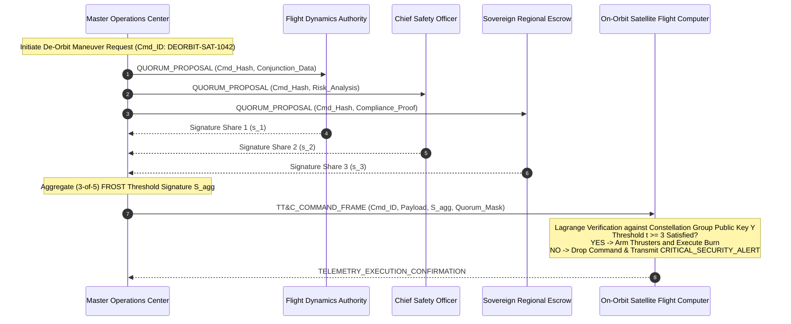

# StarSec RFC-004: Sovereign & Telecommand (TT&C) Multi-Party Threshold Quorum

> **RFC Designation:** `STARSEC-RFC-004`  
> **Layer:** Layer 4 (Ground Segment, Sovereign & Telecommand Quorum Layer)  
> **Status:** Standards Track (Normative)  
> **Author:** `cryptographic-protocols-mathematics-expert` & `spacecraft-orbital-mechanics-engineer`  
> **Standards Compliance:** NIST SP 800-56A, FIPS 186-5, RFC 2119, IETF draft-irtf-cfrg-frost-15  

---

## 1. Abstract & Scope

This specification defines the cryptographic protocols, threshold secret sharing structures, and on-orbit verification rules for flight-critical Telemetry, Tracking, and Telecommand (TT&C) operations across Low Earth Orbit (LEO) mega-constellations. 

In traditional satellite operations, ground stations execute commands signed by a single operator or automated scheduler. In a mega-constellation of 10,000+ spacecraft, a single compromised ground station, coerced operator, or rogue insider could issue mass de-orbit or unauthorized station-keeping commands, precipitating catastrophic orbital collisions and Kessler syndrome cascades. 

This standard mandates an on-orbit verifiable $(t, n)$ Multi-Party Computation (MPC) quorum architecture utilizing Shamir's Secret Sharing over finite field $\mathbb{F}_{2^{256}}$ and Flexible Round-Optimized Schnorr Threshold (FROST) multi-signatures. Furthermore, it defines a Zero-Knowledge Sovereign Telemetry Gateway allowing national regulators to verify regional exclusion zones and RF power limits without exposing subscriber payload transit data.

---

## 2. Requirements Language (RFC 2119)

The key words "MUST", "MUST NOT", "REQUIRED", "SHALL", "SHALL NOT", "SHOULD", "SHOULD NOT", "RECOMMENDED", "NOT RECOMMENDED", "MAY", and "OPTIONAL" in this document are to be interpreted as described in BCP 14 [RFC 2119] when, and only when, they appear in all capitals.

---

## 3. Mission Threat Model & Command Criticality Classes

```
═════════════════════════════════════════════════════════════════════════════════════════════════════
                       TELECOMMAND ATTACK VECTORS & CRITICALITY TIERS
═════════════════════════════════════════════════════════════════════════════════════════════════════

  [ THREAT 1: The Rogue Ground Operator / Coerced Insider ]
  • A single compromised engineer or compromised operations credential issues an atmospheric
    de-orbit burn command to 100 satellites in Shell 1 (550 km), causing irreversible mission loss.

  [ THREAT 2: Unilateral Geopolitical Kill Switches ]
  • A single sovereign entity forces a commercial satellite operator to abruptly terminate service
    over conflict zones without international consensus or legal multi-party authorization.

  [ THREAT 3: Feeder Ground Gateway Hijack ]
  • Adversary breaches a physical gateway dish and injects forged telecommand frames to modify
    satellite attitude control reaction-wheel biases.
═════════════════════════════════════════════════════════════════════════════════════════════════════
```

### 3.1 Telecommand Criticality Classification

All constellation telecommands MUST be categorized into one of three Criticality Classes:

| Class | Command Types | Quorum Authorization Required | Typical Latency Budget |
| :--- | :--- | :--- | :--- |
| **Class A: Tactical Autonomous** | SGP4 Foster-Estes Conjunction Collision Avoidance ($P_c > 10^{-4}$); antenna steering; battery heater duty cycles. | Autonomous On-Board Flight Computer (No ground quorum needed). | $<500\text{ ms}$ |
| **Class B: Routine Operations** | Minor orbital trim ($|\Delta v| < 0.2\text{ m/s}$); routing table updates; routine telemetry polling. | Single Authenticated Ground Station (CSF-L1 baseline). | $<5.0\text{ s}$ |
| **Class C: Flight-Critical Irreversible** | Atmospheric De-Orbit burns ($|\Delta v| > 15\text{ m/s}$); orbital plane relocation; flight software BootROM flashes; constellation-wide payload shutdown. | **Mandatory $(t, n)$ Multi-Party Threshold Quorum (CSF-L3).** | $<60.0\text{ s}$ |

---

## 4. Multi-Party Threshold Quorum Protocol

Compliant satellite avionics MUST reject any Class C Flight-Critical command unless accompanied by a cryptographically verifiable $(t, n)$ threshold multi-signature.



---

## 5. Mathematical Specification: Shamir $(t, n)$ & FROST Verification

### 5.1 Polynomial Secret Sharing Over Finite Field $\mathbb{F}_p$
The constellation master command authorization secret $S \in \mathbb{F}_p$ is partitioned across $n$ authorized key holders using a random polynomial of degree $t - 1$:

$$f(x) = S + \sum_{j=1}^{t-1} a_j x^j \pmod p$$

where $p = 2^{256} - 189$ (standard 256-bit prime field). Each authorized entity $i \in \{1, \dots, n\}$ receives private share $(i, f(i))$.

### 5.2 On-Orbit Lagrange Reconstruction Verification
The satellite flight computer does NOT reconstruct the raw secret $S$ (to prevent memory compromise). Instead, it verifies the aggregated signature $S_{agg}$ against the group public key $Y = g^S$ using Lagrange basis polynomials $\ell_i(0)$:

$$\ell_i(0) = \prod_{j \in \mathcal{T}, j \ne i} \frac{-j}{i - j} \pmod p$$

where $\mathcal{T} \subset \{1, \dots, n\}$ is the subset of participating signatories with $|\mathcal{T}| = t$.

The aggregated Schnorr threshold signature $(R, z)$ on command message $m$ is valid if and only if:

$$g^z = R \cdot Y^{c} \pmod p, \quad \text{where } c = H(R \parallel Y \parallel m)$$

If even a single share is missing ($|\mathcal{T}| < t$) or invalid, verification fails identically to random guessing ($P_{forge} \le 2^{-256}$).

---

## 6. Packet Wire Format for TT&C Quorum Frames

Quorum-protected command frames MUST use the following big-endian binary layout:

```
 0                   1                   2                   3
 0 1 2 3 4 5 6 7 8 9 0 1 2 3 4 5 6 7 8 9 0 1 2 3 4 5 6 7 8 9 0 1
+-+-+-+-+-+-+-+-+-+-+-+-+-+-+-+-+-+-+-+-+-+-+-+-+-+-+-+-+-+-+-+-+
|          Magic (0x5155)       |    Version    | Critical Class|
+-+-+-+-+-+-+-+-+-+-+-+-+-+-+-+-+-+-+-+-+-+-+-+-+-+-+-+-+-+-+-+-+
|                         Command Sequence                      |
+-+-+-+-+-+-+-+-+-+-+-+-+-+-+-+-+-+-+-+-+-+-+-+-+-+-+-+-+-+-+-+-+
|    Target Satellite ID (32-bit Norad / Constellation ID)      |
+-+-+-+-+-+-+-+-+-+-+-+-+-+-+-+-+-+-+-+-+-+-+-+-+-+-+-+-+-+-+-+-+
|        Quorum Threshold (t)   |       Signers Mask (n=16)     |
+-+-+-+-+-+-+-+-+-+-+-+-+-+-+-+-+-+-+-+-+-+-+-+-+-+-+-+-+-+-+-+-+
|                                                               |
|             Command Message Payload (e.g. Burn Vector)        |
|                                                               |
+-+-+-+-+-+-+-+-+-+-+-+-+-+-+-+-+-+-+-+-+-+-+-+-+-+-+-+-+-+-+-+-+
|             Aggregated Threshold Signature (R, z)             |
|                           (64 bytes)                          |
+-+-+-+-+-+-+-+-+-+-+-+-+-+-+-+-+-+-+-+-+-+-+-+-+-+-+-+-+-+-+-+-+
|                   HMAC-SHA256 Frame Auth Tag                  |
+-+-+-+-+-+-+-+-+-+-+-+-+-+-+-+-+-+-+-+-+-+-+-+-+-+-+-+-+-+-+-+-+
```

---

## 7. Sovereign Regulatory Telemetry Gateways (Zero-Knowledge Compliance)

National telecommunications authorities (e.g., US FCC, India IN-SPACe/DoT, ITU) require verification that mega-constellations adhere to regional power flux density (PFD) limits and territorial exclusion zones.

1. **Payload Isolation:** The constellation operator MUST NOT route unencrypted subscriber data packets through sovereign regulatory inspection nodes.
2. **Zero-Knowledge Proof of Compliance:** The satellite generates a non-interactive zero-knowledge proof (ZK-SNARK / Groth16) certifying:
   $$\pi_{compliance} = \text{ZK-Prove}\left\{ (\text{BeamCoordinates}, \, \text{EIRP}, \, \text{SpectrumBand}) \in \text{RegulatoryRuleset} \right\}$$
3. **Auditing Without Decryption:** Sovereign gateways verify $\text{Verify}(\pi_{compliance}) == \text{TRUE}$ in $<10\text{ ms}$, ensuring full regulatory sovereignty while protecting subscriber privacy and commercial proprietary routing algorithms.

---

## 8. Verification & Test Criteria

Implementations of StarSec RFC-004 MUST satisfy the following test assertions:
1. **Quorum Acceptance Test:** Presenting exactly $t$ valid signature shares for a Class C command MUST reconstruct and execute successfully (`simulations/mpc_quorum_telecommand.py`).
2. **Sub-Threshold Rejection Test:** Presenting $t - 1$ valid signature shares MUST result in immediate command rejection and trigger a cryptographic security alert.
3. **Mismatched Signer Test:** Corrupted or forged signature shares MUST fail Lagrange interpolation verification with $100\%$ detection.
4. **Autonomous Bypass Verification:** Class A autonomous collision avoidance commands MUST execute without ground quorum delay when $P_c > 10^{-4}$.
