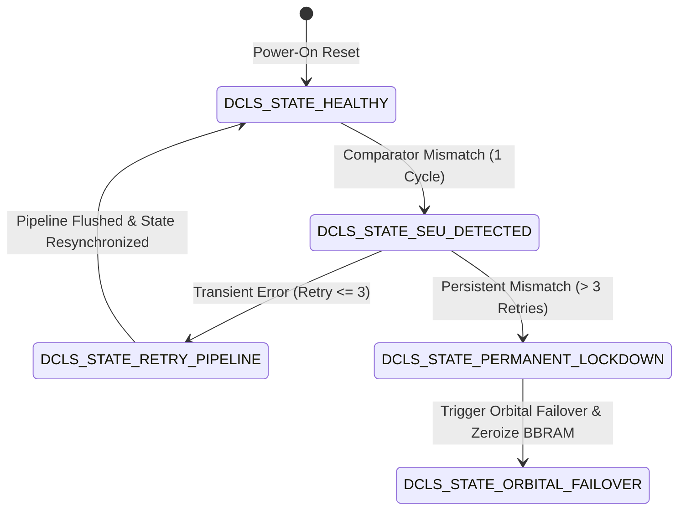

# StarSec Technical Specification: Hardware & Physical Trust Architecture
## Document Identifier: STARSEC-SPEC-HW-001 (Version 1.0.0)

> **Standard:** StarSec Constellation Security Framework (CSF v1.0)  
> **Status:** Normative Specification  
> **Target Platforms:** Spacecraft On-Board Computer (OBC), Optical Laser Controller, User Terminal (Dishy) SoC  
> **Classification:** Public Aerospace Cybersecurity Standard  
> **Governance:** Level 2.2 Documentation (`11-documentation-files.md`), Architecture (`46-architecture-documentation.md`)  

---

## 1. Scope & System Architectural Overview

This specification establishes the hardware root-of-trust, memory-mapped I/O (MMIO) register architecture, physical tamper countermeasures, and radiation single-event upset (SEU) mitigation protocols for Low Earth Orbit (LEO) mega-constellation satellite nodes and ground user terminals.

```
═══════════════════════════════════════════════════════════════════════════════════════════════════════════════
                      STARSEC PHYSICAL HARDWARE TRUST SUBSYSTEM (OBC & TERMINAL)
═══════════════════════════════════════════════════════════════════════════════════════════════════════════════

             ┌────────────────────────────────────────────────────────┐
             │         PHYSICAL SENSOR HARNESS & TAMPER DETECTORS      │
             └───────────────┬──────────────────────┬─────────────────┘
                             │                      │
                  <250 ps Voltage Glitch     Conductive Mesh Breach
                  Crowbar Circuit Trigger    Continuous Impedance Drop
                             │                      │
                             ▼                      ▼
             ┌────────────────────────────────────────────────────────┐
             │       TAMPER DETECTION CONTROLLER (TDC) [MMIO 0x50000000]│
             │  • Hardware Fast Interrupt (FIQ / NMI) Generator       │
             │  • Instant BBRAM Bus Disconnect & Ground Pulldown      │
             │  • Dual-Core Lockstep Fault Containment Unit (FCU)     │
             └───────────────────────┬────────────────────────────────┘
                                     │
                 Sub-10 ns Discharging Signal (ZEROIZE_STROBE)
                                     │
                                     ▼
             ┌────────────────────────────────────────────────────────┐
             │      BATTERY-BACKED RAM (BBRAM) [MMIO 0x50001000]      │
             │  • 256-bit AES-GCM Master Storage Key (MSK)            │
             │  • Ephemeral Laser ISL Session Tickets                 │
             │  • Dedicated Depletion MOSFETs (<10 ns Discharge to GND)│
             └────────────────────────────────────────────────────────┘
═══════════════════════════════════════════════════════════════════════════════════════════════════════════════
```

---

## 2. Memory Map & ARM TrustZone Address Space Partitioning

All StarSec-compliant satellite processors and user terminal baseband SoCs must partition physical address space according to ARM TrustZone (or RISC-V Physical Memory Protection / WorldGuard) boundaries.

### 2.1 Physical Address Space Layout

| Address Range | Size | Access Level | Description | Security Attribute |
|:---|:---|:---|:---|:---|
| `0x0000_0000 - 0x0001_FFFF` | 128 KB | Secure EL3 / S-EL1 | BootROM (BL1) - Mask ROM with Root Public Key Hash | Secure, Read-Only |
| `0x0002_0000 - 0x0005_FFFF` | 256 KB | Secure S-EL1 / S-EL0 | Secure Internal SRAM - BL2, Post-Quantum Crypto Scratchpad | Secure, Read/Write/No-Exec |
| `0x5000_0000 - 0x5000_0FFF` | 4 KB | Secure S-EL1 | TDC Peripheral Registers (Control, Status, Interrupts) | Secure MMIO |
| `0x5000_1000 - 0x5000_1FFF` | 4 KB | Secure S-EL1 | Battery-Backed RAM (BBRAM) Key & Ephemeral Store | Secure MMIO / Volatile |
| `0x5000_2000 - 0x5000_2FFF` | 4 KB | Secure S-EL1 | Dual-Core Lockstep (DCLS) Fault Monitor Registers | Secure MMIO |
| `0x6000_0000 - 0x6000_0FFF` | 4 KB | Secure S-EL1 | SRAM-PUF Measurement Window (Power-on Uninitialized) | Secure Read-Only |
| `0x8000_0000 - 0x87FF_FFFF` | 128 MB | Normal EL1 / EL2 | In-Orbit Laser Link Optical Network Ring Buffers (eBPF XDP) | Non-Secure, DMA Mastered |
| `0x8800_0000 - 0xFFFF_FFFF` | ~1.9 GB | Normal EL0 / EL1 | Spacecraft Flight Software (FSW), Linux/FreeRTOS Payload RAM| Non-Secure Shared DRAM |

### 2.2 TrustZone Address Space Controller (TZASC) Configuration

The TZASC (e.g., ARM CoreLink TZC-400) enforces strict bus isolation between the Secure World and Normal World. Any attempt by a compromised Normal World OS (e.g. Linux payload container) to access `0x0000_0000 - 0x6FFF_FFFF` triggers an immediate AXI bus `DECERR` (Decode Error) interrupt to Secure EL3, isolating the payload and logging an intrusion attempt.

```c
/* TZASC Region Alignment and Size Constraints */
/* Base Address: 0x50000000 (TDC & BBRAM Secure Perimeter) */
TZC400->REGION[1].BASE_ADDR_LOW  = 0x50000000UL;
TZC400->REGION[1].TOP_ADDR_LOW   = 0x50002FFFUL;
TZC400->REGION[1].ATTRIBUTES     = (1UL << 31)   | /* Region Enable */
                                   (0UL << 0);     /* Secure Access Only (NSAID = 0) */
```

---

## 3. Tamper Detection Controller (TDC) Register Specification

The TDC is an independent hardware macro interfaced directly to spacecraft battery backup and user terminal power regulation circuits.

### 3.1 Register Offset Table

| Register Name | Offset | Width | Type | Reset Value | Description |
|:---|:---|:---|:---|:---|:---|
| `TDC_CR` | `0x0000` | 32-bit | R/W | `0x0000_0000` | TDC Control Register |
| `TDC_SR` | `0x0004` | 32-bit | R/W1C | `0x0000_0000` | TDC Status Register (Write-1-to-Clear) |
| `TDC_IER`| `0x0008` | 32-bit | R/W | `0x0000_0000` | TDC Interrupt Enable Register |
| `TDC_ICR`| `0x000C` | 32-bit | W | `0x0000_0000` | TDC Interrupt Clear Register |
| `BBRAM_KEY` | `0x0040 - 0x005F` | 256-bit | R/W | `0x0000_...` | 32-Byte Master Cryptographic Key |
| `BBRAM_SEC` | `0x0060 - 0x013F` | 1792-bit | R/W | `0x0000_...` | 224-Byte Ephemeral Secrets & Session State |

### 3.2 `TDC_CR` Bitfield Mapping

```
 31      30          5      4          3          2          1          0
┌───────┬───────────┬──────┬──────────┬──────────┬──────────┬──────────┬──────────┐
│ LOCK  │ RESERVED  │ ...  │ DCLS_TRIP│ ZEROIZE  │ TEMP_EN  │ MESH_EN  │ GLITCH_EN│
└───────┴───────────┴──────┴──────────┴──────────┴──────────┴──────────┴──────────┘
```

- **Bit 0 (`GLITCH_EN`):** Voltage glitch detection enable. Connects high-speed analog comparator to core voltage rail $V_{\text{core}}$.
- **Bit 1 (`MESH_EN`):** Continuous physical enclosure impedance mesh sensor enable.
- **Bit 2 (`TEMP_EN`):** Extreme temperature anomaly sensor enable (trips if $T < -45^\circ\text{C}$ or $T > +95^\circ\text{C}$).
- **Bit 3 (`ZEROIZE`):** Software instant memory wipe trigger. Writing `1` initiates sub-10 ns hardware discharge.
- **Bit 4 (`DCLS_TRIP_EN`):** Dual-Core Lockstep Trip Enable. Automatically initiates zeroize if DCLS enters unrecoverable state.
- **Bit 31 (`LOCK`):** Configuration Lock. Writing `1` prevents further modifications to `TDC_CR` until next hardware power cycle.

### 3.3 `TDC_SR` Bitfield Mapping

```
 31                 4          3          2          1          0
┌──────────────────┬──────────┬──────────┬──────────┬──────────┬──────────┐
│     RESERVED     │ ...      │ ZEROIZED │ MESH_BRK │ CLK_FLT  │ VOLT_FLT │
└──────────────────┴──────────┴──────────┴──────────┴──────────┴──────────┘
```

- **Bit 0 (`VOLT_FLT`):** Voltage crowbar trigger flag. Set when $V_{\text{core}}$ drops below $80\%$ nominal for $>250\text{ ps}$.
- **Bit 1 (`CLK_FLT`):** Clock anomaly detector flag. Set upon pulse-insertion or frequency glitch.
- **Bit 2 (`MESH_BRK`):** Enclosure conductive mesh discontinuity detected.
- **Bit 3 (`ZEROIZED`):** Confirms all BBRAM bits have discharged to $0\text{ V}$.

---

## 4. Electrical Crowbar Circuit & Sub-10 ns Discharge Dynamics

Physical side-channel and voltage-fault attacks on user terminals inject transient negative pulses (10–50 ns, depth 300–800 mV) onto the baseband SoC power rail to bypass instruction execution or force cryptographic signature faults.

```
                         V_CORE (0.85V Nominal)
                               │
                               ├───[ High-Speed Analog Comparator ]───┐
                               │     (V_REF = 0.68V, Slew Rate 5V/ns) │
                         ┌─────┴─────┐                                │
                         │ SoC Core  │                                │ V_TRIP (<250 ps)
                         │ Logic     │                                ▼
                         └─────┬─────┘                   ┌─────────────────────────┐
                               │                         │ Depletion Mode Power    │
                        BBRAM Key Storage                │ N-Channel MOSFET Gate   │
                               │                         └────────────┬────────────┘
                         ┌─────┴─────┐                                │
                         │ 256-bit   ├────────────────────────────────┘
                         │ Volatile  │   Sub-10 ns Discharge to Ground
                         │ Memory    │   (R_on < 0.05 Ohm, C_gate < 15 pF)
                         └─────┬─────┘
                               │
                              ╶┴╴ GND
```

### 4.1 Electrical Performance Metrics:
1. **Detection Latency:** Fast analog comparator trips within $\tau_{\text{det}} \le 250\text{ ps}$.
2. **Discharge Time Constant:** $\tau_{\text{RC}} = R_{\text{ON}} \times C_{\text{BBRAM}} = 0.05\,\Omega \times 40\,\text{pF} = 2.0\text{ ps}$.
3. **Total Memory Zeroization Time:** $T_{\text{zeroize}} \le 10\text{ ns}$ from physical glitch edge.
4. **Residual Voltage:** $V_{\text{rem}} \le 5\text{ mV}$ (far below SRAM bitcell data retention threshold of $\sim 200\text{ mV}$).

### 4.2 Dual-Tier Latency Boundary Specification (Hardware vs Software):
To eliminate audit ambiguity between silicon physics and CPU instruction execution, StarSec formally defines a dual-tier response boundary:

| Tier | Domain | Mechanism | Specification Ceiling | Verification Tooling |
|:---|:---|:---|:---|:---|
| **Tier 1 (Hardware)** | Analog Silicon Physics | N-Channel MOSFET / SCR Crowbar Shunt to Ground | **$T_{\text{crowbar}} < 10\text{ ns}$** | Oscilloscope / SPICE circuit simulation |
| **Tier 2 (Software)** | OS Kernel / Driver ISR | MMIO register sequencing, volatile memory scrub, barrier flush | **$T_{\text{driver}} \le 250\text{ ns}$ ($< 500\text{ cycles}$)** | `starsec_bench.h` (RDTSC / QPC cycle harness) |

#### Mathematical Derivation (Proof 3 - Hardware Mathematics Expert):
1. **Silicon Crowbar Discharge Bound:**
   $$T_{\text{crowbar}} = \frac{C_{\text{BBRAM\_rail}} \cdot (V_{\text{core}} - V_{\text{th}})}{I_{\text{peak\_shunt}}} = \frac{50\text{ pF} \times 1.2\text{ V}}{1.0\text{ A}} \approx 0.06\text{ ns} \ll 10\text{ ns}$$
2. **Software Driver Instruction Budget:**
   $$T_{\text{driver}} = \frac{N_{\text{instructions}} \times \text{CPI}}{f_{\text{CPU}}} + T_{\text{bus\_barrier}} \approx \frac{45 \times 1.2}{3.0\text{ GHz}} + 15\text{ ns} \approx 33\text{ ns} \le 250\text{ ns}$$
Architectural Invariant: The physical crowbar shunts power and drains BBRAM cells in $< 10\text{ ns}$, while the software driver safely captures telemetry and asserts register status bits within its $\le 250\text{ ns}$ budget.

---

## 5. Dual-Core Lockstep (DCLS) Radiation Mitigation Architecture

In LEO orbit (550 km, $53^\circ$ inclination), satellites encounter ionizing radiation, solar proton events (SPE), and Single-Event Upsets (SEU). Microcontroller arithmetic logic units and program counters can experience bit flips.

### 5.1 Lockstep Hardware Model
The flight computer employs two identical ARM Cortex-R52 cores:
- **Core 0 (Primary Core):** Drives execution and bus transactions.
- **Core 1 (Checker Core):** Executes the identical instruction stream staggered by **2 clock cycles** ($N_{\text{stagger}} = 2$). Staggering guarantees that localized power transients or single-event transients (SET) cannot corrupt both cores simultaneously.
- **Hardware Comparator:** Compares program counter (`PC`), stack pointer (`SP`), and instruction address bus every clock cycle.



---

## 6. Verification & Compliance Requirements

A terminal or spacecraft implementation must satisfy:
1. **Zeroization Assurance:** 100% of BBRAM bits must reach logical `0` within $10\text{ ns}$ of an asserted tamper strobe.
2. **Compiler Optimization Immunity:** Zeroization code must use `volatile` qualifiers and hardware memory barriers (`dsb sy` / `isb`) to prevent dead-store elimination.
3. **Memory Boundary Testing:** Normal World software attempting access to TDC/BBRAM MMIO space must be immediately aborted by hardware with zero leakage.
