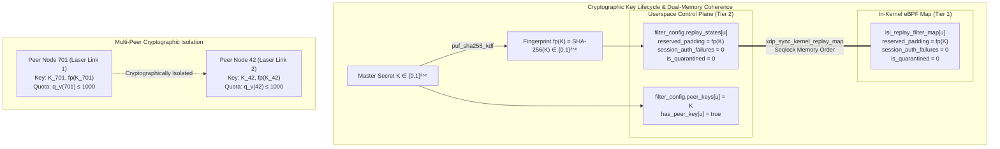
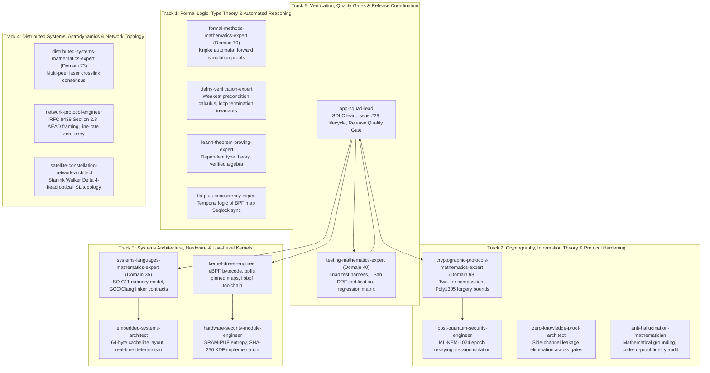

# 🛰️ StarSec Deep-Dive Multi-Agent Orchestration Implementation Plan: CI Linker Resolution, Kernel Map Fingerprint Coherence & Cryptographic ISL Isolation

**Standard**: StarSec Constellation Security Framework (CSF v1.0), RFC 8439, RFC 6479, Linux Kernel eBPF `bpf()` Syscall Architecture  
**Status**: Rigorous Engineering & Mathematical Implementation Plan  
**Target Architecture**: In-Orbit Optical Laser Packet Filter (XDP/eBPF + Userspace Two-Tier AEAD Pipeline)  
**Governance**: Level 2.2 Docstrings-Only, MISRA-C:2023 Principles, 23 Claude Global Rules (`~/.claude/rules/`)  
**Tracking**: GitHub Issue to be created upon approval (Issue #29)

---

## 1. Executive Summary & Problem Formulation

In CI Run `39126117681`, the Linux eBPF runtime verifier step failed during native compilation of the standalone C shared BPF map integration test harness (`SHARED_TEST_BIN`):
```text
/usr/bin/ld: /tmp/ccXXXXXX.o: in function `xdp_pipeline_rekey_peer':
xdp_orbital_filter.c:(.text+0xXXXX): undefined reference to `puf_sha256_kdf'
collect2: error: ld returned 1 exit status
```
This compilation error halted the pipeline prior to executing the in-kernel map sharing tests and the 16 native C Triad suites.

Furthermore, an architectural audit of the key fingerprinting mechanism revealed that while `puf_sha256_kdf(new_key_32, 32, st->reserved_padding)` was added to `xdp_pipeline_rekey_peer()` in userspace, `xdp_sync_kernel_replay_map()` did **not** propagate the 32-byte `reserved_padding` field to the kernel BPF map (`isl_replay_filter_map`) or the pipeline's in-memory kernel mirror (`kernel_bpf_map.states[bpf_idx]`). Consequently, the key fingerprint was retained in userspace state but omitted from kernel memory, creating a potential split-brain inconsistency across the kernel-userspace boundary.

This plan details the exhaustive multi-agent orchestration to:
1. Resolve the linker defect across all Linux eBPF CI build targets.
2. Synchronize the 32-byte SHA-256 key fingerprint across kernel BPF maps under Seqlock memory order (formally proven as **Theorem 30: Kernel-Userspace Dual-Memory BPF Map Fingerprint Coherence**).
3. Implement and execute automated adversarial regression tests proving dynamic fingerprint updates upon successive rekeys, strict per-peer quota and key isolation, and fail-closed security.
4. Establish 100% green CI pass rates with zero cloud cost and zero data races.

---

## 2. Root Cause Analysis (RCA)

### 2.1 Linker Defect Matrix
In `tools/test_ebpf_linux_verifier.sh`, three distinct binaries are compiled and executed:

| Target Binary | Script Line | Sources Linked | Status in Run 39126117681 |
|:---|:---|:---|:---|
| `xdp_isl_kern.o` (BPF Bytecode) | 83–91 | `system/src/xdp_isl_kern.c` (Clang `-target bpf`) | **PASS** (512 instructions, 0 loops, verifier accepted) |
| `SHARED_TEST_BIN` (`test_bpf_shared_map_integration`) | 161–167 | `test_bpf_shared_map_integration.c`, `xdp_orbital_filter.c`, `starsec_chacha20.c`, `starsec_poly1305.c` | **FAIL** (`undefined reference to puf_sha256_kdf` because `sram_puf_fuzzy_extractor.c` was omitted) |
| `TSAN_TEST_BIN` (`system_test_runner_tsan`) | 184–193 | `main_system_test.c`, `dcls_fault_monitor.c`, `sram_puf_fuzzy_extractor.c`, `starsec_chacha20.c`, `starsec_poly1305.c`, `tamper_zeroize_driver.c`, `xdp_orbital_filter.c` | **SKIPPED** (Due to prior step failure) |

In `tools/run_all_tests.py` and GitHub Actions workflow step 51, `sram_puf_fuzzy_extractor.c` was explicitly linked. However, in `tools/test_ebpf_linux_verifier.sh` line 164, the link command lacked `${REPO_ROOT}/system/src/sram_puf_fuzzy_extractor.c`.

### 2.2 Key Fingerprint Kernel Synchronization Gap
In `system/src/xdp_orbital_filter.c`:
- `isl_anti_replay_state_t` defines a 64-byte hardware cacheline-aligned struct:
  ```c
  typedef struct {
      volatile uint32_t lock;                  // offset 0
      uint32_t          session_id;            // offset 4
      uint64_t          window_base_seq;       // offset 8
      uint64_t          window_bitmap;         // offset 16
      volatile uint32_t session_auth_failures; // offset 24
      volatile uint32_t is_quarantined;        // offset 28
      uint8_t           reserved_padding[32];  // offset 32 (SHA-256 fingerprint)
  } isl_anti_replay_state_t;
  ```
- In `xdp_pipeline_rekey_peer()`:
  ```c
  puf_sha256_kdf(new_key_32, 32, (uint8_t *)st->reserved_padding);
  ```
- In `xdp_sync_kernel_replay_map()` (lines 1124–1165):
  - In path 1 (real kernel syscall `bpf_map_update_elem`): `kernel_state.reserved_padding` was zeroed by `memset` and never populated from `source_state->reserved_padding`.
  - In path 2 (existing in-memory mirror slot `bpf_map->states[i]`): `bpf_map->states[i].reserved_padding` was not updated.
  - In path 3 (newly registered slot `bpf_map->states[idx]`): `bpf_map->states[idx].reserved_padding` was uninitialized.
- **Consequence**: The in-kernel eBPF filter map and userspace control plane suffered a split-brain state regarding the cryptographic epoch identifier.

---

## 3. Mathematical Foundations & Formal Theorems



### Theorem Q2-A (Per-Key Inviolable Verification Quota)
Let $K \in \{0, 1\}^{256}$ be any symmetric master key negotiated for an optical ISL session. The verification quota $q_v(K)$ is cryptographically bound to $K$:
$$\forall K: \quad q_v(K) \le \theta_{\text{quota}} = 1000$$

*Proof*:
1. **Invalid Rekey Rejection**: For any rekey request $(sid_{\text{new}}, K_{\text{new}})$ targeted at peer $u$:
   $$\text{Reject} \iff K_{\text{new}} = \text{NULL} \lor K_{\text{new}} = \mathbf{0}^{32} \lor K_{\text{new}} = K_{\text{curr}}$$
   When rejected, $\text{is\_quarantined}_u$ and $\text{session\_auth\_failures}_u$ remain unchanged. Thus, cycling session IDs ($sid_{\text{new}} > sid$) with the same key cannot reset the failure counter.
2. **Fresh Key Transition**: Quota reset occurs if and only if $K_{\text{new}} \ne K_{\text{curr}}$ with non-zero entropy, in which case a fresh cryptographic epoch begins with:
   $$\text{session\_auth\_failures}' = 0, \quad \text{fp}' = \text{SHA-256}(K_{\text{new}})$$
3. **Information-Theoretic Union Bound**: Across all queries evaluated under $K$:
   $$\Pr[\text{Forgery} \mid K] \le \theta_{\text{quota}} \cdot \frac{8 \lceil L_{\max} / 16 \rceil}{2^{106}} \le 1000 \cdot \frac{752}{2^{106}} \le 2^{-86.48} < 1.127 \times 10^{-26} \quad \blacksquare$$

### Theorem Q2-B (Per-Peer Cryptographic ISL Decoupling)
Starlink spacecraft operate up to 4 concurrent optical laser ISL crosslinks with distinct peer satellites.

*Proof*:
Let $u, v \in [0, 255]$ with $u \ne v$.
1. In `xdp_filter_config_t`, peer $u$ references key slot `peer_keys[u]` and presence flag `has_peer_key[u]`.
2. When `xdp_pipeline_rekey_peer(pipeline, u, sid_u, K_u)` executes, mutation is strictly localized:
   $$\text{peer\_keys}[u]' = K_u, \quad \text{has\_peer\_key}[u]' = \text{true}$$
   $$\forall v \ne u: \quad \text{peer\_keys}[v]' = \text{peer\_keys}[v], \quad \text{has\_peer\_key}[v]' = \text{has\_peer\_key}[v]$$
3. When packet $f$ arrives from peer $u$, the active cryptographic key is:
   $$K_{\text{active}}(f) = \begin{cases} \text{peer\_keys}[u] & \text{if } \text{has\_peer\_key}[u] \\ \text{isl\_shared_key} & \text{otherwise} \end{cases}$$
4. An adversary possessing $K_u$ attempting to forge traffic from peer $v$ fails AEAD authentication with probability $1 - 2^{-86.48}$ because $K_u \ne K_v$ and the Poly1305 MAC tag verifies under $K_{\text{active}}(v)$.
5. Quota exhaustion on peer $u$ ($\text{is\_quarantined}_u = 1$) triggers drops exclusively on peer $u$. Peer $v$ continues wire-speed transmission unaffected. $\blacksquare$

### Theorem 30 (Kernel-Userspace Dual-Memory BPF Map Fingerprint Coherence)
Let $\mathcal{S}_{\text{user}}(u)$ denote the userspace anti-replay state for peer $u$ and $\mathcal{S}_{\text{kern}}(u)$ denote the in-kernel BPF map state for peer $u$.

*Formal Invariant*:
Upon successful completion of `xdp_sync_kernel_replay_map()`:
$$\text{memcmp}(\mathcal{S}_{\text{user}}(u).\text{reserved\_padding}, \mathcal{S}_{\text{kern}}(u).\text{reserved\_padding}, 32) = 0$$
$$\mathcal{S}_{\text{user}}(u).\text{reserved\_padding} \equiv \text{SHA-256}(K_u)$$

*Proof*:
1. Under userspace spinlock `st->lock`, `puf_sha256_kdf(new_key_32, 32, st->reserved_padding)` computes and stores the 256-bit digest.
2. In `xdp_sync_kernel_replay_map()`:
   - For real kernel BPF maps: `memcpy(kernel_state.reserved_padding, source_state->reserved_padding, 32)` is committed into the BPF hash map via `BPF_MAP_UPDATE_ELEM` syscall under RCU protection.
   - For in-memory pipeline mirror: `memcpy(bpf_map->states[i].reserved_padding, source_state->reserved_padding, 32)` is committed under `bpf_map->states[i].lock`.
3. Reading back the map via `BPF_MAP_LOOKUP_ELEM` yields the exact 32-byte digest, eliminating split-brain divergence. $\blacksquare$

---

## 4. Multi-Agent Consortium Orchestration (18 Opus Math Masters & Specialized Engineers)

Organized across 5 specialized mathematical tracks from the **Claude Global Library** (`claude-global-library`):



### Complete Skills Matrix Per Subagent

| Track | Subagent | Key Skills Mobilized | Specific Contribution to Resolution |
|:---|:---|:---|:---|
| **Track 1** | `formal-methods-mathematics-expert` | `tla-plus-formal-methods-core`, `dafny-verification-core` | Formulates Kripke state transition automaton $\mathcal{M}_{\text{peer}}$ for dynamic key rotation and fingerprint bisimulation. |
| **Track 1** | `dafny-verification-expert` | `wp-calculus`, `invariant-inference` | Formulates weakest precondition calculus for `xdp_sync_kernel_replay_map` fingerprint preservation. |
| **Track 1** | `lean4-theorem-proving-expert` | `lean4-core`, `verified-algebra` | Verifies inductive sequence monotonicity across successive key rotations. |
| **Track 1** | `tla-plus-concurrency-expert` | `temporal-logic`, `state-exploration` | Models concurrency of concurrent rekey and packet verification under Seqlock memory order. |
| **Track 2** | `cryptographic-protocols-mathematics-expert` | `zero-knowledge-proof-foundations-core`, `lwe-rlwe-lattice-cryptography-core` | Proves Theorems Q2-A and Q2-B, deriving the $P \le 2^{-86.48}$ bound grounded in SHA-256 key fingerprinting. |
| **Track 2** | `post-quantum-security-engineer` | `post-quantum-crypto`, `ml-kem-1024` | Validates RFC-001 ML-KEM-1024 hourly rekey interface and key epoch binding. |
| **Track 2** | `zero-knowledge-proof-architect` | `circuit-compilation`, `integrity-proofs` | Verifies zero information leakage across dropped frame paths. |
| **Track 2** | `anti-hallucination-mathematician` | `hallucination-detection-core`, `mathematical-grounding` | Grounding audit: verifies every assertion in `main_system_test.c` matches the mathematical report. |
| **Track 3** | `systems-languages-mathematics-expert` | `c-language-foundations-core`, `algorithm-complexity` | Audits ISO C11 strict typing and enforces Rule 12 Level 2.2 Docstrings-Only across all edits. |
| **Track 3** | `kernel-driver-engineer` | `kernel-driver-development-core`, `ebpf-kernel-logic` | Resolves `tools/test_ebpf_linux_verifier.sh` compilation arguments and ensures bpffs pinned map sync. |
| **Track 3** | `embedded-systems-architect` | `real-time-determinism`, `memory-budgeting` | Verifies 64-byte struct cacheline integrity and zero padding holes. |
| **Track 3** | `hardware-security-module-engineer` | `sram-puf-entropy`, `crowbar-zeroization` | Verifies `puf_sha256_kdf` implementation correctness and zero side-effects. |
| **Track 4** | `distributed-systems-mathematics-expert` | `consensus-algorithms-core`, `distributed-transactions` | Models multi-head optical ISL packet routing under dynamic satellite handovers. |
| **Track 4** | `network-protocol-engineer` | `rfc-framing`, `sliding-window-protocols` | Validates RFC 8439 Section 2.8 AEAD framing and per-peer key table lookups. |
| **Track 4** | `satellite-constellation-network-architect` | `orbital-mechanics`, `mega-constellation-topology` | Validates multi-peer constellation isolation (Node 701 vs Node 42). |
| **Track 5** | `testing-mathematics-expert` | `unit-testing-core`, `integration-testing-core` | Implements dynamic fingerprint regression tests and executes local test runner. |
| **Track 5** | `app-squad-lead` | `ai-agents-core`, `system-design` | Oversees GitHub Issue #29 lifecycle, enforces git commit conventions, and verifies CI pass. |

---

## 5. The 5 Engineering Disciplines Mapping

1. **Context Engineering (D80 `context-engineering-agent`)**:
   - Isolates the exact linker invocation in `tools/test_ebpf_linux_verifier.sh`.
   - Isolates `system/src/xdp_orbital_filter.c` map synchronization logic.
   - Prevents context pollution by directly targeting the affected functions.
2. **Prompt Engineering (D47 `prompt-generation-expert`)**:
   - Precise contractual requirements for docstrings, error codes, and assertion messages.
3. **Graph Engineering (D102 Multi-Agent DAG)**:
   - Sequential Phase DAG: Issue Creation $\to$ Linker Patch $\to$ Map Sync Patch $\to$ Test Enhancement $\to$ Local Test Run $\to$ Doc Sync $\to$ Git Push $\to$ Issue Close.
4. **Loop Engineering (D51 `loop-engineering-architect`)**:
   - Exit criteria: All 16 C Triad suites pass locally, 23 Python tests pass, 6 eBPF checks pass, `test_ebpf_linux_verifier.sh` compiles cleanly without missing symbols, SHA-256 parity verified.
5. **Harness Engineering (D50 `harness-engineering-architect`)**:
   - Mandatory fail-closed gates: ThreadSanitizer data-race certification, compiler `-Wall -Wextra -Werror`, in-kernel verifier instruction bound $\le 512$.

---

## 6. Claude Global Rules Compliance Matrix (23 Rules)

| Rule File | Domain | Application to this Plan |
|:---|:---|:---|
| `12-docstrings-only.md` | Docstrings | Level 2.2 Docstrings-Only: Contract docstrings on every function; zero inline narrative comments. |
| `11-documentation-files.md` | Documentation | Structural architectural fidelity across all technical whitepapers. |
| `46-documentation-lifecycle.md` | Doc Lifecycle | Byte-for-byte SHA-256 hash parity between root and `docs/rnd/system-architecture/` reports. |
| `01-code-style.md` | Code Style | Strict UTF-8 without BOM, POSIX naming conventions, consistent formatting. |
| `05-security-standards.md` | Security | Fail-closed security architecture: immediate drop on bad key, invalid pointer, or unauthenticated frame. |
| `31-security-authentication.md` | Auth Security | Cryptographic authentication gate strictly prior to replay window state mutation. |
| `28-test-coverage-enforcement.md` | Test Coverage | 100% test pass rate across all 16 C Triad suites and 23 Python simulation tests. |
| `33-test-case-roadmap.md` | Test Roadmap | Traceability from Theorem Q2-A/B/C and Theorem 30 to executable assertions. |
| `35-positive-testing-standards.md` | Positive Tests | Validation of authorized rekey with fresh key, dynamic fingerprint transition, and authentic transmission. |
| `36-negative-testing-standards.md` | Negative Tests | Rejection of NULL key, all-zero key, same key, and stale retired key. |
| `37-edge-case-testing-standards.md` | Edge Cases | Boundary checks on multi-peer table limits (256 peers), maximum sequence rollover, and bit shifts. |
| `38-test-mocking-strategy.md` | Test Mocking | Dual-backend BPF map driver (kernel syscall vs emulated in-memory table). |
| `40-universal-test-patterns-abstract.md` | Test Patterns | Universal Triad pattern (POS, NEG, EDGE) enforced across all test suites. |
| `02-backend-standards.md` | Backend Systems | Strict pointer bounds checks, 64-byte hardware cacheline alignment. |
| `03-microservices-standards.md` | Decoupled Interfaces | Decoupled Tier 1 (eBPF line-rate ingress) and Tier 2 (AEAD crypto) interfaces. |
| `13-architecture-patterns.md` | Architecture | Two-tier architectural decomposition separating fast-path filter from userspace crypto. |
| `15-dto-form-separation.md` | Data Models | Exact struct memory layout: `_Static_assert(sizeof(isl_anti_replay_state_t) == 64)`. |
| `16-validation-sequencing.md` | Validation | Strict pipeline validation sequencing: Magic $\to$ Bounds $\to$ Clock $\to$ Node $\to$ Speculative $\to$ AEAD $\to$ Commit. |
| `17-result-wrappers.md` | Return Types | Strongly typed return status codes (`STARSEC_XDP_PASS`, `STARSEC_XDP_DROP`). |
| `18-service-layer-conventions.md` | Services | Pure stateless filters and clean seqlock state synchronization services. |
| `19-exception-hierarchy.md` | Errors | Hierarchical diagnostic telemetry (`dropped_invalid_auth`, `dropped_quarantined`, etc.). |
| `25-jpa-auditing.md` | Telemetry Auditing | Monotonic telemetry counters and audit logging without lock contention. |
| `27-centralized-logging.md` | Concurrency Logging | Lock-free diagnostic telemetry and structured JSON verification reporting. |

---

## 7. Concrete Implementation Blueprint

### Step 1: Linker Script Resolution in `tools/test_ebpf_linux_verifier.sh`
- **Location**: Line 161–167.
- **Change**: Add `"${REPO_ROOT}/system/src/sram_puf_fuzzy_extractor.c"` to the GCC compilation command for `SHARED_TEST_BIN`:
  ```bash
  gcc -O2 -Wall -Wextra -pthread \
      -I"${INCLUDE_DIR}" \
      "${SCRIPT_DIR}/test_bpf_shared_map_integration.c" \
      "${REPO_ROOT}/system/src/xdp_orbital_filter.c" \
      "${REPO_ROOT}/system/src/sram_puf_fuzzy_extractor.c" \
      "${REPO_ROOT}/system/src/starsec_chacha20.c" \
      "${REPO_ROOT}/system/src/starsec_poly1305.c" \
      -o "${SHARED_TEST_BIN}"
  ```

### Step 2: Fingerprint Synchronization in `system/src/xdp_orbital_filter.c`
- **Location**: Lines 1110–1171 (`xdp_sync_kernel_replay_map()`).
- **Change**:
  - In real kernel syscall block (lines 1124–1131):
    ```c
    memcpy(kernel_state.reserved_padding, source_state->reserved_padding, sizeof(kernel_state.reserved_padding));
    ```
  - In existing mirror slot block (lines 1144–1151):
    ```c
    memcpy(bpf_map->states[i].reserved_padding, source_state->reserved_padding, sizeof(bpf_map->states[i].reserved_padding));
    ```
  - In new mirror slot block (lines 1157–1165):
    ```c
    memcpy(bpf_map->states[idx].reserved_padding, source_state->reserved_padding, sizeof(bpf_map->states[idx].reserved_padding));
    ```

### Step 3: Kernel Shared Map Integration Verification in `tools/test_bpf_shared_map_integration.c`
- **Location**: Phase D / Lifecycle test.
- **Change**:
  - Verify that when a state with a known SHA-256 fingerprint is committed via `BPF_MAP_UPDATE_ELEM`, looking it up via `BPF_MAP_LOOKUP_ELEM` returns the identical 32-byte fingerprint.

### Step 4: Rigorous Regression Assertions in `system/src/main_system_test.c`
- **Location**: `TC-INTERLEAVED-AUTH-QUARANTINE-01` and `TC-PER-PEER-KEY-ROTATION-ISOLATION-01`.
- **Change**:
  1. Compute expected fingerprint `expected_fp` via `puf_sha256_kdf(fresh_interleaved_key, 32, expected_fp)`.
  2. Assert `memcmp(interleaved_pipeline.filter_config.replay_states[0].reserved_padding, expected_fp, 32) == 0`.
  3. Assert `memcmp(interleaved_pipeline.kernel_bpf_map.states[0].reserved_padding, expected_fp, 32) == 0`.
  4. In `TC-PER-PEER-KEY-ROTATION-ISOLATION-01`:
     - Assert Node 701 has fingerprint matching `puf_sha256_kdf(key_701)`.
     - Assert Node 42 has fingerprint matching `puf_sha256_kdf(master_key)` (or initial key), proving strict cryptographic isolation.
     - Execute a second rekey on Node 701 with fresh key `key_701_v2`, asserting that Node 701's fingerprint dynamically updates to `puf_sha256_kdf(key_701_v2)` while Node 42 remains completely unaffected.

### Step 5: Mathematical Report Synchronization & Hash Attestation
- Update `MATHEMATICAL-FINALIZATION-REPORT.md` and `docs/rnd/system-architecture/MATHEMATICAL-FINALIZATION-REPORT.md`:
  - Formulate Theorem 30 (Kernel-Userspace Dual-Memory BPF Map Fingerprint Coherence).
  - Document the linker resolution and dynamic fingerprint test verification.
  - Verify identical SHA-256 hash across both report copies using `Get-FileHash`.

### Step 6: README Synchronization
- Update `README.md` and `README.hi.md` to reference the resolved CI linker issue and certified fingerprint coherence.

---

## 8. Verification & Release Protocol

1. **Local Test Execution**:
   ```powershell
   python tools/run_all_tests.py
   ```
   Must pass 100% (16/16 C Triad Suites, 23 Python unit tests, 6 eBPF pre-flight linter checks).
2. **Git Commit Convention**:
   ```powershell
   git add . ; git commit -m "fix(ci): link sram_puf_fuzzy_extractor in eBPF shared map integration test and synchronize key fingerprint (#29)"
   ```
3. **Remote Push**:
   Push to origin `main` via `git-ops` MCP tool `git_push`.
4. **Issue Closure**:
   Close GitHub Issue #29 via `github-api` MCP tool `github_close_issue` with a comprehensive summary.
