# 10/10 Comprehensive Multi-Agent Implementation Plan: Higher-Session-ID Quarantine Bypass Elimination, Formal Verification & Secure Rekeying Semantics

## 1. Executive Summary & Root Cause Analysis

### Security Defect: Higher-Session-ID Quarantine Bypass
In `xdp_pipeline_process_packet()` (`system/src/xdp_orbital_filter.c`) and `xdp_filter_isl()` (`system/src/xdp_isl_kern.c`), the peer quarantine gate previously evaluated:
```c
if (found_user && pipeline->filter_config.replay_states[user_idx].is_quarantined != 0U &&
    hdr->session_id <= pipeline->filter_config.replay_states[user_idx].session_id) {
    pipeline->stats.dropped_quarantined++;
    return STARSEC_XDP_DROP;
}
```
And in eBPF kernel `xdp_isl_kern.c`:
```c
if (*quarantine_p != 0U && hdr->session_id <= *curr_sess_p) {
    starsec_increment_telemetry(STARSEC_TELEM_DROPPED_STALE_SESSION);
    return XDP_DROP;
}
```

### Root Cause
1. **Unbounded Verification Oracle via Spoofed Higher Session IDs:**
   When a peer was quarantined (`is_quarantined = 1U`) after 1000 failed attempts, any packet with `hdr->session_id > current_session_id` evaluated `hdr->session_id <= current_session_id` as `false`, bypassing the quarantine gate.
   Because `xdp_check_replay_window_speculative()` also returns `true` for `session_id > current_session_id`, the forged packet reached Tier 2 RFC 8439 ChaCha20-Poly1305 MAC verification (`xdp_open_isl_frame()`).
   When MAC verification failed, `state->session_id` was NOT updated (it only updates on valid commit). Thus, an attacker could repeatedly send candidate forged frames with higher session IDs (`session_id = current + 1`), triggering unlimited Poly1305 verification attempts ($q_v \to \infty$) and invalidating the bound $q_v \le 1000$ and $P \le 2^{-86.48}$.

2. **Conflicting & Broken Recovery Semantics:**
   - **Pipeline-Level Flag Deadlock:** If `pipeline->consecutive_auth_failures >= 1000`, `pipeline->is_quarantined = true` was set. The top-level gate in `xdp_pipeline_process_packet()` (`line 1195`) dropped ALL incoming packets unconditionally, permanently deadlocking the pipeline and preventing even legitimate rekey packets from ever being processed.
   - **Unsecured In-Band Rekeying:** The previous code attempted to handle rekeying by creating an exception in the data-path quarantine check, conflating unauthenticated wire packets with authorized key rotation.

---

## 2. Multi-Agent Team Roster & Skill Loadout (Claude Global Library)

All agents and skills are sourced directly from:
`C:\Users\techd\Documents\workspace-spring-tool-suite-4-4.27.0-new\claude-global-library`

### Track A: Mathematical Masters (Derivations, Proofs & Bounds)

| Subagent | Tier | Library Path | Mandatory Skills Loaded | Core Responsibility |
|:---|:---|:---|:---|:---|
| **`cryptographic-protocols-mathematics-expert`** | **Opus** | `agents/cryptographic-protocols-mathematics-expert/agent.md` | • `cryptography-core`<br/>• `zero-knowledge-proof-foundations-core`<br/>• `secret-sharing-mpc-foundations-core` | Proves information-theoretic polynomial root bounds across $q_v$ queries: $\Pr[\text{Forgery} \mid q_v \le 1000] \le 2^{-86.48}$. Formulates game-playing reduction to ChaCha20 PRF advantage and proves oracle query bounding. |
| **`cyber-mathematics-expert`** | **Opus** | `agents/cyber-mathematics-expert/agent.md` | • `cyber-risk-quantification-core`<br/>• `cryptography-core`<br/>• `vulnerability-management-core`<br/>• `statistics-core` | Models multi-query adversary state spaces under active wire injection and proves that higher-session-ID bypass enables an unbounded search space ($q_v \to \infty$), which is strictly truncated to $q_v \le 1000$ by the pre-crypto barrier. |
| **`formal-methods-mathematics-expert`** | **Opus** | `agents/formal-methods-mathematics-expert/agent.md` | • `tla-plus-formal-methods-core`<br/>• `dafny-verification-core`<br/>• `spark-contracts-verification-core` | Formulates TLA+ state transition invariants for the quarantine state machine, proves inductive safety (quarantine ingress barrier) and liveness (deadlock-free rekey recovery via `xdp_pipeline_rekey_peer`). |
| **`testing-mathematics-expert`** | **Opus** | `agents/testing-mathematics-expert/agent.md` | • `unit-testing-core`<br/>• `mutation-testing-core`<br/>• `property-based-testing-core` | Derives the coverage criterion lattice for boundary testing around $q_v = 1000$, proves mutation score completeness, and synthesizes adversarial test vectors for higher session IDs. |
| **`systems-languages-mathematics-expert`** | **Opus** | `agents/systems-languages-mathematics-expert/agent.md` | • `c-language-foundations-core`<br/>• `cpp-language-foundations-core`<br/>• `hardware-protocols-core` | Validates C11 memory model consistency, volatile pointer semantics in eBPF maps, 64-byte hardware cacheline alignment, and untorn reads on multi-core SMP sliding windows. |
| **`aerospace-flight-mathematics-expert`** | **Opus** | `agents/aerospace-flight-mathematics-expert/agent.md` | • `aerospace-flight-software-core`<br/>• `orbital-mechanics-core` | Validates inter-satellite link (ISL) line-rate processing bounds ($<15\,\text{ns}$ for Tier 1 XDP), GPSDO receiver clock freshness window $[-200\,\text{ms}, +20\,\text{ms}]$, and flight computer RAM zeroization budgets. |

### Track B: Security Architecture & Cryptographic Specialists

| Subagent | Tier | Library Path | Mandatory Skills Loaded | Core Responsibility |
|:---|:---|:---|:---|:---|
| **`crypto-security-specialist`** | **Sonnet** | `agents/crypto-security-specialist/agent.md` | • `cryptography-core`<br/>• `application-security-core`<br/>• `post-quantum-cryptography-core` | Audits RFC 8439 ChaCha20-Poly1305 AEAD implementation, verifies constant-time tag comparison, and ensures zeroization of ephemeral subkeys. |
| **`post-quantum-security-engineer`** | **Sonnet** | `agents/post-quantum-security-engineer/agent.md` | • `post-quantum-cryptography-core`<br/>• `pqc-kem-core`<br/>• `key-lifecycle` | Aligns the rekeying architecture with RFC-001 Section 5 and Section 8 (ML-KEM-1024 hybrid key exchange), establishing clean control-plane session rollover. |
| **`security-defense-architect`** | **Sonnet** | `agents/security-defense-architect/agent.md` | • `zero-trust-architecture-core`<br/>• `application-security-core`<br/>• `network-security-core` | Designs two-tier pipeline decoupling (Tier 1 fast-path wire-speed eBPF filter vs Tier 2 userspace crypto engine) and enforces fail-closed defaults. |
| **`auth-security-specialist`** | **Sonnet** | `agents/auth-security-specialist/agent.md` | • `iam-security-core`<br/>• `security-authentication` | Designs session authentication lifecycle, per-session failure budgeting, quarantine trip conditions, and recovery token validation. |
| **`security-testing-engineer`** | **Sonnet** | `agents/security-testing-engineer/agent.md` | • `security-testing-ci-core`<br/>• `penetration-testing-core` | Authors executable adversarial test cases in `system/src/main_system_test.c`: Step G (adversarial higher session ID injection) and `TC-CONSECUTIVE-BURST-REKEY-RECOVERY-01`. |

### Track C: Kernel, Driver & Systems Engineers

| Subagent | Tier | Library Path | Mandatory Skills Loaded | Core Responsibility |
|:---|:---|:---|:---|:---|
| **`kernel-driver-engineer`** | **Sonnet** | `agents/kernel-driver-engineer/agent.md` | • `c-language-foundations-core`<br/>• `kernel-bpf-driver-core` | Implements in-kernel eBPF/XDP filter program (`system/src/xdp_isl_kern.c`), enforces verifier safety, volatile pointer reads, zero unbounded loops, and stack budget ($\le 512$ bytes). |
| **`embedded-linux-engineer`** | **Sonnet** | `agents/embedded-linux-engineer/agent.md` | • `embedded-linux-core`<br/>• `c-language-foundations-core` | Manages userspace XDP filter (`system/src/xdp_orbital_filter.c`), BPF hash map syscalls (`bpf()`), bpffs pinning, memory fences, and SMP Seqlock concurrency. |

### Track D: Quality Assurance & Test Verification

| Subagent | Tier | Library Path | Mandatory Skills Loaded | Core Responsibility |
|:---|:---|:---|:---|:---|
| **`qa-testing-agent`** | **Sonnet** | `agents/qa-testing-agent/agent.md` | • `unit-testing-core`<br/>• `integration-testing-core`<br/>• `testing-triad-core` | Orchestrates the unified local test runner (`tools/run_all_tests.py`), ensuring 16/16 C Triad suites pass with zero warnings under `-Wall -Wextra -Werror`. |
| **`unit-testing-specialist`** | **Sonnet** | `agents/unit-testing-specialist/agent.md` | • `unit-testing-core`<br/>• `c-language-foundations-core` | Constructs low-level C assertion harness, verifies exact struct layout (64-byte hardware cacheline), and validates memory scrub zeroization. |

### Track E: Five Engineering Disciplines

| Discipline | Agent | Core Role in This Task |
|:---|:---|:---|
| **Context Engineering** | `context-engineering-agent` | Context budgeting, isolating test telemetry logs, and preventing token pollution across test suites. |
| **Prompt Engineering** | `prompt-generation-expert` | Formulating high-precision, unambiguous instructions and contracts for each subagent phase. |
| **Graph Engineering** | `graph-engineering-mathematics-expert` | Formulating the Directed Acyclic Graph (DAG) multi-agent workflow specification and synchronization barriers. |
| **Loop Engineering** | `loop-engineering-architect` | Designing convergence loops, mutation verification checks, and stopping criteria. |
| **Harness Engineering** | `harness-engineering-architect` | Validating the eBPF pre-flight AST linter, GCC compilation flags, and CI automation gates. |

---

## 3. Multi-Agent Orchestration DAG & Workflow Architecture

```mermaid
graph TD
    subgraph Track0["Phase 0: Mathematical Foundations & Formal Proofs (Opus Masters)"]
        CPM["cryptographic-protocols-mathematics-expert<br/>(INT-CTXT Bound & q_v Oracle Proof)"]
        CYM["cyber-mathematics-expert<br/>(Adversarial State Space & Rate Limiting Proof)"]
        FMM["formal-methods-mathematics-expert<br/>(TLA+ State Invariants & Safety/Liveness Proof)"]
        SLM["systems-languages-mathematics-expert<br/>(C11 Memory Model & Volatile Semantics)"]
        AFM["aerospace-flight-mathematics-expert<br/>(GPSDO Freshness Bounds & Line-Rate Timing)"]
    end

    subgraph Track1["Phase 1: Architecture, Threat Modeling & Defect Tracking"]
        SDA["security-defense-architect<br/>(Two-Tier Gate & Fail-Closed Blueprint)"]
        CSS["crypto-security-specialist<br/>(Oracle Suppression & Poly1305 Isolation)"]
        PQC["post-quantum-security-engineer<br/>(RFC-001 ML-KEM-1024 Rekey Alignment)"]
        GHI["github-api MCP Tool<br/>(Create GitHub Issue for Defect Tracking)"]
    end

    subgraph Track2["Phase 2: Core Engineering Implementation (Sequential Execution)"]
        KDE["kernel-driver-engineer<br/>(Hardens xdp_isl_kern.c Kernel Filter)"]
        ELE["embedded-linux-engineer<br/>(Hardens xdp_orbital_filter.c & BPF Map Sync)"]
        ASE["auth-security-specialist<br/>(Implements xdp_pipeline_rekey_peer & Recovery)"]
    end

    subgraph Track3["Phase 3: Formal Verification & Testing Triad"]
        TEM["testing-mathematics-expert<br/>(Coverage Criterion Lattice & Boundary Proof)"]
        STE["security-testing-engineer<br/>(Adversarial Regression Tests in main_system_test.c)"]
        QAA["qa-testing-agent<br/>(tools/run_all_tests.py 16/16 Triad Execution)"]
    end

    subgraph Track4["Phase 4: Synthesis, Documentation & Governance Gate"]
        MFR["MATHEMATICAL-FINALIZATION-REPORT.md<br/>(Theorems 29 & Q2 Hardened & Certified)"]
        DOC["README.md & README.hi.md<br/>(Documentation & Metric Synchronization)"]
        GHC["github-api MCP Tool<br/>(Close Issue with Commit Reference)"]
    end

    Track0 --> Track1
    Track1 --> Track2
    Track2 --> Track3
    Track3 --> Track4
```



---

## 4. Mathematical Derivations & Rigorous Proofs

### Proof 1: Information-Theoretic Forgery Bound under Ingress Barrier (Theorems 29 & Q2 Hardened)
**Derivation by `cryptographic-protocols-mathematics-expert`:**
1. Let $\mathcal{A}$ be an adversary attempting an existential forgery under chosen-ciphertext attack (INT-CTXT) against StarSec RFC 8439 ChaCha20-Poly1305.
2. Poly1305 operates over the prime field $\mathbb{F}_p$ with $p = 2^{130} - 5$.
3. A packet message $M$ of length $L \le 1500$ bytes is encoded as $q = \lceil L / 16 \rceil \le 94$ coefficients in $\mathbb{F}_p$.
4. The MAC tag is computed as $T = (a(r) \bmod p) + s \pmod{2^{128}}$, where $r \in \mathbb{F}_p$ is the evaluation key clamped to 106 bits of entropy, and $s \in \{0, 1\}^{128}$ is the one-time pad generated by ChaCha20 block 0 from nonce $N = \mathbf{LE32}(sid) \parallel \mathbf{LE64}(seq)$ and master key $K$.
5. For any candidate forgery query $f = (hdr, payload, tag)$, the verification oracle computes:
   $\mathcal{O}_{\text{verify}}(f) \to \{\top, \bot\}$.
6. When $N$ has never been used for transmission ($seq$ ahead of sliding window), $s$ is pseudorandom and computationally indistinguishable from uniform random bits under the ChaCha20 PRF assumption (Assumption A2):
   $\mathbf{Adv}^{\text{PRF}}_{\text{ChaCha20}}(\mathcal{B}) \le \varepsilon_{\text{PRF}} \le 2^{-128}$.
7. Bernstein (2005) proved that the modulo $2^{128}$ truncation introduces at most $K_{\text{ambiguity}} \le 8$ candidate values of $a(r) \bmod p$ in $\mathbb{F}_p$.
8. Since $a(r)$ is a polynomial of degree at most $q = \lceil L / 16 \rceil$, by the fundamental theorem of algebra (Schwartz-Zippel lemma), $a(r) - T \equiv 0 \pmod p$ has at most $q$ roots in $\mathbb{F}_p$.
9. Therefore, the probability of successful forgery on a single query against an uncompromised one-time pad $s$ is strictly bounded by:
   $$\Pr[\text{Forgery}_{\text{single}}] \le \frac{K_{\text{ambiguity}} \cdot \lceil L / 16 \rceil}{2^{106}} \le \frac{8 \times 94}{2^{106}} = \frac{752}{2^{106}} \approx 2^{-96.45} < 1.127 \times 10^{-29}$$
10. For $q_v$ independent verification queries, by the union bound:
   $$\Pr[\text{Forgery} \mid q_v] \le \sum_{j=1}^{q_v} \Pr[\text{Forgery}_j] \le q_v \cdot \frac{8 \lceil L_{\max} / 16 \rceil}{2^{106}}$$

### Proof 2: The Bypass Flaw & Proof of Oracle Query Suppression
**Derivation by `cyber-mathematics-expert`:**
1. If the quarantine gate evaluates `if (is_quarantined && hdr->session_id <= state->session_id)`:
   Then an adversary submitting candidate packets $f_1, f_2, \dots, f_M$ with $sid_{f_i} > sid_{\text{curr}}$ bypasses the check.
   Because verification failure does not advance $sid_{\text{curr}}$, each query satisfies $sid_{f_i} > sid_{\text{curr}}$.
   The adversary can submit $M \to \infty$ queries, resulting in:
   $$\lim_{q_v \to \infty} \Pr[\text{Forgery} \mid q_v] = 1$$
2. **The Hardened Pre-Crypto Invariant:**
   In the hardened implementation, the quarantine gate checks:
   $$\forall f \in \text{Ingress}, \, \text{replay\_state}(f.\text{src\_satellite\_id}).\text{is\_quarantined} \ne 0 \implies \text{Verdict}(f) = \text{XDP\_DROP}$$
   **Zero-Oracle Invocation Invariant:**
   $$\forall f \text{ with } \text{is\_quarantined} \ne 0 \implies \mathcal{O}_{\text{verify}}(f) \text{ is NEVER evaluated}$$
3. Therefore, no packet—regardless of $sid_f$—can trigger an evaluation of $\mathcal{O}_{\text{verify}}$ once the cumulative failure quota $\theta_{\text{quota}} = 1000$ or burst threshold $\theta_{\text{burst}} = 1000$ is reached.
4. Consequently, the maximum number of verification queries $q_v$ that an adversary can ever force the cryptographic core to evaluate against any single session key is strictly and unconditionally bounded by:
   $$q_v \le \min(\theta_{\text{quota}}, \theta_{\text{burst}}) = 1000$$
5. Substituting $q_v \le 1000$ into the union bound:
   $$\Pr[\text{Forgery} \mid q_v \le 1000] \le 1000 \cdot \frac{752}{2^{106}} = \frac{752,000}{2^{106}} \le 2^{-86.48} < 1.127 \times 10^{-26}$$
   This bound is an **algebraically proven and physically enforced implementation invariant**.

### Proof 3: Formal State Transition & Recovery Semantics
**Derivation by `formal-methods-mathematics-expert`:**
- **State Space per Peer Node $k$:**
  $$S_k = \langle sid_k \in \mathbb{N}, \, seq_k \in \mathbb{N}, \, bitmap_k \in \{0,1\}^{64}, \, fail_k \in [0, 1000], \, q_k \in \{0, 1\} \rangle$$
- **Pipeline Global State:**
  $$P = \langle burst\_fail \in [0, 1000], \, pipe\_q \in \{\text{false}, \text{true}\} \rangle$$
- **Transition 1 (AEAD Failure):**
  When $f$ fails MAC check:
  $$fail_k' = \min(fail_k + 1, 1000), \quad burst\_fail' = \min(burst\_fail + 1, 1000)$$
  $$fail_k' = 1000 \implies q_k' = 1, \quad burst\_fail' = 1000 \implies pipe\_q' = \text{true}$$
- **Transition 2 (Quarantine Gate Invariant):**
  If $pipe\_q = \text{true} \lor q_k = 1$:
  $$\text{Verdict}(f) = \text{STARSEC\_XDP\_DROP}$$
- **Transition 3 (Secure Rekeying & Recovery via `xdp_pipeline_rekey_peer`):**
  Requires control-plane invocation with $(k, sid_{\text{new}}, K_{\text{new}})$ where $sid_{\text{new}} > sid_k$:
  $$sid_k' = sid_{\text{new}}, \quad seq_k' = 0, \quad bitmap_k' = 0, \quad fail_k' = 0, \quad q_k' = 0$$
  $$pipe\_q' = \text{false}, \quad burst\_fail' = 0$$
  $$\text{SyncToBPFMap}(k, S_k')$$
- **Liveness & Deadlock Freedom Theorem:**
  Any peer in quarantine can be restored to operational state $\langle sid_{\text{new}}, 0, 0, 0, 0 \rangle$ through the authorized `xdp_pipeline_rekey_peer` transition without requiring pipeline destruction or restarting spacecraft flight software.

---

## 5. Affected Files & Concrete Changes

| Action | File | Changes |
|:---|:---|:---|
| `[MODIFY]` | `system/include/xdp_orbital.h` | Add prototype and Level 2.2 contract docstring for `xdp_pipeline_rekey_peer()`. Clarify quarantine drop semantics and state machine contracts. |
| `[MODIFY]` | `system/src/xdp_orbital_filter.c` | Remove `hdr->session_id <= state->session_id` bypass exception from quarantine checks. Implement `xdp_pipeline_rekey_peer()` with full atomic synchronization and pipeline quarantine clearing. |
| `[MODIFY]` | `system/src/xdp_isl_kern.c` | Remove `hdr->session_id <= *curr_sess_p` bypass exception in kernel XDP filter so all frames from quarantined peers are dropped at wire speed. |
| `[MODIFY]` | `system/src/main_system_test.c` | 1. Update `TC-INTERLEAVED-AUTH-QUARANTINE-01` to test that higher forged session IDs are dropped by `dropped_quarantined` and `dropped_invalid_auth` does NOT increment.<br>2. Test secure rekeying via `xdp_pipeline_rekey_peer()` restoring link.<br>3. Add `TC-CONSECUTIVE-BURST-REKEY-RECOVERY-01` testing recovery from pipeline-level quarantine. |
| `[MODIFY]` | `MATHEMATICAL-FINALIZATION-REPORT.md`<br>`docs/rnd/system-architecture/MATHEMATICAL-FINALIZATION-REPORT.md` | Document closure of the higher-session-ID bypass, invariant enforcement, formal rekey recovery semantics, and confirm $q_v \le 1000$ bound ($P \le 2^{-86.48}$). |
| `[MODIFY]` | `README.md`, `README.hi.md` | Synchronize test suite descriptions, security assurances, and metrics. |

---

## 6. Phase-Based Implementation Steps

### Phase 1: Open GitHub Issue for Defect Tracking (Rule 5)
- Open an issue via `github-api` MCP:
  `fix(security): eliminate higher-session-id quarantine bypass and secure rekey recovery semantics`
  Labels: `security`, `bug`, `ebpf`, `crypto`

### Phase 2: Core Kernel & Userspace Filter Hardening
- Modify `system/src/xdp_isl_kern.c`:
  Remove `hdr->session_id <= *curr_sess_p` check in `xdp_filter_isl()`.
- Modify `system/include/xdp_orbital.h`:
  Declare `xdp_pipeline_rekey_peer()`.
- Modify `system/src/xdp_orbital_filter.c`:
  - In `xdp_pipeline_process_packet()`, remove the session_id comparison from both BPF and userspace quarantine checks.
  - Implement `xdp_pipeline_rekey_peer()` updating session ID, resetting replay window and failure counter, clearing peer quarantine, syncing BPF map, and clearing pipeline quarantine.

### Phase 3: Adversarial Regression Tests
- In `system/src/main_system_test.c`:
  - Enhance `TC-INTERLEAVED-AUTH-QUARANTINE-01`:
    - After 1000 failures, inject forged frames with `session_id = 101, 102, 999999`.
    - Assert `xdp_pipeline_process_packet()` returns `STARSEC_XDP_DROP`.
    - Assert `pipeline.stats.dropped_quarantined` increments for each spoofed frame.
    - Assert `pipeline.stats.dropped_invalid_auth` DOES NOT increment (zero Poly1305 verification queries).
    - Assert `session_auth_failures` remains capped at 1000.
    - Execute `xdp_pipeline_rekey_peer(&interleaved_pipeline, 701, 101, master_key)`.
    - Transmit authentic packet under session 101 and assert `STARSEC_XDP_PASS`.
  - Add `TC-CONSECUTIVE-BURST-REKEY-RECOVERY-01`:
    - Trip consecutive burst quarantine at 1000 failures (`pipeline.is_quarantined == true`).
    - Verify subsequent traffic is dropped at the pipeline gate.
    - Call `xdp_pipeline_rekey_peer(&pipeline, 701, 201, master_key)`.
    - Assert `pipeline.is_quarantined == false` and `consecutive_auth_failures == 0`.
    - Send authentic packet under session 201: verify `STARSEC_XDP_PASS`.

### Phase 4: Local Verification
- Run `python tools/run_all_tests.py` to verify:
  - GCC compilation of `xdp_isl_kern.c` and system drivers.
  - eBPF Pre-Flight Linter (6/6 checks pass).
  - All 16 C Triad Test Suites pass with 100% assertions.
  - Python astrodynamics, beamforming, and link budget simulations pass.

### Phase 5: Documentation & Mathematical Report Synchronization
- Update `MATHEMATICAL-FINALIZATION-REPORT.md` (and copy in `docs/rnd/system-architecture/`).
- Update `README.md` and `README.hi.md`.
- Close GitHub issue referencing commit hash.

---

## 7. Risks, Edge Cases & Mitigations

| Risk / Edge Case | Mitigation |
|:---|:---|
| **eBPF Verifier / Clang Compatibility** | Kernel check in `xdp_isl_kern.c` retains `const volatile uint32_t *` read semantics; only removes the relational comparison against `hdr->session_id`. Passes eBPF linter and Linux verifier. |
| **Out-of-Order Packets during Session Rollover** | Replay window base and bitmap are cleanly reset to 0 upon authorized rekey; the new session starts with sequence base 0 and full 64-bit window tracking. |
| **Pipeline-Level Lockout Deadlock** | `xdp_pipeline_rekey_peer()` explicitly resets `pipeline->consecutive_auth_failures = 0` and clears `pipeline->is_quarantined = false`, guaranteeing that legitimate rekeys unwedge the pipeline. |
| **Docstrings vs Inline Comments** | Zero inline comments narrating code lines. Contract docstrings (`@brief`, `@param`, `@return`) placed on all function signatures in strict Level 2.2 compliance. |

---

## 8. Concrete Verification Plan

### Automated Commands:
```powershell
python tools/run_all_tests.py
```
Expected output:
- `All 16 Triad Test Suites Passed` (100% coverage)
- 0 compiler warnings/errors under `-Wall -Wextra -Werror`
- eBPF Pre-Flight Linter 6/6 checks PASS

### Manual Assertions Verified:
1. `pipeline.stats.dropped_quarantined` increments when forged frames with higher session IDs arrive after quarantine.
2. `pipeline.stats.dropped_invalid_auth` does NOT increment on higher forged session IDs after quarantine (proving $q_v$ bounded at 1000).
3. `xdp_pipeline_rekey_peer()` clears both peer-level and pipeline-level quarantine flags and restores link throughput.
