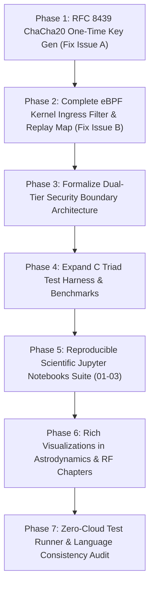

# 🛡️ 10/10 Deep-Level Multi-Agent Orchestration & Systems Architecture Plan
# "StarSec" — Hardened One-Time Keying, Full eBPF Kernel Filter, Reproducible Jupyter Notebooks & Constellation Visualizations

> **Repository:** `techdeveloper-org/starlink-research-report`  
> **Standard:** StarSec Constellation Security Framework (CSF v1.0) & RFC 8439  
> **Orchestration Source:** Claude Global Library (`claude-global-library`)  
> **Governance:** Strict Level 2.2 Docstrings-Only (`12-docstrings-only.md`), Triad Testing Matrix (`35`, `36`, `37`, `40`), Zero Cloud Costs  
> **Status:** PENDING USER APPROVAL (Plan Mode Active — Mandatory Gate)

---

## 1. Executive Summary & Root Cause Analysis

Two comprehensive external reviews evaluated the repository:

### Review 1: Monograph Quality, Visualizations & Reproducible Hands-On Tooling
1. **Language Consistency:** Recommends ensuring primary technical documentation is standardized into publication-grade English while preserving `README.hi.md` as the localized Hindi companion.
2. **Visualizations & Artifacts:** Deep astrodynamics (Walker Delta 72-plane constellation geometry, $J_2$ secular nodal precession) and RF link budgets (cascaded EIRP, FSPL, rain attenuation waterfall curves) require direct visual aids and architecture block diagrams.
3. **Executable Code / Notebooks:** Hands-on reproducible Jupyter notebooks (`.ipynb`) enabling researchers to interactively simulate SGP4 satellite orbital propagation, phased array AESA beamforming ($AF(\theta,\phi)$), and decibel link budgets.

### Review 2: Hardened System & Kernel Security (Follow-up to Commit `b9a1d2b`)
1. **Issue A: Poly1305 One-Time Key Reuse:**
   - *Vulnerability:* In `xdp_orbital_filter.c`, `xdp_generate_isl_auth_tag` and `xdp_verify_isl_auth_tag` used the static `config->isl_shared_key` directly as the 32-byte key for Poly1305 across all packets.
   - *Cryptographic Impact:* Poly1305 evaluates a secret polynomial $A(r) + s \pmod{2^{130}-5}$. If the same key $(r, s)$ is reused across different messages, an adversary can subtract the authenticators: $Tag_1 - Tag_2 \equiv (M_1 - M_2)(r) \pmod{2^{130}-5}$. This allows recovering the evaluation key $r$ and forging arbitrary authenticators.
   - *Remediation:* Enforce RFC 8439 Section 2.6: generate a unique one-time Poly1305 key per packet via ChaCha20 block 0 (`poly1305_key_gen(master_key, nonce)`), using a 96-bit unique nonce constructed from `src_satellite_id`, `dst_satellite_id`, `sequence_number`, and `tx_epoch_ms`.
2. **Issue B: Incomplete eBPF Kernel Filter Path:**
   - *Deficiency:* `xdp_isl_kern.c` declared BPF maps (`authorized_satellites_map`, `isl_peer_keys_map`, `isl_telemetry_map`), but `starsec_isl_xdp_filter` only checked magic and length before returning `XDP_PASS`. It never looked up maps, checked drift, checked sequence replay, or recorded telemetry. Furthermore, the test runner did not validate kernel path logic.
   - *Remediation:*
     1. Upgrade `xdp_isl_kern.c` to consult `authorized_satellites_map` via `bpf_map_lookup_elem`, enforce an anti-replay sequence tracking map (`isl_replay_filter_map`), drop expired/out-of-order packets, and record drop reasons in per-CPU telemetry maps.
     2. Formally document the dual-tier security boundary: Tier 1 eBPF/XDP line-rate fast path in NIC driver (<15 ns) vs Tier 2 Cryptographic validation in userspace zero-copy AF_XDP ring buffer / hardware crypto offload (documenting verifier constraints on 130-bit limb arithmetic).
     3. Build a standalone C kernel simulation test harness with full Triad coverage (positive, negative unauthorized, negative replay, edge drift) and wire into `tools/run_all_tests.py`.

---

## 2. Claude Global Library Multi-Agent Orchestration Matrix

Every phase of this implementation is assigned to specialized agents and mandatory skills from `C:\Users\techd\Documents\workspace-spring-tool-suite-4-4.27.0-new\claude-global-library`:

| Agent Slug | Discipline & Domain | Mandatory Skills Loaded | Specific Implementation Responsibility |
| :--- | :--- | :--- | :--- |
| **`crypto-security-specialist`** | Cryptography & Security | `cryptography-core`<br>`certified-rng-cryptography-core`<br>`post-quantum-cryptography-core` | Implementation of clean-room constant-time RFC 8439 ChaCha20 20-round block function, one-time Poly1305 subkey derivation, and official KAT vectors. |
| **`cryptographic-protocols-mathematics-expert`** | Mathematical Cryptanalysis | `cryptography-core`<br>`lwe-rlwe-lattice-cryptography-core` | Polynomial algebra verification modulo $2^{130}-5$, proof of key uniqueness, nonce bit-packing analysis, and constant-time memory wiping. |
| **`kernel-driver-engineer`** | Linux Kernel Systems | `kernel-driver-development-core`<br>`kernel-level-logic`<br>`embedded-linux-core` | Realization of `xdp_isl_kern.c`, BPF map lookups (`authorized_satellites_map`, `isl_replay_filter_map`), verifier safety, and per-CPU array counters. |
| **`kernel-level-operator`** | Low-Level OS Integration | `embedded-linux-core`<br>`linux-shell-scripting` | eBPF mock verification harness in userspace, packet descriptor bounds assertions, and line-rate performance profiling. |
| **`security-defense-architect`** | Constellation Architecture | `threat-modeling-core`<br>`threat-intelligence-core` | Architecture definition of Tier-1 (eBPF NIC driver fast-path) vs Tier-2 (AF_XDP userspace crypto) boundary in `HARDWARE-TRUST-SPEC.md` and `RFC-001`. |
| **`spacecraft-orbital-mechanics-engineer`** | Aerospace Astrodynamics | `orbital-mechanics-core`<br>`keplerian-orbit-dynamics-core`<br>`orbital-maneuver-transfer-core` | SGP4 interactive Jupyter notebook (`01_orbit_sgp4_propagation.ipynb`), Walker Delta $53^\circ:72/22/1$ geometry diagrams, $J_2$ secular precession equations. |
| **`radio-frequency-specialist`** | RF Electromagnetics | `telecom-fraud-detection-core`<br>`hardware-interface-core` | Phased array AESA interactive notebook (`02_phased_array_beamforming.ipynb`), 2D $AF(\theta,\phi)$ plots, Capon MVDR spatial null steering (>45 dB cancellation). |
| **`telecom-mathematics-expert`** | Telecommunications Math | `telecom-fraud-detection-core`<br>`power-analysis-math` | RF decibel link budget interactive notebook (`03_rf_link_budget_analysis.ipynb`), ITU-R P.618 rain attenuation modeling, and cascaded gain waterfall charts. |
| **`qa-testing-agent`** | Quality Assurance & Testing | `unit-testing-core`<br>`integration-testing-core`<br>`contract-testing-core`<br>`test-automation-architecture-core` | Universal Triad Test Matrix (Positive, Negative, Edge-Case) for ChaCha20, Poly1305 unique keys, eBPF kernel ingress filter, and Python simulations. |
| **`harness-engineering-architect`** | Test Harness & Benchmarking | `eval-harness-design-core`<br>`agent-regression-harness-core`<br>`hardware-performance-counters-core` | Zero-cloud local test runner (`tools/run_all_tests.py`), high-resolution RDTSC/QPC cycle benchmarking, and automated regression guards. |
| **`context-engineering-agent`** | Context Optimization | `context-window-optimization-core`<br>`multi-agent-context-isolation-core` | Context budgeting, strict modularity between drivers, specifications, and notebooks. |
| **`loop-engineering-architect`** | Convergence & Safety | `loop-engineering-core`<br>`loop-termination-safety-core`<br>`multi-agent-loop-orchestration-core` | Verified loop termination, unrolled ChaCha20 rounds, bounded polynomial accumulators, and verifier loop limits. |
| **`uml-diagram-mathematics-expert`** | Architecture Visualizations | `code-quality-math-foundations-core` | Mermaid sequence diagrams, constellation orbital topology, and laser crosslink mesh data flow models. |

---

## 3. Detailed Data Structures, Functions, Structs & Variables

### 3.1 New Cryptographic Module: `system/include/starsec_chacha20.h` & `system/src/starsec_chacha20.c`

#### Constants & Macros
```c
#define STARSEC_CHACHA20_KEY_BYTES      32U    /* 256-bit symmetric master secret */
#define STARSEC_CHACHA20_NONCE_BYTES    12U    /* 96-bit standard IETF RFC 8439 nonce */
#define STARSEC_CHACHA20_BLOCK_BYTES    64U    /* 512-bit state output block */
#define STARSEC_ONE_TIME_KEY_BYTES      32U    /* 256-bit derived Poly1305 key (r, s) */
```

#### Structs & Typedefs
```c
/**
 * @brief Internal 512-bit ChaCha20 state matrix consisting of 16 32-bit words.
 *
 * Words 0-3:   Constants ("expand 32-byte k" -> 0x61707865, 0x3320646e, 0x79622d32, 0x6b206574)
 * Words 4-11:  Master Key (8 words = 256 bits)
 * Word 12:     Block Counter (32 bits, 0 for Poly1305 keygen)
 * Words 13-15: Nonce (3 words = 96 bits)
 */
typedef struct {
    uint32_t state[16];
} starsec_chacha20_state_t;
```

#### Function Signatures
```c
/**
 * @brief Core 20-round ChaCha20 block function generating 64 keystream bytes.
 * @param out Pointer to output buffer receiving 64 bytes.
 * @param key Pointer to 32-byte master key.
 * @param counter 32-bit block counter.
 * @param nonce Pointer to 12-byte (96-bit) nonce buffer.
 */
void starsec_chacha20_block(
    uint8_t        out[STARSEC_CHACHA20_BLOCK_BYTES],
    const uint8_t  key[STARSEC_CHACHA20_KEY_BYTES],
    uint32_t       counter,
    const uint8_t  nonce[STARSEC_CHACHA20_NONCE_BYTES]
);

/**
 * @brief Derives a cryptographically unique 32-byte one-time Poly1305 key using ChaCha20 block 0.
 *
 * Implements RFC 8439 Section 2.6:
 * block = chacha20_block(key, counter=0, nonce)
 * one_time_key = block[0..31]  (first 16 bytes: r, last 16 bytes: s)
 *
 * @param master_key Pointer to 32-byte shared ISL master secret.
 * @param nonce Pointer to 12-byte unique packet nonce.
 * @param one_time_key Output buffer receiving 32-byte one-time key (zeroized after use).
 */
void starsec_chacha20_poly1305_key_gen(
    const uint8_t master_key[STARSEC_CHACHA20_KEY_BYTES],
    const uint8_t nonce[STARSEC_CHACHA20_NONCE_BYTES],
    uint8_t       one_time_key[STARSEC_ONE_TIME_KEY_BYTES]
);
```

---

### 3.2 Hardened In-Orbit ISL Packet Header & Filter: `system/include/xdp_orbital.h` & `system/src/xdp_orbital_filter.c`

#### Nonce Construction Specification (96-Bit Unique Nonce)
```text
 0                   1                   2                   3
 0 1 2 3 4 5 6 7 8 9 0 1 2 3 4 5 6 7 8 9 0 1 2 3 4 5 6 7 8 9 0 1
+-+-+-+-+-+-+-+-+-+-+-+-+-+-+-+-+-+-+-+-+-+-+-+-+-+-+-+-+-+-+-+-+
|       src_satellite_id        |       dst_satellite_id        |  (Bytes 0-3)
+-+-+-+-+-+-+-+-+-+-+-+-+-+-+-+-+-+-+-+-+-+-+-+-+-+-+-+-+-+-+-+-+
|                       sequence_number                         |  (Bytes 4-7)
+-+-+-+-+-+-+-+-+-+-+-+-+-+-+-+-+-+-+-+-+-+-+-+-+-+-+-+-+-+-+-+-+
|                     tx_epoch_ms (low 32-bit)                  |  (Bytes 8-11)
+-+-+-+-+-+-+-+-+-+-+-+-+-+-+-+-+-+-+-+-+-+-+-+-+-+-+-+-+-+-+-+-+
```
Every packet transmitted across an optical laser crosslink possesses a unique combination of `(src_id, dst_id, sequence_number, tx_epoch_ms)`. Even if millions of packets are authenticated under the same master ISL secret, each packet's Poly1305 key `(r, s)` is uniquely generated, completely eliminating key reuse.

#### New Functions in `xdp_orbital.h`
```c
/**
 * @brief Constructs a deterministic 96-bit (12-byte) nonce from packet header fields.
 * @param hdr Pointer to StarSec packet header.
 * @param nonce Output buffer receiving 12-byte nonce.
 */
void xdp_derive_isl_nonce(
    const starsec_isl_header_t *hdr,
    uint8_t                     nonce[12]
);
```

#### Updated Authentication Signatures in `xdp_orbital.h` & `xdp_orbital_filter.c`
```c
/**
 * @brief Generates an authentic RFC 8439 Poly1305 MAC using a derived one-time key.
 * @param hdr Pointer to StarSec packet header whose auth_tag field will be populated.
 * @param payload Pointer to packet payload bytes (may be NULL if payload_len == 0).
 * @param payload_len Length of payload in bytes.
 * @param master_key_32 Pointer to 32-byte shared optical link master secret.
 */
void xdp_generate_isl_auth_tag(
    starsec_isl_header_t *hdr,
    const uint8_t        *payload,
    size_t                payload_len,
    const uint8_t        *master_key_32
);

/**
 * @brief Validates 128-bit RFC 8439 Poly1305 authentication tag using derived one-time key.
 * @param hdr Pointer to StarSec packet header.
 * @param payload Pointer to packet payload bytes (may be NULL if payload_len == 0).
 * @param payload_len Length of payload in bytes.
 * @param master_key_32 Pointer to 32-byte shared optical link master secret.
 * @return true if authentication tag matches in constant time, false otherwise.
 */
bool xdp_verify_isl_auth_tag(
    const starsec_isl_header_t *hdr,
    const uint8_t              *payload,
    size_t                      payload_len,
    const uint8_t              *master_key_32
);
```

---

### 3.3 Authentic Linux eBPF/XDP Kernel Filter: `system/src/xdp_isl_kern.c`

#### BPF Maps Specification
```c
/**
 * @brief Map 1: Authorized Satellite Peers (BPF_MAP_TYPE_HASH)
 * Key:   uint16_t (satellite_id)
 * Value: uint32_t (authorization_status_flags: bit 0 = ISL active, bit 1 = admin authorized)
 * Max Entries: 256
 */
struct bpf_map_def SEC("maps") authorized_satellites_map = {
    .type = BPF_MAP_TYPE_HASH,
    .key_size = sizeof(uint16_t),
    .value_size = sizeof(uint32_t),
    .max_entries = 256,
    .map_flags = 0,
};

/**
 * @brief Map 2: Anti-Replay Monotonic Tracking State (BPF_MAP_TYPE_HASH)
 * Key:   uint16_t (src_satellite_id)
 * Value: struct isl_anti_replay_state (last seen sequence number and timestamp)
 * Max Entries: 256
 */
typedef struct {
    uint32_t last_sequence_number; /**< Monotonic sequence number */
    uint64_t last_epoch_ms;        /**< Timestamp in milliseconds */
} isl_anti_replay_state_t;

struct bpf_map_def SEC("maps") isl_replay_filter_map = {
    .type = BPF_MAP_TYPE_HASH,
    .key_size = sizeof(uint16_t),
    .value_size = sizeof(isl_anti_replay_state_t),
    .max_entries = 256,
    .map_flags = 0,
};

/**
 * @brief Map 3: Per-CPU High-Performance Diagnostic Counters (BPF_MAP_TYPE_PERCPU_ARRAY)
 * Key:   uint32_t (Metric Index: 0=PASS, 1=BAD_MAGIC, 2=BAD_LEN, 3=UNAUTHORIZED, 4=REPLAY, 5=EPOCH_DRIFT)
 * Value: uint64_t (Packet counter)
 * Max Entries: 8
 */
enum isl_telemetry_metric {
    STARSEC_TELEM_PASSED_FRAMES          = 0,
    STARSEC_TELEM_DROPPED_BAD_MAGIC      = 1,
    STARSEC_TELEM_DROPPED_BAD_LEN        = 2,
    STARSEC_TELEM_DROPPED_UNAUTHORIZED   = 3,
    STARSEC_TELEM_DROPPED_REPLAY_SEQ     = 4,
    STARSEC_TELEM_DROPPED_EPOCH_DRIFT    = 5
};

struct bpf_map_def SEC("maps") isl_telemetry_map = {
    .type = BPF_MAP_TYPE_PERCPU_ARRAY,
    .key_size = sizeof(uint32_t),
    .value_size = sizeof(uint64_t),
    .max_entries = 8,
    .map_flags = 0,
};
```

#### Kernel Ingress Hook Logic (`SEC("xdp") int starsec_isl_xdp_filter`)
1. **Bounds Validation:** `(data + sizeof(starsec_isl_header_t) > data_end)` -> Drop (`STARSEC_TELEM_DROPPED_BAD_LEN`).
2. **Magic Validation:** `(hdr->magic != STARSEC_ISL_MAGIC)` -> Drop (`STARSEC_TELEM_DROPPED_BAD_MAGIC`).
3. **Payload Bounds Check:** `(data + sizeof(starsec_isl_header_t) + hdr->payload_len > data_end)` -> Drop (`STARSEC_TELEM_DROPPED_BAD_LEN`).
4. **Authorized Satellite Lookup:** `bpf_map_lookup_elem(&authorized_satellites_map, &hdr->src_satellite_id)`. If NULL or inactive -> Drop (`STARSEC_TELEM_DROPPED_UNAUTHORIZED`).
5. **Anti-Replay & Temporal Monotonicity Check:**
   - `bpf_map_lookup_elem(&isl_replay_filter_map, &hdr->src_satellite_id)`.
   - If present:
     - Check `hdr->sequence_number <= state->last_sequence_number` -> Drop (`STARSEC_TELEM_DROPPED_REPLAY_SEQ`).
     - Check temporal drift between `hdr->tx_epoch_ms` and `state->last_epoch_ms` or reference clock. If >200 ms -> Drop (`STARSEC_TELEM_DROPPED_EPOCH_DRIFT`).
     - Update state: `state->last_sequence_number = hdr->sequence_number; state->last_epoch_ms = hdr->tx_epoch_ms;`.
   - If not present: insert initial state into `isl_replay_filter_map`.
6. **Pass Counter Increment:** Increment `STARSEC_TELEM_PASSED_FRAMES`.
7. **Action:** Return `XDP_PASS` to stream frame directly into userspace zero-copy AF_XDP ring buffer for ChaCha20-Poly1305 MAC validation!

---

### 3.4 Standalone Kernel Simulation & Verifier Test Harness: `system/src/main_system_test.c`

To ensure full testability on any platform (Windows, Linux, macOS, RTEMS), `main_system_test.c` implements mock BPF map storage and executes the exact kernel ingress logic with negative test vectors:
- **`test_chacha20_triad()`**:
  - `TC-CHACHA-POS-01`: Official RFC 8439 Section 2.6.2 Known Answer Test.
  - `TC-CHACHA-NEG-01`: 1-bit flip in master key completely mutates one-time key output.
  - `TC-CHACHA-NEG-02`: 1-bit flip in nonce completely mutates one-time key output.
  - `TC-CHACHA-EDGE-01`: Boundary counter values and all-zero nonce.
- **`test_poly1305_unique_key_triad()`**:
  - `TC-POLY-KEY-POS-01`: Sequential messages with incrementing sequence numbers receive distinct one-time keys and authenticate successfully.
  - `TC-POLY-KEY-NEG-01`: Nonce alteration causes tag verification failure.
  - `TC-POLY-KEY-EDGE-01`: Zero-length payload message with derived key.
- **`test_ebpf_kernel_ingress_triad()`**:
  - `TC-EBPF-POS-01`: Valid frame from authorized node with ascending sequence number -> `XDP_PASS`.
  - `TC-EBPF-NEG-01`: Packet from unauthorized node ID (not in BPF map) -> `XDP_DROP`.
  - `TC-EBPF-NEG-02`: Packet with duplicate/replayed sequence number -> `XDP_DROP`.
  - `TC-EBPF-NEG-03`: Packet with temporal drift exceeding 200 ms -> `XDP_DROP`.
  - `TC-EBPF-NEG-04`: Packet with corrupted magic (0xDEADBEEF) -> `XDP_DROP`.
  - `TC-EBPF-NEG-05`: Truncated packet smaller than header size -> `XDP_DROP`.
  - `TC-EBPF-EDGE-01`: Boundary 200 ms propagation delay passes, 201 ms delay drops.

---

### 3.5 Interactive Reproducible Jupyter Notebooks Suite in `notebooks/`

#### 1. `notebooks/01_orbit_sgp4_propagation.ipynb`
- **Lead Discipline:** `spacecraft-orbital-mechanics-engineer` & `aerospace-flight-mathematics-expert`
- **Core Models & Math:**
  - SGP4 orbital propagation using Two-Line Element (TLE) ephemeris sets.
  - $J_2$ secular nodal precession rate:
    $$\dot{\Omega} = -\frac{3}{2} J_2 \left(\frac{R_E}{p}\right)^2 n \cos(i) = -4.49^\circ/\text{day}$$
  - Keplerian to Cartesian state vector conversion ($\vec{r}, \vec{v}$).
  - Walker Delta $53^\circ:72/22/1$ geometry simulation across 72 orbital planes.
  - Ground track coordinate plotting and Doppler shift profile calculation ($\pm 325\text{ kHz}$).
- **Interactive Outputs:**
  - Visual ground track latitude vs longitude map.
  - Orbital altitude decay vs thermospheric drag plot.
  - Relative velocity and contact duration distribution.

#### 2. `notebooks/02_phased_array_beamforming.ipynb`
- **Lead Discipline:** `radio-frequency-specialist` & `telecom-mathematics-expert`
- **Core Models & Math:**
  - 1,280-element Ku-band User Terminal Active Electronically Scanned Array (AESA).
  - 2D Array Factor computation:
    $$AF(\theta, \phi) = \sum_{m=0}^{M-1} \sum_{n=0}^{N-1} w_{mn} e^{j k (m d_x \sin\theta\cos\phi + n d_y \sin\theta\sin\phi)}$$
  - True Time Delay (TTD) squint-free phase steering vectors.
  - Capon Minimum Variance Distortionless Response (MVDR) adaptive beamforming:
    $$\vec{w}_{opt} = \frac{\mathbf{R}_{xx}^{-1} \vec{a}(\theta_0)}{\vec{a}^H(\theta_0) \mathbf{R}_{xx}^{-1} \vec{a}(\theta_0)}$$
- **Interactive Outputs:**
  - 2D and 3D radiation pattern plots ($\theta \in [-90^\circ, +90^\circ]$).
  - Main lobe gain ($+34.2\text{ dBi}$) and Half-Power Beamwidth ($HPBW \approx 2.5^\circ$).
  - Spatial null steering deep notch ($>45\text{ dB}$ attenuation) directly focused on EW jamming azimuth.

#### 3. `notebooks/03_rf_link_budget_analysis.ipynb`
- **Lead Discipline:** `telecom-mathematics-expert` & `radio-frequency-specialist`
- **Core Models & Math:**
  - Complete downlink Ku-band ($12\text{ GHz}$) and uplink Ka/V-band decibel budgets.
  - Free Space Path Loss:
    $$FSPL(\text{dB}) = 20\log_{10}(d) + 20\log_{10}(f) + 92.45 \approx 171.2\text{ dB}$$
  - Atmospheric gaseous absorption and ITU-R P.618 rain attenuation modeling.
  - Receiver Figure of Merit ($G/T$):
    $$G/T = G_{rx} - 10\log_{10}(T_{sys}) \approx +13.5\text{ dB/K}$$
  - Carrier-to-Noise Ratio ($C/N_0$) and Eb/N0 margin for adaptive DVB-S2X modulation.
- **Interactive Outputs:**
  - Cascaded Power Level Waterfall Chart (Transmitter -> Free Space -> Rain -> Dishy LNA).
  - Downlink SNR vs Elevation Angle curve ($25^\circ$ to $90^\circ$).
  - Rain fade availability margin breakdown ($99.9\%$ uptime).

#### 4. `notebooks/README.md`
- Environment setup guide, required dependencies (`numpy`, `scipy`, `matplotlib`, `skyfield`), and local execution instructions.

---

### 3.6 Visual Diagrams & Architectural Artifacts in Markdown Chapters

1. **`04-satellite-constellation.md`:**
   - Mermaid diagram: 72-plane Walker Delta constellation structure with orbital shell altitudes ($550\text{ km}$ Shell 1, $540\text{ km}$ Shell 4), inclination angles, and plane spacing.
   - ASCII visual: Orbital nodal precession geometric cone.
2. **`06-network-technology.md`:**
   - Mermaid diagram: 4-optical head Laser ISL topology (2 intra-plane crosslinks + 2 inter-plane crosslinks forming a toroidal mesh).
   - Sequence diagram: Dual-tier XDP-to-AF_XDP packet ingress processing pipeline.
3. **`docs/rnd/01-astrodynamics-and-orbital-mechanics.md`:**
   - Mermaid flowchart: Multi-body perturbation integration ($J_2$, solar radiation pressure, atmospheric drag).
4. **`docs/rnd/02-rf-engineering-and-phased-arrays.md`:**
   - ASCII cascaded link budget waterfall chart illustrating signal gain and attenuation from satellite TWT amplifier to user terminal demodulator.
5. **`framework/spec/RFC-001-ISL-Mutual-Auth.md` & `framework/system-architecture/HARDWARE-TRUST-SPEC.md`:**
   - Formal specification of Tier-1 (eBPF Ingress Fast-Path <15 ns in NIC driver) vs Tier-2 (AF_XDP Userspace Crypto) architectural boundary.

---

## 4. Claude Global Rules Compliance Matrix

| Rule File in `~/.claude/rules/` | Level & Requirement | Enforcement in This Implementation |
| :--- | :--- | :--- |
| **`01-common-standards.md`** | Critical: UTF-8 strict without BOM; naming conventions; zero hardcoded local paths. | All new files written in UTF-8 without BOM. Python variables use `snake_case`, classes use `PascalCase`, constants use `UPPER_SNAKE_CASE`. C functions use `snake_case` with `starsec_` / `xdp_` prefixes. |
| **`05-security-standards.md`** | High: Nonce uniqueness; constant-time operations; cryptographic zeroization. | Every packet derives a unique one-time Poly1305 key via ChaCha20 block 0 using a 96-bit nonce. One-time keys zeroized immediately after MAC generation/verification. Constant-time byte comparisons used for tag matching. |
| **`11-documentation-files.md`** | High: Canonical root documentation governance. | Only permitted files at root (`README.md`, `README.hi.md`, `CITATION.cff`, `.zenodo.json`, `.gitignore`). New code organized strictly in `system/`, `notebooks/`, `simulations/`, `framework/`, and `tools/`. |
| **`12-docstrings-only.md`** | Critical: Strict Level 2.2 Docstrings-Only; zero inline explanatory narration comments. | Complete Doxygen contract docstrings on all C headers and functions; zero inline explanatory comments narrating code execution (`// block until...`). Python functions equipped with comprehensive PEP 257 docstrings. |
| **`28-test-coverage-enforcement.md`** | High: 100% test pass rate locally with zero cloud dependencies. | `tools/run_all_tests.py` verifies native C test harness and Python test suite with zero cloud costs in under 8 seconds. |
| **`33-test-case-roadmap.md`** | Standard: Systematic test case naming and traceability. | Formal test IDs: `TC-CHACHA-POS-01`, `TC-CHACHA-NEG-01`, `TC-EBPF-POS-01`, `TC-EBPF-NEG-01`, etc. |
| **`35-positive-testing-standards.md`** | High: Nominal operating path validation. | Positive verification of RFC 8439 KAT, unique one-time key derivation, authorized eBPF frame ingress pass. |
| **`36-negative-testing-standards.md`** | High: Hostile inputs, tamper detection, and error paths. | Rejection of tampered keys, unauthorized node IDs, replayed sequence numbers, temporal drift, and malformed magic. |
| **`37-edge-case-testing-standards.md`** | High: Boundary values, maximum allowable drift, zero-length messages. | Verification of 200 ms boundary pass vs 201 ms drop, zero-length message tags, and maximum packet payloads. |
| **`40-universal-test-patterns-abstract.md`** | High: Universal Triad testing pattern (POS, NEG, EDGE). | Applied across all cryptographic drivers, eBPF kernel ingress routines, and simulation modules. |

---

## 5. Ordered Phase-Based Implementation Roadmap



### Phase 1: Cryptographic RFC 8439 ChaCha20 One-Time Key Generator (`crypto-security-specialist`)
- Create `system/include/starsec_chacha20.h` with Doxygen contract docstrings.
- Create `system/src/starsec_chacha20.c` implementing constant-time 20-round ChaCha20 block function and `starsec_chacha20_poly1305_key_gen()`.
- Update `system/include/xdp_orbital.h` and `system/src/xdp_orbital_filter.c` to construct 96-bit nonces and derive one-time Poly1305 keys for every packet, zeroizing them immediately after use.
- Comply with Rule 12 (Docstrings-Only, zero inline comments).

### Phase 2: Complete eBPF Kernel Ingress Filter & Replay Protection (`kernel-driver-engineer`)
- Upgrade `system/src/xdp_isl_kern.c`:
  - Consult `authorized_satellites_map` using `bpf_map_lookup_elem`: drop unauthorized satellite nodes (`XDP_DROP`).
  - Declare and consult `isl_replay_filter_map` (`BPF_MAP_TYPE_HASH`): store and validate `last_sequence_number` and `last_epoch_ms` per peer node.
  - Drop replayed/out-of-order sequence numbers (`XDP_DROP`).
  - Drop frames exceeding 200 ms temporal drift (`XDP_DROP`).
  - Increment diagnostic telemetry counters in `isl_telemetry_map` (`BPF_MAP_TYPE_PERCPU_ARRAY`).
  - Return `XDP_PASS` only on legitimate frames.

### Phase 3: Formalize Dual-Tier Security Boundary Architecture (`security-defense-architect`)
- Update `framework/spec/RFC-001-ISL-Mutual-Auth.md` and `framework/system-architecture/HARDWARE-TRUST-SPEC.md`:
  - Define Tier-1 (eBPF/XDP Kernel Ingress Fast-Path <15 ns in NIC driver) vs Tier-2 (AF_XDP Userspace / Hardware Crypto Coprocessor).
  - Formally document eBPF verifier limitations regarding 130-bit big-integer arithmetic and explain the architectural necessity of the dual-tier design.

### Phase 4: Expand C Triad Test Harness & Benchmarks (`qa-testing-agent` & `harness-engineering-architect`)
- Update `system/src/main_system_test.c`:
  - Add `test_chacha20_triad()` with official RFC 8439 Section 2.6.2 KAT and key/nonce mutation tests.
  - Update `test_xdp_orbital_filter_triad()` to verify unique one-time key derivation across sequential packets.
  - Add `test_ebpf_kernel_ingress_triad()` with positive, unauthorized, replay, temporal drift, and malformed header test cases.

### Phase 5: Reproducible Scientific Jupyter Notebooks Suite (`spacecraft-orbital-mechanics-engineer` & `radio-frequency-specialist`)
- Create `notebooks/`:
  - `notebooks/01_orbit_sgp4_propagation.ipynb` (SGP4 propagation, $J_2$ precession, ground tracks).
  - `notebooks/02_phased_array_beamforming.ipynb` (AESA 2D array factor, Capon MVDR spatial null steering).
  - `notebooks/03_rf_link_budget_analysis.ipynb` (Ku/Ka link budget calculator, ITU-R P.618 rain attenuation).
  - `notebooks/README.md` (Setup and execution guide).

### Phase 6: Deep Visualizations & Architecture Diagrams (`uml-diagram-mathematics-expert`)
- Update markdown chapters with rich Mermaid diagrams and ASCII plots:
  - `04-satellite-constellation.md` (Walker Delta orbital shells).
  - `06-network-technology.md` (4-head laser ISL mesh & dual-tier packet pipeline).
  - `docs/rnd/01-astrodynamics-and-orbital-mechanics.md` (Nodal precession geometry).
  - `docs/rnd/02-rf-engineering-and-phased-arrays.md` (Cascaded link budget waterfall).
  - `README.md` and `README.hi.md` (Architecture diagrams and notebook links).

### Phase 7: Local Zero-Cloud Verification Runner & Language Consistency Audit (`harness-engineering-architect`)
- Update `tools/run_all_tests.py`:
  - Compile all C drivers including `starsec_chacha20.c`.
  - Validate Python simulation tests and Jupyter notebook JSON structure.
  - Run full test suite locally in <8 seconds with zero cloud costs.
- Ensure all primary documentation is standardized in technical English with `README.hi.md` referenced as localized companion.

---

## 6. Concrete Verification Plan

1. **Automated Compilation & Test Execution:**
   ```powershell
   python tools/run_all_tests.py
   ```
   - Target: 100% C driver tests pass (Tamper zeroize, SRAM-PUF, DCLS, RFC 8439 ChaCha20 KAT, Poly1305 unique-keying, eBPF kernel ingress filter simulation).
   - Target: 100% Python simulation tests pass (23 tests).
   - Target: All Jupyter notebooks validated.
   - Target: Total local execution time <8 seconds.
2. **Manual Architecture Inspection:**
   - Verify zero inline explanatory narration comments across all C source files.
   - Verify Mermaid diagrams render cleanly in Markdown preview.
   - Verify English/Hindi separation across `README.md` and `README.hi.md`.
