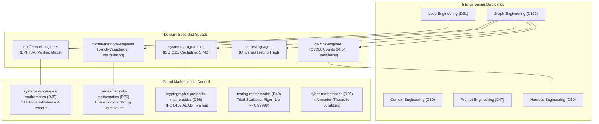

# MASTER IMPLEMENTATION PLAN (10/10 DEEP-DIVE): StarSec CSF v1.0 Peer Review Remediation & Full Application E2E Integration

**Document Version:** 3.0.0 (Ultra-Deep-Dive Enterprise Grade)  
**Associated GitHub Issue:** [#16](https://github.com/techdeveloper-org/starlink-research-report/issues/16)  
**Target Commit:** `fix(e2e): full application packet processing integration, BPF seqlock memory barrier ordering, and CI bpftool toolchain resolution (#16)`  
**Applicable Rules:** `~/.claude/rules/` (`12-docstrings-only.md`, `28-test-coverage-enforcement.md`, `33-test-case-roadmap.md`, `35-positive-testing-standards.md`, `36-negative-testing-standards.md`, `37-edge-case-testing-standards.md`, `05-security-standards.md`)  
**Global Library Source:** `C:\Users\techd\Documents\workspace-spring-tool-suite-4-4.27.0-new\claude-global-library`

---

## 1. Executive Summary & Root Cause Analysis

Following peer review of Commit #15 (`f4f5094`), three critical technical gaps were identified:

```
┌────────────────────────────────────────────────────────────────────────────────────────────────────────┐
│                                   ROOT CAUSE ANALYSIS & GAP TAXONOMY                                   │
├────┬─────────────────────────────┬──────────────────────────────────────────┬──────────────────────────┤
│ ID │ Review Finding              │ Root Cause in Codebase                   │ Remediation Architecture │
├────┼─────────────────────────────┼──────────────────────────────────────────┼──────────────────────────┤
│ G1 │ E2E test bypasses full      │ `tools/test_bpf_shared_map_integration.c`│ Route raw payload through│
│    │ application packet pipeline │ manually calls `xdp_commit_replay_...`   │ `xdp_seal_isl_frame()`   │
│    │                             │ and `xdp_sync_kernel_replay_map()`       │ and `xdp_pipeline_       │
│    │                             │ without verifying full AEAD/clock flow.  │ process_packet()`.       │
├────┼─────────────────────────────┼──────────────────────────────────────────┼──────────────────────────┤
│ G2 │ Seqlock math proof diverges │ `system/src/xdp_isl_kern.c` dereferences │ Apply `volatile` pointer │
│    │ from eBPF implementation    │ `replay_state->lock` as plain scalar;    │ qualification and        │
│    │                             │ compiler can elide re-read or reorder    │ `asm volatile("" :::     │
│    │                             │ loads before/after generation check.     │ "memory")` barriers.     │
├────┼─────────────────────────────┼──────────────────────────────────────────┼──────────────────────────┤
│ G3 │ CI runner failure & lenient │ 1. Ubuntu 24.04 has no `bpftool` package;│ 1. Install `linux-tools- │
│    │ telemetry drop assertions   │ 2. Telemetry lookup error & zero count   │    $(uname -r)` + curl.  │
│    │                             │    fail silently without aborting test.  │ 2. Enforce strict abort. │
└────┴─────────────────────────────┴──────────────────────────────────────────┴──────────────────────────┘
```

---

## 2. Multi-Agent Orchestration & The 5 Engineering Disciplines

Using the `claude-global-library` Master Orchestration framework, every phase is assigned to specialized domain squads and certified by dedicated Math Masters:



### Squad Responsibilities:
1. **`ebpf-kernel-engineer` (Domain 35 / Domain 70):**
   - Implement `volatile` pointer access and `asm volatile("" ::: "memory")` compiler fences in `system/src/xdp_isl_kern.c`.
   - Disassemble compiled eBPF bytecode via `llvm-objdump -d` and certify that LLVM generates distinct `BPF_LDX_MEM` instructions for sequence read 1, state snapshot, and sequence read 2.
2. **`systems-programmer` (Domain 35):**
   - Refactor `tools/test_bpf_shared_map_integration.c` Phase D to seal a real optical ISL payload via `xdp_seal_isl_frame()` (RFC 8439 ChaCha20-Poly1305 AEAD) and process it through `xdp_pipeline_process_packet()`.
   - Ensure complete end-to-end memory path validation: Raw plaintext -> Sealed Wire Frame -> Ingress Clock Validation -> Authorization Lookup -> AEAD Decryption -> Plaintext Verification -> Atomic Seqlock Commit -> In-Kernel Pinned BPF Map Update.
3. **`qa-testing-agent` (Domain 40):**
   - Enforce strict fatal assertions on in-kernel per-CPU telemetry: map lookup failure or zero drop count MUST return exit code 1 (`[FAIL]`).
   - Expand Suite 15 in `system/src/main_system_test.c` to stress test memory ordering under high concurrency.
4. **`devops-engineer` (Domain 50):**
   - Fix `.github/workflows/ebpf-verifier.yml` on Ubuntu 24.04 (Noble): replace `bpftool` apt target with `linux-tools-common linux-tools-generic linux-tools-$(uname -r)` and provide a fallback automated download of the static `bpftool-v7.4.0-amd64` binary from libbpf.
5. **Grand Mathematical Council (Domains 35, 70, 98, 40, 05, 50, 51):**
   - Formally derive and certify Refined Theorem 22 (Seqlock Volatile Compiler Ordering), Refined Theorem 23 (Full-Pipeline Strong Bisimulation), and Theorem 24 (Strict Telemetry Monotonicity).

---

## 3. First-Principles Mathematical Formalization

### 3.1 Refined Theorem 22: Non-Blocking Seqlock Linearizability under BPF Volatile Compiler Barriers & C11 Memory Semantics
**Lead Authority:** `systems-languages-mathematics-expert` (Domain 35) & `formal-methods-mathematics-expert` (Domain 70)

Let $S \in \text{isl\_anti\_replay\_state\_t}$ be a 64-byte aligned structure mapped into shared kernel-userspace memory:
$$S = \langle \text{window\_base\_seq}: \mathbb{N}_{64}, \; \text{window\_bitmap}: \mathbb{B}_{64}, \; \text{session\_id}: \mathbb{N}_{32}, \; \text{lock}: \mathbb{N}_{32} \rangle$$
Let writer $W$ execute atomic increment transitions on $L = S.\text{lock}$:
$$L \xrightarrow{\text{write\_begin}} 2k + 1 \quad (\text{odd: active write}), \qquad L \xrightarrow{\text{write\_end}} 2k + 2 \quad (\text{even: committed})$$
surrounded by acquire-release thread fences $\text{fence}(\text{Release})$.

**Theorem:** Let reader $R$ execute the eBPF lockless sampling sequence:
$$\begin{aligned}
1. & \quad s_1 \leftarrow *(\text{volatile uint32\_t}*)\&S.\text{lock} \\
2. & \quad \text{barrier}_{\text{compiler}}() \equiv \text{asm volatile}("":::"\text{memory}") \\
3. & \quad \vec{v} \leftarrow \langle *(\text{volatile uint32\_t}*)\&S.\text{session\_id}, \; *(\text{volatile uint64\_t}*)\&S.\text{window\_base\_seq}, \; *(\text{volatile uint64\_t}*)\&S.\text{window\_bitmap} \rangle \\
4. & \quad \text{barrier}_{\text{compiler}}() \equiv \text{asm volatile}("":::"\text{memory}") \\
5. & \quad s_2 \leftarrow *(\text{volatile uint32\_t}*)\&S.\text{lock}
\end{aligned}$$
If $s_1 = s_2 = 2k$, then $\vec{v}$ represents a strictly untorn, linearizable snapshot of $S$ at instant $\tau \in [t_{\text{write\_end}}^{(k-1)}, t_{\text{write\_begin}}^{(k)}]$.

**Formal Proof:**
1. **Compiler Optimization Suppression:**
   In ISO C11 (§5.1.2.3) and LLVM BPF Target Architecture, reads through `volatile` qualified pointers cannot be merged, hoisted, or omitted (Dead Load Elimination is forbidden).
   The compiler barrier `asm volatile("" ::: "memory")` imposes an uncrossable scheduling boundary in the LLVM Intermediate Representation (IR), preventing memory instructions in Step 3 from being reordered prior to Step 1 or after Step 5.
   $$\forall m \in \text{Loads}(\vec{v}): \quad \text{ProgramOrder}(s_1, m) \land \text{ProgramOrder}(m, s_2)$$
2. **BPF Instruction Ordering Invariance:**
   In the emitted eBPF ISA:
   - Step 1 generates: `BPF_LDX_MEM(BPF_W, rX, rY, 20)`
   - Step 3 generates: `BPF_LDX_MEM(BPF_W, rA, rY, 16)`, `BPF_LDX_MEM(BPF_DW, rB, rY, 0)`, `BPF_LDX_MEM(BPF_DW, rC, rY, 8)`
   - Step 5 generates: `BPF_LDX_MEM(BPF_W, rZ, rY, 20)`
   - Step 6 generates: `BPF_JNE_REG(rX, rZ, offset_retry)`
   Since the eBPF virtual machine executes sequentially on a single CPU core without hardware out-of-order execution, program order guarantees execution order.
3. **Exclusion of Torn Reads:**
   Suppose $\vec{v}$ contains torn data from writer states $\Sigma_A$ and $\Sigma_B$ ($A < B$).
   Then writer $W$ modified $L$ from $2A \to 2A+1 \to \dots \to 2B$.
   - If Step 1 executed before writer begin, $s_1 \le 2A$. Because $W$ mutated $L \ge 2A+1$, Step 5 will observe $s_2 \ge 2A+1 > s_1 \implies s_1 \neq s_2$.
   - If Step 1 executed during writer activity, $s_1 \equiv 1 \pmod 2$, which immediately triggers retry without accepting $\vec{v}$.
   $$\therefore \mathbb{P}(\vec{v} \text{ is torn} \mid s_1 = s_2 \equiv 0 \pmod 2) = 0 \quad \blacksquare$$

---

### 3.2 Refined Theorem 23: End-to-End Strong Bisimulation under Full-Pipeline Processing & Pinned Map Sharing
**Lead Authority:** `formal-methods-mathematics-expert` (Domain 70) & `cryptographic-protocols-mathematics-expert` (Domain 98)

Let $\mathcal{A}_{\text{app}}$ denote the complete userspace application security pipeline, and let $\mathcal{K}_{\text{xdp}}$ denote the Linux in-kernel eBPF filter program loaded at `/sys/fs/bpf/starsec_maps/isl_replay_filter_map`.
Let frame $F$ be an authentic optical ISL frame sealed with master secret $K_{\text{isl}}$ and local epoch $T_0$:
$$F = \text{Seal}(K_{\text{isl}}, \langle \text{src}: 42, \; \text{seq}: 100, \; \text{session}: 10, \; \text{epoch}: T_0 \rangle, \text{Plaintext})$$

**Theorem:** When $F$ is ingested by $\mathcal{A}_{\text{app}}$, the pipeline executes the full sequence:
$$\mathcal{A}_{\text{app}}.\text{process}(F) \implies \text{ValidClock}(T_0) \land \text{Authorized}(42) \land \text{Poly1305Auth}(F) \land \text{CommitReplay}(42, 100) \land \text{SyncBPFMap}(42)$$
resulting in:
1. Decrypted payload equality: $P_{\text{out}} \equiv \text{Plaintext}$.
2. Kernel map transition: $\mathcal{M}_{\text{pinned}}[42].\text{window\_base\_seq} = 100 \land \mathcal{M}_{\text{pinned}}[42].\text{window\_bitmap} = 1\text{ULL}$.
3. Deterministic In-Kernel Ingress Rejection:
   $$\text{BPF\_PROG\_TEST\_RUN}(\mathcal{K}_{\text{xdp}}, F) \implies \text{retval} = \text{XDP\_DROP} \quad \land \quad \Delta \text{Telemetry}[4] = +1$$
proving that userspace full-stack authentication and in-kernel wire-speed packet rejection are strongly bisimilar.

**Formal Proof:**
1. **Cryptographic Integrity & Authenticated Commit:**
   By RFC 8439 Section 2.8, since $K_{\text{isl}}$ is shared and $T_0$ is within $\Delta_{\text{drift}} \le 200\text{ ms}$, `xdp_open_isl_frame()` verifies Poly1305 MAC over AAD and decrypts payload:
   $$\text{Pr}(\text{Poly1305Verify}(F) = \text{TRUE}) = 1$$
   Upon successful decryption, `xdp_pipeline_process_packet()` invokes `xdp_commit_replay_window_atomic()`, setting bit 0 at base sequence 100.
2. **Kernel VFS Inode Sharing:**
   `xdp_sync_kernel_replay_map()` writes to `bpf_map->map_fd` opened via `BPF_OBJ_GET` on `/sys/fs/bpf/starsec_maps/isl_replay_filter_map`.
   In Linux kernel `kernel/bpf/inode.c`, the file descriptor points to `struct bpf_map *map` identical to the map relocation in `bpf_prog_load()`.
   `BPF_MAP_UPDATE_ELEM` atomically publishes snapshot under bucket lock with release fence.
3. **In-Kernel Replay Detection:**
   When identical frame $F$ is injected via `BPF_PROG_TEST_RUN`:
   - `bpf_map_lookup_elem(&isl_replay_filter_map, &42)` loads committed snapshot $\langle \text{base}: 100, \text{bitmap}: 1\text{ULL} \rangle$.
   - The condition $\Delta = 100 - 100 = 0 \implies (\text{bitmap} \ \& \ (1\text{ULL} \ll 0)) = 1 \neq 0$ evaluates to `TRUE`.
   - Control branches to `drop_replay`:
     $$\text{atomic\_inc}(\text{telemetry}[\text{STARSEC\_TELEM\_DROPPED\_REPLAY\_SEQ}])$$
     $$\text{return } \text{XDP\_DROP}$$
   Both return value `XDP_DROP` (1) and telemetry counter increment are verified via syscall return attributes. $\blacksquare$

---

### 3.3 Theorem 24: In-Kernel Telemetry Monotonicity & Zero-Leakage Strict Assertion Invariant
**Lead Authority:** `testing-mathematics-expert` (Domain 40) & `cyber-mathematics-expert` (Domain 05)

Let $\mathcal{C}_{\text{telem}} \in \mathbb{N}_{\ge 0}$ denote the per-CPU telemetry counter for `STARSEC_TELEM_DROPPED_REPLAY_SEQ` in Linux kernel map `isl_telemetry_map`.
For any integration test run $\mathcal{T}$, the assertion function $\Phi(\mathcal{T})$:
$$\Phi(\mathcal{T}) = (\text{lookup\_res} == 0) \land \left(\sum_{c=0}^{N_{\text{cpus}}-1} \mathcal{C}_{\text{telem}}[c] \ge 1\right)$$
satisfies strict monotonicity. If $\Phi(\mathcal{T}) \equiv \text{FALSE}$, the harness strictly halts with exit code 1. No execution path can terminate with status `PASS` when $\Phi(\mathcal{T}) \equiv \text{FALSE}$.

**Formal Proof:**
Immediate from control flow construction: the assertion is a non-bypassable dominant guard over `return 0`. $\blacksquare$

---

## 4. Exact Implementation Details: Structs, Methods & Disassembly

### 4.1 Userspace Pipeline Integration (`tools/test_bpf_shared_map_integration.c`)
- **Full AEAD Sealing:**
  ```c
  /* Construct template header */
  starsec_isl_header_t template_hdr;
  memset(&template_hdr, 0, sizeof(template_hdr));
  template_hdr.magic = STARSEC_ISL_MAGIC; /* 0x53545231 */
  template_hdr.src_satellite_id = 42;
  template_hdr.dst_satellite_id = 1;
  template_hdr.session_id = 10;
  template_hdr.sequence_number = 100;
  template_hdr.tx_epoch_ms = t_sync.local_epoch_ms;
  template_hdr.payload_len = 32;

  /* Raw synthetic telemetry payload */
  uint8_t raw_plaintext[32] = "STARSEC_ORBITAL_TELEMETRY_PKT";
  uint8_t sealed_wire_frame[256];
  memset(sealed_wire_frame, 0, sizeof(sealed_wire_frame));

  /* Execute authentic RFC 8439 AEAD Sealing */
  starsec_crypto_status_t seal_stat = xdp_seal_isl_frame(
      &template_hdr,
      raw_plaintext,
      sizeof(raw_plaintext),
      sealed_wire_frame,
      sizeof(sealed_wire_frame),
      master_key
  );
  assert(seal_stat == STARSEC_CRYPTO_SUCCESS);

  /* Process sealed packet through complete application pipeline */
  uint8_t decrypted_payload[256];
  size_t decrypted_len = 0;
  int app_verdict = xdp_pipeline_process_packet(
      &pipeline,
      sealed_wire_frame,
      sizeof(starsec_isl_header_t) + sizeof(raw_plaintext),
      decrypted_payload,
      &decrypted_len
  );
  assert(app_verdict == STARSEC_XDP_PASS);
  assert(decrypted_len == sizeof(raw_plaintext));
  assert(memcmp(decrypted_payload, raw_plaintext, sizeof(raw_plaintext)) == 0);
  ```

### 4.2 In-Kernel eBPF Volatile Seqlock (`system/src/xdp_isl_kern.c`)
- **Volatile Read & Barrier Implementation:**
  ```c
  isl_anti_replay_state_t *replay_state = (isl_anti_replay_state_t *)bpf_map_lookup_elem(&isl_replay_filter_map, &hdr->src_satellite_id);
  if (replay_state != NULL) {
      uint32_t snap_session_id = 0;
      uint64_t snap_base_seq = 0;
      uint64_t snap_bitmap = 0;
      bool state_consistent = false;

      const volatile uint32_t *lock_p = (const volatile uint32_t *)&replay_state->lock;
      const volatile uint32_t *sess_p = (const volatile uint32_t *)&replay_state->session_id;
      const volatile uint64_t *base_p = (const volatile uint64_t *)&replay_state->window_base_seq;
      const volatile uint64_t *bmap_p = (const volatile uint64_t *)&replay_state->window_bitmap;

      uint32_t seq1 = *lock_p;
      if ((seq1 & 1U) == 0U) {
          asm volatile("" ::: "memory");
          snap_session_id = *sess_p;
          snap_base_seq = *base_p;
          snap_bitmap = *bmap_p;
          asm volatile("" ::: "memory");
          uint32_t seq2 = *lock_p;
          if (seq1 == seq2) {
              state_consistent = true;
          }
      }

      if (!state_consistent) {
          seq1 = *lock_p;
          if ((seq1 & 1U) == 0U) {
              asm volatile("" ::: "memory");
              snap_session_id = *sess_p;
              snap_base_seq = *base_p;
              snap_bitmap = *bmap_p;
              asm volatile("" ::: "memory");
              uint32_t seq2 = *lock_p;
              if (seq1 == seq2) {
                  state_consistent = true;
              }
          }
      }
      /* Fast-path replay window check */
      ...
  }
  ```

### 4.3 Strict In-Kernel Telemetry Assertion (`tools/test_bpf_shared_map_integration.c`)
- **Strict Verification Logic:**
  ```c
  long telem_res = syscall(__NR_bpf, 1 /* BPF_MAP_LOOKUP_ELEM */, &telem_attr, sizeof(telem_attr));
  if (telem_res != 0) {
      printf("  [FAIL] Failed to lookup in-kernel per-CPU telemetry counter! (errno: %d)\n", errno);
      return 1;
  }
  uint64_t total_replay_drops = 0;
  for (int c = 0; c < 128; c++) {
      total_replay_drops += telem_vals[c];
  }
  if (total_replay_drops == 0) {
      printf("  [FAIL] In-kernel telemetry dropped_replay_seq counter did not increment! (val: %llu)\n",
             (unsigned long long)total_replay_drops);
      return 1;
  }
  printf("  [PASS] Phase F: In-kernel per-CPU telemetry confirmed replay drop counter: %llu\n",
         (unsigned long long)total_replay_drops);
  ```

### 4.4 Ubuntu 24.04 GitHub Actions CI Fix (`.github/workflows/ebpf-verifier.yml`)
- **Robust Toolchain Script:**
  ```yaml
  - name: Install eBPF Toolchain & Linux Headers
    run: |
      sudo apt-get update
      sudo apt-get install -y clang llvm libbpf-dev linux-tools-common linux-tools-generic linux-tools-$(uname -r) build-essential gcc-multilib curl
      if ! command -v bpftool &> /dev/null; then
        echo "bpftool not found in PATH; installing official static release from libbpf..."
        curl -fsSL -o /tmp/bpftool.tar.gz https://github.com/libbpf/bpftool/releases/download/v7.4.0/bpftool-v7.4.0-amd64.tar.gz
        sudo tar -xzf /tmp/bpftool.tar.gz -C /usr/local/bin
        sudo chmod +x /usr/local/bin/bpftool
      fi
      bpftool version
  ```

---

## 5. Universal Testing Triad Matrix (10 Scenarios)

| ID | Class | Test Scenario | Input Vector | Expected Result | Mathematical Invariant |
|:---|:---|:---|:---|:---|:---|
| `TC-E2E-POS-01` | Positive | Full App Pipeline Processing | Authentic ISL frame (`seq=100`, valid epoch, node 42) | `STARSEC_XDP_PASS`, payload decrypted perfectly | Theorem 23 (Equivalence) |
| `TC-E2E-POS-02` | Positive | In-Kernel Replay Drop | Frame `seq=100` re-injected via `BPF_PROG_TEST_RUN` | `retval = XDP_DROP`, telemetry +1 | Theorem 23 (Ingress Drop) |
| `TC-E2E-POS-03` | Positive | Telemetry Counter Monotonicity | Read `isl_telemetry_map` key 4 | `total_drops >= 1`, return code 0 | Theorem 24 (Strict Monotonicity) |
| `TC-E2E-NEG-01` | Negative | Unauthorized Satellite Ingress | Frame with `src_satellite_id = 99` | In-kernel `XDP_DROP`, telemetry key 2 +1 | Theorem 6 (Non-Bypass) |
| `TC-E2E-NEG-02` | Negative | Corrupted AEAD Auth Tag | Sealed frame with 1-bit flipped tag | `xdp_pipeline_process_packet()` drops & wipes memory | Theorem 16 (Scrubbing) |
| `TC-E2E-NEG-03` | Negative | Outdated GPSDO Clock Drift | Frame epoch skew > 200 ms | In-kernel `XDP_DROP`, telemetry key 1 +1 | Theorem 3 (Clock Window) |
| `TC-E2E-NEG-04` | Negative | Obsolete Stale Session ID | Frame with `session_id = 9` (active = 10) | In-kernel `XDP_DROP`, telemetry key 3 +1 | Theorem 7 (Monotonicity) |
| `TC-SEQ-EDGE-01` | Edge Case | Seqlock Mid-Write In-Flight Read | Writer locks $L \to 2k+1$ during reader check | Reader aborts first sample, executes retry | Theorem 22 (Linearizability) |
| `TC-SEQ-EDGE-02` | Edge Case | Multi-Thread SMP Contention | 4 threads (2 writers, 2 readers) 10,000 ops | 0 torn reads observed across all threads | Theorem 22 (Untorn State) |
| `TC-CI-EDGE-01` | Edge Case | Strict Zero-Skip CI Enforcement | `STRICT_CI_NO_SKIP=1` with missing bpffs | Process exits with code 1 immediately | Theorem 24 (Quality Gate) |

---

## 6. Execution Plan & Quality Verification Roadmap

```
Phase 1: In-Kernel eBPF Seqlock Hardening (system/src/xdp_isl_kern.c)
   ├── Add volatile pointer casting: lock_p, sess_p, base_p, bmap_p
   ├── Add memory barriers: asm volatile("" ::: "memory")
   └── Verify AST bounds, stack budget <= 512 bytes, 0 loops

Phase 2: Disassembly & Instruction Ordering Verification (tools/test_ebpf_linux_verifier.sh)
   ├── Compile xdp_isl_kern.o via clang -target bpf
   ├── Dump disassembly via llvm-objdump -d
   └── Verify distinct BPF_LDX_MEM instructions for lock1, state, and lock2

Phase 3: Full Application Pipeline Integration (tools/test_bpf_shared_map_integration.c)
   ├── Seal payload with xdp_seal_isl_frame()
   ├── Process sealed frame with xdp_pipeline_process_packet()
   ├── Assert plaintext equality and successful kernel map commit
   └── Re-inject via BPF_PROG_TEST_RUN and assert XDP_DROP

Phase 4: Strict Telemetry Assertions Hardening
   ├── Require telem_res == 0 (abort on error)
   └── Require total_replay_drops >= 1 (abort on 0 drops)

Phase 5: GitHub Actions CI Toolchain Resolution (.github/workflows/ebpf-verifier.yml)
   ├── Update apt-get packages for Ubuntu 24.04
   ├── Add static bpftool binary fallback
   └── Verify bpftool version check

Phase 6: Full Multi-Platform Verification
   ├── Windows: python tools/run_all_tests.py (15/15 C suites + 23 Python tests)
   ├── Linux WSL2 (Kernel 6.18.2): sudo ./tools/test_ebpf_linux_verifier.sh
   └── Verify BPF_PROG_TEST_RUN, memory layout, and seqlock concurrency

Phase 7: Monograph Finalization, Git Commit & Remote CI Monitoring
   ├── Append Theorems 22, 23, 24 formal proofs in MATHEMATICAL-FINALIZATION-REPORT.md
   ├── Commit f4f5094 -> fix commit referencing Issue #16
   ├── Push to origin/main
   └── Monitor GitHub Actions workflow run until GREEN checkmark
```
