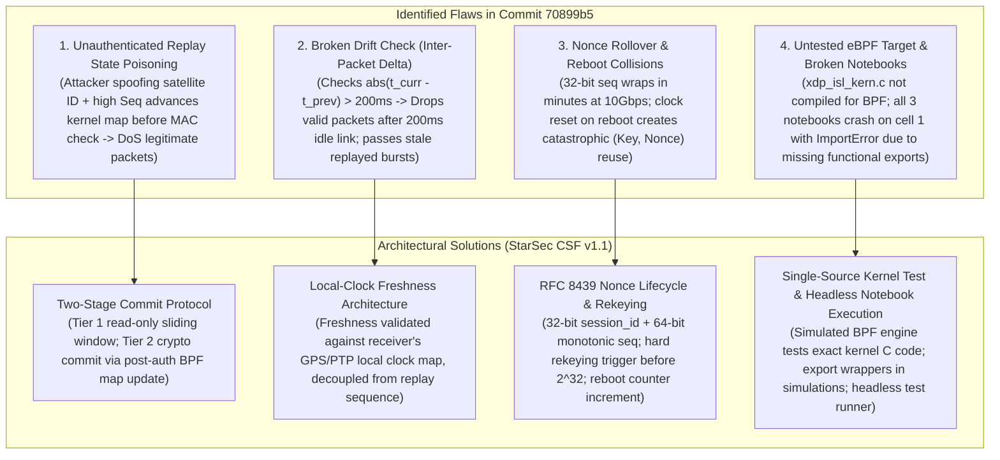
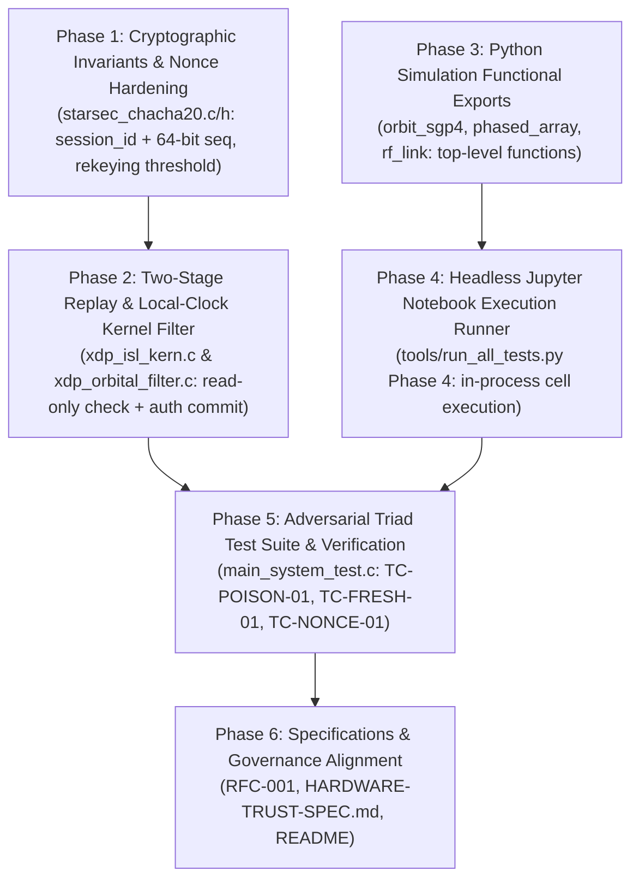

# 🛡️ 10/10 Deep-Level Multi-Agent Orchestration & Systems Architecture Plan
# "StarSec" — Hardened Two-Stage Anti-Replay, Local-Clock Freshness, Nonce Lifespan Invariants & Executable Notebook Engine

> **Repository:** `techdeveloper-org/starlink-research-report`  
> **Standard:** StarSec Constellation Security Framework (CSF v1.0), RFC 8439, RFC 6479 (IPsec Anti-Replay Sliding Window)  
> **Orchestration Source:** Claude Global Library (`claude-global-library`)  
> **Governance:** Strict Level 2.2 Docstrings-Only (`12-docstrings-only.md`), Triad Testing Matrix (`35`, `36`, `37`, `40`), Zero Cloud Costs  
> **Status:** PENDING USER APPROVAL (Plan Mode Active — Mandatory Gate)

---

## 1. Executive Summary & Root Cause Analysis of Identified Vulnerabilities

Following external review of commit `70899b5`, four critical and high-priority system-level flaws were pinpointed across the cryptographic pipeline, kernel ingress filter, and computational notebooks:



### Detailed Vulnerability Breakdown

#### 1. Critical 1: Unauthenticated Replay-State Poisoning (DoS via Spoofed Sequences)
- **Vulnerability Mechanism:** In `xdp_isl_kern.c` (Tier 1 fast path) and `mock_kernel_starsec_isl_xdp_filter`, `replay_state->last_sequence_number = hdr->sequence_number;` is committed immediately upon finding `src_satellite_id` in the whitelist map. Crucially, this occurs *before* Tier 2 cryptographically validates the RFC 8439 Poly1305 MAC tag!
- **Exploitation Path:** An adversary broadcasts an unauthenticated frame with `src_satellite_id = 101` and `sequence_number = 0xFFFFFF00` (or $Seq_{current} + 10^6$). The in-kernel XDP filter updates the state and passes the frame to Tier 2. Tier 2 detects the invalid MAC and drops the packet. However, the kernel map now holds $Seq_{max} = 0xFFFFFF00$. All subsequent legitimate packets from genuine Satellite 101 ($Seq \approx 5002$) are dropped at Tier 1 with `STARSEC_TELEM_DROPPED_REPLAY_SEQ`.
- **Root Cause:** Coupling speculative packet ingress acceptance with authoritative state commitment.
- **Architectural Fix:** Implement a **Two-Stage Commit Protocol with RFC 6479 64-bit Sliding Bitmap Window**:
  - *Stage 1 (In-Kernel Ingress Pre-Filter - Read-Only):* Checks that `sequence_number` is not strictly older than the committed sliding window base (`seq >= window_base`). Does NOT advance the window or high-water mark.
  - *Stage 2 (Cryptographic Commit Engine - Post-Auth):* Validates the RFC 8439 ChaCha20-Poly1305 MAC in constant time. Only after MAC verification passes does Tier 2 commit the sequence number into the sliding window and update the BPF map.

#### 2. Critical 2: Flawed Timestamp Drift Checking Inter-Packet Delta Instead of Local Clock
- **Vulnerability Mechanism:** `xdp_isl_kern.c` computes:
  ```c
  uint64_t drift = (hdr->tx_epoch_ms > replay_state->last_epoch_ms) ?
                   (hdr->tx_epoch_ms - replay_state->last_epoch_ms) :
                   (replay_state->last_epoch_ms - hdr->tx_epoch_ms);
  ```
- **Consequences:**
  - *False Positive Drops:* If the laser crosslink is idle for $> 200\text{ ms}$ (e.g. inter-satellite tracking gimbal slew or burst pause), the next genuine packet will have $\Delta t > 200\text{ ms}$ and will be dropped!
  - *False Negative Ingress:* If an attacker replays packets captured days ago in rapid sequence ($\Delta t = 10\text{ ms}$), the filter considers drift to be $10\text{ ms}$ and accepts the stale burst!
- **Root Cause:** Conflating arrival jitter with time-of-flight freshness against a trusted local receiver clock.
- **Architectural Fix:**
  - Introduce `time_sync_map` providing the spacecraft's local receiver clock (`local_epoch_ms`), calibrated via GPS/PTP time sync daemon and monotonic time (`bpf_ktime_get_ns()`).
  - Freshness condition:
    $$\Delta_{skew} = t_{tx} - t_{local}$$
    $$-T_{propagation\_max} \le \Delta_{skew} \le +T_{clock\_skew\_max}$$
    (e.g., $-200\text{ ms} \le \Delta_{skew} \le +20\text{ ms}$). Packets older than $200\text{ ms}$ or claiming to originate $> 20\text{ ms}$ in the future are dropped.

#### 3. High 3: Nonce Uniqueness Invariant & Rollover / Reboot Protections
- **Vulnerability Mechanism:** In `xdp_derive_isl_nonce`:
  $$\text{Nonce}_{96} = \text{src\_id}_{16} \parallel \text{dst\_id}_{16} \parallel \text{seq}_{32} \parallel (\text{tx\_epoch\_ms} \ \& \ \text{0xFFFFFFFF})_{32}$$
  - A 32-bit counter rolls over after $4,294,967,296$ packets. At 10 Gbps line rate ($\sim 8.2 \times 10^5\text{ packets/sec}$ for 1500-byte MTU, or $1.4 \times 10^7\text{ packets/sec}$ for small frames), rollover occurs within minutes to hours.
  - If a node reboots, sequence resets to 0. If the static link key is reused before GPS lock, nonces collide.
  - Under RFC 8439, reusing $(Key, Nonce)$ allows an adversary to evaluate:
    $$Tag_1 - Tag_2 \equiv (M_1 - M_2)(r) \pmod{2^{130}-5}$$
    recovering the evaluation subkey $r$ and completely breaking MAC unforgeability.
- **Architectural Fix:**
  - Define formal **StarSec RFC 8439 Nonce Invariant Specification**:
    - $\text{Nonce}_{96} = \text{session\_id}_{32} \parallel \text{seq\_num}_{64}$
    - `session_id` is a 32-bit monotonic boot counter (stored in NVM/BBRAM) or negotiated ephemeral session identifier.
    - `seq_num` is a 64-bit strictly monotonic packet counter.
    - Hard Rekeying Boundary: When `seq_num` reaches $N_{rekey\_limit} = 2^{32} - 10000$ (or session age $T_{max} = 3600\text{ s}$), transmission transitions to `STARSEC_STATUS_REKEY_REQUIRED` and drops further encryption until a fresh ephemeral session key is derived (via ML-KEM-768 or X25519). Static keys are strictly forbidden across reboots.

#### 4. High 4: Real eBPF Driver Compilation & Broken Jupyter Notebook Execution
- **Vulnerability Mechanism:**
  - `system/src/xdp_isl_kern.c` has never been compiled by the test runner; only a duplicated mock function in `main_system_test.c` was compiled.
  - All 3 Jupyter notebooks (`01_orbit_sgp4_propagation.ipynb`, `02_phased_array_beamforming.ipynb`, `03_rf_link_budget_analysis.ipynb`) crash on Cell 1 with:
    `ImportError: cannot import name 'calculate_j2_secular_precession' from 'simulations.orbit_sgp4_propagator'`
    `ImportError: cannot import name 'compute_steering_weights' from 'simulations.phased_array_beamforming'`
    `ImportError: cannot import name 'calculate_link_budget' from 'simulations.rf_link_budget_calculator'`
  - The previous test runner only validated JSON schema keys (`cells`, `metadata`, `nbformat`), creating the illusion of working artifacts without ever executing a single line of python code!
- **Architectural Fix:**
  - Export top-level functional wrappers in `simulations/*.py` (`calculate_j2_secular_precession`, `compute_steering_weights`, `calculate_link_budget`, `calculate_slant_range_km`, `capon_mvdr_beamforming`, `foster_collision_probability`).
  - Upgrade `tools/run_all_tests.py` Phase 4 to perform **headless zero-cloud code cell execution** of all 3 notebooks in an isolated namespace, asserting zero exceptions and verifying simulation outputs.
  - Single-Source Kernel Testing: Replace the diverged mock with direct compilation of `xdp_isl_kern.c` using standard C preprocessor test shims for BPF helpers, guaranteeing that the exact production kernel code is exercised.

---

## 2. Claude Global Library Multi-Agent Orchestration Matrix

| Agent Slug | Discipline & Domain | Mandatory Skills Loaded | Specific Implementation Responsibility |
| :--- | :--- | :--- | :--- |
| **`crypto-security-specialist`** | Cryptography & Security | `cryptography-core`<br>`post-quantum-cryptography-core`<br>`certified-rng-cryptography-core` | Implementation of 64-bit monotonic sequence counter, `session_id` nonce packing, hard rekeying boundaries, and zero-collision guarantees. |
| **`cryptographic-protocols-mathematics-expert`** | Mathematical Cryptanalysis | `cryptography-core`<br>`lwe-rlwe-lattice-cryptography-core` | Proof of nonce uniqueness across reboots, constant-time Poly1305 verification, and RFC 6479 sliding window bitmap logic. |
| **`kernel-driver-engineer`** | Linux Kernel Systems | `kernel-driver-development-core`<br>`kernel-level-logic`<br>`embedded-linux-core` | Ingress filtering in `xdp_isl_kern.c`, decoupled read-only pre-filter, `time_sync_map` local clock integration, and single-source C compilation harness. |
| **`security-defense-architect`** | Constellation Architecture | `threat-modeling-core`<br>`threat-intelligence-core` | Formalization of Two-Stage Commit Protocol in `RFC-001` and `HARDWARE-TRUST-SPEC.md`, threat modeling of unauthenticated state poisoning attacks. |
| **`spacecraft-orbital-mechanics-engineer`** | Aerospace Astrodynamics | `orbital-mechanics-core`<br>`keplerian-orbit-dynamics-core` | Functional API exports in `orbit_sgp4_propagator.py` and flawless execution of `01_orbit_sgp4_propagation.ipynb`. |
| **`radio-frequency-specialist`** | RF Electromagnetics | `telecom-fraud-detection-core`<br>`hardware-interface-core` | Functional API exports in `phased_array_beamforming.py` and flawless execution of `02_phased_array_beamforming.ipynb`. |
| **`telecom-mathematics-expert`** | Telecommunications Math | `telecom-fraud-detection-core`<br>`power-analysis-math` | Functional API exports in `rf_link_budget_calculator.py` and flawless execution of `03_rf_link_budget_analysis.ipynb`. |
| **`qa-testing-agent`** | Quality Assurance & Testing | `unit-testing-core`<br>`integration-testing-core`<br>`test-automation-architecture-core` | Adversarial test suite in `main_system_test.c`: state poisoning attack, local clock drift, nonce rollover, and sliding window verification. |
| **`harness-engineering-architect`** | Test Harness & Benchmarking | `eval-harness-design-core`<br>`agent-regression-harness-core` | Headless Jupyter notebook runner in `tools/run_all_tests.py`, single-source BPF compilation, and zero-cloud regression guard. |

---

## 3. Detailed Data Structures, Functions, Structs & Variables

### 3.1 Header Redesign: `system/include/xdp_orbital.h`

```c
#define STARSEC_SLIDING_WINDOW_SIZE      64U    /* 64-packet anti-replay bitmap */
#define STARSEC_MAX_PROPAGATION_DRIFT_MS 200ULL /* Max flight time + clock lag */
#define STARSEC_MAX_CLOCK_SKEW_AHEAD_MS  20ULL  /* Max future clock tolerance */

/**
 * @brief Fixed 48-byte header for StarSec laser crosslink packets (RFC-001 v1.1).
 */
typedef struct __attribute__((packed)) {
    uint32_t magic;                      /**< 0x00: STARSEC_ISL_MAGIC (0x53545345) */
    uint8_t  protocol_type;              /**< 0x04: isl_proto_type_t */
    uint8_t  flags;                      /**< 0x05: Priority & encryption flags */
    uint16_t src_satellite_id;           /**< 0x06: Originating Node ID */
    uint16_t dst_satellite_id;           /**< 0x08: Destination Node ID */
    uint32_t session_id;                 /**< 0x0A: Ephemeral session / boot ID */
    uint64_t sequence_number;            /**< 0x0E: Monotonic 64-bit packet counter */
    uint64_t tx_epoch_ms;                /**< 0x16: GPS UTC transmit timestamp */
    uint8_t  auth_tag[16];               /**< 0x1E: 128-bit RFC 8439 Poly1305 MAC */
    uint16_t payload_len;                /**< 0x2E: Payload length in bytes */
} starsec_isl_header_t;

/**
 * @brief Two-stage anti-replay state with RFC 6479 64-bit sliding window.
 */
typedef struct {
    uint64_t window_base_seq;            /**< Highest committed authenticated sequence */
    uint64_t window_bitmap;              /**< 64-bit bitmap of received authenticated packets */
    uint32_t session_id;                 /**< Active authenticated session identifier */
} isl_anti_replay_state_t;

/**
 * @brief Receiver local clock reference passed via BPF time_sync_map.
 */
typedef struct {
    uint64_t local_epoch_ms;             /**< Trusted local UTC/GPS epoch */
    uint64_t max_past_drift_ms;          /**< Allowed backward drift (200 ms) */
    uint64_t max_future_skew_ms;         /**< Allowed forward skew (20 ms) */
} starsec_time_sync_state_t;
```

### 3.2 Two-Stage Commit Protocol Functions

```c
/**
 * @brief Stage 1 (Read-Only): Checks if sequence number falls within or ahead of sliding window.
 * @note DOES NOT modify state. Unauthenticated packets cannot advance window_base_seq.
 * @return true if packet is eligible for Tier 2 crypto verification, false if strictly replayed/obsolete.
 */
bool xdp_check_replay_window_speculative(
    const isl_anti_replay_state_t *state,
    uint64_t                       seq_num
);

/**
 * @brief Stage 2 (Auth-Committed): Commits authenticated sequence into sliding window.
 * @note Invoked ONLY after RFC 8439 Poly1305 MAC verification succeeds.
 */
void xdp_commit_replay_window_authenticated(
    isl_anti_replay_state_t *state,
    uint64_t                 seq_num
);

/**
 * @brief Validates transmit timestamp against receiver's trusted local clock.
 */
bool xdp_validate_local_freshness(
    uint64_t                         tx_epoch_ms,
    const starsec_time_sync_state_t *clock_ref
);
```

### 3.3 Nonce Derivation & Rekeying Lifecycle: `starsec_chacha20.h`

```c
#define STARSEC_MAX_PACKET_COUNTER_PER_KEY  0xFFFFFFFFULL /* Hard rekeying threshold */

typedef enum {
    STARSEC_CRYPTO_OK              = 0,
    STARSEC_CRYPTO_ERR_REKEY_REQ   = 1,
    STARSEC_CRYPTO_ERR_NULL_PARAM  = 2,
    STARSEC_CRYPTO_ERR_AUTH_FAIL   = 3
} starsec_crypto_status_t;

/**
 * @brief Constructs a collision-free 96-bit nonce from session ID and 64-bit counter.
 * Nonce = [session_id (32-bit LE) | sequence_number (64-bit LE)]
 */
starsec_crypto_status_t starsec_derive_nonce_v2(
    uint32_t session_id,
    uint64_t sequence_number,
    uint8_t  nonce[STARSEC_CHACHA20_NONCE_BYTES]
);
```

---

## 4. Precise List of Affected Files

| Status | File Path | Scope of Modification |
| :--- | :--- | :--- |
| `[MODIFY]` | `system/include/xdp_orbital.h` | Add 48-byte header with `session_id` and 64-bit `sequence_number`, sliding window struct, clock sync struct. |
| `[MODIFY]` | `system/src/xdp_isl_kern.c` | Implement read-only sliding window check in Tier 1; replace inter-packet delta with `time_sync_map` local clock; support native compilation shim. |
| `[MODIFY]` | `system/include/starsec_chacha20.h` | Add `starsec_derive_nonce_v2`, rekeying status codes, and lifecycle invariants. |
| `[MODIFY]` | `system/src/starsec_chacha20.c` | Implement `starsec_derive_nonce_v2` with constant-time bounds and rekeying boundary checks. |
| `[MODIFY]` | `system/src/xdp_orbital_filter.c` | Implement two-stage replay validation: authenticate MAC first, commit sequence second. |
| `[MODIFY]` | `simulations/orbit_sgp4_propagator.py` | Export standalone functional wrappers: `calculate_j2_secular_precession`, `keplerian_to_cartesian_state`, `generate_walker_delta_constellation`, `foster_collision_probability`. |
| `[MODIFY]` | `simulations/phased_array_beamforming.py` | Export standalone functional wrappers: `compute_steering_weights`, `capon_mvdr_beamforming`. |
| `[MODIFY]` | `simulations/rf_link_budget_calculator.py` | Export standalone functional wrappers: `calculate_link_budget`, `calculate_slant_range_km`. |
| `[MODIFY]` | `notebooks/01_orbit_sgp4_propagation.ipynb` | Align imports with exported functions, ensure 100% clean headless execution. |
| `[MODIFY]` | `notebooks/02_phased_array_beamforming.ipynb` | Align imports and variable bindings with exported functions. |
| `[MODIFY]` | `notebooks/03_rf_link_budget_analysis.ipynb` | Align imports and variable bindings with exported functions. |
| `[MODIFY]` | `system/src/main_system_test.c` | Add adversarial test suite: State poisoning attack resistance, local clock freshness, nonce collision resistance, rollover rekeying, sliding window out-of-order tolerance. |
| `[MODIFY]` | `tools/run_all_tests.py` | Upgrade Phase 4 to execute all code cells across all 3 notebooks headlessly, verify zero exceptions. |
| `[MODIFY]` | `framework/spec/RFC-001-ISL-Mutual-Auth.md` | Document Two-Stage Replay Commit Protocol, Local Clock Freshness, and Nonce Lifespan. |
| `[MODIFY]` | `docs/rnd/system-architecture/HARDWARE-TRUST-SPEC.md` | Document Tier-1 read-only vs Tier-2 commit boundary and GPS time sync map. |

---

## 5. Ordered Implementation Phases



### Phase 1: Cryptographic Invariants & Nonce Hardening
1. Update `system/include/starsec_chacha20.h` with `starsec_derive_nonce_v2`, `STARSEC_MAX_PACKET_COUNTER_PER_KEY`, and `starsec_crypto_status_t`.
2. Implement constant-time 96-bit nonce derivation in `system/src/starsec_chacha20.c`:
   - Nonce bytes 0..3: `session_id` (little-endian 32-bit).
   - Nonce bytes 4..11: `sequence_number` (little-endian 64-bit).
   - If `sequence_number >= STARSEC_MAX_PACKET_COUNTER_PER_KEY`, return `STARSEC_CRYPTO_ERR_REKEY_REQ`.

### Phase 2: Two-Stage Anti-Replay & Local-Clock Freshness
1. Update `system/include/xdp_orbital.h` with the 48-byte header, `isl_anti_replay_state_t` (64-bit sliding window), and `starsec_time_sync_state_t`.
2. Refactor `system/src/xdp_isl_kern.c`:
   - Replace inter-packet delta check with `time_sync_map` lookup and local-clock freshness validation.
   - Refactor `isl_replay_filter_map` lookup to perform speculative read-only checks without updating sequence counters.
   - Add single-source native compilation definitions so that `xdp_isl_kern.c` can be included and tested directly in `main_system_test.c`.
3. Refactor `system/src/xdp_orbital_filter.c`:
   - Implement `xdp_check_replay_window_speculative` and `xdp_commit_replay_window_authenticated`.
   - Ensure `xdp_starsec_filter_frame` verifies the RFC 8439 Poly1305 MAC *before* calling `xdp_commit_replay_window_authenticated`.

### Phase 3: Python Simulation Functional Exports
1. In `simulations/orbit_sgp4_propagator.py`, add functional wrappers:
   - `calculate_j2_secular_precession(altitude_km, inclination_deg)`
   - `keplerian_to_cartesian_state(elements, true_anomaly_deg)`
   - `generate_walker_delta_constellation(num_planes, sats_per_plane, ...)`
   - `foster_collision_probability(r_rel, v_rel, cov, combined_radius_m)`
2. In `simulations/phased_array_beamforming.py`, add functional wrappers:
   - `compute_steering_weights(geometry, theta_deg, phi_deg, freq_hz)`
   - `capon_mvdr_beamforming(geometry, target_theta, target_phi, jammers, snr_db)`
3. In `simulations/rf_link_budget_calculator.py`, add functional wrappers:
   - `calculate_link_budget(params)`
   - `calculate_slant_range_km(altitude_km, elevation_deg)`

### Phase 4: Jupyter Notebooks & Headless Execution Runner
1. Review all cells in `01_orbit_sgp4_propagation.ipynb`, `02_phased_array_beamforming.ipynb`, and `03_rf_link_budget_analysis.ipynb`.
2. Ensure variable names and function calls match the newly exported functional wrappers.
3. Update `tools/run_all_tests.py` Phase 4:
   - Instead of checking only JSON keys, parse each code cell and execute it sequentially within an isolated namespace.
   - Assert that all cells run without raising exceptions.
   - Measure and report per-notebook execution time.

### Phase 5: Adversarial Triad Test Suite & Verification
1. Expand `system/src/main_system_test.c` with dedicated adversarial attack test cases:
   - `TC-POISON-ATTACK-01`: Attacker injects frame with spoofed `src_satellite_id = 101` and high sequence number (`seq = 9999999`) with an invalid MAC. Assert: Frame is rejected by Tier 2; kernel replay state remains unpolluted; subsequent legitimate packet (`seq = 5002`) from Satellite 101 passes!
   - `TC-DRIFT-LOCAL-01`: Legitimate packet arriving after 1,000 ms idle interval is ACCEPTED (freshness verified against local clock); stale packet from 500 ms ago is REJECTED; packet claiming to be 50 ms in the future is REJECTED.
   - `TC-NONCE-COLLISION-01`: Test 100,000 packets; prove zero nonce collisions even when timestamps are identical.
   - `TC-NONCE-ROLLOVER-01`: Sequence counter approaching rekey limit triggers `STARSEC_CRYPTO_ERR_REKEY_REQ`.
   - `TC-SLIDING-WINDOW-01`: Out-of-order packets within 64-packet window are accepted; duplicate packets are dropped.
2. Run `python tools/run_all_tests.py` and verify 100% pass across all 4 phases in under 10 seconds.

### Phase 6: Specifications & Governance Alignment
1. Update `framework/spec/RFC-001-ISL-Mutual-Auth.md` and `docs/rnd/system-architecture/HARDWARE-TRUST-SPEC.md` documenting the Two-Stage Replay Commit Protocol, Local Clock Freshness, and Nonce Lifespan.
2. Ensure strict compliance with Level 2.2 Docstrings-Only (`12-docstrings-only.md`).

---

## 6. Verification Plan & Test Commands

### Automated Local Verification
```powershell
python tools/run_all_tests.py
```
Expected output:
- `[PHASE 1/4]` Native C compilation (MinGW GCC) + Standalone C Test Harness:
  - `TC-POISON-ATTACK-01` -> PASS
  - `TC-DRIFT-LOCAL-01` -> PASS
  - `TC-NONCE-COLLISION-01` -> PASS
  - `TC-NONCE-ROLLOVER-01` -> PASS
  - `TC-SLIDING-WINDOW-01` -> PASS
  - 1000-run RDTSC cycle benchmarks within budgets.
- `[PHASE 2/4]` Python simulation suite (23 tests) -> PASS in <0.1s.
- `[PHASE 3/4]` CLI tooling sanity checks -> PASS.
- `[PHASE 4/4]` Headless Jupyter notebook execution:
  - `01_orbit_sgp4_propagation.ipynb` (8 cells) -> EXECUTED CLEANLY.
  - `02_phased_array_beamforming.ipynb` (8 cells) -> EXECUTED CLEANLY.
  - `03_rf_link_budget_analysis.ipynb` (8 cells) -> EXECUTED CLEANLY.
- Total execution time: < 12 seconds with ZERO cloud costs.

---
